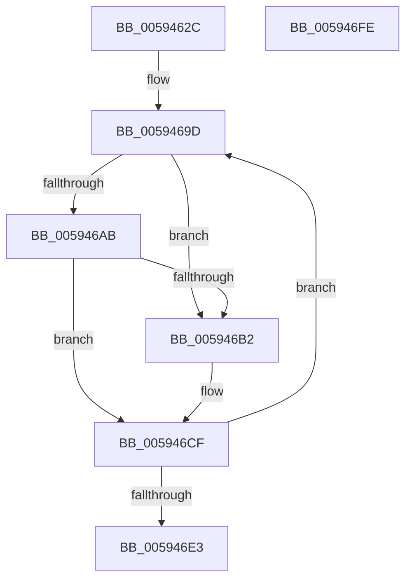

# IopAddRunTimeTriageDataBlocks

- RVA: `0x0059462C`–`0x005946FF` (길이 `211` bytes)
- VA: `0x000000014059462C`
- 실행 섹션: `.text`
- PDB 이름 있음: `예`; PDB Function 태그: `아니요`
- unwind 정보 RVA: `0x0005D7BC`
- 디코드: `53`개 명령, `211/211` bytes 표시
- 미해석 바이트: `0` (있으면 어셈블리에 `.byte`로 보존)

> 이 문서는 커널 이미지의 기계어와 PDB 기호를 분석해 생성했습니다. 4번과 5번은 함수 원형과 자료형을 바이너리 사용 방식에서 추정한 C 해석이며 원본 소스 복구 결과는 아닙니다.

## 1. Dependencies

- 직접 호출 지점: **4**; 고유 호출 대상: **3**
- 직접 호출자로 확인된 함수: **1**
- RIP 상대 이미지 참조: **1**

### Outgoing calls
- `0x00594658` → [IopGetMaxValidMemorySizeDown](IopGetMaxValidMemorySizeDown_function_00595618.md) (function, `0x00595618`)
- `0x0059466B` → [IopGetMaxValidMemorySize](IopGetMaxValidMemorySize_function_0059559C.md) (function, `0x0059559C`)
- `0x0059468C` → [IopAddTriageDumpDataBlock](../42/IopAddTriageDumpDataBlock_function_004283FC.md) (function, `0x004283FC`)
- `0x005946CA` → [IopAddTriageDumpDataBlock](../42/IopAddTriageDumpDataBlock_function_004283FC.md) (function, `0x004283FC`)

### Direct callers
- [IoFillTriageDumpBuffer](IoFillTriageDumpBuffer_function_005921CC.md) at `0x005925BB`

### Static image references
- `0x00594696` → RVA `0x000277A8` (`.rdata`; read)

## 2. Other-region calls and transfers

- 다른 실행 섹션으로 향하는 call: **0**
- 별도 외부 분기/꼬리 이동을 확인하지 못했습니다.

## 3. Assembly (complete function range)

```asm
0059462C  48 8B C4                        mov rax, rsp
0059462F  48 89 58 08                     mov qword ptr [rax + 8], rbx
00594633  48 89 68 10                     mov qword ptr [rax + 0x10], rbp
00594637  48 89 70 18                     mov qword ptr [rax + 0x18], rsi
0059463B  48 89 78 20                     mov qword ptr [rax + 0x20], rdi
0059463F  41 56                           push r14
00594641  48 83 EC 30                     sub rsp, 0x30
00594645  44 8B F1                        mov r14d, ecx
00594648  49 8B F9                        mov rdi, r9
0059464B  49 8B 89 F8 00 00 00            mov rcx, qword ptr [r9 + 0xf8]
00594652  49 8B F0                        mov rsi, r8
00594655  48 8B EA                        mov rbp, rdx
00594658  E8 BB 0F 00 00                  call 0x140595618
0059465D  48 8B 8F F8 00 00 00            mov rcx, qword ptr [rdi + 0xf8]
00594664  BA 00 01 00 00                  mov edx, 0x100
00594669  8B D8                           mov ebx, eax
0059466B  E8 2C 0F 00 00                  call 0x14059559c
00594670  4C 8B 8F F8 00 00 00            mov r9, qword ptr [rdi + 0xf8]
00594677  4C 8B C6                        mov r8, rsi
0059467A  4C 2B CB                        sub r9, rbx
0059467D  48 8B D5                        mov rdx, rbp
00594680  41 8B CE                        mov ecx, r14d
00594683  44 8D 14 18                     lea r10d, [rax + rbx]
00594687  44 89 54 24 20                  mov dword ptr [rsp + 0x20], r10d
0059468C  E8 6B 3D E9 FF                  call 0x1404283fc
00594691  B9 90 00 00 00                  mov ecx, 0x90
00594696  48 8D 1D 0B 31 A9 FF            lea rbx, [rip - 0x56cef5]
0059469D  0F B7 C1                        movzx eax, cx
005946A0  4C 8B 0C 38                     mov r9, qword ptr [rax + rdi]
005946A4  4C 3B 4C 24 60                  cmp r9, qword ptr [rsp + 0x60]
005946A9  72 07                           jb 0x1405946b2
005946AB  4C 3B 4C 24 68                  cmp r9, qword ptr [rsp + 0x68]
005946B0  72 1D                           jb 0x1405946cf
005946B2  49 81 E1 00 F0 FF FF            and r9, 0xfffffffffffff000
005946B9  C7 44 24 20 00 10 00 00         mov dword ptr [rsp + 0x20], 0x1000
005946C1  4C 8B C6                        mov r8, rsi
005946C4  48 8B D5                        mov rdx, rbp
005946C7  41 8B CE                        mov ecx, r14d
005946CA  E8 2D 3D E9 FF                  call 0x1404283fc
005946CF  48 83 C3 02                     add rbx, 2
005946D3  BA FF FF 00 00                  mov edx, 0xffff
005946D8  0F B7 03                        movzx eax, word ptr [rbx]
005946DB  0F B7 C8                        movzx ecx, ax
005946DE  66 3B C2                        cmp ax, dx
005946E1  72 BA                           jb 0x14059469d
005946E3  48 8B 5C 24 40                  mov rbx, qword ptr [rsp + 0x40]
005946E8  48 8B 6C 24 48                  mov rbp, qword ptr [rsp + 0x48]
005946ED  48 8B 74 24 50                  mov rsi, qword ptr [rsp + 0x50]
005946F2  48 8B 7C 24 58                  mov rdi, qword ptr [rsp + 0x58]
005946F7  48 83 C4 30                     add rsp, 0x30
005946FB  41 5E                           pop r14
005946FD  C3                              ret
005946FE  CC                              int3
```

## 4. C-style interpretation (structured pseudocode)

```c
__int64 __fastcall IopAddRunTimeTriageDataBlocks(int a1, __int64 a2, __int64 a3, __int64 a4, __int64 a5, __int64 a6)
{
    __int64 result;
    __int64 v_rbx;
    __int64 v_rsp;
    unsigned int v_stack_m18;
    unsigned __int64 v_stack_p10;
    unsigned __int64 v_stack_p18;
    unsigned __int64 v_stack_p20;
    unsigned __int64 v_stack_p8;

    *(unsigned __int64 *)(v_rsp + 8) = v_rbx;
    *(unsigned __int64 *)(v_rsp + 16) = v_rbp;
    *(unsigned __int64 *)(v_rsp + 24) = v_rsi;
    *(unsigned __int64 *)(v_rsp + 32) = v_rdi;
    v_rsp = (v_rsp) - (48);
    result = IopGetMaxValidMemorySizeDown(*(unsigned __int64 *)(a4 + 248), a2, a3, a4);
    result = IopGetMaxValidMemorySize(*(unsigned __int64 *)(a4 + 248), 256, a3, a4);
    a4 = (*(unsigned __int64 *)(a4 + 248)) - ((unsigned int)((unsigned int)(result)));
    v_stack_m18 = (unsigned int)(result + (unsigned int)((unsigned int)(result)) * 1);
    result = IopAddTriageDumpDataBlock((unsigned int)((unsigned int)((unsigned int)(a1))), a2, a3, a4);
loc_0059469D:
    if ((*(unsigned __int64 *)(144 + a4 * 1)) < a5) goto loc_005946B2;
    result = 144;
    if ((*(unsigned __int64 *)(144 + a4 * 1)) >= a6) {
        a4 = (*(unsigned __int64 *)(144 + a4 * 1)) & (0xFFFFFFFFFFFFF000ULL);
        v_stack_m18 = 0x1000ULL;
        a3 = a3;
        a2 = a2;
        a1 = (unsigned int)((unsigned int)(a1));
        result = IopAddTriageDumpDataBlock(a1, a2, a3, a4);
    }
    v_rbx = (v_rip - 5689077) + (2);
    if (((unsigned __int16)(*(unsigned __int16 *)(v_rbx))) < ((unsigned __int16)((unsigned int)(0xFFFFULL)))) goto loc_0059469D;
    v_rsp = (v_rsp) + (48);
    return *(unsigned __int16 *)(v_rbx);
}
```

## 5. (Beta) C Style

```c
int64_t IopAddRunTimeTriageDataBlocks(int32_t Arg1, int64_t Arg2, int64_t Arg3, void *Arg4, int64_t Arg5, int64_t Arg6)
{
    uint8_t *arg4 = (uint8_t *)Arg4;

    int64_t result;
    int64_t local_rbx;
    int64_t local_rsp;
    uint32_t v_stack_m18;
    uint64_t v_stack_p10;
    uint64_t v_stack_p18;
    uint64_t v_stack_p20;
    uint64_t v_stack_p8;

    *(uint64_t *)(local_rsp + 0x8) = local_rbx;
    *(uint64_t *)(local_rsp + 0x10) = local_rbp;
    *(uint64_t *)(local_rsp + 0x18) = local_rsi;
    *(uint64_t *)(local_rsp + 0x20) = local_rdi;
    local_rsp = (local_rsp) - (48);
    result = IopGetMaxValidMemorySizeDown(*(uint64_t *)(arg4 + 0xF8), Arg2, Arg3, Arg4);
    result = IopGetMaxValidMemorySize(*(uint64_t *)(arg4 + 0xF8), 256, Arg3, Arg4);
    Arg4 = (*(uint64_t *)(arg4 + 0xF8)) - ((uint32_t)((uint32_t)(result)));
    v_stack_m18 = (uint32_t)(result + (uint32_t)((uint32_t)(result)) * 1);
    result = IopAddTriageDumpDataBlock((uint32_t)((uint32_t)((uint32_t)(Arg1))), Arg2, Arg3, Arg4);
loc_0059469D:
    if ((*(uint64_t *)(144 + arg4 * 1)) < Arg5) goto loc_005946B2;
    result = 144;
    if ((*(uint64_t *)(144 + arg4 * 1)) >= Arg6) {
        Arg4 = (*(uint64_t *)(144 + arg4 * 1)) & (0xFFFFFFFFFFFFF000ULL);
        v_stack_m18 = 0x1000ULL;
        Arg3 = Arg3;
        Arg2 = Arg2;
        Arg1 = (uint32_t)((uint32_t)(Arg1));
        result = IopAddTriageDumpDataBlock(Arg1, Arg2, Arg3, Arg4);
    }
    local_rbx = (v_rip - 5689077) + (2);
    if (((uint16_t)(*(uint16_t *)(local_rbx))) < ((uint16_t)((uint32_t)(0xFFFFULL)))) goto loc_0059469D;
    local_rsp = (local_rsp) + (48);
    return *(uint16_t *)(local_rbx);
}
```

### 관측된 메모리 오프셋

구조체 형식이 확인되지 않은 접근은 인자 기준의 오프셋으로만 기록했습니다.

| 기준 인자 | 오프셋 표현 | 폭 (bit) | 접근 |
|---|---:|---:|---|
| `Arg4` | `+ 0xF8` | `64` | `R` |

## 6. Execution-region graph

[열기: 2D/3D 그래프와 함수 탐색 컨트롤 패널](../../../control-panel.html?section=text&rva=0x0059462C&view=graph)

- 2D 그래프는 위에서 아래로 흐르고, 3D 그래프는 빈 공간을 드래그해 회전합니다. Shift+드래그는 이동, 휠은 확대·축소, 함수 노드 선택은 대상 보고서 이동입니다.

### Static fallback


