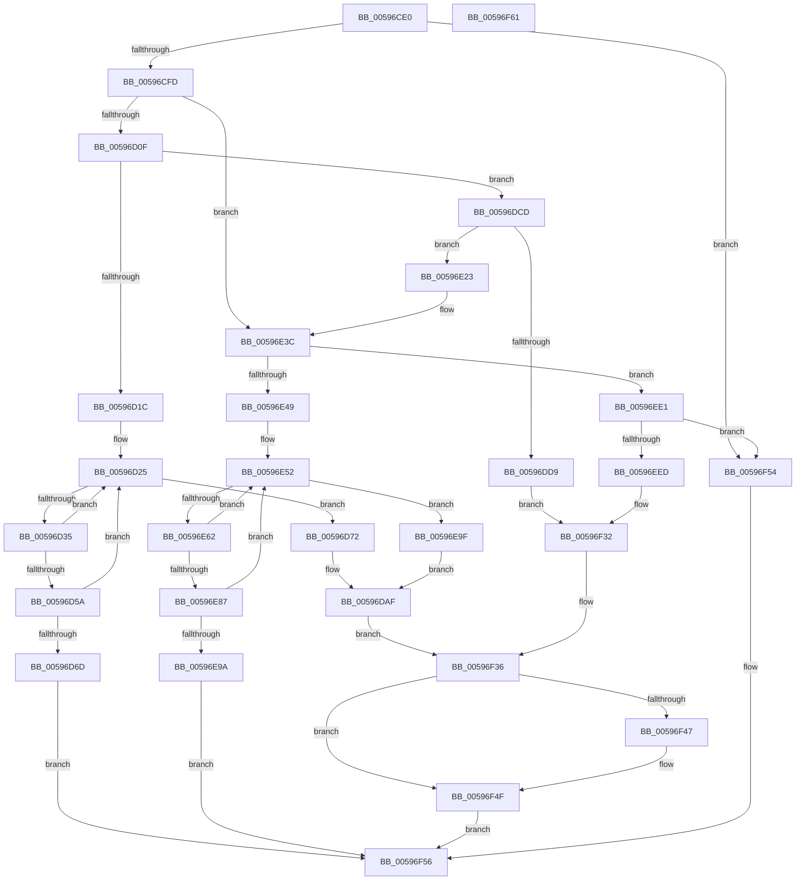

# IopAllocateBackpocketIrp

- RVA: `0x00596CE0`–`0x00596F62` (길이 `642` bytes)
- VA: `0x0000000140596CE0`
- 실행 섹션: `.text`
- PDB 이름 있음: `예`; PDB Function 태그: `아니요`
- unwind 정보 RVA: `0x00065960`
- 디코드: `145`개 명령, `642/642` bytes 표시
- 미해석 바이트: `0` (있으면 어셈블리에 `.byte`로 보존)

> 이 문서는 커널 이미지의 기계어와 PDB 기호를 분석해 생성했습니다. 4번과 5번은 함수 원형과 자료형을 바이너리 사용 방식에서 추정한 C 해석이며 원본 소스 복구 결과는 아닙니다.

## 1. Dependencies

- 직접 호출 지점: **11**; 고유 호출 대상: **6**
- 직접 호출자로 확인된 함수: **6**
- RIP 상대 이미지 참조: **13**

### Outgoing calls
- `0x00596D4E` → [KeWaitForSingleObject](../20/KeWaitForSingleObject_function_0020E6B0.md) (function, `0x0020E6B0`)
- `0x00596D63` → [IopAllocateIrpExReturn](../20/IopAllocateIrpExReturn_function_00207720.md) (function, `0x00207720`)
- `0x00596D96` → [IoInitializeIrp](../44/IoInitializeIrp_function_00445050.md) (function, `0x00445050`)
- `0x00596E00` → [IoInitializeIrp](../44/IoInitializeIrp_function_00445050.md) (function, `0x00445050`)
- `0x00596E36` → [KeBugCheckEx](../4F/KeBugCheckEx_function_004FD660.md) (function, `0x004FD660`)
- `0x00596E7B` → [KeWaitForSingleObject](../20/KeWaitForSingleObject_function_0020E6B0.md) (function, `0x0020E6B0`)
- `0x00596E90` → [IopAllocateIrpExReturn](../20/IopAllocateIrpExReturn_function_00207720.md) (function, `0x00207720`)
- `0x00596EC3` → [IoInitializeIrp](../44/IoInitializeIrp_function_00445050.md) (function, `0x00445050`)
- `0x00596F14` → [IoInitializeIrp](../44/IoInitializeIrp_function_00445050.md) (function, `0x00445050`)
- `0x00596F3E` → [IoIsActivityTracingEnabled](../29/IoIsActivityTracingEnabled_function_0029DBC0.md) (function, `0x0029DBC0`)
- `0x00596F4A` → [IopInitActivityIdIrp](../45/IopInitActivityIdIrp_function_0045B014.md) (function, `0x0045B014`)

### Direct callers
- [MiIssueAsynchronousFlush](../29/MiIssueAsynchronousFlush_function_00299898.md) at `0x00299BC1`
- [IoAsynchronousPageWrite](../29/IoAsynchronousPageWrite_function_00299C08.md) at `0x00299DE2`
- [MiSynchronousPageWrite](../29/MiSynchronousPageWrite_function_0029A2E4.md) at `0x0029A513`
- [MiIssueSynchronousFlush](../29/MiIssueSynchronousFlush_function_0029A588.md) at `0x0029A82B`
- [IoSynchronousPageWriteEx](../29/IoSynchronousPageWriteEx_function_0029A860.md) at `0x0029ABC5`
- [IoPageReadEx](../29/IoPageReadEx_function_0029ABF0.md) at `0x0029B0B4`

### Static image references
- `0x00596CF0` → RVA `0x00F8D660` (`.data`; read)
- `0x00596D0F` → RVA `0x00F8D608` (`.data`; read)
- `0x00596D2A` → RVA `0x00F8D600` (`.data`; read/write)
- `0x00596D47` → RVA `0x00F8D610` (`.data`; read)
- `0x00596D72` → RVA `0x00F8D5F8` (`.data`; read)
- `0x00596DA8` → RVA `0x00F8D608` (`.data`; write)
- `0x00596DCD` → RVA `0x00F8D658` (`.data`; read)
- `0x00596DE0` → RVA `0x00F8D658` (`.data`; write)
- `0x00596E3C` → RVA `0x00F8D638` (`.data`; read)
- `0x00596E57` → RVA `0x00F8D630` (`.data`; read/write)
- `0x00596E74` → RVA `0x00F8D640` (`.data`; read)
- `0x00596E9F` → RVA `0x00F8D628` (`.data`; read)
- `0x00596ED5` → RVA `0x00F8D638` (`.data`; write)

## 2. Other-region calls and transfers

- 다른 실행 섹션으로 향하는 call: **0**
- 별도 외부 분기/꼬리 이동을 확인하지 못했습니다.

## 3. Assembly (complete function range)

```asm
00596CE0  48 89 5C 24 08                  mov qword ptr [rsp + 8], rbx
00596CE5  57                              push rdi
00596CE6  48 83 EC 40                     sub rsp, 0x40
00596CEA  0F BE FA                        movsx edi, dl
00596CED  48 8B D9                        mov rbx, rcx
00596CF0  40 3A 3D 69 69 9F 00            cmp dil, byte ptr [rip + 0x9f6969]
00596CF7  0F 8F 57 02 00 00               jg 0x140596f54
00596CFD  65 48 8B 04 25 88 01 00 00      mov rax, qword ptr gs:[0x188]
00596D06  45 84 C0                        test r8b, r8b
00596D09  0F 84 2D 01 00 00               je 0x140596e3c
00596D0F  48 39 05 F2 68 9F 00            cmp qword ptr [rip + 0x9f68f2], rax
00596D16  0F 84 B1 00 00 00               je 0x140596dcd
00596D1C  48 C7 44 24 68 00 5D 1E EE      mov qword ptr [rsp + 0x68], 0xffffffffee1e5d00
00596D25  B8 01 00 00 00                  mov eax, 1
00596D2A  87 05 D0 68 9F 00               xchg dword ptr [rip + 0x9f68d0], eax
00596D30  83 F8 01                        cmp eax, 1
00596D33  75 3D                           jne 0x140596d72
00596D35  48 8D 44 24 68                  lea rax, [rsp + 0x68]
00596D3A  45 33 C9                        xor r9d, r9d
00596D3D  45 33 C0                        xor r8d, r8d
00596D40  48 89 44 24 20                  mov qword ptr [rsp + 0x20], rax
00596D45  33 D2                           xor edx, edx
00596D47  48 8D 0D C2 68 9F 00            lea rcx, [rip + 0x9f68c2]
00596D4E  E8 5D 79 C7 FF                  call 0x14020e6b0
00596D53  3D 02 01 00 00                  cmp eax, 0x102
00596D58  75 CB                           jne 0x140596d25
00596D5A  45 33 C0                        xor r8d, r8d
00596D5D  40 8A D7                        mov dl, dil
00596D60  48 8B CB                        mov rcx, rbx
00596D63  E8 B8 09 C7 FF                  call 0x140207720
00596D68  48 85 C0                        test rax, rax
00596D6B  74 B8                           je 0x140596d25
00596D6D  E9 E4 01 00 00                  jmp 0x140596f56
00596D72  48 8B 1D 7F 68 9F 00            mov rbx, qword ptr [rip + 0x9f687f]
00596D79  44 8D 47 02                     lea r8d, [rdi + 2]
00596D7D  0F B7 C7                        movzx eax, di
00596D80  48 8B CB                        mov rcx, rbx
00596D83  66 C1 E0 03                     shl ax, 3
00596D87  8D 14 38                        lea edx, [rax + rdi]
00596D8A  B8 60 01 00 00                  mov eax, 0x160
00596D8F  66 C1 E2 03                     shl dx, 3
00596D93  66 03 D0                        add dx, ax
00596D96  E8 B5 E2 EA FF                  call 0x140445050
00596D9B  C6 43 47 21                     mov byte ptr [rbx + 0x47], 0x21
00596D9F  65 48 8B 04 25 88 01 00 00      mov rax, qword ptr gs:[0x188]
00596DA8  48 89 05 59 68 9F 00            mov qword ptr [rip + 0x9f6859], rax
00596DAF  48 81 83 B8 00 00 00 70 FF FF FF  add qword ptr [rbx + 0xb8], -0x90
00596DBA  48 8B 83 B8 00 00 00            mov rax, qword ptr [rbx + 0xb8]
00596DC1  48 89 83 C8 00 00 00            mov qword ptr [rbx + 0xc8], rax
00596DC8  E9 69 01 00 00                  jmp 0x140596f36
00596DCD  48 8B 1D 84 68 9F 00            mov rbx, qword ptr [rip + 0x9f6884]
00596DD4  48 85 DB                        test rbx, rbx
00596DD7  74 4A                           je 0x140596e23
00596DD9  48 8B 03                        mov rax, qword ptr [rbx]
00596DDC  44 8D 47 02                     lea r8d, [rdi + 2]
00596DE0  48 89 05 71 68 9F 00            mov qword ptr [rip + 0x9f6871], rax
00596DE7  48 8B CB                        mov rcx, rbx
00596DEA  0F B7 C7                        movzx eax, di
00596DED  66 C1 E0 03                     shl ax, 3
00596DF1  8D 14 38                        lea edx, [rax + rdi]
00596DF4  B8 60 01 00 00                  mov eax, 0x160
00596DF9  66 C1 E2 03                     shl dx, 3
00596DFD  66 03 D0                        add dx, ax
00596E00  E8 4B E2 EA FF                  call 0x140445050
00596E05  48 81 83 B8 00 00 00 70 FF FF FF  add qword ptr [rbx + 0xb8], -0x90
00596E10  48 8B 83 B8 00 00 00            mov rax, qword ptr [rbx + 0xb8]
00596E17  48 89 83 C8 00 00 00            mov qword ptr [rbx + 0xc8], rax
00596E1E  E9 0F 01 00 00                  jmp 0x140596f32
00596E23  48 83 64 24 20 00               and qword ptr [rsp + 0x20], 0
00596E29  45 33 C9                        xor r9d, r9d
00596E2C  45 33 C0                        xor r8d, r8d
00596E2F  33 D2                           xor edx, edx
00596E31  B9 1E 01 00 00                  mov ecx, 0x11e
00596E36  E8 25 68 F6 FF                  call 0x1404fd660
00596E3B  CC                              int3
00596E3C  48 39 05 F5 67 9F 00            cmp qword ptr [rip + 0x9f67f5], rax
00596E43  0F 84 98 00 00 00               je 0x140596ee1
00596E49  48 C7 44 24 30 00 5D 1E EE      mov qword ptr [rsp + 0x30], 0xffffffffee1e5d00
00596E52  B8 01 00 00 00                  mov eax, 1
00596E57  87 05 D3 67 9F 00               xchg dword ptr [rip + 0x9f67d3], eax
00596E5D  83 F8 01                        cmp eax, 1
00596E60  75 3D                           jne 0x140596e9f
00596E62  48 8D 44 24 30                  lea rax, [rsp + 0x30]
00596E67  45 33 C9                        xor r9d, r9d
00596E6A  45 33 C0                        xor r8d, r8d
00596E6D  48 89 44 24 20                  mov qword ptr [rsp + 0x20], rax
00596E72  33 D2                           xor edx, edx
00596E74  48 8D 0D C5 67 9F 00            lea rcx, [rip + 0x9f67c5]
00596E7B  E8 30 78 C7 FF                  call 0x14020e6b0
00596E80  3D 02 01 00 00                  cmp eax, 0x102
00596E85  75 CB                           jne 0x140596e52
00596E87  45 33 C0                        xor r8d, r8d
00596E8A  40 8A D7                        mov dl, dil
00596E8D  48 8B CB                        mov rcx, rbx
00596E90  E8 8B 08 C7 FF                  call 0x140207720
00596E95  48 85 C0                        test rax, rax
00596E98  74 B8                           je 0x140596e52
00596E9A  E9 B7 00 00 00                  jmp 0x140596f56
00596E9F  48 8B 1D 82 67 9F 00            mov rbx, qword ptr [rip + 0x9f6782]
00596EA6  44 8D 47 02                     lea r8d, [rdi + 2]
00596EAA  0F B7 C7                        movzx eax, di
00596EAD  48 8B CB                        mov rcx, rbx
00596EB0  66 C1 E0 03                     shl ax, 3
00596EB4  8D 14 38                        lea edx, [rax + rdi]
00596EB7  B8 60 01 00 00                  mov eax, 0x160
00596EBC  66 C1 E2 03                     shl dx, 3
00596EC0  66 03 D0                        add dx, ax
00596EC3  E8 88 E1 EA FF                  call 0x140445050
00596EC8  C6 43 47 21                     mov byte ptr [rbx + 0x47], 0x21
00596ECC  65 48 8B 04 25 88 01 00 00      mov rax, qword ptr gs:[0x188]
00596ED5  48 89 05 5C 67 9F 00            mov qword ptr [rip + 0x9f675c], rax
00596EDC  E9 CE FE FF FF                  jmp 0x140596daf
00596EE1  48 8B 1D 70 67 9F 00            mov rbx, qword ptr [rip + 0x9f6770]
00596EE8  48 85 DB                        test rbx, rbx
00596EEB  74 67                           je 0x140596f54
00596EED  48 8B 03                        mov rax, qword ptr [rbx]
00596EF0  44 8D 47 02                     lea r8d, [rdi + 2]
00596EF4  48 89 05 5D 67 9F 00            mov qword ptr [rip + 0x9f675d], rax
00596EFB  48 8B CB                        mov rcx, rbx
00596EFE  0F B7 C7                        movzx eax, di
00596F01  66 C1 E0 03                     shl ax, 3
00596F05  8D 14 38                        lea edx, [rax + rdi]
00596F08  B8 60 01 00 00                  mov eax, 0x160
00596F0D  66 C1 E2 03                     shl dx, 3
00596F11  66 03 D0                        add dx, ax
00596F14  E8 37 E1 EA FF                  call 0x140445050
00596F19  48 81 83 B8 00 00 00 70 FF FF FF  add qword ptr [rbx + 0xb8], -0x90
00596F24  48 8B 8B B8 00 00 00            mov rcx, qword ptr [rbx + 0xb8]
00596F2B  48 89 8B C8 00 00 00            mov qword ptr [rbx + 0xc8], rcx
00596F32  C6 43 47 21                     mov byte ptr [rbx + 0x47], 0x21
00596F36  80 43 42 FE                     add byte ptr [rbx + 0x42], 0xfe
00596F3A  80 43 43 FE                     add byte ptr [rbx + 0x43], 0xfe
00596F3E  E8 7D 6C D0 FF                  call 0x14029dbc0
00596F43  84 C0                           test al, al
00596F45  74 08                           je 0x140596f4f
00596F47  48 8B CB                        mov rcx, rbx
00596F4A  E8 C5 40 EC FF                  call 0x14045b014
00596F4F  48 8B C3                        mov rax, rbx
00596F52  EB 02                           jmp 0x140596f56
00596F54  33 C0                           xor eax, eax
00596F56  48 8B 5C 24 50                  mov rbx, qword ptr [rsp + 0x50]
00596F5B  48 83 C4 40                     add rsp, 0x40
00596F5F  5F                              pop rdi
00596F60  C3                              ret
00596F61  CC                              int3
```

## 4. C-style interpretation (structured pseudocode)

```c
__int64 __fastcall IopAllocateBackpocketIrp(__int64 a1, int a2, int a3, int a4)
{
    __int64 result;
    __int64 v_rsp;
    unsigned __int64 v_stack_m18;
    unsigned __int64 v_stack_m28;
    unsigned __int64 v_stack_p20;
    unsigned __int64 v_stack_p8;

    v_stack_p8 = v_rbx;
    v_rsp = (v_rsp) - (64);
    if (((unsigned __int8)((__int8)((unsigned __int8)(a2)))) > (*(unsigned __int8 *)(v_rip + 10447209))) goto loc_00596F54;
    if ((unsigned __int8)(a3) == 0) goto loc_00596E3C;
    if ((*(unsigned __int64 *)(v_rip + 10447090)) == (*(unsigned __int64 *)(gs_base + (0 + 392)))) goto loc_00596DCD;
    v_stack_p20 = 0xFFFFFFFFEE1E5D00ULL;
loc_00596D25:
    if (1 != 1) goto loc_00596D72;
    a4 = 0;
    a3 = 0;
    v_stack_m28 = v_stack_p20;
    a2 = 0;
    result = KeWaitForSingleObject(v_rip + 10447042, a2, a3, a4);
    if (((unsigned int)(result)) != 258) goto loc_00596D25;
    a3 = 0;
    result = IopAllocateIrpExReturn(a1, (unsigned __int8)((__int8)((unsigned __int8)(a2))), a3, a4);
    if (result == 0) goto loc_00596D25;
    goto loc_00596F56;
loc_00596D72:
    result = (unsigned __int16)(((unsigned __int16)((__int8)((unsigned __int8)(a2)))) << (3));
    a2 = (unsigned __int16)((result + (__int8)((unsigned __int8)(a2)) * 1) << (3));
    a2 = (unsigned __int16)((a2) + (352));
    result = IoInitializeIrp(*(unsigned __int64 *)(v_rip + 10446975), a2, (__int8)((unsigned __int8)(a2)) + 2, a4);
    *(unsigned __int8 *)(*(unsigned __int64 *)(v_rip + 10446975) + 71) = 33;
    *(unsigned __int64 *)(v_rip + 10446937) = *(unsigned __int64 *)(gs_base + (0 + 392));
loc_00596DAF:
    *(unsigned __int64 *)(*(unsigned __int64 *)(v_rip + 10446975) + 200) = *(unsigned __int64 *)(*(unsigned __int64 *)(v_rip + 10446975) + 184);
    goto loc_00596F36;
loc_00596DCD:
    if (*(unsigned __int64 *)(v_rip + 10446980) == 0) goto loc_00596E23;
    *(unsigned __int64 *)(v_rip + 10446961) = *(unsigned __int64 *)(*(unsigned __int64 *)(v_rip + 10446980));
    result = (unsigned __int16)(((unsigned __int16)((__int8)((unsigned __int8)(a2)))) << (3));
    a2 = (unsigned __int16)((result + (__int8)((unsigned __int8)(a2)) * 1) << (3));
    a2 = (unsigned __int16)((a2) + (352));
    result = IoInitializeIrp(*(unsigned __int64 *)(v_rip + 10446980), a2, (__int8)((unsigned __int8)(a2)) + 2, a4);
    *(unsigned __int64 *)(*(unsigned __int64 *)(v_rip + 10446980) + 200) = *(unsigned __int64 *)(*(unsigned __int64 *)(v_rip + 10446980) + 184);
    goto loc_00596F32;
loc_00596E23:
    a4 = 0;
    a3 = 0;
    a2 = 0;
    result = KeBugCheckEx(286, a2, a3, a4);
loc_00596E3C:
    if ((*(unsigned __int64 *)(v_rip + 10446837)) == result) goto loc_00596EE1;
    v_stack_m18 = 0xFFFFFFFFEE1E5D00ULL;
loc_00596E52:
    if (1 != 1) goto loc_00596E9F;
    a4 = 0;
    a3 = 0;
    v_stack_m28 = v_stack_m18;
    a2 = 0;
    result = KeWaitForSingleObject(v_rip + 10446789, a2, a3, a4);
    if (((unsigned int)(result)) != 258) goto loc_00596E52;
    a3 = 0;
    result = IopAllocateIrpExReturn(*(unsigned __int64 *)(v_rip + 10446980), (unsigned __int8)((__int8)((unsigned __int8)(a2))), a3, a4);
    if (result == 0) goto loc_00596E52;
    goto loc_00596F56;
loc_00596E9F:
    result = (unsigned __int16)(((unsigned __int16)((__int8)((unsigned __int8)(a2)))) << (3));
    a2 = (unsigned __int16)((result + (__int8)((unsigned __int8)(a2)) * 1) << (3));
    a2 = (unsigned __int16)((a2) + (352));
    result = IoInitializeIrp(*(unsigned __int64 *)(v_rip + 10446722), a2, (__int8)((unsigned __int8)(a2)) + 2, a4);
    *(unsigned __int8 *)(*(unsigned __int64 *)(v_rip + 10446722) + 71) = 33;
    *(unsigned __int64 *)(v_rip + 10446684) = *(unsigned __int64 *)(gs_base + (0 + 392));
    goto loc_00596DAF;
loc_00596EE1:
    if (*(unsigned __int64 *)(v_rip + 10446704) == 0) goto loc_00596F54;
    *(unsigned __int64 *)(v_rip + 10446685) = *(unsigned __int64 *)(*(unsigned __int64 *)(v_rip + 10446704));
    result = (unsigned __int16)(((unsigned __int16)((__int8)((unsigned __int8)(a2)))) << (3));
    a2 = (unsigned __int16)((result + (__int8)((unsigned __int8)(a2)) * 1) << (3));
    a2 = (unsigned __int16)((a2) + (352));
    result = IoInitializeIrp(*(unsigned __int64 *)(v_rip + 10446704), a2, (__int8)((unsigned __int8)(a2)) + 2, a4);
    *(unsigned __int64 *)(*(unsigned __int64 *)(v_rip + 10446704) + 200) = *(unsigned __int64 *)(*(unsigned __int64 *)(v_rip + 10446704) + 184);
loc_00596F32:
    *(unsigned __int8 *)(*(unsigned __int64 *)(v_rip + 10446704) + 71) = 33;
loc_00596F36:
    result = IoIsActivityTracingEnabled(*(unsigned __int64 *)(*(unsigned __int64 *)(v_rip + 10446704) + 184), a2, (__int8)((unsigned __int8)(a2)) + 2, a4);
    if ((unsigned __int8)(result) != 0) {
        a1 = *(unsigned __int64 *)(v_rip + 10446704);
        result = IopInitActivityIdIrp(a1, a2, (__int8)((unsigned __int8)(a2)) + 2, a4);
    }
    goto loc_00596F56;
loc_00596F54:
    result = 0;
loc_00596F56:
    v_rsp = (v_rsp) + (64);
    return result;
}
```

## 5. (Beta) C Style

```c
int64_t IopAllocateBackpocketIrp(int64_t Arg1, int32_t Arg2, int32_t Arg3, int32_t Arg4)
{
    int64_t result;
    int64_t local_rsp;
    uint64_t v_stack_m18;
    uint64_t v_stack_m28;
    uint64_t v_stack_p20;
    uint64_t v_stack_p8;

    v_stack_p8 = local_rbx;
    local_rsp = (local_rsp) - (64);
    if (((uint8_t)((int8_t)((uint8_t)(Arg2)))) > (*(uint8_t *)(v_rip + 0x9F6969))) goto loc_00596F54;
    if ((uint8_t)(Arg3) == 0) goto loc_00596E3C;
    if ((*(uint64_t *)(v_rip + 0x9F68F2)) == (*(uint64_t *)(gs_base + (0 + 0x188)))) goto loc_00596DCD;
    v_stack_p20 = 0xFFFFFFFFEE1E5D00ULL;
loc_00596D25:
    if (1 != 1) goto loc_00596D72;
    Arg4 = 0;
    Arg3 = 0;
    v_stack_m28 = v_stack_p20;
    Arg2 = 0;
    result = KeWaitForSingleObject(v_rip + 10447042, Arg2, Arg3, Arg4);
    if (((uint32_t)(result)) != 258) goto loc_00596D25;
    Arg3 = 0;
    result = IopAllocateIrpExReturn(Arg1, (uint8_t)((int8_t)((uint8_t)(Arg2))), Arg3, Arg4);
    if (result == 0) goto loc_00596D25;
    goto loc_00596F56;
loc_00596D72:
    result = (uint16_t)(((uint16_t)((int8_t)((uint8_t)(Arg2)))) << (3));
    Arg2 = (uint16_t)((result + (int8_t)((uint8_t)(Arg2)) * 1) << (3));
    Arg2 = (uint16_t)((Arg2) + (352));
    result = IoInitializeIrp(*(uint64_t *)(v_rip + 0x9F687F), Arg2, (int8_t)((uint8_t)(Arg2)) + 2, Arg4);
    *(uint8_t *)(*(uint64_t *)(v_rip + 0x9F687F) + 0x47) = 33;
    *(uint64_t *)(v_rip + 0x9F6859) = *(uint64_t *)(gs_base + (0 + 0x188));
loc_00596DAF:
    *(uint64_t *)(*(uint64_t *)(v_rip + 0x9F687F) + 0xC8) = *(uint64_t *)(*(uint64_t *)(v_rip + 0x9F687F) + 0xB8);
    goto loc_00596F36;
loc_00596DCD:
    if (*(uint64_t *)(v_rip + 0x9F6884) == 0) goto loc_00596E23;
    *(uint64_t *)(v_rip + 0x9F6871) = *(uint64_t *)(*(uint64_t *)(v_rip + 0x9F6884));
    result = (uint16_t)(((uint16_t)((int8_t)((uint8_t)(Arg2)))) << (3));
    Arg2 = (uint16_t)((result + (int8_t)((uint8_t)(Arg2)) * 1) << (3));
    Arg2 = (uint16_t)((Arg2) + (352));
    result = IoInitializeIrp(*(uint64_t *)(v_rip + 0x9F6884), Arg2, (int8_t)((uint8_t)(Arg2)) + 2, Arg4);
    *(uint64_t *)(*(uint64_t *)(v_rip + 0x9F6884) + 0xC8) = *(uint64_t *)(*(uint64_t *)(v_rip + 0x9F6884) + 0xB8);
    goto loc_00596F32;
loc_00596E23:
    Arg4 = 0;
    Arg3 = 0;
    Arg2 = 0;
    result = KeBugCheckEx(286, Arg2, Arg3, Arg4);
loc_00596E3C:
    if ((*(uint64_t *)(v_rip + 0x9F67F5)) == result) goto loc_00596EE1;
    v_stack_m18 = 0xFFFFFFFFEE1E5D00ULL;
loc_00596E52:
    if (1 != 1) goto loc_00596E9F;
    Arg4 = 0;
    Arg3 = 0;
    v_stack_m28 = v_stack_m18;
    Arg2 = 0;
    result = KeWaitForSingleObject(v_rip + 10446789, Arg2, Arg3, Arg4);
    if (((uint32_t)(result)) != 258) goto loc_00596E52;
    Arg3 = 0;
    result = IopAllocateIrpExReturn(*(uint64_t *)(v_rip + 0x9F6884), (uint8_t)((int8_t)((uint8_t)(Arg2))), Arg3, Arg4);
    if (result == 0) goto loc_00596E52;
    goto loc_00596F56;
loc_00596E9F:
    result = (uint16_t)(((uint16_t)((int8_t)((uint8_t)(Arg2)))) << (3));
    Arg2 = (uint16_t)((result + (int8_t)((uint8_t)(Arg2)) * 1) << (3));
    Arg2 = (uint16_t)((Arg2) + (352));
    result = IoInitializeIrp(*(uint64_t *)(v_rip + 0x9F6782), Arg2, (int8_t)((uint8_t)(Arg2)) + 2, Arg4);
    *(uint8_t *)(*(uint64_t *)(v_rip + 0x9F6782) + 0x47) = 33;
    *(uint64_t *)(v_rip + 0x9F675C) = *(uint64_t *)(gs_base + (0 + 0x188));
    goto loc_00596DAF;
loc_00596EE1:
    if (*(uint64_t *)(v_rip + 0x9F6770) == 0) goto loc_00596F54;
    *(uint64_t *)(v_rip + 0x9F675D) = *(uint64_t *)(*(uint64_t *)(v_rip + 0x9F6770));
    result = (uint16_t)(((uint16_t)((int8_t)((uint8_t)(Arg2)))) << (3));
    Arg2 = (uint16_t)((result + (int8_t)((uint8_t)(Arg2)) * 1) << (3));
    Arg2 = (uint16_t)((Arg2) + (352));
    result = IoInitializeIrp(*(uint64_t *)(v_rip + 0x9F6770), Arg2, (int8_t)((uint8_t)(Arg2)) + 2, Arg4);
    *(uint64_t *)(*(uint64_t *)(v_rip + 0x9F6770) + 0xC8) = *(uint64_t *)(*(uint64_t *)(v_rip + 0x9F6770) + 0xB8);
loc_00596F32:
    *(uint8_t *)(*(uint64_t *)(v_rip + 0x9F6770) + 0x47) = 33;
loc_00596F36:
    result = IoIsActivityTracingEnabled(*(uint64_t *)(*(uint64_t *)(v_rip + 0x9F6770) + 0xB8), Arg2, (int8_t)((uint8_t)(Arg2)) + 2, Arg4);
    if ((uint8_t)(result) != 0) {
        Arg1 = *(uint64_t *)(v_rip + 0x9F6770);
        result = IopInitActivityIdIrp(Arg1, Arg2, (int8_t)((uint8_t)(Arg2)) + 2, Arg4);
    }
    goto loc_00596F56;
loc_00596F54:
    result = 0;
loc_00596F56:
    local_rsp = (local_rsp) + (64);
    return result;
}
```

## 6. Execution-region graph

[열기: 2D/3D 그래프와 함수 탐색 컨트롤 패널](../../../control-panel.html?section=text&rva=0x00596CE0&view=graph)

- 2D 그래프는 위에서 아래로 흐르고, 3D 그래프는 빈 공간을 드래그해 회전합니다. Shift+드래그는 이동, 휠은 확대·축소, 함수 노드 선택은 대상 보고서 이동입니다.

### Static fallback


