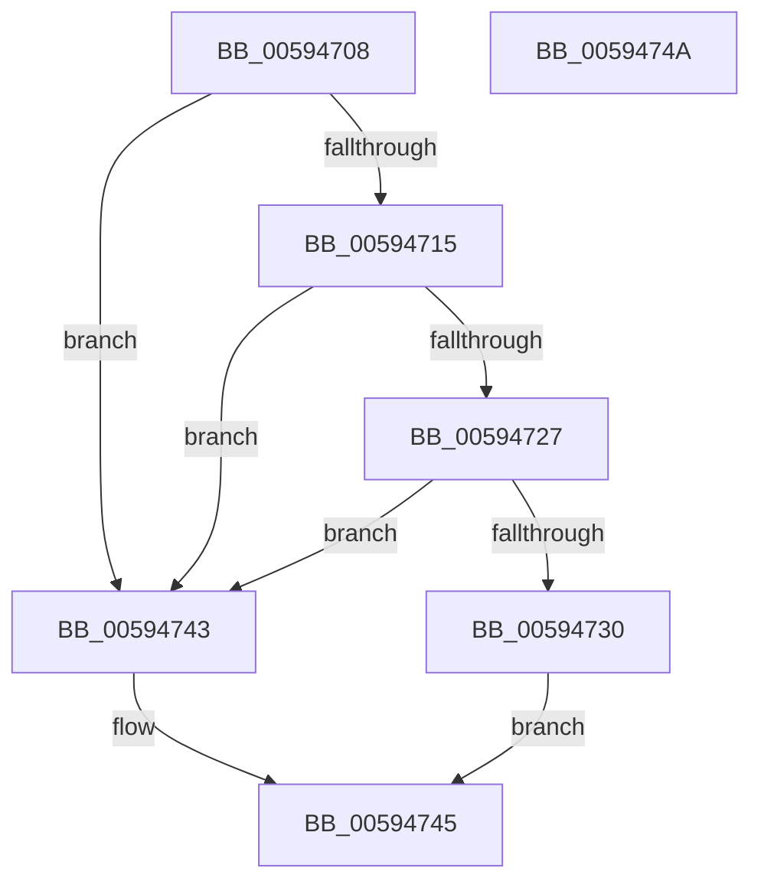

# IopBugCheckProgressEfiVariableServicesAvailable

- RVA: `0x00594708`–`0x0059474B` (길이 `67` bytes)
- VA: `0x0000000140594708`
- 실행 섹션: `.text`
- PDB 이름 있음: `예`; PDB Function 태그: `아니요`
- unwind 정보 RVA: `0x0005C788`
- 디코드: `19`개 명령, `67/67` bytes 표시
- 미해석 바이트: `0` (있으면 어셈블리에 `.byte`로 보존)

> 이 문서는 커널 이미지의 기계어와 PDB 기호를 분석해 생성했습니다. 4번과 5번은 함수 원형과 자료형을 바이너리 사용 방식에서 추정한 C 해석이며 원본 소스 복구 결과는 아닙니다.

## 1. Dependencies

- 직접 호출 지점: **2**; 고유 호출 대상: **2**
- 직접 호출자로 확인된 함수: **2**
- RIP 상대 이미지 참조: **4**

### Outgoing calls
- `0x00594715` → [KeFrozenProcessorCount](../5C/KeFrozenProcessorCount_function_005C2EC4.md) (function, `0x005C2EC4`)
- `0x00594737` → [guard_dispatch_icall](../6B/guard_dispatch_icall_function_006BAAD0.md) (function, `0x006BAAD0`)

### Direct callers
- [IoSaveInitialBugCheckProgress](IoSaveInitialBugCheckProgress_function_00593020.md) at `0x00593066`
- [IoUpdateBugCheckProgressEnvVariable](IoUpdateBugCheckProgressEnvVariable_function_005933E0.md) at `0x005933E4`

### Static image references
- `0x0059470C` → RVA `0x00E65ED4` (`.data`; read)
- `0x0059471A` → RVA `0x00FC6A80` (`ALMOSTRO`; read)
- `0x00594727` → RVA `0x00E65ED8` (`.data`; read)
- `0x00594730` → RVA `0x00E00BA0` (`.data`; read)

## 2. Other-region calls and transfers

- 다른 실행 섹션으로 향하는 call: **0**
- 별도 외부 분기/꼬리 이동을 확인하지 못했습니다.

## 3. Assembly (complete function range)

```asm
00594708  48 83 EC 28                     sub rsp, 0x28
0059470C  83 3D C1 17 8D 00 00            cmp dword ptr [rip + 0x8d17c1], 0
00594713  74 2E                           je 0x140594743
00594715  E8 AA E7 02 00                  call 0x1405c2ec4
0059471A  8B 0D 60 23 A3 00               mov ecx, dword ptr [rip + 0xa32360]
00594720  2B C8                           sub ecx, eax
00594722  83 F9 01                        cmp ecx, 1
00594725  77 1C                           ja 0x140594743
00594727  83 3D AA 17 8D 00 00            cmp dword ptr [rip + 0x8d17aa], 0
0059472E  75 13                           jne 0x140594743
00594730  48 8B 05 69 C4 86 00            mov rax, qword ptr [rip + 0x86c469]
00594737  E8 94 63 12 00                  call 0x1406baad0
0059473C  84 C0                           test al, al
0059473E  0F 94 C0                        sete al
00594741  EB 02                           jmp 0x140594745
00594743  32 C0                           xor al, al
00594745  48 83 C4 28                     add rsp, 0x28
00594749  C3                              ret
0059474A  CC                              int3
```

## 4. C-style interpretation (structured pseudocode)

```c
__int64 __fastcall IopBugCheckProgressEfiVariableServicesAvailable(void)
{
    __int64 result;
    __int64 v_rsp;

    v_rsp = (v_rsp) - (40);
    if ((*(unsigned int *)(v_rip + 9246657)) == 0) goto loc_00594743;
    result = KeFrozenProcessorCount(a1, a2, a3, a4);
    a1 = (unsigned int)(((unsigned int)(*(unsigned int *)(v_rip + 10691424))) - ((unsigned int)(result)));
    if (((unsigned int)(a1)) > 1) goto loc_00594743;
    if ((*(unsigned int *)(v_rip + 9246634)) != 0) goto loc_00594743;
    result = guard_dispatch_icall(a1, a2, a3, a4);
    result = ((unsigned __int8)(result) == 0) ? 1 : 0;
    goto loc_00594745;
loc_00594743:
    result = 0;
loc_00594745:
    v_rsp = (v_rsp) + (40);
    return result;
}
```

## 5. (Beta) C Style

```c
void IopBugCheckProgressEfiVariableServicesAvailable(void)
{
    int64_t result;
    int64_t local_rsp;

    local_rsp = (local_rsp) - (40);
    if ((*(uint32_t *)(v_rip + 0x8D17C1)) == 0) goto loc_00594743;
    result = KeFrozenProcessorCount(a1, a2, a3, a4);
    a1 = (uint32_t)(((uint32_t)(*(uint32_t *)(v_rip + 0xA32360))) - ((uint32_t)(result)));
    if (((uint32_t)(a1)) > 1) goto loc_00594743;
    if ((*(uint32_t *)(v_rip + 0x8D17AA)) != 0) goto loc_00594743;
    result = guard_dispatch_icall(a1, a2, a3, a4);
    result = ((uint8_t)(result) == 0) ? 1 : 0;
    goto loc_00594745;
loc_00594743:
    result = 0;
loc_00594745:
    local_rsp = (local_rsp) + (40);
    return result;
}
```

## 6. Execution-region graph

[열기: 2D/3D 그래프와 함수 탐색 컨트롤 패널](../../../control-panel.html?section=text&rva=0x00594708&view=graph)

- 2D 그래프는 위에서 아래로 흐르고, 3D 그래프는 빈 공간을 드래그해 회전합니다. Shift+드래그는 이동, 휠은 확대·축소, 함수 노드 선택은 대상 보고서 이동입니다.

### Static fallback


