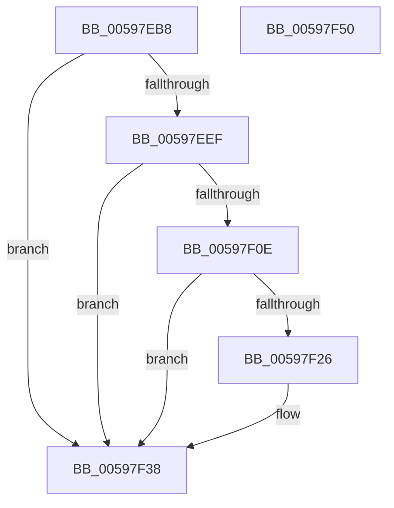

# IopCheckDiskName

- RVA: `0x00597EB8`–`0x00597F51` (길이 `153` bytes)
- VA: `0x0000000140597EB8`
- 실행 섹션: `.text`
- PDB 이름 있음: `예`; PDB Function 태그: `아니요`
- unwind 정보 RVA: `0x0009B270`
- 디코드: `44`개 명령, `153/153` bytes 표시
- 미해석 바이트: `0` (있으면 어셈블리에 `.byte`로 보존)

> 이 문서는 커널 이미지의 기계어와 PDB 기호를 분석해 생성했습니다. 4번과 5번은 함수 원형과 자료형을 바이너리 사용 방식에서 추정한 C 해석이며 원본 소스 복구 결과는 아닙니다.

## 1. Dependencies

- 직접 호출 지점: **4**; 고유 호출 대상: **3**
- 직접 호출자로 확인된 함수: **1**
- RIP 상대 이미지 참조: **1**

### Outgoing calls
- `0x00597EE6` → [RtlPrefixString](../../page/90/RtlPrefixString_function_0090F520.md) (function, `0x0090F520`)
- `0x00597EFD` → [RtlInitAnsiString](../47/RtlInitAnsiString_function_00470F40.md) (function, `0x00470F40`)
- `0x00597F1D` → [RtlPrefixString](../../page/90/RtlPrefixString_function_0090F520.md) (function, `0x0090F520`)
- `0x00597F33` → [RtlCharToInteger](../../page/A6/RtlCharToInteger_function_00A6C4E0.md) (function, `0x00A6C4E0`)

### Direct callers
- [IopGetBootDiskInformationLite](../../init/C2/IopGetBootDiskInformationLite_function_00C2DF64.md) at `0x00C2E0DD`

### Static image references
- `0x00597F16` → RVA `0x00009EE8` (`.rdata`; read)

## 2. Other-region calls and transfers

- 다른 실행 섹션으로 향하는 call: **3**
  - `0x00597EE6` → [RtlPrefixString](../../page/90/RtlPrefixString_function_0090F520.md) (`.text` → `PAGE`)
  - `0x00597F1D` → [RtlPrefixString](../../page/90/RtlPrefixString_function_0090F520.md) (`.text` → `PAGE`)
  - `0x00597F33` → [RtlCharToInteger](../../page/A6/RtlCharToInteger_function_00A6C4E0.md) (`.text` → `PAGE`)
- 별도 외부 분기/꼬리 이동을 확인하지 못했습니다.

## 3. Assembly (complete function range)

```asm
00597EB8  48 8B C4                        mov rax, rsp
00597EBB  48 89 58 08                     mov qword ptr [rax + 8], rbx
00597EBF  48 89 70 10                     mov qword ptr [rax + 0x10], rsi
00597EC3  48 89 78 18                     mov qword ptr [rax + 0x18], rdi
00597EC7  41 56                           push r14
00597EC9  48 83 EC 30                     sub rsp, 0x30
00597ECD  41 83 20 00                     and dword ptr [r8], 0
00597ED1  4D 8B F0                        mov r14, r8
00597ED4  0F 57 C0                        xorps xmm0, xmm0
00597ED7  45 33 C0                        xor r8d, r8d
00597EDA  0F 11 40 E8                     movups xmmword ptr [rax - 0x18], xmm0
00597EDE  48 8B FA                        mov rdi, rdx
00597EE1  48 8B F1                        mov rsi, rcx
00597EE4  32 DB                           xor bl, bl
00597EE6  E8 35 76 37 00                  call 0x14090f520
00597EEB  84 C0                           test al, al
00597EED  74 49                           je 0x140597f38
00597EEF  0F B7 16                        movzx edx, word ptr [rsi]
00597EF2  48 8D 4C 24 20                  lea rcx, [rsp + 0x20]
00597EF7  48 03 57 08                     add rdx, qword ptr [rdi + 8]
00597EFB  B3 01                           mov bl, 1
00597EFD  E8 3E 90 ED FF                  call 0x140470f40
00597F02  BF 0A 00 00 00                  mov edi, 0xa
00597F07  66 39 7C 24 20                  cmp word ptr [rsp + 0x20], di
00597F0C  76 2A                           jbe 0x140597f38
00597F0E  45 33 C0                        xor r8d, r8d
00597F11  48 8D 54 24 20                  lea rdx, [rsp + 0x20]
00597F16  48 8D 0D CB 1F A7 FF            lea rcx, [rip - 0x58e035]
00597F1D  E8 FE 75 37 00                  call 0x14090f520
00597F22  84 C0                           test al, al
00597F24  74 12                           je 0x140597f38
00597F26  48 8B 4C 24 28                  mov rcx, qword ptr [rsp + 0x28]
00597F2B  4D 8B C6                        mov r8, r14
00597F2E  48 03 CF                        add rcx, rdi
00597F31  8B D7                           mov edx, edi
00597F33  E8 A8 45 4D 00                  call 0x140a6c4e0
00597F38  48 8B 74 24 48                  mov rsi, qword ptr [rsp + 0x48]
00597F3D  8A C3                           mov al, bl
00597F3F  48 8B 5C 24 40                  mov rbx, qword ptr [rsp + 0x40]
00597F44  48 8B 7C 24 50                  mov rdi, qword ptr [rsp + 0x50]
00597F49  48 83 C4 30                     add rsp, 0x30
00597F4D  41 5E                           pop r14
00597F4F  C3                              ret
00597F50  CC                              int3
```

## 4. C-style interpretation (structured pseudocode)

```c
__int64 __fastcall IopCheckDiskName(__int64 a1, __int64 a2, __int64 a3)
{
    __int64 result;
    __int64 v_rbx;
    __int64 v_rsp;
    unsigned __int64 v_stack_m10;
    unsigned __int64 v_stack_m18;
    unsigned __int64 v_stack_p10;
    unsigned __int64 v_stack_p18;
    unsigned __int64 v_stack_p8;

    *(unsigned __int64 *)(v_rsp + 8) = v_rbx;
    *(unsigned __int64 *)(v_rsp + 16) = v_rsi;
    *(unsigned __int64 *)(v_rsp + 24) = v_rdi;
    v_rsp = (v_rsp) - (48);
    a3 = 0;
    *(unsigned __int64 *)(v_rsp - 24) = v_xmm0;
    v_rbx = 0;
    result = RtlPrefixString(a1, a2, a3, a4);
    if ((unsigned __int8)(result) == 0) goto loc_00597F38;
    a2 = (*(unsigned __int16 *)(a1)) + (*(unsigned __int64 *)(a2 + 8));
    result = RtlInitAnsiString(v_stack_m18, a2, a3, a4);
    if (v_stack_m18 <= 10) goto loc_00597F38;
    a3 = 0;
    result = RtlPrefixString(v_rip - 5824565, v_stack_m18, a3, a4);
    if ((unsigned __int8)(result) != 0) {
        a1 = v_stack_m10;
        a3 = 0;
        a1 = (a1) + (10);
        a2 = 10;
        result = RtlCharToInteger(a1, a2, a3, a4);
    }
    v_rsp = (v_rsp) + (48);
    return 1;
}
```

## 5. (Beta) C Style

```c
int64_t IopCheckDiskName(void *Arg1, void *Arg2, void *Arg3)
{
    uint8_t *arg1 = (uint8_t *)Arg1;
    uint8_t *arg2 = (uint8_t *)Arg2;
    uint8_t *arg3 = (uint8_t *)Arg3;

    int64_t result;
    int64_t local_rbx;
    int64_t local_rsp;
    uint64_t v_stack_m10;
    uint64_t v_stack_m18;
    uint64_t v_stack_p10;
    uint64_t v_stack_p18;
    uint64_t v_stack_p8;

    *(uint64_t *)(local_rsp + 0x8) = local_rbx;
    *(uint64_t *)(local_rsp + 0x10) = local_rsi;
    *(uint64_t *)(local_rsp + 0x18) = local_rdi;
    local_rsp = (local_rsp) - (48);
    Arg3 = 0;
    *(uint64_t *)(local_rsp - 0x18) = v_xmm0;
    local_rbx = 0;
    result = RtlPrefixString(Arg1, Arg2, Arg3, a4);
    if ((uint8_t)(result) == 0) goto loc_00597F38;
    Arg2 = (*(uint16_t *)(arg1)) + (*(uint64_t *)(arg2 + 0x8));
    result = RtlInitAnsiString(v_stack_m18, Arg2, Arg3, a4);
    if (v_stack_m18 <= 10) goto loc_00597F38;
    Arg3 = 0;
    result = RtlPrefixString(v_rip - 5824565, v_stack_m18, Arg3, a4);
    if ((uint8_t)(result) != 0) {
        Arg1 = v_stack_m10;
        Arg3 = 0;
        Arg1 = (Arg1) + (10);
        Arg2 = 10;
        result = RtlCharToInteger(Arg1, Arg2, Arg3, a4);
    }
    local_rsp = (local_rsp) + (48);
    return 1;
}
```

### 관측된 메모리 오프셋

구조체 형식이 확인되지 않은 접근은 인자 기준의 오프셋으로만 기록했습니다.

| 기준 인자 | 오프셋 표현 | 폭 (bit) | 접근 |
|---|---:|---:|---|
| `Arg1` | `+ 0x0` | `16` | `R` |
| `Arg2` | `+ 0x8` | `64` | `R` |
| `Arg3` | `+ 0x0` | `32` | `R/W` |

## 6. Execution-region graph

[열기: 2D/3D 그래프와 함수 탐색 컨트롤 패널](../../../control-panel.html?section=text&rva=0x00597EB8&view=graph)

- 2D 그래프는 위에서 아래로 흐르고, 3D 그래프는 빈 공간을 드래그해 회전합니다. Shift+드래그는 이동, 휠은 확대·축소, 함수 노드 선택은 대상 보고서 이동입니다.

### Static fallback


