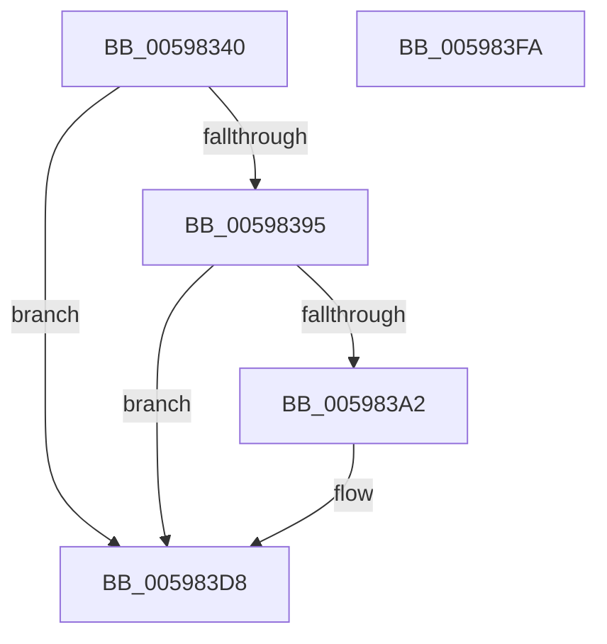

# IopCheckHandleForRevocation

- RVA: `0x00598340`–`0x005983FB` (길이 `187` bytes)
- VA: `0x0000000140598340`
- 실행 섹션: `.text`
- PDB 이름 있음: `예`; PDB Function 태그: `아니요`
- unwind 정보 RVA: `0x00066400`
- 디코드: `50`개 명령, `187/187` bytes 표시
- 미해석 바이트: `0` (있으면 어셈블리에 `.byte`로 보존)

> 이 문서는 커널 이미지의 기계어와 PDB 기호를 분석해 생성했습니다. 4번과 5번은 함수 원형과 자료형을 바이너리 사용 방식에서 추정한 C 해석이며 원본 소스 복구 결과는 아닙니다.

## 1. Dependencies

- 직접 호출 지점: **4**; 고유 호출 대상: **4**
- 직접 호출자로 확인된 함수: **0**
- RIP 상대 이미지 참조: **3**

### Outgoing calls
- `0x005983AE` → [IopSetFileObjectExtensionFlag](../43/IopSetFileObjectExtensionFlag_function_0043D710.md) (function, `0x0043D710`)
- `0x005983C9` → [IopCancelIrpsInFileObjectList](../20/IopCancelIrpsInFileObjectList_function_00207110.md) (function, `0x00207110`)
- `0x005983D3` → [IopCancelIrpsInThreadListForCurrentProcess](../../page/8C/IopCancelIrpsInThreadListForCurrentProcess_function_008C9C18.md) (function, `0x008C9C18`)
- `0x005983DE` → [ExUnlockHandleTableEntry](../../page/94/ExUnlockHandleTableEntry_function_0094D2D0.md) (function, `0x0094D2D0`)

### Direct callers
- 이 함수 시작 RVA로 연결되는 직접 call은 확인되지 않았습니다. 간접 호출은 완전히 역산할 수 없습니다.

### Static image references
- `0x0059835E` → RVA `0x00FC7800` (`ALMOSTRO`; read)
- `0x0059837E` → RVA `0x00FC6E4C` (`ALMOSTRO`; read)
- `0x00598388` → RVA `0x00FC6AE0` (`ALMOSTRO`; read)

## 2. Other-region calls and transfers

- 다른 실행 섹션으로 향하는 call: **2**
  - `0x005983D3` → [IopCancelIrpsInThreadListForCurrentProcess](../../page/8C/IopCancelIrpsInThreadListForCurrentProcess_function_008C9C18.md) (`.text` → `PAGE`)
  - `0x005983DE` → [ExUnlockHandleTableEntry](../../page/94/ExUnlockHandleTableEntry_function_0094D2D0.md) (`.text` → `PAGE`)
- 별도 외부 분기/꼬리 이동을 확인하지 못했습니다.

## 3. Assembly (complete function range)

```asm
00598340  48 89 5C 24 08                  mov qword ptr [rsp + 8], rbx
00598345  48 89 6C 24 10                  mov qword ptr [rsp + 0x10], rbp
0059834A  48 89 74 24 18                  mov qword ptr [rsp + 0x18], rsi
0059834F  57                              push rdi
00598350  48 83 EC 30                     sub rsp, 0x30
00598354  48 8B 3A                        mov rdi, qword ptr [rdx]
00598357  48 8B E9                        mov rbp, rcx
0059835A  48 C1 FF 10                     sar rdi, 0x10
0059835E  48 8D 0D 9B F4 A2 00            lea rcx, [rip + 0xa2f49b]
00598365  48 83 E7 F0                     and rdi, 0xfffffffffffffff0
00598369  48 8B F2                        mov rsi, rdx
0059836C  48 8B C7                        mov rax, rdi
0059836F  48 C1 E8 08                     shr rax, 8
00598373  44 0F B6 C0                     movzx r8d, al
00598377  0F B6 47 18                     movzx eax, byte ptr [rdi + 0x18]
0059837B  4C 33 C0                        xor r8, rax
0059837E  0F B6 05 C7 EA A2 00            movzx eax, byte ptr [rip + 0xa2eac7]
00598385  4C 33 C0                        xor r8, rax
00598388  48 8B 05 51 E7 A2 00            mov rax, qword ptr [rip + 0xa2e751]
0059838F  4A 39 04 C1                     cmp qword ptr [rcx + r8*8], rax
00598393  75 43                           jne 0x1405983d8
00598395  49 8B 01                        mov rax, qword ptr [r9]
00598398  48 83 C7 30                     add rdi, 0x30
0059839C  48 39 47 08                     cmp qword ptr [rdi + 8], rax
005983A0  75 36                           jne 0x1405983d8
005983A2  49 8B 59 08                     mov rbx, qword ptr [r9 + 8]
005983A6  BA 04 00 00 00                  mov edx, 4
005983AB  48 8B CF                        mov rcx, rdi
005983AE  E8 5D 53 EA FF                  call 0x14043d710
005983B3  45 33 C9                        xor r9d, r9d
005983B6  C6 44 24 28 00                  mov byte ptr [rsp + 0x28], 0
005983BB  45 33 C0                        xor r8d, r8d
005983BE  C6 44 24 20 00                  mov byte ptr [rsp + 0x20], 0
005983C3  48 8B D3                        mov rdx, rbx
005983C6  48 8B CF                        mov rcx, rdi
005983C9  E8 42 ED C6 FF                  call 0x140207110
005983CE  33 D2                           xor edx, edx
005983D0  48 8B CF                        mov rcx, rdi
005983D3  E8 40 18 33 00                  call 0x1408c9c18
005983D8  48 8B D6                        mov rdx, rsi
005983DB  48 8B CD                        mov rcx, rbp
005983DE  E8 ED 4E 3B 00                  call 0x14094d2d0
005983E3  48 8B 5C 24 40                  mov rbx, qword ptr [rsp + 0x40]
005983E8  32 C0                           xor al, al
005983EA  48 8B 6C 24 48                  mov rbp, qword ptr [rsp + 0x48]
005983EF  48 8B 74 24 50                  mov rsi, qword ptr [rsp + 0x50]
005983F4  48 83 C4 30                     add rsp, 0x30
005983F8  5F                              pop rdi
005983F9  C3                              ret
005983FA  CC                              int3
```

## 4. C-style interpretation (structured pseudocode)

```c
__int64 __fastcall IopCheckHandleForRevocation(__int64 a1, __int64 a2, __int64 a3, __int64 a4)
{
    __int64 result;
    __int64 v_rbx;
    __int64 v_rdi;
    __int64 v_rsp;
    unsigned __int8 v_stack_m10;
    unsigned __int8 v_stack_m18;
    unsigned __int64 v_stack_p10;
    unsigned __int64 v_stack_p18;
    unsigned __int64 v_stack_p8;

    v_stack_p8 = v_rbx;
    v_stack_p10 = v_rbp;
    v_stack_p18 = v_rsi;
    v_rsp = (v_rsp) - (48);
    v_rdi = (*(unsigned __int64 *)(a2)) >> (16);
    v_rdi = (v_rdi) & (-16);
    result = (v_rdi) >> (8);
    a3 = ((unsigned __int8)(result)) ^ (*(unsigned __int8 *)(v_rdi + 24));
    a3 = (a3) ^ (*(unsigned __int8 *)(v_rip + 10676935));
    if ((*(unsigned __int64 *)(v_rip + 10679451 + a3 * 8)) != (*(unsigned __int64 *)(v_rip + 10676049))) goto loc_005983D8;
    v_rdi = (v_rdi) + (48);
    result = *(unsigned __int64 *)(a4);
    if ((*(unsigned __int64 *)(v_rdi + 8)) == (*(unsigned __int64 *)(a4))) {
        v_rbx = *(unsigned __int64 *)(a4 + 8);
        a2 = 4;
        a1 = v_rdi;
        result = IopSetFileObjectExtensionFlag(a1, a2, a3, a4);
        a4 = 0;
        v_stack_m10 = 0;
        a3 = 0;
        v_stack_m18 = 0;
        a2 = v_rbx;
        a1 = v_rdi;
        result = IopCancelIrpsInFileObjectList(a1, a2, a3, a4);
        a2 = 0;
        a1 = v_rdi;
        result = IopCancelIrpsInThreadListForCurrentProcess(a1, a2, a3, a4);
    }
    result = ExUnlockHandleTableEntry(a1, 0, a3, a4);
    result = 0;
    v_rsp = (v_rsp) + (48);
    return result;
}
```

## 5. (Beta) C Style

```c
int64_t IopCheckHandleForRevocation(int64_t Arg1, void *Arg2, int64_t Arg3, void *Arg4)
{
    uint8_t *arg2 = (uint8_t *)Arg2;
    uint8_t *arg4 = (uint8_t *)Arg4;

    int64_t result;
    int64_t local_rbx;
    int64_t local_rdi;
    int64_t local_rsp;
    uint8_t v_stack_m10;
    uint8_t v_stack_m18;
    uint64_t v_stack_p10;
    uint64_t v_stack_p18;
    uint64_t v_stack_p8;

    v_stack_p8 = local_rbx;
    v_stack_p10 = local_rbp;
    v_stack_p18 = local_rsi;
    local_rsp = (local_rsp) - (48);
    local_rdi = (*(uint64_t *)(arg2)) >> (16);
    local_rdi = (local_rdi) & (-16);
    result = (local_rdi) >> (8);
    Arg3 = ((uint8_t)(result)) ^ (*(uint8_t *)(local_rdi + 0x18));
    Arg3 = (Arg3) ^ (*(uint8_t *)(v_rip + 0xA2EAC7));
    if ((*(uint64_t *)(v_rip + 0xA2F49B + Arg3 * 8)) != (*(uint64_t *)(v_rip + 0xA2E751))) goto loc_005983D8;
    local_rdi = (local_rdi) + (48);
    result = *(uint64_t *)(arg4);
    if ((*(uint64_t *)(local_rdi + 0x8)) == (*(uint64_t *)(arg4))) {
        local_rbx = *(uint64_t *)(arg4 + 0x8);
        Arg2 = 4;
        Arg1 = local_rdi;
        result = IopSetFileObjectExtensionFlag(Arg1, Arg2, Arg3, Arg4);
        Arg4 = 0;
        v_stack_m10 = 0;
        Arg3 = 0;
        v_stack_m18 = 0;
        Arg2 = local_rbx;
        Arg1 = local_rdi;
        result = IopCancelIrpsInFileObjectList(Arg1, Arg2, Arg3, Arg4);
        Arg2 = 0;
        Arg1 = local_rdi;
        result = IopCancelIrpsInThreadListForCurrentProcess(Arg1, Arg2, Arg3, Arg4);
    }
    result = ExUnlockHandleTableEntry(Arg1, 0, Arg3, Arg4);
    result = 0;
    local_rsp = (local_rsp) + (48);
    return result;
}
```

### 관측된 메모리 오프셋

구조체 형식이 확인되지 않은 접근은 인자 기준의 오프셋으로만 기록했습니다.

| 기준 인자 | 오프셋 표현 | 폭 (bit) | 접근 |
|---|---:|---:|---|
| `Arg2` | `+ 0x0` | `64` | `R` |
| `Arg4` | `+ 0x0` | `64` | `R` |
| `Arg4` | `+ 0x8` | `64` | `R` |

## 6. Execution-region graph

[열기: 2D/3D 그래프와 함수 탐색 컨트롤 패널](../../../control-panel.html?section=text&rva=0x00598340&view=graph)

- 2D 그래프는 위에서 아래로 흐르고, 3D 그래프는 빈 공간을 드래그해 회전합니다. Shift+드래그는 이동, 휠은 확대·축소, 함수 노드 선택은 대상 보고서 이동입니다.

### Static fallback


