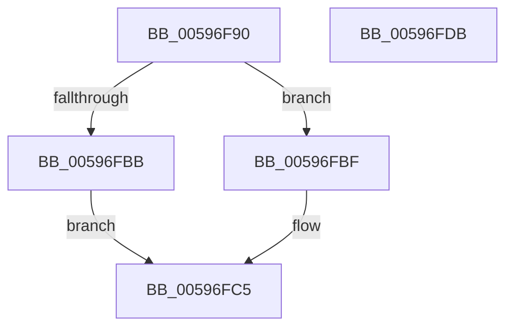

# IopCheckHardErrorEmpty

- RVA: `0x00596F90`–`0x00596FDC` (길이 `76` bytes)
- VA: `0x0000000140596F90`
- 실행 섹션: `.text`
- PDB 이름 있음: `예`; PDB Function 태그: `아니요`
- unwind 정보 RVA: `0x0005CF00`
- 디코드: `20`개 명령, `76/76` bytes 표시
- 미해석 바이트: `0` (있으면 어셈블리에 `.byte`로 보존)

> 이 문서는 커널 이미지의 기계어와 PDB 기호를 분석해 생성했습니다. 4번과 5번은 함수 원형과 자료형을 바이너리 사용 방식에서 추정한 C 해석이며 원본 소스 복구 결과는 아닙니다.

## 1. Dependencies

- 직접 호출 지점: **2**; 고유 호출 대상: **2**
- 직접 호출자로 확인된 함수: **1**
- RIP 상대 이미지 참조: **4**

### Outgoing calls
- `0x00596F9D` → [KeAcquireSpinLockRaiseToDpc](../20/KeAcquireSpinLockRaiseToDpc_function_00208470.md) (function, `0x00208470`)
- `0x00596FCE` → [KeReleaseSpinLock](../39/KeReleaseSpinLock_function_00392BA0.md) (function, `0x00392BA0`)

### Direct callers
- [IopHardErrorThread](../../page/71/IopHardErrorThread_function_0071B690.md) at `0x0071B70A`

### Static image references
- `0x00596F96` → RVA `0x00F8D7B0` (`.data`; read)
- `0x00596FA4` → RVA `0x00F8D7A0` (`.data`; read)
- `0x00596FB2` → RVA `0x00F8D1F8` (`.data`; write)
- `0x00596FBF` → RVA `0x00F8D7D8` (`.data`; write)

## 2. Other-region calls and transfers

- 다른 실행 섹션으로 향하는 call: **0**
- 별도 외부 분기/꼬리 이동을 확인하지 못했습니다.

## 3. Assembly (complete function range)

```asm
00596F90  40 53                           push rbx
00596F92  48 83 EC 20                     sub rsp, 0x20
00596F96  48 8D 0D 13 68 9F 00            lea rcx, [rip + 0x9f6813]
00596F9D  E8 CE 14 C7 FF                  call 0x140208470
00596FA2  33 DB                           xor ebx, ebx
00596FA4  48 8D 0D F5 67 9F 00            lea rcx, [rip + 0x9f67f5]
00596FAB  48 39 0D EE 67 9F 00            cmp qword ptr [rip + 0x9f67ee], rcx
00596FB2  48 89 1D 3F 62 9F 00            mov qword ptr [rip + 0x9f623f], rbx
00596FB9  74 04                           je 0x140596fbf
00596FBB  B3 01                           mov bl, 1
00596FBD  EB 06                           jmp 0x140596fc5
00596FBF  88 1D 13 68 9F 00               mov byte ptr [rip + 0x9f6813], bl
00596FC5  8A D0                           mov dl, al
00596FC7  48 8D 0D E2 67 9F 00            lea rcx, [rip + 0x9f67e2]
00596FCE  E8 CD BB DF FF                  call 0x140392ba0
00596FD3  8A C3                           mov al, bl
00596FD5  48 83 C4 20                     add rsp, 0x20
00596FD9  5B                              pop rbx
00596FDA  C3                              ret
00596FDB  CC                              int3
```

## 4. C-style interpretation (structured pseudocode)

```c
__int64 __fastcall IopCheckHardErrorEmpty(void)
{
    __int64 result;
    __int64 v_rbx;
    __int64 v_rsp;

    v_rsp = (v_rsp) - (32);
    result = KeAcquireSpinLockRaiseToDpc(v_rip + 10446867, a2, a3, a4);
    v_rbx = 0;
    *(unsigned __int64 *)(v_rip + 10445375) = 0;
    if ((*(unsigned __int64 *)(v_rip + 10446830)) == (v_rip + 10446837)) goto loc_00596FBF;
    goto loc_00596FC5;
loc_00596FBF:
    *(unsigned __int8 *)(v_rip + 10446867) = 1;
loc_00596FC5:
    result = KeReleaseSpinLock(v_rip + 10446818, (unsigned __int8)(result), a3, a4);
    v_rsp = (v_rsp) + (32);
    return 1;
}
```

## 5. (Beta) C Style

```c
void IopCheckHardErrorEmpty(void)
{
    int64_t result;
    int64_t local_rbx;
    int64_t local_rsp;

    local_rsp = (local_rsp) - (32);
    result = KeAcquireSpinLockRaiseToDpc(v_rip + 10446867, a2, a3, a4);
    local_rbx = 0;
    *(uint64_t *)(v_rip + 0x9F623F) = 0;
    if ((*(uint64_t *)(v_rip + 0x9F67EE)) == (v_rip + 10446837)) goto loc_00596FBF;
    goto loc_00596FC5;
loc_00596FBF:
    *(uint8_t *)(v_rip + 0x9F6813) = 1;
loc_00596FC5:
    result = KeReleaseSpinLock(v_rip + 10446818, (uint8_t)(result), a3, a4);
    local_rsp = (local_rsp) + (32);
    return 1;
}
```

## 6. Execution-region graph

[열기: 2D/3D 그래프와 함수 탐색 컨트롤 패널](../../../control-panel.html?section=text&rva=0x00596F90&view=graph)

- 2D 그래프는 위에서 아래로 흐르고, 3D 그래프는 빈 공간을 드래그해 회전합니다. Shift+드래그는 이동, 휠은 확대·축소, 함수 노드 선택은 대상 보고서 이동입니다.

### Static fallback


