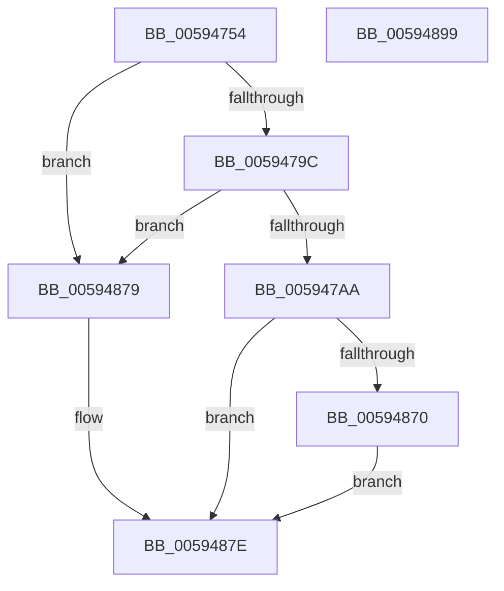

# IopCollectTriageDumpData

- RVA: `0x00594754`–`0x0059489A` (길이 `326` bytes)
- VA: `0x0000000140594754`
- 실행 섹션: `.text`
- PDB 이름 있음: `예`; PDB Function 태그: `아니요`
- unwind 정보 RVA: `0x000C7094`
- 디코드: `65`개 명령, `326/326` bytes 표시
- 미해석 바이트: `0` (있으면 어셈블리에 `.byte`로 보존)

> 이 문서는 커널 이미지의 기계어와 PDB 기호를 분석해 생성했습니다. 4번과 5번은 함수 원형과 자료형을 바이너리 사용 방식에서 추정한 C 해석이며 원본 소스 복구 결과는 아닙니다.

## 1. Dependencies

- 직접 호출 지점: **4**; 고유 호출 대상: **4**
- 직접 호출자로 확인된 함수: **2**
- RIP 상대 이미지 참조: **7**

### Outgoing calls
- `0x005947C6` → [IopUpdateMinidumpContext](IopUpdateMinidumpContext_function_00596360.md) (function, `0x00596360`)
- `0x005947D6` → [MmSnapTriageDumpInformation](../67/MmSnapTriageDumpInformation_function_0067DE28.md) (function, `0x0067DE28`)
- `0x00594867` → [IoFillTriageDumpBuffer](IoFillTriageDumpBuffer_function_005921CC.md) (function, `0x005921CC`)
- `0x00594889` → [_security_check_cookie](../6A/_security_check_cookie_function_006AC640.md) (function, `0x006AC640`)

### Direct callers
- [IoCapturePristineTriageDump](IoCapturePristineTriageDump_function_00591AB8.md) at `0x00591B88`
- [IoWriteCrashDump](IoWriteCrashDump_function_005936D8.md) at `0x00593AD8`
- [IoWriteCrashDump](IoWriteCrashDump_function_005936D8.md) at `0x00593D3B`

### Static image references
- `0x0059475F` → RVA `0x00E0A740` (`.data`; read)
- `0x00594776` → RVA `0x00F4754C` (`.data`; read)
- `0x0059479C` → RVA `0x00E65EE8` (`.data`; read)
- `0x005947DB` → RVA `0x00F8E8E0` (`.data`; read)
- `0x00594802` → RVA `0x00F8D8E0` (`.data`; read)
- `0x0059483D` → RVA `0x00FC41C0` (`.data`; read)
- `0x00594870` → RVA `0x00E65EE8` (`.data`; write)

## 2. Other-region calls and transfers

- 다른 실행 섹션으로 향하는 call: **0**
- 별도 외부 분기/꼬리 이동을 확인하지 못했습니다.

## 3. Assembly (complete function range)

```asm
00594754  40 53                           push rbx
00594756  56                              push rsi
00594757  57                              push rdi
00594758  48 81 EC B0 00 00 00            sub rsp, 0xb0
0059475F  48 8B 05 DA 5F 87 00            mov rax, qword ptr [rip + 0x875fda]
00594766  48 33 C4                        xor rax, rsp
00594769  48 89 84 24 A8 00 00 00         mov qword ptr [rsp + 0xa8], rax
00594771  83 64 24 70 00                  and dword ptr [rsp + 0x70], 0
00594776  8B 05 D0 2D 9B 00               mov eax, dword ptr [rip + 0x9b2dd0]
0059477C  48 8B BC 24 F8 00 00 00         mov rdi, qword ptr [rsp + 0xf8]
00594784  48 8B B4 24 00 01 00 00         mov rsi, qword ptr [rsp + 0x100]
0059478C  48 8B 9C 24 18 01 00 00         mov rbx, qword ptr [rsp + 0x118]
00594794  A8 03                           test al, 3
00594796  0F 84 DD 00 00 00               je 0x140594879
0059479C  48 83 3D 44 17 8D 00 00         cmp qword ptr [rip + 0x8d1744], 0
005947A4  0F 85 CF 00 00 00               jne 0x140594879
005947AA  48 8B 84 24 F0 00 00 00         mov rax, qword ptr [rsp + 0xf0]
005947B2  C6 44 24 40 01                  mov byte ptr [rsp + 0x40], 1
005947B7  48 89 74 24 30                  mov qword ptr [rsp + 0x30], rsi
005947BC  48 89 7C 24 28                  mov qword ptr [rsp + 0x28], rdi
005947C1  48 89 44 24 20                  mov qword ptr [rsp + 0x20], rax
005947C6  E8 95 1B 00 00                  call 0x140596360
005947CB  48 8D 94 24 88 00 00 00         lea rdx, [rsp + 0x88]
005947D3  48 8B CF                        mov rcx, rdi
005947D6  E8 4D 96 0E 00                  call 0x14067de28
005947DB  8B 05 FF A0 9F 00               mov eax, dword ptr [rip + 0x9fa0ff]
005947E1  41 B0 01                        mov r8b, 1
005947E4  F6 9C 24 08 01 00 00            neg byte ptr [rsp + 0x108]
005947EB  48 8B D3                        mov rdx, rbx
005947EE  89 44 24 78                     mov dword ptr [rsp + 0x78], eax
005947F2  B9 00 E0 03 00                  mov ecx, 0x3e000
005947F7  45 1B C9                        sbb r9d, r9d
005947FA  C7 44 24 7C 00 01 00 00         mov dword ptr [rsp + 0x7c], 0x100
00594802  48 8D 05 D7 90 9F 00            lea rax, [rip + 0x9f90d7]
00594809  41 81 E1 F8 FE FF FF            and r9d, 0xfffffef8
00594810  48 89 84 24 80 00 00 00         mov qword ptr [rsp + 0x80], rax
00594818  41 81 C1 FF 0D 00 00            add r9d, 0xdff
0059481F  48 8D 44 24 70                  lea rax, [rsp + 0x70]
00594824  48 89 44 24 60                  mov qword ptr [rsp + 0x60], rax
00594829  48 8D 44 24 78                  lea rax, [rsp + 0x78]
0059482E  48 89 44 24 58                  mov qword ptr [rsp + 0x58], rax
00594833  48 8D 44 24 78                  lea rax, [rsp + 0x78]
00594838  48 89 44 24 50                  mov qword ptr [rsp + 0x50], rax
0059483D  8B 05 7D F9 A2 00               mov eax, dword ptr [rip + 0xa2f97d]
00594843  C7 44 24 48 01 00 00 00         mov dword ptr [rsp + 0x48], 1
0059484B  C7 44 24 40 41 00 00 00         mov dword ptr [rsp + 0x40], 0x41
00594853  89 44 24 38                     mov dword ptr [rsp + 0x38], eax
00594857  48 89 74 24 30                  mov qword ptr [rsp + 0x30], rsi
0059485C  48 89 7C 24 28                  mov qword ptr [rsp + 0x28], rdi
00594861  48 83 64 24 20 00               and qword ptr [rsp + 0x20], 0
00594867  E8 60 D9 FF FF                  call 0x1405921cc
0059486C  85 C0                           test eax, eax
0059486E  78 0E                           js 0x14059487e
00594870  48 89 1D 71 16 8D 00            mov qword ptr [rip + 0x8d1671], rbx
00594877  EB 05                           jmp 0x14059487e
00594879  B8 01 00 00 C0                  mov eax, 0xc0000001
0059487E  48 8B 8C 24 A8 00 00 00         mov rcx, qword ptr [rsp + 0xa8]
00594886  48 33 CC                        xor rcx, rsp
00594889  E8 B2 7D 11 00                  call 0x1406ac640
0059488E  48 81 C4 B0 00 00 00            add rsp, 0xb0
00594895  5F                              pop rdi
00594896  5E                              pop rsi
00594897  5B                              pop rbx
00594898  C3                              ret
00594899  CC                              int3
```

## 4. C-style interpretation (structured pseudocode)

```c
__int64 __fastcall IopCollectTriageDumpData(__int64 a1, __int64 a2, __int64 a3, int a4, __int64 a5, __int64 a6, __int64 a7, unsigned __int8 a8, __int64 a9, __int64 a10)
{
    __int64 result;
    __int64 v_rsp;
    unsigned __int64 v_stack_m20;
    unsigned __int64 v_stack_m40;
    unsigned __int64 v_stack_m48;
    unsigned int v_stack_m4C;
    unsigned int v_stack_m50;
    unsigned int v_stack_m58;
    unsigned __int64 v_stack_m68;
    unsigned __int64 v_stack_m70;
    unsigned __int64 v_stack_m78;
    unsigned int v_stack_m80;
    unsigned __int8 v_stack_m88;
    unsigned int v_stack_m90;
    unsigned __int64 v_stack_m98;
    unsigned __int64 v_stack_mA0;
    unsigned __int64 v_stack_mA8;

    v_rsp = (v_rsp) - (176);
    result = (*(unsigned __int64 *)(v_rip + 8871898)) ^ (v_rsp);
    v_stack_m20 = result;
    if ((((unsigned __int8)((unsigned int)(*(unsigned int *)(v_rip + 10169808)))) & (3)) == 0) goto loc_00594879;
    if ((*(unsigned __int64 *)(v_rip + 9246532)) != 0) goto loc_00594879;
    v_stack_m88 = 1;
    v_stack_m98 = a7;
    v_stack_mA0 = a6;
    v_stack_mA8 = a5;
    result = IopUpdateMinidumpContext(a1, a2, a3, a4);
    result = MmSnapTriageDumpInformation(a6, v_stack_m40, a3, a4);
    v_stack_m50 = (unsigned int)((unsigned int)(*(unsigned int *)(v_rip + 10461439)));
    v_stack_m4C = 256;
    a4 = (unsigned int)((a4) & (0xFFFFFEF8ULL));
    v_stack_m48 = v_rip + 10457303;
    a4 = (unsigned int)((a4) + (0xDFFULL));
    v_stack_m68 = v_stack_m58;
    v_stack_m70 = v_stack_m50;
    v_stack_m78 = v_stack_m50;
    v_stack_m80 = 1;
    v_stack_m88 = 65;
    v_stack_m90 = (unsigned int)((unsigned int)(*(unsigned int *)(v_rip + 10680701)));
    v_stack_m98 = a7;
    v_stack_mA0 = a6;
    result = IoFillTriageDumpBuffer((unsigned int)(0x3E000ULL), a10, 1, a4);
    if (sign_flag) goto loc_0059487E;
    *(unsigned __int64 *)(v_rip + 9246321) = a10;
    goto loc_0059487E;
loc_00594879:
loc_0059487E:
    a1 = (v_stack_m20) ^ (v_rsp);
    result = _security_check_cookie(a1, a10, 1, a4);
    v_rsp = (v_rsp) + (176);
    return result;
}
```

## 5. (Beta) C Style

```c
int64_t IopCollectTriageDumpData(int64_t Arg1, int64_t Arg2, int64_t Arg3, int32_t Arg4, int64_t Arg5, int64_t Arg6, int64_t Arg7, uint8_t Arg8, uint64_t Arg9, int64_t Arg10)
{
    int64_t result;
    int64_t local_rsp;
    uint64_t v_stack_m20;
    uint64_t v_stack_m40;
    uint64_t v_stack_m48;
    uint32_t v_stack_m4C;
    uint32_t v_stack_m50;
    uint32_t v_stack_m58;
    uint64_t v_stack_m68;
    uint64_t v_stack_m70;
    uint64_t v_stack_m78;
    uint32_t v_stack_m80;
    uint8_t v_stack_m88;
    uint32_t v_stack_m90;
    uint64_t v_stack_m98;
    uint64_t v_stack_mA0;
    uint64_t v_stack_mA8;

    local_rsp = (local_rsp) - (176);
    result = (*(uint64_t *)(v_rip + 0x875FDA)) ^ (local_rsp);
    v_stack_m20 = result;
    if ((((uint8_t)((uint32_t)(*(uint32_t *)(v_rip + 0x9B2DD0)))) & (3)) == 0) goto loc_00594879;
    if ((*(uint64_t *)(v_rip + 0x8D1744)) != 0) goto loc_00594879;
    v_stack_m88 = 1;
    v_stack_m98 = Arg7;
    v_stack_mA0 = Arg6;
    v_stack_mA8 = Arg5;
    result = IopUpdateMinidumpContext(Arg1, Arg2, Arg3, Arg4);
    result = MmSnapTriageDumpInformation(Arg6, v_stack_m40, Arg3, Arg4);
    v_stack_m50 = (uint32_t)((uint32_t)(*(uint32_t *)(v_rip + 0x9FA0FF)));
    v_stack_m4C = 256;
    Arg4 = (uint32_t)((Arg4) & (0xFFFFFEF8ULL));
    v_stack_m48 = v_rip + 10457303;
    Arg4 = (uint32_t)((Arg4) + (0xDFFULL));
    v_stack_m68 = v_stack_m58;
    v_stack_m70 = v_stack_m50;
    v_stack_m78 = v_stack_m50;
    v_stack_m80 = 1;
    v_stack_m88 = 65;
    v_stack_m90 = (uint32_t)((uint32_t)(*(uint32_t *)(v_rip + 0xA2F97D)));
    v_stack_m98 = Arg7;
    v_stack_mA0 = Arg6;
    result = IoFillTriageDumpBuffer((uint32_t)(0x3E000ULL), Arg10, 1, Arg4);
    if (sign_flag) goto loc_0059487E;
    *(uint64_t *)(v_rip + 0x8D1671) = Arg10;
    goto loc_0059487E;
loc_00594879:
loc_0059487E:
    Arg1 = (v_stack_m20) ^ (local_rsp);
    result = _security_check_cookie(Arg1, Arg10, 1, Arg4);
    local_rsp = (local_rsp) + (176);
    return result;
}
```

## 6. Execution-region graph

[열기: 2D/3D 그래프와 함수 탐색 컨트롤 패널](../../../control-panel.html?section=text&rva=0x00594754&view=graph)

- 2D 그래프는 위에서 아래로 흐르고, 3D 그래프는 빈 공간을 드래그해 회전합니다. Shift+드래그는 이동, 휠은 확대·축소, 함수 노드 선택은 대상 보고서 이동입니다.

### Static fallback


