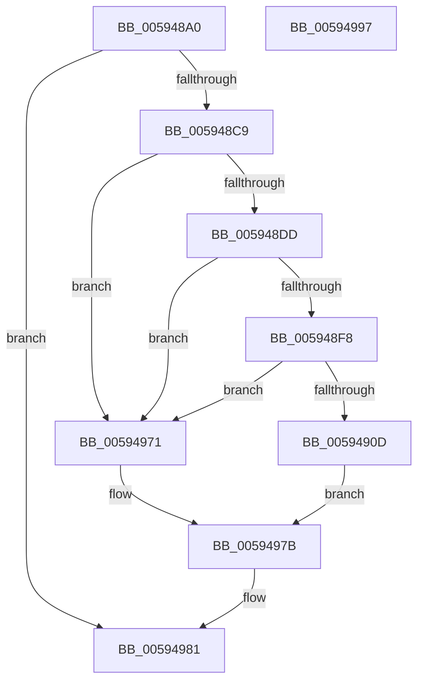

# IopConstructInMemoryDumpHeader

- RVA: `0x005948A0`–`0x00594998` (길이 `248` bytes)
- VA: `0x00000001405948A0`
- 실행 섹션: `.text`
- PDB 이름 있음: `예`; PDB Function 태그: `아니요`
- unwind 정보 RVA: `0x000BCAF8`
- 디코드: `56`개 명령, `248/248` bytes 표시
- 미해석 바이트: `0` (있으면 어셈블리에 `.byte`로 보존)

> 이 문서는 커널 이미지의 기계어와 PDB 기호를 분석해 생성했습니다. 4번과 5번은 함수 원형과 자료형을 바이너리 사용 방식에서 추정한 C 해석이며 원본 소스 복구 결과는 아닙니다.

## 1. Dependencies

- 직접 호출 지점: **1**; 고유 호출 대상: **1**
- 직접 호출자로 확인된 함수: **2**
- RIP 상대 이미지 참조: **8**

### Outgoing calls
- `0x00594936` → [IoFillDumpHeader](IoFillDumpHeader_function_00591ECC.md) (function, `0x00591ECC`)

### Direct callers
- [IoUpdateDumpPhysicalRanges](IoUpdateDumpPhysicalRanges_function_0059343C.md) at `0x005934A5`
- [IopInitializeOfflineCrashDump](IopInitializeOfflineCrashDump_function_00595A24.md) at `0x00595BBC`

### Static image references
- `0x005948BA` → RVA `0x00E65F10` (`.data`; read/write)
- `0x005948CB` → RVA `0x00E65F14` (`.data`; read)
- `0x005948D1` → RVA `0x00E65F48` (`.data`; write)
- `0x005948DD` → RVA `0x00E65F30` (`.data`; read)
- `0x005948E4` → RVA `0x00E65F10` (`.data`; read)
- `0x0059493B` → RVA `0x00E65F38` (`.data`; read)
- `0x00594949` → RVA `0x00FC6AB0` (`ALMOSTRO`; read)
- `0x00594969` → RVA `0x00E65F30` (`.data`; read/write)

## 2. Other-region calls and transfers

- 다른 실행 섹션으로 향하는 call: **0**
- 별도 외부 분기/꼬리 이동을 확인하지 못했습니다.

## 3. Assembly (complete function range)

```asm
005948A0  4C 8B DC                        mov r11, rsp
005948A3  49 89 5B 08                     mov qword ptr [r11 + 8], rbx
005948A7  49 89 73 10                     mov qword ptr [r11 + 0x10], rsi
005948AB  49 89 7B 18                     mov qword ptr [r11 + 0x18], rdi
005948AF  41 56                           push r14
005948B1  48 83 EC 40                     sub rsp, 0x40
005948B5  B8 01 00 00 00                  mov eax, 1
005948BA  87 05 50 16 8D 00               xchg dword ptr [rip + 0x8d1650], eax
005948C0  83 F8 01                        cmp eax, 1
005948C3  0F 84 B8 00 00 00               je 0x140594981
005948C9  33 FF                           xor edi, edi
005948CB  39 3D 43 16 8D 00               cmp dword ptr [rip + 0x8d1643], edi
005948D1  89 3D 71 16 8D 00               mov dword ptr [rip + 0x8d1671], edi
005948D7  0F 84 94 00 00 00               je 0x140594971
005948DD  48 8B 05 4C 16 8D 00            mov rax, qword ptr [rip + 0x8d164c]
005948E4  48 8D 35 25 16 8D 00            lea rsi, [rip + 0x8d1625]
005948EB  83 E0 01                        and eax, 1
005948EE  4C 8B 74 C6 08                  mov r14, qword ptr [rsi + rax*8 + 8]
005948F3  4D 85 F6                        test r14, r14
005948F6  74 79                           je 0x140594971
005948F8  8B 05 32 16 8D 00               mov eax, dword ptr [rip + 0x8d1632]
005948FE  FF C8                           dec eax
00594900  83 E0 01                        and eax, 1
00594903  48 8B 74 C6 08                  mov rsi, qword ptr [rsi + rax*8 + 8]
00594908  48 85 F6                        test rsi, rsi
0059490B  74 64                           je 0x140594971
0059490D  65 48 8B 04 25 88 01 00 00      mov rax, qword ptr gs:[0x188]
00594916  8D 57 01                        lea edx, [rdi + 1]
00594919  49 89 43 F0                     mov qword ptr [r11 - 0x10], rax
0059491D  48 8D 4E 18                     lea rcx, [rsi + 0x18]
00594921  49 89 7B E8                     mov qword ptr [r11 - 0x18], rdi
00594925  45 33 C9                        xor r9d, r9d
00594928  49 89 7B E0                     mov qword ptr [r11 - 0x20], rdi
0059492C  41 B8 4C 01 00 00               mov r8d, 0x14c
00594932  49 89 7B D8                     mov qword ptr [r11 - 0x28], rdi
00594936  E8 91 D5 FF FF                  call 0x140591ecc
0059493B  48 8B 05 F6 15 8D 00            mov rax, qword ptr [rip + 0x8d15f6]
00594942  48 89 86 C8 0F 00 00            mov qword ptr [rsi + 0xfc8], rax
00594949  48 8B 05 60 21 A3 00            mov rax, qword ptr [rip + 0xa32160]
00594950  48 8B 48 28                     mov rcx, qword ptr [rax + 0x28]
00594954  B8 3B 49 53 53                  mov eax, 0x5353493b
00594959  48 81 E1 00 F0 FF FF            and rcx, 0xfffffffffffff000
00594960  48 89 4E 28                     mov qword ptr [rsi + 0x28], rcx
00594964  87 06                           xchg dword ptr [rsi], eax
00594966  41 89 06                        mov dword ptr [r14], eax
00594969  FF 05 C1 15 8D 00               inc dword ptr [rip + 0x8d15c1]
0059496F  EB 0A                           jmp 0x14059497b
00594971  C7 05 CD 15 8D 00 01 00 00 C0   mov dword ptr [rip + 0x8d15cd], 0xc0000001
0059497B  87 3D 8F 15 8D 00               xchg dword ptr [rip + 0x8d158f], edi
00594981  48 8B 5C 24 50                  mov rbx, qword ptr [rsp + 0x50]
00594986  48 8B 74 24 58                  mov rsi, qword ptr [rsp + 0x58]
0059498B  48 8B 7C 24 60                  mov rdi, qword ptr [rsp + 0x60]
00594990  48 83 C4 40                     add rsp, 0x40
00594994  41 5E                           pop r14
00594996  C3                              ret
00594997  CC                              int3
```

## 4. C-style interpretation (structured pseudocode)

```c
__int64 __fastcall IopConstructInMemoryDumpHeader(__int64 a1, __int64 a2, __int64 a3, int a4)
{
    __int64 result;
    __int64 v_rdi;
    __int64 v_rsp;
    unsigned __int64 v_stack_p10;
    unsigned __int64 v_stack_p18;
    unsigned __int64 v_stack_p8;

    *(unsigned __int64 *)(v_rsp + 8) = v_rbx;
    *(unsigned __int64 *)(v_rsp + 16) = v_rsi;
    *(unsigned __int64 *)(v_rsp + 24) = v_rdi;
    v_rsp = (v_rsp) - (64);
    if (1 == 1) goto loc_00594981;
    v_rdi = 0;
    *(unsigned int *)(v_rip + 9246321) = 0;
    if ((*(unsigned int *)(v_rip + 9246275)) == 0) goto loc_00594971;
    result = (unsigned int)((*(unsigned __int64 *)(v_rip + 9246284)) & (1));
    if (*(unsigned __int64 *)(v_rip + 9246245 + result * 8 + 8) == 0) goto loc_00594971;
    result = (unsigned int)(((unsigned int)(*(unsigned int *)(v_rip + 9246258))) - 1);
    result = (unsigned int)((result) & (1));
    if (*(unsigned __int64 *)(v_rip + 9246245 + result * 8 + 8) == 0) goto loc_00594971;
    *(unsigned __int64 *)(v_rsp - 16) = *(unsigned __int64 *)(gs_base + (0 + 392));
    *(unsigned __int64 *)(v_rsp - 24) = 0;
    a4 = 0;
    *(unsigned __int64 *)(v_rsp - 32) = 0;
    *(unsigned __int64 *)(v_rsp - 40) = 0;
    result = IoFillDumpHeader(*(unsigned __int64 *)(v_rip + 9246245 + result * 8 + 8) + 24, v_rdi + 1, 332, a4);
    *(unsigned __int64 *)(*(unsigned __int64 *)(v_rip + 9246245 + result * 8 + 8) + 4040) = *(unsigned __int64 *)(v_rip + 9246198);
    a1 = (*(unsigned __int64 *)(*(unsigned __int64 *)(v_rip + 10690912) + 40)) & (0xFFFFFFFFFFFFF000ULL);
    *(unsigned __int64 *)(*(unsigned __int64 *)(v_rip + 9246245 + result * 8 + 8) + 40) = a1;
    *(unsigned int *)(*(unsigned __int64 *)(v_rip + 9246245 + result * 8 + 8)) = (unsigned int)((unsigned int)(0x5353493BULL));
    goto loc_0059497B;
loc_00594971:
    *(unsigned int *)(v_rip + 9246157) = 0xC0000001ULL;
loc_0059497B:
loc_00594981:
    v_rsp = (v_rsp) + (64);
    return (unsigned int)(0x5353493BULL);
}
```

## 5. (Beta) C Style

```c
int64_t IopConstructInMemoryDumpHeader(int64_t Arg1, int64_t Arg2, int64_t Arg3, int32_t Arg4)
{
    int64_t result;
    int64_t local_rdi;
    int64_t local_rsp;
    uint64_t v_stack_p10;
    uint64_t v_stack_p18;
    uint64_t v_stack_p8;

    *(uint64_t *)(local_rsp + 0x8) = local_rbx;
    *(uint64_t *)(local_rsp + 0x10) = local_rsi;
    *(uint64_t *)(local_rsp + 0x18) = local_rdi;
    local_rsp = (local_rsp) - (64);
    if (1 == 1) goto loc_00594981;
    local_rdi = 0;
    *(uint32_t *)(v_rip + 0x8D1671) = 0;
    if ((*(uint32_t *)(v_rip + 0x8D1643)) == 0) goto loc_00594971;
    result = (uint32_t)((*(uint64_t *)(v_rip + 0x8D164C)) & (1));
    if (*(uint64_t *)(v_rip + 0x8D1625 + result * 8 + 0x8) == 0) goto loc_00594971;
    result = (uint32_t)(((uint32_t)(*(uint32_t *)(v_rip + 0x8D1632))) - 1);
    result = (uint32_t)((result) & (1));
    if (*(uint64_t *)(v_rip + 0x8D1625 + result * 8 + 0x8) == 0) goto loc_00594971;
    *(uint64_t *)(local_rsp - 0x10) = *(uint64_t *)(gs_base + (0 + 0x188));
    *(uint64_t *)(local_rsp - 0x18) = 0;
    Arg4 = 0;
    *(uint64_t *)(local_rsp - 0x20) = 0;
    *(uint64_t *)(local_rsp - 0x28) = 0;
    result = IoFillDumpHeader(*(uint64_t *)(v_rip + 0x8D1625 + result * 8 + 0x8) + 24, local_rdi + 1, 332, Arg4);
    *(uint64_t *)(*(uint64_t *)(v_rip + 0x8D1625 + result * 8 + 0x8) + 0xFC8) = *(uint64_t *)(v_rip + 0x8D15F6);
    Arg1 = (*(uint64_t *)(*(uint64_t *)(v_rip + 0xA32160) + 0x28)) & (0xFFFFFFFFFFFFF000ULL);
    *(uint64_t *)(*(uint64_t *)(v_rip + 0x8D1625 + result * 8 + 0x8) + 0x28) = Arg1;
    *(uint32_t *)(*(uint64_t *)(v_rip + 0x8D1625 + result * 8 + 0x8)) = (uint32_t)((uint32_t)(0x5353493BULL));
    goto loc_0059497B;
loc_00594971:
    *(uint32_t *)(v_rip + 0x8D15CD) = 0xC0000001ULL;
loc_0059497B:
loc_00594981:
    local_rsp = (local_rsp) + (64);
    return (uint32_t)(0x5353493BULL);
}
```

## 6. Execution-region graph

[열기: 2D/3D 그래프와 함수 탐색 컨트롤 패널](../../../control-panel.html?section=text&rva=0x005948A0&view=graph)

- 2D 그래프는 위에서 아래로 흐르고, 3D 그래프는 빈 공간을 드래그해 회전합니다. Shift+드래그는 이동, 휠은 확대·축소, 함수 노드 선택은 대상 보고서 이동입니다.

### Static fallback


