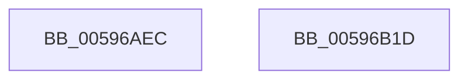

# IopCreateUnicodeFromAnsiBuffer

- RVA: `0x00596AEC`–`0x00596B1E` (길이 `50` bytes)
- VA: `0x0000000140596AEC`
- 실행 섹션: `.text`
- PDB 이름 있음: `예`; PDB Function 태그: `아니요`
- unwind 정보 RVA: `0x00064C80`
- 디코드: `15`개 명령, `50/50` bytes 표시
- 미해석 바이트: `0` (있으면 어셈블리에 `.byte`로 보존)

> 이 문서는 커널 이미지의 기계어와 PDB 기호를 분석해 생성했습니다. 4번과 5번은 함수 원형과 자료형을 바이너리 사용 방식에서 추정한 C 해석이며 원본 소스 복구 결과는 아닙니다.

## 1. Dependencies

- 직접 호출 지점: **2**; 고유 호출 대상: **2**
- 직접 호출자로 확인된 함수: **2**
- RIP 상대 이미지 참조: **0**

### Outgoing calls
- `0x00596B02` → [RtlInitAnsiString](../47/RtlInitAnsiString_function_00470F40.md) (function, `0x00470F40`)
- `0x00596B12` → [RtlAnsiStringToUnicodeString](../../page/90/RtlAnsiStringToUnicodeString_function_0090BEA0.md) (function, `0x0090BEA0`)

### Direct callers
- [sub_00B46364](../../page/B4/Unknown_function_00B46364.md) at `0x00B463E3`
- [sub_00B46364](../../page/B4/Unknown_function_00B46364.md) at `0x00B464E2`
- [IopMarkBootPartition](../../init/C2/IopMarkBootPartition_function_00C2CFA0.md) at `0x00C2D181`

### Static image references
- 디코드된 RIP-relative 메모리 참조가 없습니다.

## 2. Other-region calls and transfers

- 다른 실행 섹션으로 향하는 call: **1**
  - `0x00596B12` → [RtlAnsiStringToUnicodeString](../../page/90/RtlAnsiStringToUnicodeString_function_0090BEA0.md) (`.text` → `PAGE`)
- 별도 외부 분기/꼬리 이동을 확인하지 못했습니다.

## 3. Assembly (complete function range)

```asm
00596AEC  40 53                           push rbx
00596AEE  48 83 EC 30                     sub rsp, 0x30
00596AF2  48 8B D9                        mov rbx, rcx
00596AF5  0F 57 C0                        xorps xmm0, xmm0
00596AF8  48 8D 4C 24 20                  lea rcx, [rsp + 0x20]
00596AFD  0F 11 44 24 20                  movups xmmword ptr [rsp + 0x20], xmm0
00596B02  E8 39 A4 ED FF                  call 0x140470f40
00596B07  41 B0 01                        mov r8b, 1
00596B0A  48 8D 54 24 20                  lea rdx, [rsp + 0x20]
00596B0F  48 8B CB                        mov rcx, rbx
00596B12  E8 89 53 37 00                  call 0x14090bea0
00596B17  48 83 C4 30                     add rsp, 0x30
00596B1B  5B                              pop rbx
00596B1C  C3                              ret
00596B1D  CC                              int3
```

## 4. C-style interpretation (structured pseudocode)

```c
__int64 __fastcall IopCreateUnicodeFromAnsiBuffer(__int64 a1)
{
    __int64 result;
    __int64 v_rsp;
    unsigned __int64 v_stack_m18;

    v_rsp = (v_rsp) - (48);
    v_stack_m18 = v_xmm0;
    result = RtlInitAnsiString(v_stack_m18, a2, a3, a4);
    result = RtlAnsiStringToUnicodeString(a1, v_stack_m18, 1, a4);
    v_rsp = (v_rsp) + (48);
    return result;
}
```

## 5. (Beta) C Style

```c
int64_t IopCreateUnicodeFromAnsiBuffer(int64_t Arg1)
{
    int64_t result;
    int64_t local_rsp;
    uint64_t v_stack_m18;

    local_rsp = (local_rsp) - (48);
    v_stack_m18 = v_xmm0;
    result = RtlInitAnsiString(v_stack_m18, a2, a3, a4);
    result = RtlAnsiStringToUnicodeString(Arg1, v_stack_m18, 1, a4);
    local_rsp = (local_rsp) + (48);
    return result;
}
```

## 6. Execution-region graph

[열기: 2D/3D 그래프와 함수 탐색 컨트롤 패널](../../../control-panel.html?section=text&rva=0x00596AEC&view=graph)

- 2D 그래프는 위에서 아래로 흐르고, 3D 그래프는 빈 공간을 드래그해 회전합니다. Shift+드래그는 이동, 휠은 확대·축소, 함수 노드 선택은 대상 보고서 이동입니다.

### Static fallback


