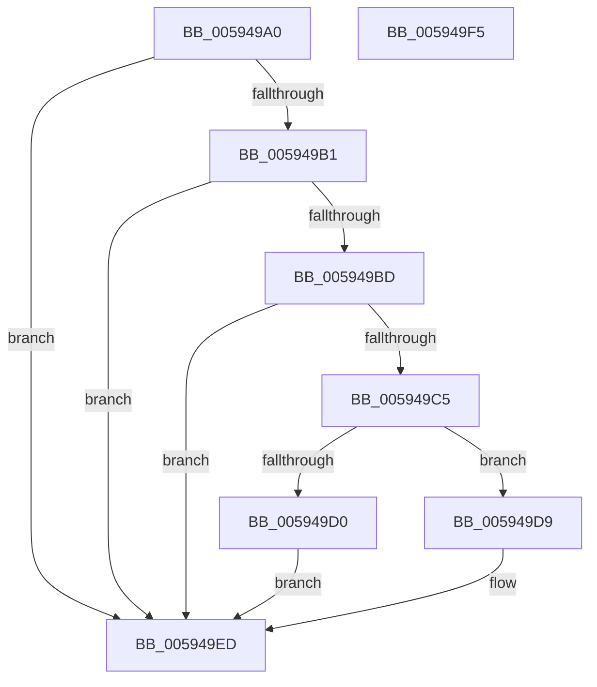

# IopDisableCrashDump

- RVA: `0x005949A0`–`0x005949F6` (길이 `86` bytes)
- VA: `0x00000001405949A0`
- 실행 섹션: `.text`
- PDB 이름 있음: `예`; PDB Function 태그: `아니요`
- unwind 정보 RVA: `0x0005CF00`
- 디코드: `25`개 명령, `86/86` bytes 표시
- 미해석 바이트: `0` (있으면 어셈블리에 `.byte`로 보존)

> 이 문서는 커널 이미지의 기계어와 PDB 기호를 분석해 생성했습니다. 4번과 5번은 함수 원형과 자료형을 바이너리 사용 방식에서 추정한 C 해석이며 원본 소스 복구 결과는 아닙니다.

## 1. Dependencies

- 직접 호출 지점: **3**; 고유 호출 대상: **3**
- 직접 호출자로 확인된 함수: **1**
- RIP 상대 이미지 참조: **5**

### Outgoing calls
- `0x005949C5` → [guard_dispatch_icall](../6B/guard_dispatch_icall_function_006BAAD0.md) (function, `0x006BAAD0`)
- `0x005949D2` → [IopDumpTraceDisableCrashDumpFailure](IopDumpTraceDisableCrashDumpFailure_function_00594E78.md) (function, `0x00594E78`)
- `0x005949E8` → [IopDumpTraceCrashDumpDisabled](IopDumpTraceCrashDumpDisabled_function_00594C8C.md) (function, `0x00594C8C`)

### Direct callers
- [IoConfigureCrashDump](IoConfigureCrashDump_function_00591CB4.md) at `0x00591DD5`
- [IoConfigureCrashDump](IoConfigureCrashDump_function_00591CB4.md) at `0x00591E44`

### Static image references
- `0x005949A8` → RVA `0x00E66058` (`.data`; read)
- `0x005949B1` → RVA `0x00E65FF8` (`.data`; read)
- `0x005949BD` → RVA `0x00E66068` (`.data`; read)
- `0x005949D9` → RVA `0x00E66050` (`.data`; read/write)
- `0x005949E1` → RVA `0x00E66068` (`.data`; write)

## 2. Other-region calls and transfers

- 다른 실행 섹션으로 향하는 call: **0**
- 별도 외부 분기/꼬리 이동을 확인하지 못했습니다.

## 3. Assembly (complete function range)

```asm
005949A0  40 53                           push rbx
005949A2  48 83 EC 20                     sub rsp, 0x20
005949A6  33 DB                           xor ebx, ebx
005949A8  48 39 1D A9 16 8D 00            cmp qword ptr [rip + 0x8d16a9], rbx
005949AF  74 3C                           je 0x1405949ed
005949B1  48 8B 05 40 16 8D 00            mov rax, qword ptr [rip + 0x8d1640]
005949B8  48 85 C0                        test rax, rax
005949BB  74 30                           je 0x1405949ed
005949BD  38 1D A5 16 8D 00               cmp byte ptr [rip + 0x8d16a5], bl
005949C3  74 28                           je 0x1405949ed
005949C5  E8 06 61 12 00                  call 0x1406baad0
005949CA  8B D8                           mov ebx, eax
005949CC  85 C0                           test eax, eax
005949CE  79 09                           jns 0x1405949d9
005949D0  8B C8                           mov ecx, eax
005949D2  E8 A1 04 00 00                  call 0x140594e78
005949D7  EB 14                           jmp 0x1405949ed
005949D9  48 83 25 6F 16 8D 00 00         and qword ptr [rip + 0x8d166f], 0
005949E1  C6 05 80 16 8D 00 00            mov byte ptr [rip + 0x8d1680], 0
005949E8  E8 9F 02 00 00                  call 0x140594c8c
005949ED  8B C3                           mov eax, ebx
005949EF  48 83 C4 20                     add rsp, 0x20
005949F3  5B                              pop rbx
005949F4  C3                              ret
005949F5  CC                              int3
```

## 4. C-style interpretation (structured pseudocode)

```c
__int64 __fastcall IopDisableCrashDump(void)
{
    __int64 result;
    __int64 v_rbx;
    __int64 v_rsp;

    v_rsp = (v_rsp) - (32);
    v_rbx = 0;
    if ((*(unsigned __int64 *)(v_rip + 9246377)) == 0) goto loc_005949ED;
    if (*(unsigned __int64 *)(v_rip + 9246272) == 0) goto loc_005949ED;
    if ((*(unsigned __int8 *)(v_rip + 9246373)) == 0) goto loc_005949ED;
    result = guard_dispatch_icall(a1, a2, a3, a4);
    if (!sign_flag) goto loc_005949D9;
    result = IopDumpTraceDisableCrashDumpFailure((unsigned int)((unsigned int)(result)), a2, a3, a4);
    goto loc_005949ED;
loc_005949D9:
    *(unsigned __int8 *)(v_rip + 9246336) = 0;
    result = IopDumpTraceCrashDumpDisabled((unsigned int)((unsigned int)(result)), a2, a3, a4);
loc_005949ED:
    v_rsp = (v_rsp) + (32);
    return (unsigned int)((unsigned int)((unsigned int)((unsigned int)(result))));
}
```

## 5. (Beta) C Style

```c
void IopDisableCrashDump(void)
{
    int64_t result;
    int64_t local_rbx;
    int64_t local_rsp;

    local_rsp = (local_rsp) - (32);
    local_rbx = 0;
    if ((*(uint64_t *)(v_rip + 0x8D16A9)) == 0) goto loc_005949ED;
    if (*(uint64_t *)(v_rip + 0x8D1640) == 0) goto loc_005949ED;
    if ((*(uint8_t *)(v_rip + 0x8D16A5)) == 0) goto loc_005949ED;
    result = guard_dispatch_icall(a1, a2, a3, a4);
    if (!sign_flag) goto loc_005949D9;
    result = IopDumpTraceDisableCrashDumpFailure((uint32_t)((uint32_t)(result)), a2, a3, a4);
    goto loc_005949ED;
loc_005949D9:
    *(uint8_t *)(v_rip + 0x8D1680) = 0;
    result = IopDumpTraceCrashDumpDisabled((uint32_t)((uint32_t)(result)), a2, a3, a4);
loc_005949ED:
    local_rsp = (local_rsp) + (32);
    return (uint32_t)((uint32_t)((uint32_t)((uint32_t)(result))));
}
```

## 6. Execution-region graph

[열기: 2D/3D 그래프와 함수 탐색 컨트롤 패널](../../../control-panel.html?section=text&rva=0x005949A0&view=graph)

- 2D 그래프는 위에서 아래로 흐르고, 3D 그래프는 빈 공간을 드래그해 회전합니다. Shift+드래그는 이동, 휠은 확대·축소, 함수 노드 선택은 대상 보고서 이동입니다.

### Static fallback


