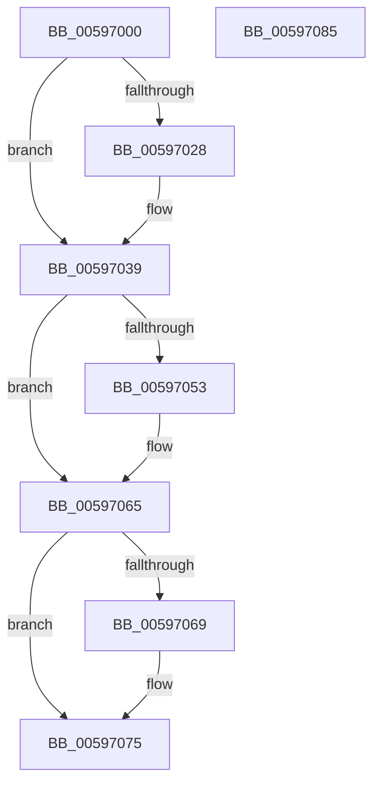

# IopDisableTimer

- RVA: `0x00597000`–`0x00597086` (길이 `134` bytes)
- VA: `0x0000000140597000`
- 실행 섹션: `.text`
- PDB 이름 있음: `예`; PDB Function 태그: `아니요`
- unwind 정보 RVA: `0x00060BC4`
- 디코드: `34`개 명령, `134/134` bytes 표시
- 미해석 바이트: `0` (있으면 어셈블리에 `.byte`로 보존)

> 이 문서는 커널 이미지의 기계어와 PDB 기호를 분석해 생성했습니다. 4번과 5번은 함수 원형과 자료형을 바이너리 사용 방식에서 추정한 C 해석이며 원본 소스 복구 결과는 아닙니다.

## 1. Dependencies

- 직접 호출 지점: **4**; 고유 호출 대상: **4**
- 직접 호출자로 확인된 함수: **1**
- RIP 상대 이미지 참조: **4**

### Outgoing calls
- `0x0059701D` → [KeAcquireSpinLockRaiseToDpc](../20/KeAcquireSpinLockRaiseToDpc_function_00208470.md) (function, `0x00208470`)
- `0x00597042` → [KeReleaseSpinLock](../39/KeReleaseSpinLock_function_00392BA0.md) (function, `0x00392BA0`)
- `0x00597060` → [EtwTraceIoTimerEvent](../64/EtwTraceIoTimerEvent_function_0064FAFC.md) (function, `0x0064FAFC`)
- `0x00597070` → [KeCancelTimer](../23/KeCancelTimer_function_002327E0.md) (function, `0x002327E0`)

### Direct callers
- [IoStopTimer](IoStopTimer_function_00597D20.md) at `0x00597D28`

### Static image references
- `0x00597014` → RVA `0x00FCF140` (`CACHEALI`; read)
- `0x0059702F` → RVA `0x00F8D500` (`.data`; read/write)
- `0x00597047` → RVA `0x00FC6B08` (`ALMOSTRO`; read)
- `0x00597069` → RVA `0x00F8D480` (`.data`; read)

## 2. Other-region calls and transfers

- 다른 실행 섹션으로 향하는 call: **0**
- 별도 외부 분기/꼬리 이동을 확인하지 못했습니다.

## 3. Assembly (complete function range)

```asm
00597000  48 89 5C 24 08                  mov qword ptr [rsp + 8], rbx
00597005  48 89 74 24 10                  mov qword ptr [rsp + 0x10], rsi
0059700A  57                              push rdi
0059700B  48 83 EC 20                     sub rsp, 0x20
0059700F  48 8B F9                        mov rdi, rcx
00597012  33 F6                           xor esi, esi
00597014  48 8D 0D 25 81 A3 00            lea rcx, [rip + 0xa38125]
0059701B  8B DE                           mov ebx, esi
0059701D  E8 4E 14 C7 FF                  call 0x140208470
00597022  66 39 77 02                     cmp word ptr [rdi + 2], si
00597026  74 11                           je 0x140597039
00597028  66 89 77 02                     mov word ptr [rdi + 2], si
0059702C  8D 56 01                        lea edx, [rsi + 1]
0059702F  83 05 CA 64 9F 00 FF            add dword ptr [rip + 0x9f64ca], -1
00597036  0F 44 DA                        cmove ebx, edx
00597039  8A D0                           mov dl, al
0059703B  48 8D 0D FE 80 A3 00            lea rcx, [rip + 0xa380fe]
00597042  E8 59 BB DF FF                  call 0x140392ba0
00597047  F7 05 B7 FA A2 00 00 00 80 00   test dword ptr [rip + 0xa2fab7], 0x800000
00597051  74 12                           je 0x140597065
00597053  4C 8B 47 18                     mov r8, qword ptr [rdi + 0x18]
00597057  B9 5E 0F 00 00                  mov ecx, 0xf5e
0059705C  48 8B 57 28                     mov rdx, qword ptr [rdi + 0x28]
00597060  E8 97 8A 0B 00                  call 0x14064fafc
00597065  85 DB                           test ebx, ebx
00597067  74 0C                           je 0x140597075
00597069  48 8D 0D 10 64 9F 00            lea rcx, [rip + 0x9f6410]
00597070  E8 6B B7 C9 FF                  call 0x1402327e0
00597075  48 8B 5C 24 30                  mov rbx, qword ptr [rsp + 0x30]
0059707A  48 8B 74 24 38                  mov rsi, qword ptr [rsp + 0x38]
0059707F  48 83 C4 20                     add rsp, 0x20
00597083  5F                              pop rdi
00597084  C3                              ret
00597085  CC                              int3
```

## 4. C-style interpretation (structured pseudocode)

```c
__int64 __fastcall IopDisableTimer(__int64 a1)
{
    __int64 result;
    __int64 v_rbx;
    __int64 v_rsi;
    __int64 v_rsp;
    unsigned __int64 v_stack_p10;
    unsigned __int64 v_stack_p8;

    v_stack_p8 = v_rbx;
    v_stack_p10 = v_rsi;
    v_rsp = (v_rsp) - (32);
    v_rsi = 0;
    result = KeAcquireSpinLockRaiseToDpc(v_rip + 10715429, a2, a3, a4);
    v_rbx = 0;
    if ((*(unsigned __int16 *)(a1 + 2)) != 0) {
        *(unsigned __int16 *)(a1 + 2) = 0;
        a2 = v_rsi + 1;
        v_rbx = 0;
        if ((*(unsigned __int16 *)(a1 + 2)) == 0) { v_rbx = (unsigned int)(a2); }
    }
    result = KeReleaseSpinLock(v_rip + 10715390, (unsigned __int8)(result), a3, a4);
    if (((*(unsigned int *)(v_rip + 10681015)) & (0x800000ULL)) != 0) {
        a3 = *(unsigned __int64 *)(a1 + 24);
        a1 = 0xF5EULL;
        a2 = *(unsigned __int64 *)(a1 + 40);
        result = EtwTraceIoTimerEvent(a1, a2, a3, a4);
    }
    if ((unsigned int)(v_rbx) != 0) {
        a1 = v_rip + 10445840;
        result = KeCancelTimer(a1, a2, a3, a4);
    }
    v_rsp = (v_rsp) + (32);
    return result;
}
```

## 5. (Beta) C Style

```c
int64_t IopDisableTimer(void *Arg1)
{
    uint8_t *arg1 = (uint8_t *)Arg1;

    int64_t result;
    int64_t local_rbx;
    int64_t local_rsi;
    int64_t local_rsp;
    uint64_t v_stack_p10;
    uint64_t v_stack_p8;

    v_stack_p8 = local_rbx;
    v_stack_p10 = local_rsi;
    local_rsp = (local_rsp) - (32);
    local_rsi = 0;
    result = KeAcquireSpinLockRaiseToDpc(v_rip + 10715429, a2, a3, a4);
    local_rbx = 0;
    if ((*(uint16_t *)(arg1 + 0x2)) != 0) {
        *(uint16_t *)(arg1 + 0x2) = 0;
        a2 = local_rsi + 1;
        local_rbx = 0;
        if ((*(uint16_t *)(arg1 + 0x2)) == 0) { local_rbx = (uint32_t)(a2); }
    }
    result = KeReleaseSpinLock(v_rip + 10715390, (uint8_t)(result), a3, a4);
    if (((*(uint32_t *)(v_rip + 0xA2FAB7)) & (0x800000ULL)) != 0) {
        a3 = *(uint64_t *)(arg1 + 0x18);
        Arg1 = 0xF5EULL;
        a2 = *(uint64_t *)(arg1 + 0x28);
        result = EtwTraceIoTimerEvent(Arg1, a2, a3, a4);
    }
    if ((uint32_t)(local_rbx) != 0) {
        Arg1 = v_rip + 10445840;
        result = KeCancelTimer(Arg1, a2, a3, a4);
    }
    local_rsp = (local_rsp) + (32);
    return result;
}
```

### 관측된 메모리 오프셋

구조체 형식이 확인되지 않은 접근은 인자 기준의 오프셋으로만 기록했습니다.

| 기준 인자 | 오프셋 표현 | 폭 (bit) | 접근 |
|---|---:|---:|---|
| `Arg1` | `+ 0x2` | `16` | `R` |
| `Arg1` | `+ 0x2` | `16` | `W` |
| `Arg1` | `+ 0x18` | `64` | `R` |
| `Arg1` | `+ 0x28` | `64` | `R` |

## 6. Execution-region graph

[열기: 2D/3D 그래프와 함수 탐색 컨트롤 패널](../../../control-panel.html?section=text&rva=0x00597000&view=graph)

- 2D 그래프는 위에서 아래로 흐르고, 3D 그래프는 빈 공간을 드래그해 회전합니다. Shift+드래그는 이동, 휠은 확대·축소, 함수 노드 선택은 대상 보고서 이동입니다.

### Static fallback


