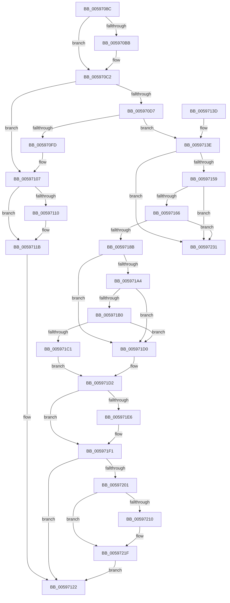

# IopDisassociateThreadIrp

- RVA: `0x0059708C`–`0x00597238` (길이 `428` bytes)
- VA: `0x000000014059708C`
- 실행 섹션: `.text`
- PDB 이름 있음: `예`; PDB Function 태그: `아니요`
- unwind 정보 RVA: `0x000C74EC`
- 디코드: `108`개 명령, `428/428` bytes 표시
- 미해석 바이트: `0` (있으면 어셈블리에 `.byte`로 보존)

> 이 문서는 커널 이미지의 기계어와 PDB 기호를 분석해 생성했습니다. 4번과 5번은 함수 원형과 자료형을 바이너리 사용 방식에서 추정한 C 해석이며 원본 소스 복구 결과는 아닙니다.

## 1. Dependencies

- 직접 호출 지점: **11**; 고유 호출 대상: **8**
- 직접 호출자로 확인된 함수: **1**
- RIP 상대 이미지 참조: **4**

### Outgoing calls
- `0x005970BD` → [KiRaiseIrqlProcessIrqlFlags](../4F/KiRaiseIrqlProcessIrqlFlags_function_004F56FC.md) (function, `0x004F56FC`)
- `0x005970E0` → [KeAcquireQueuedSpinLock](../27/KeAcquireQueuedSpinLock_function_00273D80.md) (function, `0x00273D80`)
- `0x00597102` → [KeReleaseQueuedSpinLock](../27/KeReleaseQueuedSpinLock_function_00272540.md) (function, `0x00272540`)
- `0x00597116` → [KiLowerIrqlProcessIrqlFlags](../4F/KiLowerIrqlProcessIrqlFlags_function_004F5698.md) (function, `0x004F5698`)
- `0x00597147` → [ObfReferenceObjectWithTag](../21/ObfReferenceObjectWithTag_function_00210710.md) (function, `0x00210710`)
- `0x005971C9` → [ObfReferenceObjectWithTag](../21/ObfReferenceObjectWithTag_function_00210710.md) (function, `0x00210710`)
- `0x005971D8` → [KeReleaseQueuedSpinLock](../27/KeReleaseQueuedSpinLock_function_00272540.md) (function, `0x00272540`)
- `0x005971EC` → [KiLowerIrqlProcessIrqlFlags](../4F/KiLowerIrqlProcessIrqlFlags_function_004F5698.md) (function, `0x004F5698`)
- `0x00597206` → [IoAllocateErrorLogEntry](../4A/IoAllocateErrorLogEntry_function_004ABF20.md) (function, `0x004ABF20`)
- `0x0059721A` → [IoWriteErrorLogEntry](../4B/IoWriteErrorLogEntry_function_004B5B30.md) (function, `0x004B5B30`)
- `0x00597227` → [ObfDereferenceObjectWithTag](../2F/ObfDereferenceObjectWithTag_function_002F78E0.md) (function, `0x002F78E0`)

### Direct callers
- [IoCancelThreadIo](../../page/90/IoCancelThreadIo_function_00906830.md) at `0x00906974`

### Static image references
- `0x005970B2` → RVA `0x00FC6D20` (`ALMOSTRO`; read)
- `0x00597169` → RVA `0x00F8D470` (`.data`; read)
- `0x0059717B` → RVA `0x00F8D478` (`.data`; read)
- `0x00597195` → RVA `0x00F8D478` (`.data`; write)

## 2. Other-region calls and transfers

- 다른 실행 섹션으로 향하는 call: **0**
- 별도 외부 분기/꼬리 이동을 확인하지 못했습니다.

## 3. Assembly (complete function range)

```asm
0059708C  48 8B C4                        mov rax, rsp
0059708F  48 89 58 08                     mov qword ptr [rax + 8], rbx
00597093  48 89 68 10                     mov qword ptr [rax + 0x10], rbp
00597097  48 89 70 18                     mov qword ptr [rax + 0x18], rsi
0059709B  48 89 78 20                     mov qword ptr [rax + 0x20], rdi
0059709F  41 57                           push r15
005970A1  48 83 EC 20                     sub rsp, 0x20
005970A5  44 0F 20 C3                     mov rbx, cr8
005970A9  BA 01 00 00 00                  mov edx, 1
005970AE  44 0F 22 C2                     mov cr8, rdx
005970B2  83 3D 67 FC A2 00 00            cmp dword ptr [rip + 0xa2fc67], 0
005970B9  74 07                           je 0x1405970c2
005970BB  8A CB                           mov cl, bl
005970BD  E8 3A E6 F5 FF                  call 0x1404f56fc
005970C2  65 48 8B 04 25 88 01 00 00      mov rax, qword ptr gs:[0x188]
005970CB  48 8D B0 40 05 00 00            lea rsi, [rax + 0x540]
005970D2  48 39 36                        cmp qword ptr [rsi], rsi
005970D5  74 30                           je 0x140597107
005970D7  41 BF 0B 00 00 00               mov r15d, 0xb
005970DD  41 8B CF                        mov ecx, r15d
005970E0  E8 9B CC CD FF                  call 0x140273d80
005970E5  48 8B 3E                        mov rdi, qword ptr [rsi]
005970E8  40 8A E8                        mov bpl, al
005970EB  44 0F BE 47 22                  movsx r8d, byte ptr [rdi + 0x22]
005970F0  0F BE 57 23                     movsx edx, byte ptr [rdi + 0x23]
005970F4  41 83 C0 02                     add r8d, 2
005970F8  41 3B D0                        cmp edx, r8d
005970FB  75 41                           jne 0x14059713e
005970FD  8A D0                           mov dl, al
005970FF  41 8B CF                        mov ecx, r15d
00597102  E8 39 B4 CD FF                  call 0x140272540
00597107  83 3D 12 FC A2 00 00            cmp dword ptr [rip + 0xa2fc12], 0
0059710E  74 0B                           je 0x14059711b
00597110  8A D3                           mov dl, bl
00597112  44 0F 20 C1                     mov rcx, cr8
00597116  E8 7D E5 F5 FF                  call 0x1404f5698
0059711B  0F B6 C3                        movzx eax, bl
0059711E  44 0F 22 C0                     mov cr8, rax
00597122  48 8B 5C 24 30                  mov rbx, qword ptr [rsp + 0x30]
00597127  48 8B 6C 24 38                  mov rbp, qword ptr [rsp + 0x38]
0059712C  48 8B 74 24 40                  mov rsi, qword ptr [rsp + 0x40]
00597131  48 8B 7C 24 48                  mov rdi, qword ptr [rsp + 0x48]
00597136  48 83 C4 20                     add rsp, 0x20
0059713A  41 5F                           pop r15
0059713C  C3                              ret
0059713D  CC                              int3
0059713E  48 8B 4F 78                     mov rcx, qword ptr [rdi + 0x78]
00597142  BA 44 66 6C 74                  mov edx, 0x746c6644
00597147  E8 C4 95 C7 FF                  call 0x140210710
0059714C  48 8B 06                        mov rax, qword ptr [rsi]
0059714F  48 39 70 08                     cmp qword ptr [rax + 8], rsi
00597153  0F 85 D8 00 00 00               jne 0x140597231
00597159  48 8B 08                        mov rcx, qword ptr [rax]
0059715C  48 39 41 08                     cmp qword ptr [rcx + 8], rax
00597160  0F 85 CB 00 00 00               jne 0x140597231
00597166  48 89 0E                        mov qword ptr [rsi], rcx
00597169  48 8D 15 00 63 9F 00            lea rdx, [rip + 0x9f6300]
00597170  48 89 71 08                     mov qword ptr [rcx + 8], rsi
00597174  48 89 7F 08                     mov qword ptr [rdi + 8], rdi
00597178  48 89 3F                        mov qword ptr [rdi], rdi
0059717B  48 8B 0D F6 62 9F 00            mov rcx, qword ptr [rip + 0x9f62f6]
00597182  48 39 11                        cmp qword ptr [rcx], rdx
00597185  0F 85 A6 00 00 00               jne 0x140597231
0059718B  48 89 10                        mov qword ptr [rax], rdx
0059718E  48 89 48 08                     mov qword ptr [rax + 8], rcx
00597192  48 89 01                        mov qword ptr [rcx], rax
00597195  48 89 05 DC 62 9F 00            mov qword ptr [rip + 0x9f62dc], rax
0059719C  8A 47 22                        mov al, byte ptr [rdi + 0x22]
0059719F  38 47 23                        cmp byte ptr [rdi + 0x23], al
005971A2  7F 2C                           jg 0x1405971d0
005971A4  48 8B 8F A0 00 00 00            mov rcx, qword ptr [rdi + 0xa0]
005971AB  48 85 C9                        test rcx, rcx
005971AE  74 20                           je 0x1405971d0
005971B0  48 8B 87 98 00 00 00            mov rax, qword ptr [rdi + 0x98]
005971B7  48 8B 78 28                     mov rdi, qword ptr [rax + 0x28]
005971BB  48 39 79 08                     cmp qword ptr [rcx + 8], rdi
005971BF  75 0F                           jne 0x1405971d0
005971C1  BA 44 66 6C 74                  mov edx, 0x746c6644
005971C6  48 8B CF                        mov rcx, rdi
005971C9  E8 42 95 C7 FF                  call 0x140210710
005971CE  EB 02                           jmp 0x1405971d2
005971D0  33 FF                           xor edi, edi
005971D2  40 8A D5                        mov dl, bpl
005971D5  49 8B CF                        mov rcx, r15
005971D8  E8 63 B3 CD FF                  call 0x140272540
005971DD  83 3D 3C FB A2 00 00            cmp dword ptr [rip + 0xa2fb3c], 0
005971E4  74 0B                           je 0x1405971f1
005971E6  44 0F 20 C1                     mov rcx, cr8
005971EA  8A D3                           mov dl, bl
005971EC  E8 A7 E4 F5 FF                  call 0x1404f5698
005971F1  0F B6 C3                        movzx eax, bl
005971F4  44 0F 22 C0                     mov cr8, rax
005971F8  48 85 FF                        test rdi, rdi
005971FB  0F 84 21 FF FF FF               je 0x140597122
00597201  B2 30                           mov dl, 0x30
00597203  48 8B CF                        mov rcx, rdi
00597206  E8 15 4D F1 FF                  call 0x1404abf20
0059720B  48 85 C0                        test rax, rax
0059720E  74 0F                           je 0x14059721f
00597210  48 8B C8                        mov rcx, rax
00597213  C7 40 0C 36 00 04 80            mov dword ptr [rax + 0xc], 0x80040036
0059721A  E8 11 E9 F1 FF                  call 0x1404b5b30
0059721F  BA 44 66 6C 74                  mov edx, 0x746c6644
00597224  48 8B CF                        mov rcx, rdi
00597227  E8 B4 06 D6 FF                  call 0x1402f78e0
0059722C  E9 F1 FE FF FF                  jmp 0x140597122
00597231  B9 03 00 00 00                  mov ecx, 3
00597236  CD 29                           int 0x29
```

## 4. C-style interpretation (structured pseudocode)

```c
__int64 __fastcall IopDisassociateThreadIrp(void)
{
    __int64 result;
    __int64 v_rdi;
    __int64 v_rsp;
    unsigned __int64 v_stack_p10;
    unsigned __int64 v_stack_p18;
    unsigned __int64 v_stack_p20;
    unsigned __int64 v_stack_p8;

    *(unsigned __int64 *)(v_rsp + 8) = v_rbx;
    *(unsigned __int64 *)(v_rsp + 16) = v_rbp;
    *(unsigned __int64 *)(v_rsp + 24) = v_rsi;
    *(unsigned __int64 *)(v_rsp + 32) = v_rdi;
    v_rsp = (v_rsp) - (32);
    result = v_rsp;
    if ((*(unsigned int *)(v_rip + 10681447)) != 0) {
        a1 = (unsigned __int8)(v_cr8);
        result = KiRaiseIrqlProcessIrqlFlags(a1, 1, a3, a4);
    }
    if ((*(unsigned __int64 *)(*(unsigned __int64 *)(gs_base + (0 + 392)) + 1344)) == (*(unsigned __int64 *)(gs_base + (0 + 392)) + 1344)) goto loc_00597107;
    result = KeAcquireQueuedSpinLock(11, 1, a3, a4);
    a3 = (unsigned int)(((__int8)(*(unsigned __int8 *)(*(unsigned __int64 *)(*(unsigned __int64 *)(gs_base + (0 + 392)) + 1344) + 34))) + (2));
    if (((unsigned int)((__int8)(*(unsigned __int8 *)(*(unsigned __int64 *)(*(unsigned __int64 *)(gs_base + (0 + 392)) + 1344) + 35)))) != ((unsigned int)(a3))) goto loc_0059713E;
    result = KeReleaseQueuedSpinLock(11, (unsigned __int8)(result), a3, a4);
loc_00597107:
    if ((*(unsigned int *)(v_rip + 10681362)) != 0) {
        a2 = (unsigned __int8)(v_cr8);
        a1 = 1;
        result = KiLowerIrqlProcessIrqlFlags(a1, a2, a3, a4);
    }
loc_00597122:
    v_rsp = (v_rsp) + (32);
    return (unsigned __int8)(v_cr8);
loc_0059713E:
    result = ObfReferenceObjectWithTag(*(unsigned __int64 *)(v_stack_p20 + 120), (unsigned int)(0x746C6644ULL), a3, a4);
    if ((*(unsigned __int64 *)(*(unsigned __int64 *)(v_stack_p18) + 8)) != v_stack_p18) goto loc_00597231;
    if ((*(unsigned __int64 *)(*(unsigned __int64 *)(*(unsigned __int64 *)(v_stack_p18)) + 8)) != (*(unsigned __int64 *)(v_stack_p18))) goto loc_00597231;
    *(unsigned __int64 *)(v_stack_p18) = *(unsigned __int64 *)(*(unsigned __int64 *)(v_stack_p18));
    *(unsigned __int64 *)(*(unsigned __int64 *)(*(unsigned __int64 *)(v_stack_p18)) + 8) = v_stack_p18;
    *(unsigned __int64 *)(v_stack_p20 + 8) = v_stack_p20;
    *(unsigned __int64 *)(v_stack_p20) = v_stack_p20;
    if ((*(unsigned __int64 *)(*(unsigned __int64 *)(v_rip + 10445558))) != (v_rip + 10445568)) goto loc_00597231;
    *(unsigned __int64 *)(*(unsigned __int64 *)(v_stack_p18)) = v_rip + 10445568;
    *(unsigned __int64 *)(*(unsigned __int64 *)(v_stack_p18) + 8) = *(unsigned __int64 *)(v_rip + 10445558);
    *(unsigned __int64 *)(*(unsigned __int64 *)(v_rip + 10445558)) = *(unsigned __int64 *)(v_stack_p18);
    *(unsigned __int64 *)(v_rip + 10445532) = *(unsigned __int64 *)(v_stack_p18);
    if ((*(unsigned __int8 *)(v_stack_p20 + 35)) > ((unsigned __int8)(*(unsigned __int8 *)(v_stack_p20 + 34)))) goto loc_005971D0;
    if (*(unsigned __int64 *)(v_stack_p20 + 160) == 0) goto loc_005971D0;
    if ((*(unsigned __int64 *)(*(unsigned __int64 *)(v_stack_p20 + 160) + 8)) != (*(unsigned __int64 *)(*(unsigned __int64 *)(v_stack_p20 + 152) + 40))) goto loc_005971D0;
    result = ObfReferenceObjectWithTag(*(unsigned __int64 *)(*(unsigned __int64 *)(v_stack_p20 + 152) + 40), (unsigned int)(0x746C6644ULL), a3, a4);
    goto loc_005971D2;
loc_005971D0:
    v_rdi = 0;
loc_005971D2:
    result = KeReleaseQueuedSpinLock(11, (unsigned __int8)(v_stack_p10), a3, a4);
    if ((*(unsigned int *)(v_rip + 10681148)) != 0) {
        a1 = (unsigned __int8)(v_cr8);
        a2 = (unsigned __int8)(v_stack_p8);
        result = KiLowerIrqlProcessIrqlFlags(a1, a2, a3, a4);
    }
    if (0 == 0) goto loc_00597122;
    result = IoAllocateErrorLogEntry(0, 48, a3, a4);
    if (result != 0) {
        a1 = result;
        *(unsigned int *)(result + 12) = 0x80040036ULL;
        result = IoWriteErrorLogEntry(a1, 48, a3, a4);
    }
    result = ObfDereferenceObjectWithTag(0, (unsigned int)(0x746C6644ULL), a3, a4);
    goto loc_00597122;
loc_00597231:
    return result;
}
```

## 5. (Beta) C Style

```c
void IopDisassociateThreadIrp(void)
{
    int64_t result;
    int64_t local_rdi;
    int64_t local_rsp;
    uint64_t v_stack_p10;
    uint64_t v_stack_p18;
    uint64_t v_stack_p20;
    uint64_t v_stack_p8;

    *(uint64_t *)(local_rsp + 0x8) = local_rbx;
    *(uint64_t *)(local_rsp + 0x10) = local_rbp;
    *(uint64_t *)(local_rsp + 0x18) = local_rsi;
    *(uint64_t *)(local_rsp + 0x20) = local_rdi;
    local_rsp = (local_rsp) - (32);
    result = local_rsp;
    if ((*(uint32_t *)(v_rip + 0xA2FC67)) != 0) {
        a1 = (uint8_t)(v_cr8);
        result = KiRaiseIrqlProcessIrqlFlags(a1, 1, a3, a4);
    }
    if ((*(uint64_t *)(*(uint64_t *)(gs_base + (0 + 0x188)) + 0x540)) == (*(uint64_t *)(gs_base + (0 + 0x188)) + 1344)) goto loc_00597107;
    result = KeAcquireQueuedSpinLock(11, 1, a3, a4);
    a3 = (uint32_t)(((int8_t)(*(uint8_t *)(*(uint64_t *)(*(uint64_t *)(gs_base + (0 + 0x188)) + 0x540) + 0x22))) + (2));
    if (((uint32_t)((int8_t)(*(uint8_t *)(*(uint64_t *)(*(uint64_t *)(gs_base + (0 + 0x188)) + 0x540) + 0x23)))) != ((uint32_t)(a3))) goto loc_0059713E;
    result = KeReleaseQueuedSpinLock(11, (uint8_t)(result), a3, a4);
loc_00597107:
    if ((*(uint32_t *)(v_rip + 0xA2FC12)) != 0) {
        a2 = (uint8_t)(v_cr8);
        a1 = 1;
        result = KiLowerIrqlProcessIrqlFlags(a1, a2, a3, a4);
    }
loc_00597122:
    local_rsp = (local_rsp) + (32);
    return (uint8_t)(v_cr8);
loc_0059713E:
    result = ObfReferenceObjectWithTag(*(uint64_t *)(v_stack_p20 + 0x78), (uint32_t)(0x746C6644ULL), a3, a4);
    if ((*(uint64_t *)(*(uint64_t *)(v_stack_p18) + 0x8)) != v_stack_p18) goto loc_00597231;
    if ((*(uint64_t *)(*(uint64_t *)(*(uint64_t *)(v_stack_p18)) + 0x8)) != (*(uint64_t *)(v_stack_p18))) goto loc_00597231;
    *(uint64_t *)(v_stack_p18) = *(uint64_t *)(*(uint64_t *)(v_stack_p18));
    *(uint64_t *)(*(uint64_t *)(*(uint64_t *)(v_stack_p18)) + 0x8) = v_stack_p18;
    *(uint64_t *)(v_stack_p20 + 0x8) = v_stack_p20;
    *(uint64_t *)(v_stack_p20) = v_stack_p20;
    if ((*(uint64_t *)(*(uint64_t *)(v_rip + 0x9F62F6))) != (v_rip + 10445568)) goto loc_00597231;
    *(uint64_t *)(*(uint64_t *)(v_stack_p18)) = v_rip + 10445568;
    *(uint64_t *)(*(uint64_t *)(v_stack_p18) + 0x8) = *(uint64_t *)(v_rip + 0x9F62F6);
    *(uint64_t *)(*(uint64_t *)(v_rip + 0x9F62F6)) = *(uint64_t *)(v_stack_p18);
    *(uint64_t *)(v_rip + 0x9F62DC) = *(uint64_t *)(v_stack_p18);
    if ((*(uint8_t *)(v_stack_p20 + 0x23)) > ((uint8_t)(*(uint8_t *)(v_stack_p20 + 0x22)))) goto loc_005971D0;
    if (*(uint64_t *)(v_stack_p20 + 0xA0) == 0) goto loc_005971D0;
    if ((*(uint64_t *)(*(uint64_t *)(v_stack_p20 + 0xA0) + 0x8)) != (*(uint64_t *)(*(uint64_t *)(v_stack_p20 + 0x98) + 0x28))) goto loc_005971D0;
    result = ObfReferenceObjectWithTag(*(uint64_t *)(*(uint64_t *)(v_stack_p20 + 0x98) + 0x28), (uint32_t)(0x746C6644ULL), a3, a4);
    goto loc_005971D2;
loc_005971D0:
    local_rdi = 0;
loc_005971D2:
    result = KeReleaseQueuedSpinLock(11, (uint8_t)(v_stack_p10), a3, a4);
    if ((*(uint32_t *)(v_rip + 0xA2FB3C)) != 0) {
        a1 = (uint8_t)(v_cr8);
        a2 = (uint8_t)(v_stack_p8);
        result = KiLowerIrqlProcessIrqlFlags(a1, a2, a3, a4);
    }
    if (0 == 0) goto loc_00597122;
    result = IoAllocateErrorLogEntry(0, 48, a3, a4);
    if (result != 0) {
        a1 = result;
        *(uint32_t *)(result + 0xC) = 0x80040036ULL;
        result = IoWriteErrorLogEntry(a1, 48, a3, a4);
    }
    result = ObfDereferenceObjectWithTag(0, (uint32_t)(0x746C6644ULL), a3, a4);
    goto loc_00597122;
loc_00597231:
    return result;
}
```

## 6. Execution-region graph

[열기: 2D/3D 그래프와 함수 탐색 컨트롤 패널](../../../control-panel.html?section=text&rva=0x0059708C&view=graph)

- 2D 그래프는 위에서 아래로 흐르고, 3D 그래프는 빈 공간을 드래그해 회전합니다. Shift+드래그는 이동, 휠은 확대·축소, 함수 노드 선택은 대상 보고서 이동입니다.

### Static fallback


