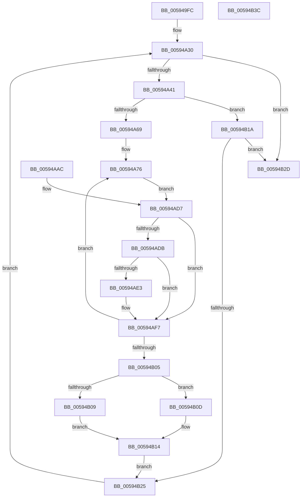

# IopDumpCallAddPagesCallbacks

- RVA: `0x005949FC`–`0x00594B3D` (길이 `321` bytes)
- VA: `0x00000001405949FC`
- 실행 섹션: `.text`
- PDB 이름 있음: `예`; PDB Function 태그: `아니요`
- unwind 정보 RVA: `0x000C70E0`
- 디코드: `81`개 명령, `321/321` bytes 표시
- 미해석 바이트: `0` (있으면 어셈블리에 `.byte`로 보존)

> 이 문서는 커널 이미지의 기계어와 PDB 기호를 분석해 생성했습니다. 4번과 5번은 함수 원형과 자료형을 바이너리 사용 방식에서 추정한 C 해석이며 원본 소스 복구 결과는 아닙니다.

## 1. Dependencies

- 직접 호출 지점: **4**; 고유 호출 대상: **4**
- 직접 호출자로 확인된 함수: **2**
- RIP 상대 이미지 참조: **1**

### Outgoing calls
- `0x00594A5C` → [KeValidateBugCheckCallbackRecord](../5B/KeValidateBugCheckCallbackRecord_function_005B39C0.md) (function, `0x005B39C0`)
- `0x00594AA5` → [guard_dispatch_icall](../6B/guard_dispatch_icall_function_006BAAD0.md) (function, `0x006BAAD0`)
- `0x00594AB3` → [IoSetBugCheckProgressFlag](IoSetBugCheckProgressFlag_function_005931C0.md) (function, `0x005931C0`)
- `0x00594AF0` → [IopAddPageDumpRange](IopAddPageDumpRange_function_005943AC.md) (function, `0x005943AC`)

### Direct callers
- [IoWriteCrashDump](IoWriteCrashDump_function_005936D8.md) at `0x00593BDD`
- [IopAddLiveDumpPagesToPartialKernelDump](../5A/IopAddLiveDumpPagesToPartialKernelDump_function_005A13AC.md) at `0x005A1643`

### Static image references
- `0x00594A1E` → RVA `0x00F23480` (`.data`; read)

## 2. Other-region calls and transfers

- 다른 실행 섹션으로 향하는 call: **0**
- 별도 외부 분기/꼬리 이동을 확인하지 못했습니다.

## 3. Assembly (complete function range)

```asm
005949FC  48 8B C4                        mov rax, rsp
005949FF  89 48 08                        mov dword ptr [rax + 8], ecx
00594A02  56                              push rsi
00594A03  57                              push rdi
00594A04  41 54                           push r12
00594A06  41 55                           push r13
00594A08  41 56                           push r14
00594A0A  41 57                           push r15
00594A0C  48 83 EC 68                     sub rsp, 0x68
00594A10  44 8B E1                        mov r12d, ecx
00594A13  0F 57 C0                        xorps xmm0, xmm0
00594A16  0F 11 40 A8                     movups xmmword ptr [rax - 0x58], xmm0
00594A1A  0F 11 40 B8                     movups xmmword ptr [rax - 0x48], xmm0
00594A1E  48 8B 3D 5B EA 98 00            mov rdi, qword ptr [rip + 0x98ea5b]
00594A25  4C 8D 3D 54 EA 98 00            lea r15, [rip + 0x98ea54]
00594A2C  4C 89 78 18                     mov qword ptr [rax + 0x18], r15
00594A30  48 89 BC 24 B8 00 00 00         mov qword ptr [rsp + 0xb8], rdi
00594A38  49 3B FF                        cmp rdi, r15
00594A3B  0F 84 EC 00 00 00               je 0x140594b2d
00594A41  4C 8B F7                        mov r14, rdi
00594A44  48 89 7C 24 30                  mov qword ptr [rsp + 0x30], rdi
00594A49  4C 8B EF                        mov r13, rdi
00594A4C  4C 8D 84 24 B0 00 00 00         lea r8, [rsp + 0xb0]
00594A54  BA 04 00 00 00                  mov edx, 4
00594A59  48 8B CF                        mov rcx, rdi
00594A5C  E8 5F EF 01 00                  call 0x1405b39c0
00594A61  84 C0                           test al, al
00594A63  0F 84 B1 00 00 00               je 0x140594b1a
00594A69  48 83 64 24 40 00               and qword ptr [rsp + 0x40], 0
00594A6F  44 89 64 24 4C                  mov dword ptr [rsp + 0x4c], r12d
00594A74  33 F6                           xor esi, esi
00594A76  48 83 64 24 50 00               and qword ptr [rsp + 0x50], 0
00594A7C  83 64 24 48 00                  and dword ptr [rsp + 0x48], 0
00594A81  48 83 64 24 58 00               and qword ptr [rsp + 0x58], 0
00594A87  C6 84 24 A8 00 00 00 00         mov byte ptr [rsp + 0xa8], 0
00594A8F  49 8B 46 10                     mov rax, qword ptr [r14 + 0x10]
00594A93  41 B9 20 00 00 00               mov r9d, 0x20
00594A99  4C 8D 44 24 40                  lea r8, [rsp + 0x40]
00594A9E  49 8B D6                        mov rdx, r14
00594AA1  41 8D 49 E4                     lea ecx, [r9 - 0x1c]
00594AA5  E8 26 60 12 00                  call 0x1406baad0
00594AAA  EB 2B                           jmp 0x140594ad7
00594AAC  8B F0                           mov esi, eax
00594AAE  B9 00 40 00 00                  mov ecx, 0x4000
00594AB3  E8 08 E7 FF FF                  call 0x1405931c0
00594AB8  4C 8D 3D C1 E9 98 00            lea r15, [rip + 0x98e9c1]
00594ABF  44 8B A4 24 A0 00 00 00         mov r12d, dword ptr [rsp + 0xa0]
00594AC7  48 8B BC 24 B8 00 00 00         mov rdi, qword ptr [rsp + 0xb8]
00594ACF  4C 8B 74 24 30                  mov r14, qword ptr [rsp + 0x30]
00594AD4  4D 8B EE                        mov r13, r14
00594AD7  85 F6                           test esi, esi
00594AD9  78 1C                           js 0x140594af7
00594ADB  48 83 7C 24 58 00               cmp qword ptr [rsp + 0x58], 0
00594AE1  74 14                           je 0x140594af7
00594AE3  48 8D 94 24 A8 00 00 00         lea rdx, [rsp + 0xa8]
00594AEB  48 8D 4C 24 40                  lea rcx, [rsp + 0x40]
00594AF0  E8 B7 F8 FF FF                  call 0x1405943ac
00594AF5  8B F0                           mov esi, eax
00594AF7  80 BC 24 A8 00 00 00 00         cmp byte ptr [rsp + 0xa8], 0
00594AFF  0F 85 71 FF FF FF               jne 0x140594a76
00594B05  85 F6                           test esi, esi
00594B07  78 04                           js 0x140594b0d
00594B09  B0 03                           mov al, 3
00594B0B  EB 07                           jmp 0x140594b14
00594B0D  41 C6 46 2D 03                  mov byte ptr [r14 + 0x2d], 3
00594B12  B0 04                           mov al, 4
00594B14  41 88 45 2C                     mov byte ptr [r13 + 0x2c], al
00594B18  EB 0B                           jmp 0x140594b25
00594B1A  48 83 BC 24 B0 00 00 00 00      cmp qword ptr [rsp + 0xb0], 0
00594B23  74 08                           je 0x140594b2d
00594B25  48 8B 3F                        mov rdi, qword ptr [rdi]
00594B28  E9 03 FF FF FF                  jmp 0x140594a30
00594B2D  48 83 C4 68                     add rsp, 0x68
00594B31  41 5F                           pop r15
00594B33  41 5E                           pop r14
00594B35  41 5D                           pop r13
00594B37  41 5C                           pop r12
00594B39  5F                              pop rdi
00594B3A  5E                              pop rsi
00594B3B  C3                              ret
00594B3C  CC                              int3
```

## 4. C-style interpretation (structured pseudocode)

```c
__int64 __fastcall IopDumpCallAddPagesCallbacks(int a1)
{
    __int64 result;
    __int64 v_rsi;
    __int64 v_rsp;
    unsigned __int64 v_stack_m40;
    unsigned __int64 v_stack_m48;
    unsigned int v_stack_m4C;
    unsigned int v_stack_m50;
    unsigned __int64 v_stack_m58;
    unsigned __int64 v_stack_m68;
    unsigned __int8 v_stack_p10;
    unsigned __int64 v_stack_p18;
    unsigned __int64 v_stack_p20;
    unsigned int v_stack_p8;

    *(unsigned int *)(v_rsp + 8) = a1;
    v_rsp = (v_rsp) - (104);
    *(unsigned __int64 *)(v_rsp - 88) = v_xmm0;
    *(unsigned __int64 *)(v_rsp - 72) = v_xmm0;
    *(unsigned __int64 *)(v_rsp + 24) = v_rip + 10021460;
loc_00594A30:
    v_stack_p20 = *(unsigned __int64 *)(v_rip + 10021467);
    if ((*(unsigned __int64 *)(v_rip + 10021467)) == (v_rip + 10021460)) goto loc_00594B2D;
    v_stack_m68 = *(unsigned __int64 *)(v_rip + 10021467);
    result = KeValidateBugCheckCallbackRecord(*(unsigned __int64 *)(v_rip + 10021467), 4, v_stack_p18, a4);
    if ((unsigned __int8)(result) == 0) goto loc_00594B1A;
    v_stack_m4C = (unsigned int)((unsigned int)(a1));
    v_rsi = 0;
loc_00594A76:
    v_stack_p10 = 0;
    result = guard_dispatch_icall(32 - 28, *(unsigned __int64 *)(v_rip + 10021467), v_stack_m58, 32);
    goto loc_00594AD7;
loc_00594AD7:
    if (sign_flag) goto loc_00594AF7;
    if (v_stack_m40 != 0) {
        a2 = v_stack_p10;
        a1 = v_stack_m58;
        result = IopAddPageDumpRange(a1, a2, v_stack_m58, 32);
        v_rsi = (unsigned int)(result);
    }
    if (v_stack_p10 != 0) goto loc_00594A76;
    if (sign_flag) goto loc_00594B0D;
    goto loc_00594B14;
loc_00594B0D:
    *(unsigned __int8 *)(*(unsigned __int64 *)(v_rip + 10021467) + 45) = 3;
loc_00594B14:
    *(unsigned __int8 *)(*(unsigned __int64 *)(v_rip + 10021467) + 44) = 4;
    goto loc_00594B25;
loc_00594B1A:
    if (v_stack_p18 == 0) goto loc_00594B2D;
loc_00594B25:
    goto loc_00594A30;
loc_00594B2D:
    v_rsp = (v_rsp) + (104);
    return 4;
}
```

## 5. (Beta) C Style

```c
int64_t IopDumpCallAddPagesCallbacks(int32_t Arg1)
{
    int64_t result;
    int64_t local_rsi;
    int64_t local_rsp;
    uint64_t v_stack_m40;
    uint64_t v_stack_m48;
    uint32_t v_stack_m4C;
    uint32_t v_stack_m50;
    uint64_t v_stack_m58;
    uint64_t v_stack_m68;
    uint8_t v_stack_p10;
    uint64_t v_stack_p18;
    uint64_t v_stack_p20;
    uint32_t v_stack_p8;

    *(uint32_t *)(local_rsp + 0x8) = Arg1;
    local_rsp = (local_rsp) - (104);
    *(uint64_t *)(local_rsp - 0x58) = v_xmm0;
    *(uint64_t *)(local_rsp - 0x48) = v_xmm0;
    *(uint64_t *)(local_rsp + 0x18) = v_rip + 10021460;
loc_00594A30:
    v_stack_p20 = *(uint64_t *)(v_rip + 0x98EA5B);
    if ((*(uint64_t *)(v_rip + 0x98EA5B)) == (v_rip + 10021460)) goto loc_00594B2D;
    v_stack_m68 = *(uint64_t *)(v_rip + 0x98EA5B);
    result = KeValidateBugCheckCallbackRecord(*(uint64_t *)(v_rip + 0x98EA5B), 4, v_stack_p18, a4);
    if ((uint8_t)(result) == 0) goto loc_00594B1A;
    v_stack_m4C = (uint32_t)((uint32_t)(Arg1));
    local_rsi = 0;
loc_00594A76:
    v_stack_p10 = 0;
    result = guard_dispatch_icall(32 - 28, *(uint64_t *)(v_rip + 0x98EA5B), v_stack_m58, 32);
    goto loc_00594AD7;
loc_00594AD7:
    if (sign_flag) goto loc_00594AF7;
    if (v_stack_m40 != 0) {
        a2 = v_stack_p10;
        Arg1 = v_stack_m58;
        result = IopAddPageDumpRange(Arg1, a2, v_stack_m58, 32);
        local_rsi = (uint32_t)(result);
    }
    if (v_stack_p10 != 0) goto loc_00594A76;
    if (sign_flag) goto loc_00594B0D;
    goto loc_00594B14;
loc_00594B0D:
    *(uint8_t *)(*(uint64_t *)(v_rip + 0x98EA5B) + 0x2D) = 3;
loc_00594B14:
    *(uint8_t *)(*(uint64_t *)(v_rip + 0x98EA5B) + 0x2C) = 4;
    goto loc_00594B25;
loc_00594B1A:
    if (v_stack_p18 == 0) goto loc_00594B2D;
loc_00594B25:
    goto loc_00594A30;
loc_00594B2D:
    local_rsp = (local_rsp) + (104);
    return 4;
}
```

## 6. Execution-region graph

[열기: 2D/3D 그래프와 함수 탐색 컨트롤 패널](../../../control-panel.html?section=text&rva=0x005949FC&view=graph)

- 2D 그래프는 위에서 아래로 흐르고, 3D 그래프는 빈 공간을 드래그해 회전합니다. Shift+드래그는 이동, 휠은 확대·축소, 함수 노드 선택은 대상 보고서 이동입니다.

### Static fallback


