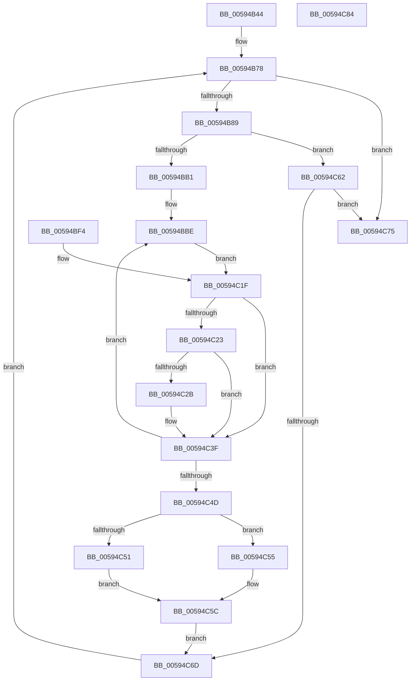

# IopDumpCallRemovePagesCallbacks

- RVA: `0x00594B44`–`0x00594C85` (길이 `321` bytes)
- VA: `0x0000000140594B44`
- 실행 섹션: `.text`
- PDB 이름 있음: `예`; PDB Function 태그: `아니요`
- unwind 정보 RVA: `0x000C70B0`
- 디코드: `81`개 명령, `321/321` bytes 표시
- 미해석 바이트: `0` (있으면 어셈블리에 `.byte`로 보존)

> 이 문서는 커널 이미지의 기계어와 PDB 기호를 분석해 생성했습니다. 4번과 5번은 함수 원형과 자료형을 바이너리 사용 방식에서 추정한 C 해석이며 원본 소스 복구 결과는 아닙니다.

## 1. Dependencies

- 직접 호출 지점: **4**; 고유 호출 대상: **4**
- 직접 호출자로 확인된 함수: **2**
- RIP 상대 이미지 참조: **1**

### Outgoing calls
- `0x00594BA4` → [KeValidateBugCheckCallbackRecord](../5B/KeValidateBugCheckCallbackRecord_function_005B39C0.md) (function, `0x005B39C0`)
- `0x00594BED` → [guard_dispatch_icall](../6B/guard_dispatch_icall_function_006BAAD0.md) (function, `0x006BAAD0`)
- `0x00594BFB` → [IoSetBugCheckProgressFlag](IoSetBugCheckProgressFlag_function_005931C0.md) (function, `0x005931C0`)
- `0x00594C38` → [IopRemovePageDumpRange](IopRemovePageDumpRange_function_00595EAC.md) (function, `0x00595EAC`)

### Direct callers
- [IoWriteCrashDump](IoWriteCrashDump_function_005936D8.md) at `0x00593C0A`
- [IoAddPagesForPartialKernelDump](../5A/IoAddPagesForPartialKernelDump_function_005A0F3C.md) at `0x005A0F79`

### Static image references
- `0x00594B66` → RVA `0x00F23480` (`.data`; read)

## 2. Other-region calls and transfers

- 다른 실행 섹션으로 향하는 call: **0**
- 별도 외부 분기/꼬리 이동을 확인하지 못했습니다.

## 3. Assembly (complete function range)

```asm
00594B44  48 8B C4                        mov rax, rsp
00594B47  89 48 08                        mov dword ptr [rax + 8], ecx
00594B4A  56                              push rsi
00594B4B  57                              push rdi
00594B4C  41 54                           push r12
00594B4E  41 55                           push r13
00594B50  41 56                           push r14
00594B52  41 57                           push r15
00594B54  48 83 EC 68                     sub rsp, 0x68
00594B58  44 8B E1                        mov r12d, ecx
00594B5B  0F 57 C0                        xorps xmm0, xmm0
00594B5E  0F 11 40 A8                     movups xmmword ptr [rax - 0x58], xmm0
00594B62  0F 11 40 B8                     movups xmmword ptr [rax - 0x48], xmm0
00594B66  48 8B 3D 13 E9 98 00            mov rdi, qword ptr [rip + 0x98e913]
00594B6D  4C 8D 3D 0C E9 98 00            lea r15, [rip + 0x98e90c]
00594B74  4C 89 78 18                     mov qword ptr [rax + 0x18], r15
00594B78  48 89 BC 24 B8 00 00 00         mov qword ptr [rsp + 0xb8], rdi
00594B80  49 3B FF                        cmp rdi, r15
00594B83  0F 84 EC 00 00 00               je 0x140594c75
00594B89  4C 8B F7                        mov r14, rdi
00594B8C  48 89 7C 24 30                  mov qword ptr [rsp + 0x30], rdi
00594B91  4C 8B EF                        mov r13, rdi
00594B94  4C 8D 84 24 B0 00 00 00         lea r8, [rsp + 0xb0]
00594B9C  BA 06 00 00 00                  mov edx, 6
00594BA1  48 8B CF                        mov rcx, rdi
00594BA4  E8 17 EE 01 00                  call 0x1405b39c0
00594BA9  84 C0                           test al, al
00594BAB  0F 84 B1 00 00 00               je 0x140594c62
00594BB1  48 83 64 24 40 00               and qword ptr [rsp + 0x40], 0
00594BB7  44 89 64 24 4C                  mov dword ptr [rsp + 0x4c], r12d
00594BBC  33 F6                           xor esi, esi
00594BBE  48 83 64 24 50 00               and qword ptr [rsp + 0x50], 0
00594BC4  83 64 24 48 00                  and dword ptr [rsp + 0x48], 0
00594BC9  48 83 64 24 58 00               and qword ptr [rsp + 0x58], 0
00594BCF  C6 84 24 A8 00 00 00 00         mov byte ptr [rsp + 0xa8], 0
00594BD7  49 8B 46 10                     mov rax, qword ptr [r14 + 0x10]
00594BDB  41 B9 20 00 00 00               mov r9d, 0x20
00594BE1  4C 8D 44 24 40                  lea r8, [rsp + 0x40]
00594BE6  49 8B D6                        mov rdx, r14
00594BE9  41 8D 49 E6                     lea ecx, [r9 - 0x1a]
00594BED  E8 DE 5E 12 00                  call 0x1406baad0
00594BF2  EB 2B                           jmp 0x140594c1f
00594BF4  8B F0                           mov esi, eax
00594BF6  B9 00 40 00 00                  mov ecx, 0x4000
00594BFB  E8 C0 E5 FF FF                  call 0x1405931c0
00594C00  4C 8D 3D 79 E8 98 00            lea r15, [rip + 0x98e879]
00594C07  44 8B A4 24 A0 00 00 00         mov r12d, dword ptr [rsp + 0xa0]
00594C0F  48 8B BC 24 B8 00 00 00         mov rdi, qword ptr [rsp + 0xb8]
00594C17  4C 8B 74 24 30                  mov r14, qword ptr [rsp + 0x30]
00594C1C  4D 8B EE                        mov r13, r14
00594C1F  85 F6                           test esi, esi
00594C21  78 1C                           js 0x140594c3f
00594C23  48 83 7C 24 58 00               cmp qword ptr [rsp + 0x58], 0
00594C29  74 14                           je 0x140594c3f
00594C2B  48 8D 94 24 A8 00 00 00         lea rdx, [rsp + 0xa8]
00594C33  48 8D 4C 24 40                  lea rcx, [rsp + 0x40]
00594C38  E8 6F 12 00 00                  call 0x140595eac
00594C3D  8B F0                           mov esi, eax
00594C3F  80 BC 24 A8 00 00 00 00         cmp byte ptr [rsp + 0xa8], 0
00594C47  0F 85 71 FF FF FF               jne 0x140594bbe
00594C4D  85 F6                           test esi, esi
00594C4F  78 04                           js 0x140594c55
00594C51  B0 03                           mov al, 3
00594C53  EB 07                           jmp 0x140594c5c
00594C55  41 C6 46 2D 04                  mov byte ptr [r14 + 0x2d], 4
00594C5A  B0 04                           mov al, 4
00594C5C  41 88 45 2C                     mov byte ptr [r13 + 0x2c], al
00594C60  EB 0B                           jmp 0x140594c6d
00594C62  48 83 BC 24 B0 00 00 00 00      cmp qword ptr [rsp + 0xb0], 0
00594C6B  74 08                           je 0x140594c75
00594C6D  48 8B 3F                        mov rdi, qword ptr [rdi]
00594C70  E9 03 FF FF FF                  jmp 0x140594b78
00594C75  48 83 C4 68                     add rsp, 0x68
00594C79  41 5F                           pop r15
00594C7B  41 5E                           pop r14
00594C7D  41 5D                           pop r13
00594C7F  41 5C                           pop r12
00594C81  5F                              pop rdi
00594C82  5E                              pop rsi
00594C83  C3                              ret
00594C84  CC                              int3
```

## 4. C-style interpretation (structured pseudocode)

```c
__int64 __fastcall IopDumpCallRemovePagesCallbacks(int a1)
{
    __int64 result;
    __int64 v_rsi;
    __int64 v_rsp;
    unsigned __int64 v_stack_m40;
    unsigned __int64 v_stack_m48;
    unsigned int v_stack_m4C;
    unsigned int v_stack_m50;
    unsigned __int64 v_stack_m58;
    unsigned __int64 v_stack_m68;
    unsigned __int8 v_stack_p10;
    unsigned __int64 v_stack_p18;
    unsigned __int64 v_stack_p20;
    unsigned int v_stack_p8;

    *(unsigned int *)(v_rsp + 8) = a1;
    v_rsp = (v_rsp) - (104);
    *(unsigned __int64 *)(v_rsp - 88) = v_xmm0;
    *(unsigned __int64 *)(v_rsp - 72) = v_xmm0;
    *(unsigned __int64 *)(v_rsp + 24) = v_rip + 10021132;
loc_00594B78:
    v_stack_p20 = *(unsigned __int64 *)(v_rip + 10021139);
    if ((*(unsigned __int64 *)(v_rip + 10021139)) == (v_rip + 10021132)) goto loc_00594C75;
    v_stack_m68 = *(unsigned __int64 *)(v_rip + 10021139);
    result = KeValidateBugCheckCallbackRecord(*(unsigned __int64 *)(v_rip + 10021139), 6, v_stack_p18, a4);
    if ((unsigned __int8)(result) == 0) goto loc_00594C62;
    v_stack_m4C = (unsigned int)((unsigned int)(a1));
    v_rsi = 0;
loc_00594BBE:
    v_stack_p10 = 0;
    result = guard_dispatch_icall(32 - 26, *(unsigned __int64 *)(v_rip + 10021139), v_stack_m58, 32);
    goto loc_00594C1F;
loc_00594C1F:
    if (sign_flag) goto loc_00594C3F;
    if (v_stack_m40 != 0) {
        a2 = v_stack_p10;
        a1 = v_stack_m58;
        result = IopRemovePageDumpRange(a1, a2, v_stack_m58, 32);
        v_rsi = (unsigned int)(result);
    }
    if (v_stack_p10 != 0) goto loc_00594BBE;
    if (sign_flag) goto loc_00594C55;
    goto loc_00594C5C;
loc_00594C55:
    *(unsigned __int8 *)(*(unsigned __int64 *)(v_rip + 10021139) + 45) = 4;
loc_00594C5C:
    *(unsigned __int8 *)(*(unsigned __int64 *)(v_rip + 10021139) + 44) = 4;
    goto loc_00594C6D;
loc_00594C62:
    if (v_stack_p18 == 0) goto loc_00594C75;
loc_00594C6D:
    goto loc_00594B78;
loc_00594C75:
    v_rsp = (v_rsp) + (104);
    return 4;
}
```

## 5. (Beta) C Style

```c
int64_t IopDumpCallRemovePagesCallbacks(int32_t Arg1)
{
    int64_t result;
    int64_t local_rsi;
    int64_t local_rsp;
    uint64_t v_stack_m40;
    uint64_t v_stack_m48;
    uint32_t v_stack_m4C;
    uint32_t v_stack_m50;
    uint64_t v_stack_m58;
    uint64_t v_stack_m68;
    uint8_t v_stack_p10;
    uint64_t v_stack_p18;
    uint64_t v_stack_p20;
    uint32_t v_stack_p8;

    *(uint32_t *)(local_rsp + 0x8) = Arg1;
    local_rsp = (local_rsp) - (104);
    *(uint64_t *)(local_rsp - 0x58) = v_xmm0;
    *(uint64_t *)(local_rsp - 0x48) = v_xmm0;
    *(uint64_t *)(local_rsp + 0x18) = v_rip + 10021132;
loc_00594B78:
    v_stack_p20 = *(uint64_t *)(v_rip + 0x98E913);
    if ((*(uint64_t *)(v_rip + 0x98E913)) == (v_rip + 10021132)) goto loc_00594C75;
    v_stack_m68 = *(uint64_t *)(v_rip + 0x98E913);
    result = KeValidateBugCheckCallbackRecord(*(uint64_t *)(v_rip + 0x98E913), 6, v_stack_p18, a4);
    if ((uint8_t)(result) == 0) goto loc_00594C62;
    v_stack_m4C = (uint32_t)((uint32_t)(Arg1));
    local_rsi = 0;
loc_00594BBE:
    v_stack_p10 = 0;
    result = guard_dispatch_icall(32 - 26, *(uint64_t *)(v_rip + 0x98E913), v_stack_m58, 32);
    goto loc_00594C1F;
loc_00594C1F:
    if (sign_flag) goto loc_00594C3F;
    if (v_stack_m40 != 0) {
        a2 = v_stack_p10;
        Arg1 = v_stack_m58;
        result = IopRemovePageDumpRange(Arg1, a2, v_stack_m58, 32);
        local_rsi = (uint32_t)(result);
    }
    if (v_stack_p10 != 0) goto loc_00594BBE;
    if (sign_flag) goto loc_00594C55;
    goto loc_00594C5C;
loc_00594C55:
    *(uint8_t *)(*(uint64_t *)(v_rip + 0x98E913) + 0x2D) = 4;
loc_00594C5C:
    *(uint8_t *)(*(uint64_t *)(v_rip + 0x98E913) + 0x2C) = 4;
    goto loc_00594C6D;
loc_00594C62:
    if (v_stack_p18 == 0) goto loc_00594C75;
loc_00594C6D:
    goto loc_00594B78;
loc_00594C75:
    local_rsp = (local_rsp) + (104);
    return 4;
}
```

## 6. Execution-region graph

[열기: 2D/3D 그래프와 함수 탐색 컨트롤 패널](../../../control-panel.html?section=text&rva=0x00594B44&view=graph)

- 2D 그래프는 위에서 아래로 흐르고, 3D 그래프는 빈 공간을 드래그해 회전합니다. Shift+드래그는 이동, 휠은 확대·축소, 함수 노드 선택은 대상 보고서 이동입니다.

### Static fallback


