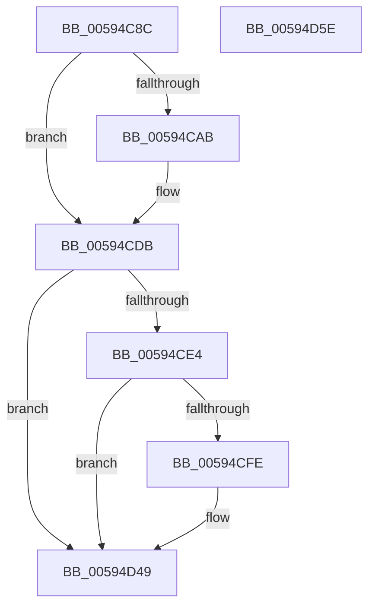

# IopDumpTraceCrashDumpDisabled

- RVA: `0x00594C8C`–`0x00594D5F` (길이 `211` bytes)
- VA: `0x0000000140594C8C`
- 실행 섹션: `.text`
- PDB 이름 있음: `예`; PDB Function 태그: `아니요`
- unwind 정보 RVA: `0x000C6F20`
- 디코드: `42`개 명령, `211/211` bytes 표시
- 미해석 바이트: `0` (있으면 어셈블리에 `.byte`로 보존)

> 이 문서는 커널 이미지의 기계어와 PDB 기호를 분석해 생성했습니다. 4번과 5번은 함수 원형과 자료형을 바이너리 사용 방식에서 추정한 C 해석이며 원본 소스 복구 결과는 아닙니다.

## 1. Dependencies

- 직접 호출 지점: **5**; 고유 호출 대상: **5**
- 직접 호출자로 확인된 함수: **1**
- RIP 상대 이미지 참조: **5**

### Outgoing calls
- `0x00594CA2` → [IopDumpIsTracingEnabled](../4F/IopDumpIsTracingEnabled_function_004FC5D0.md) (function, `0x004FC5D0`)
- `0x00594CD6` → [EtwWriteEx](../25/EtwWriteEx_function_0025F0D0.md) (function, `0x0025F0D0`)
- `0x00594CF5` → [tlgKeywordOn](../42/tlgKeywordOn_function_0042EAA0.md) (function, `0x0042EAA0`)
- `0x00594D44` → [tlgWriteTransfer_EtwWriteTransfer](../42/tlgWriteTransfer_EtwWriteTransfer_function_004260E0.md) (function, `0x004260E0`)
- `0x00594D51` → [_security_check_cookie](../6A/_security_check_cookie_function_006AC640.md) (function, `0x006AC640`)

### Direct callers
- [IopDisableCrashDump](IopDisableCrashDump_function_005949A0.md) at `0x005949E8`

### Static image references
- `0x00594C93` → RVA `0x00E0A740` (`.data`; read)
- `0x00594CB1` → RVA `0x00021D78` (`.rdata`; read)
- `0x00594CCF` → RVA `0x00E65EF0` (`.data`; read)
- `0x00594CDB` → RVA `0x00E06DE8` (`.data`; read)
- `0x00594D0D` → RVA `0x00045B71` (`.rdata`; read)

## 2. Other-region calls and transfers

- 다른 실행 섹션으로 향하는 call: **0**
- 별도 외부 분기/꼬리 이동을 확인하지 못했습니다.

## 3. Assembly (complete function range)

```asm
00594C8C  48 81 EC 88 00 00 00            sub rsp, 0x88
00594C93  48 8B 05 A6 5A 87 00            mov rax, qword ptr [rip + 0x875aa6]
00594C9A  48 33 C4                        xor rax, rsp
00594C9D  48 89 44 24 78                  mov qword ptr [rsp + 0x78], rax
00594CA2  E8 29 79 F6 FF                  call 0x1404fc5d0
00594CA7  84 C0                           test al, al
00594CA9  74 30                           je 0x140594cdb
00594CAB  48 83 64 24 38 00               and qword ptr [rsp + 0x38], 0
00594CB1  48 8D 15 C0 D0 A8 FF            lea rdx, [rip - 0x572f40]
00594CB8  83 64 24 30 00                  and dword ptr [rsp + 0x30], 0
00594CBD  45 33 C9                        xor r9d, r9d
00594CC0  48 83 64 24 28 00               and qword ptr [rsp + 0x28], 0
00594CC6  45 33 C0                        xor r8d, r8d
00594CC9  48 83 64 24 20 00               and qword ptr [rsp + 0x20], 0
00594CCF  48 8B 0D 1A 12 8D 00            mov rcx, qword ptr [rip + 0x8d121a]
00594CD6  E8 F5 A3 CC FF                  call 0x14025f0d0
00594CDB  83 3D 06 21 87 00 05            cmp dword ptr [rip + 0x872106], 5
00594CE2  76 65                           jbe 0x140594d49
00594CE4  48 BA 00 00 00 00 00 40 00 00   movabs rdx, 0x400000000000
00594CEE  48 8D 0D F3 20 87 00            lea rcx, [rip + 0x8720f3]
00594CF5  E8 A6 9D E9 FF                  call 0x14042eaa0
00594CFA  84 C0                           test al, al
00594CFC  74 4B                           je 0x140594d49
00594CFE  83 64 24 74 00                  and dword ptr [rsp + 0x74], 0
00594D03  48 8D 44 24 40                  lea rax, [rsp + 0x40]
00594D08  48 89 44 24 68                  mov qword ptr [rsp + 0x68], rax
00594D0D  48 8D 15 5D 0E AB FF            lea rdx, [rip - 0x54f1a3]
00594D14  48 8D 44 24 48                  lea rax, [rsp + 0x48]
00594D19  48 C7 44 24 40 00 00 00 01      mov qword ptr [rsp + 0x40], 0x1000000
00594D22  48 89 44 24 28                  mov qword ptr [rsp + 0x28], rax
00594D27  48 8D 0D BA 20 87 00            lea rcx, [rip + 0x8720ba]
00594D2E  45 33 C9                        xor r9d, r9d
00594D31  C7 44 24 20 03 00 00 00         mov dword ptr [rsp + 0x20], 3
00594D39  45 33 C0                        xor r8d, r8d
00594D3C  C7 44 24 70 08 00 00 00         mov dword ptr [rsp + 0x70], 8
00594D44  E8 97 13 E9 FF                  call 0x1404260e0
00594D49  48 8B 4C 24 78                  mov rcx, qword ptr [rsp + 0x78]
00594D4E  48 33 CC                        xor rcx, rsp
00594D51  E8 EA 78 11 00                  call 0x1406ac640
00594D56  48 81 C4 88 00 00 00            add rsp, 0x88
00594D5D  C3                              ret
00594D5E  CC                              int3
```

## 4. C-style interpretation (structured pseudocode)

```c
__int64 __fastcall IopDumpTraceCrashDumpDisabled(__int64 a1, __int64 a2, int a3, int a4)
{
    __int64 result;
    __int64 v_rsp;
    unsigned __int64 v_stack_m10;
    unsigned int v_stack_m14;
    unsigned int v_stack_m18;
    unsigned __int64 v_stack_m20;
    unsigned __int64 v_stack_m40;
    unsigned __int64 v_stack_m48;
    unsigned __int64 v_stack_m50;
    unsigned int v_stack_m58;
    unsigned __int64 v_stack_m60;
    unsigned __int64 v_stack_m68;

    v_rsp = (v_rsp) - (136);
    result = (*(unsigned __int64 *)(v_rip + 8870566)) ^ (v_rsp);
    v_stack_m10 = result;
    result = IopDumpIsTracingEnabled(a1, a2, a3, a4);
    if ((unsigned __int8)(result) != 0) {
        a2 = v_rip - 5713728;
        a4 = 0;
        a3 = 0;
        a1 = *(unsigned __int64 *)(v_rip + 9245210);
        result = EtwWriteEx(a1, a2, a3, a4);
    }
    if ((*(unsigned int *)(v_rip + 8855814)) <= 5) goto loc_00594D49;
    result = tlgKeywordOn(v_rip + 8855795, a2, a3, a4);
    if ((unsigned __int8)(result) != 0) {
        result = v_stack_m48;
        v_stack_m20 = result;
        a2 = v_rip - 5566883;
        result = v_stack_m40;
        v_stack_m48 = 0x1000000ULL;
        v_stack_m60 = result;
        a1 = v_rip + 8855738;
        a4 = 0;
        v_stack_m68 = 3;
        a3 = 0;
        v_stack_m18 = 8;
        result = tlgWriteTransfer_EtwWriteTransfer(a1, a2, a3, a4);
    }
    a1 = (v_stack_m10) ^ (v_rsp);
    result = _security_check_cookie(a1, a2, a3, a4);
    v_rsp = (v_rsp) + (136);
    return result;
}
```

## 5. (Beta) C Style

```c
int64_t IopDumpTraceCrashDumpDisabled(int64_t Arg1, int64_t Arg2, int32_t Arg3, int32_t Arg4)
{
    int64_t result;
    int64_t local_rsp;
    uint64_t v_stack_m10;
    uint32_t v_stack_m14;
    uint32_t v_stack_m18;
    uint64_t v_stack_m20;
    uint64_t v_stack_m40;
    uint64_t v_stack_m48;
    uint64_t v_stack_m50;
    uint32_t v_stack_m58;
    uint64_t v_stack_m60;
    uint64_t v_stack_m68;

    local_rsp = (local_rsp) - (136);
    result = (*(uint64_t *)(v_rip + 0x875AA6)) ^ (local_rsp);
    v_stack_m10 = result;
    result = IopDumpIsTracingEnabled(Arg1, Arg2, Arg3, Arg4);
    if ((uint8_t)(result) != 0) {
        Arg2 = v_rip - 5713728;
        Arg4 = 0;
        Arg3 = 0;
        Arg1 = *(uint64_t *)(v_rip + 0x8D121A);
        result = EtwWriteEx(Arg1, Arg2, Arg3, Arg4);
    }
    if ((*(uint32_t *)(v_rip + 0x872106)) <= 5) goto loc_00594D49;
    result = tlgKeywordOn(v_rip + 8855795, Arg2, Arg3, Arg4);
    if ((uint8_t)(result) != 0) {
        result = v_stack_m48;
        v_stack_m20 = result;
        Arg2 = v_rip - 5566883;
        result = v_stack_m40;
        v_stack_m48 = 0x1000000ULL;
        v_stack_m60 = result;
        Arg1 = v_rip + 8855738;
        Arg4 = 0;
        v_stack_m68 = 3;
        Arg3 = 0;
        v_stack_m18 = 8;
        result = tlgWriteTransfer_EtwWriteTransfer(Arg1, Arg2, Arg3, Arg4);
    }
    Arg1 = (v_stack_m10) ^ (local_rsp);
    result = _security_check_cookie(Arg1, Arg2, Arg3, Arg4);
    local_rsp = (local_rsp) + (136);
    return result;
}
```

## 6. Execution-region graph

[열기: 2D/3D 그래프와 함수 탐색 컨트롤 패널](../../../control-panel.html?section=text&rva=0x00594C8C&view=graph)

- 2D 그래프는 위에서 아래로 흐르고, 3D 그래프는 빈 공간을 드래그해 회전합니다. Shift+드래그는 이동, 휠은 확대·축소, 함수 노드 선택은 대상 보고서 이동입니다.

### Static fallback


