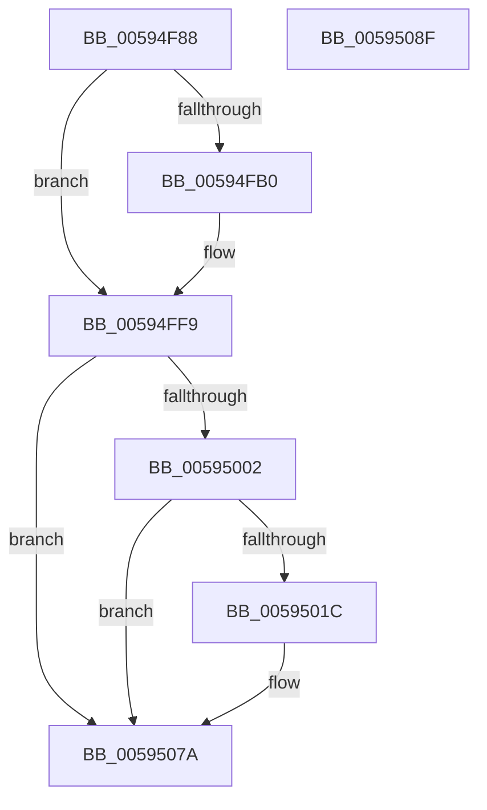

# IopDumpTraceFreeDumpStackFailure

- RVA: `0x00594F88`–`0x00595090` (길이 `264` bytes)
- VA: `0x0000000140594F88`
- 실행 섹션: `.text`
- PDB 이름 있음: `예`; PDB Function 태그: `아니요`
- unwind 정보 RVA: `0x000BF3A4`
- 디코드: `57`개 명령, `264/264` bytes 표시
- 미해석 바이트: `0` (있으면 어셈블리에 `.byte`로 보존)

> 이 문서는 커널 이미지의 기계어와 PDB 기호를 분석해 생성했습니다. 4번과 5번은 함수 원형과 자료형을 바이너리 사용 방식에서 추정한 C 해석이며 원본 소스 복구 결과는 아닙니다.

## 1. Dependencies

- 직접 호출 지점: **5**; 고유 호출 대상: **5**
- 직접 호출자로 확인된 함수: **1**
- RIP 상대 이미지 참조: **5**

### Outgoing calls
- `0x00594FA7` → [IopDumpIsTracingEnabled](../4F/IopDumpIsTracingEnabled_function_004FC5D0.md) (function, `0x004FC5D0`)
- `0x00594FF4` → [EtwWriteEx](../25/EtwWriteEx_function_0025F0D0.md) (function, `0x0025F0D0`)
- `0x00595013` → [tlgKeywordOn](../42/tlgKeywordOn_function_0042EAA0.md) (function, `0x0042EAA0`)
- `0x00595075` → [tlgWriteTransfer_EtwWriteTransfer](../42/tlgWriteTransfer_EtwWriteTransfer_function_004260E0.md) (function, `0x004260E0`)
- `0x00595081` → [_security_check_cookie](../6A/_security_check_cookie_function_006AC640.md) (function, `0x006AC640`)

### Direct callers
- [PopFreeHiberContext](../../page/70/PopFreeHiberContext_function_00704F1C.md) at `0x0070503C`

### Static image references
- `0x00594F99` → RVA `0x00E0A740` (`.data`; read)
- `0x00594FB8` → RVA `0x00E65EF0` (`.data`; read)
- `0x00594FBF` → RVA `0x00021F38` (`.rdata`; read)
- `0x00594FF9` → RVA `0x00E06DE8` (`.data`; read)
- `0x00595028` → RVA `0x00045CB9` (`.rdata`; read)

## 2. Other-region calls and transfers

- 다른 실행 섹션으로 향하는 call: **0**
- 별도 외부 분기/꼬리 이동을 확인하지 못했습니다.

## 3. Assembly (complete function range)

```asm
00594F88  89 4C 24 08                     mov dword ptr [rsp + 8], ecx
00594F8C  55                              push rbp
00594F8D  48 8D 6C 24 A9                  lea rbp, [rsp - 0x57]
00594F92  48 81 EC B0 00 00 00            sub rsp, 0xb0
00594F99  48 8B 05 A0 57 87 00            mov rax, qword ptr [rip + 0x8757a0]
00594FA0  48 33 C4                        xor rax, rsp
00594FA3  48 89 45 47                     mov qword ptr [rbp + 0x47], rax
00594FA7  E8 24 76 F6 FF                  call 0x1404fc5d0
00594FAC  84 C0                           test al, al
00594FAE  74 49                           je 0x140594ff9
00594FB0  83 65 03 00                     and dword ptr [rbp + 3], 0
00594FB4  48 8D 45 67                     lea rax, [rbp + 0x67]
00594FB8  48 8B 0D 31 0F 8D 00            mov rcx, qword ptr [rip + 0x8d0f31]
00594FBF  48 8D 15 72 CF A8 FF            lea rdx, [rip - 0x57308e]
00594FC6  48 89 45 F7                     mov qword ptr [rbp - 9], rax
00594FCA  45 33 C9                        xor r9d, r9d
00594FCD  48 8D 45 F7                     lea rax, [rbp - 9]
00594FD1  C7 45 FF 04 00 00 00            mov dword ptr [rbp - 1], 4
00594FD8  48 89 44 24 38                  mov qword ptr [rsp + 0x38], rax
00594FDD  45 33 C0                        xor r8d, r8d
00594FE0  C7 44 24 30 01 00 00 00         mov dword ptr [rsp + 0x30], 1
00594FE8  48 83 64 24 28 00               and qword ptr [rsp + 0x28], 0
00594FEE  48 83 64 24 20 00               and qword ptr [rsp + 0x20], 0
00594FF4  E8 D7 A0 CC FF                  call 0x14025f0d0
00594FF9  83 3D E8 1D 87 00 05            cmp dword ptr [rip + 0x871de8], 5
00595000  76 78                           jbe 0x14059507a
00595002  48 BA 00 00 00 00 00 40 00 00   movabs rdx, 0x400000000000
0059500C  48 8D 0D D5 1D 87 00            lea rcx, [rip + 0x871dd5]
00595013  E8 88 9A E9 FF                  call 0x14042eaa0
00595018  84 C0                           test al, al
0059501A  74 5E                           je 0x14059507a
0059501C  83 65 33 00                     and dword ptr [rbp + 0x33], 0
00595020  48 8D 45 EF                     lea rax, [rbp - 0x11]
00595024  83 65 43 00                     and dword ptr [rbp + 0x43], 0
00595028  48 8D 15 8A 0C AB FF            lea rdx, [rip - 0x54f376]
0059502F  48 89 45 27                     mov qword ptr [rbp + 0x27], rax
00595033  48 8D 0D AE 1D 87 00            lea rcx, [rip + 0x871dae]
0059503A  8B 45 67                        mov eax, dword ptr [rbp + 0x67]
0059503D  45 33 C9                        xor r9d, r9d
00595040  89 45 E7                        mov dword ptr [rbp - 0x19], eax
00595043  45 33 C0                        xor r8d, r8d
00595046  48 8D 45 E7                     lea rax, [rbp - 0x19]
0059504A  48 C7 45 EF 00 00 00 01         mov qword ptr [rbp - 0x11], 0x1000000
00595052  48 89 45 37                     mov qword ptr [rbp + 0x37], rax
00595056  48 8D 45 07                     lea rax, [rbp + 7]
0059505A  48 89 44 24 28                  mov qword ptr [rsp + 0x28], rax
0059505F  C7 44 24 20 04 00 00 00         mov dword ptr [rsp + 0x20], 4
00595067  C7 45 2F 08 00 00 00            mov dword ptr [rbp + 0x2f], 8
0059506E  C7 45 3F 04 00 00 00            mov dword ptr [rbp + 0x3f], 4
00595075  E8 66 10 E9 FF                  call 0x1404260e0
0059507A  48 8B 4D 47                     mov rcx, qword ptr [rbp + 0x47]
0059507E  48 33 CC                        xor rcx, rsp
00595081  E8 BA 75 11 00                  call 0x1406ac640
00595086  48 81 C4 B0 00 00 00            add rsp, 0xb0
0059508D  5D                              pop rbp
0059508E  C3                              ret
0059508F  CC                              int3
```

## 4. C-style interpretation (structured pseudocode)

```c
__int64 __fastcall IopDumpTraceFreeDumpStackFailure(int a1, __int64 a2, int a3, int a4)
{
    __int64 result;
    __int64 v_rsp;
    unsigned __int64 v_stack_m18;
    unsigned int v_stack_m1C;
    unsigned int v_stack_m20;
    unsigned __int64 v_stack_m28;
    unsigned int v_stack_m2C;
    unsigned int v_stack_m30;
    unsigned __int64 v_stack_m38;
    unsigned __int64 v_stack_m58;
    unsigned int v_stack_m5C;
    unsigned __int64 v_stack_m5F;
    unsigned int v_stack_m60;
    unsigned __int64 v_stack_m68;
    unsigned __int64 v_stack_m70;
    unsigned int v_stack_m78;
    unsigned __int64 v_stack_m80;
    unsigned int v_stack_m88;
    unsigned __int64 v_stack_m90;
    unsigned __int64 v_stack_m98;
    unsigned int v_stack_p8;

    v_stack_p8 = a1;
    v_rsp = (v_rsp) - (176);
    result = (*(unsigned __int64 *)(v_rip + 8869792)) ^ (v_rsp);
    v_stack_m18 = result;
    result = IopDumpIsTracingEnabled(a1, a2, a3, a4);
    if ((unsigned __int8)(result) != 0) {
        result = v_stack_p8;
        a1 = *(unsigned __int64 *)(v_rip + 9244465);
        a2 = v_rip - 5714062;
        v_stack_m68 = result;
        a4 = 0;
        result = v_stack_m68;
        v_stack_m60 = 4;
        v_stack_m80 = result;
        a3 = 0;
        v_stack_m88 = 1;
        result = EtwWriteEx(a1, a2, a3, a4);
    }
    if ((*(unsigned int *)(v_rip + 8855016)) <= 5) goto loc_0059507A;
    result = tlgKeywordOn(v_rip + 8854997, a2, a3, a4);
    if ((unsigned __int8)(result) != 0) {
        result = v_stack_m70;
        a2 = v_rip - 5567350;
        v_stack_m38 = result;
        a1 = v_rip + 8854958;
        result = v_stack_p8;
        a4 = 0;
        v_stack_m78 = (unsigned int)(result);
        a3 = 0;
        result = v_stack_m78;
        v_stack_m70 = 0x1000000ULL;
        v_stack_m28 = result;
        result = v_stack_m58;
        v_stack_m90 = result;
        v_stack_m98 = 4;
        v_stack_m30 = 8;
        v_stack_m20 = 4;
        result = tlgWriteTransfer_EtwWriteTransfer(a1, a2, a3, a4);
    }
    a1 = (v_stack_m18) ^ (v_rsp);
    result = _security_check_cookie(a1, a2, a3, a4);
    v_rsp = (v_rsp) + (176);
    return result;
}
```

## 5. (Beta) C Style

```c
int64_t IopDumpTraceFreeDumpStackFailure(int32_t Arg1, int64_t Arg2, int32_t Arg3, int32_t Arg4)
{
    int64_t result;
    int64_t local_rsp;
    uint64_t v_stack_m18;
    uint32_t v_stack_m1C;
    uint32_t v_stack_m20;
    uint64_t v_stack_m28;
    uint32_t v_stack_m2C;
    uint32_t v_stack_m30;
    uint64_t v_stack_m38;
    uint64_t v_stack_m58;
    uint32_t v_stack_m5C;
    uint64_t v_stack_m5F;
    uint32_t v_stack_m60;
    uint64_t v_stack_m68;
    uint64_t v_stack_m70;
    uint32_t v_stack_m78;
    uint64_t v_stack_m80;
    uint32_t v_stack_m88;
    uint64_t v_stack_m90;
    uint64_t v_stack_m98;
    uint32_t v_stack_p8;

    v_stack_p8 = Arg1;
    local_rsp = (local_rsp) - (176);
    result = (*(uint64_t *)(v_rip + 0x8757A0)) ^ (local_rsp);
    v_stack_m18 = result;
    result = IopDumpIsTracingEnabled(Arg1, Arg2, Arg3, Arg4);
    if ((uint8_t)(result) != 0) {
        result = v_stack_p8;
        Arg1 = *(uint64_t *)(v_rip + 0x8D0F31);
        Arg2 = v_rip - 5714062;
        v_stack_m68 = result;
        Arg4 = 0;
        result = v_stack_m68;
        v_stack_m60 = 4;
        v_stack_m80 = result;
        Arg3 = 0;
        v_stack_m88 = 1;
        result = EtwWriteEx(Arg1, Arg2, Arg3, Arg4);
    }
    if ((*(uint32_t *)(v_rip + 0x871DE8)) <= 5) goto loc_0059507A;
    result = tlgKeywordOn(v_rip + 8854997, Arg2, Arg3, Arg4);
    if ((uint8_t)(result) != 0) {
        result = v_stack_m70;
        Arg2 = v_rip - 5567350;
        v_stack_m38 = result;
        Arg1 = v_rip + 8854958;
        result = v_stack_p8;
        Arg4 = 0;
        v_stack_m78 = (uint32_t)(result);
        Arg3 = 0;
        result = v_stack_m78;
        v_stack_m70 = 0x1000000ULL;
        v_stack_m28 = result;
        result = v_stack_m58;
        v_stack_m90 = result;
        v_stack_m98 = 4;
        v_stack_m30 = 8;
        v_stack_m20 = 4;
        result = tlgWriteTransfer_EtwWriteTransfer(Arg1, Arg2, Arg3, Arg4);
    }
    Arg1 = (v_stack_m18) ^ (local_rsp);
    result = _security_check_cookie(Arg1, Arg2, Arg3, Arg4);
    local_rsp = (local_rsp) + (176);
    return result;
}
```

## 6. Execution-region graph

[열기: 2D/3D 그래프와 함수 탐색 컨트롤 패널](../../../control-panel.html?section=text&rva=0x00594F88&view=graph)

- 2D 그래프는 위에서 아래로 흐르고, 3D 그래프는 빈 공간을 드래그해 회전합니다. Shift+드래그는 이동, 휠은 확대·축소, 함수 노드 선택은 대상 보고서 이동입니다.

### Static fallback


