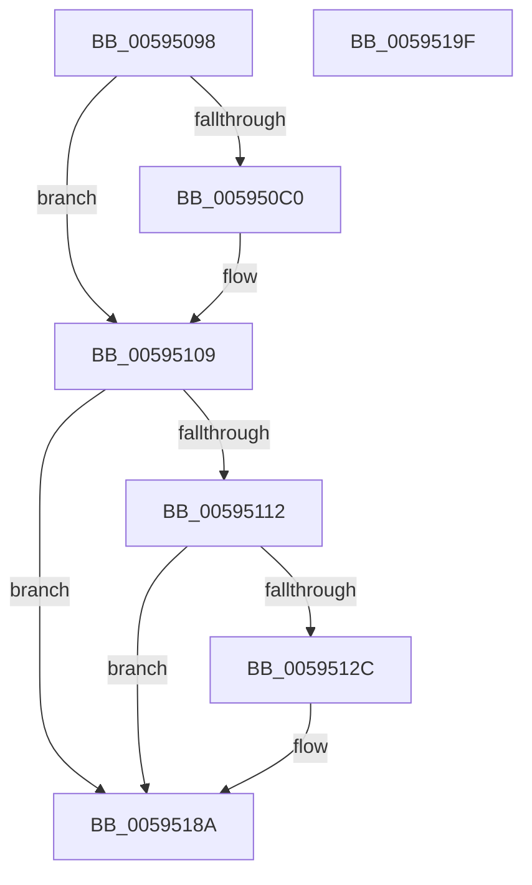

# IopDumpTraceInitializeCrashDumpFailure

- RVA: `0x00595098`–`0x005951A0` (길이 `264` bytes)
- VA: `0x0000000140595098`
- 실행 섹션: `.text`
- PDB 이름 있음: `예`; PDB Function 태그: `아니요`
- unwind 정보 RVA: `0x000BF3A4`
- 디코드: `57`개 명령, `264/264` bytes 표시
- 미해석 바이트: `0` (있으면 어셈블리에 `.byte`로 보존)

> 이 문서는 커널 이미지의 기계어와 PDB 기호를 분석해 생성했습니다. 4번과 5번은 함수 원형과 자료형을 바이너리 사용 방식에서 추정한 C 해석이며 원본 소스 복구 결과는 아닙니다.

## 1. Dependencies

- 직접 호출 지점: **5**; 고유 호출 대상: **5**
- 직접 호출자로 확인된 함수: **1**
- RIP 상대 이미지 참조: **5**

### Outgoing calls
- `0x005950B7` → [IopDumpIsTracingEnabled](../4F/IopDumpIsTracingEnabled_function_004FC5D0.md) (function, `0x004FC5D0`)
- `0x00595104` → [EtwWriteEx](../25/EtwWriteEx_function_0025F0D0.md) (function, `0x0025F0D0`)
- `0x00595123` → [tlgKeywordOn](../42/tlgKeywordOn_function_0042EAA0.md) (function, `0x0042EAA0`)
- `0x00595185` → [tlgWriteTransfer_EtwWriteTransfer](../42/tlgWriteTransfer_EtwWriteTransfer_function_004260E0.md) (function, `0x004260E0`)
- `0x00595191` → [_security_check_cookie](../6A/_security_check_cookie_function_006AC640.md) (function, `0x006AC640`)

### Direct callers
- [IopInitializeCrashDump](../../page/71/IopInitializeCrashDump_function_0071A270.md) at `0x0071A39E`

### Static image references
- `0x005950A9` → RVA `0x00E0A740` (`.data`; read)
- `0x005950C8` → RVA `0x00E65EF0` (`.data`; read)
- `0x005950CF` → RVA `0x00022098` (`.rdata`; read)
- `0x00595109` → RVA `0x00E06DE8` (`.data`; read)
- `0x00595138` → RVA `0x00045BE3` (`.rdata`; read)

## 2. Other-region calls and transfers

- 다른 실행 섹션으로 향하는 call: **0**
- 별도 외부 분기/꼬리 이동을 확인하지 못했습니다.

## 3. Assembly (complete function range)

```asm
00595098  89 4C 24 08                     mov dword ptr [rsp + 8], ecx
0059509C  55                              push rbp
0059509D  48 8D 6C 24 A9                  lea rbp, [rsp - 0x57]
005950A2  48 81 EC B0 00 00 00            sub rsp, 0xb0
005950A9  48 8B 05 90 56 87 00            mov rax, qword ptr [rip + 0x875690]
005950B0  48 33 C4                        xor rax, rsp
005950B3  48 89 45 47                     mov qword ptr [rbp + 0x47], rax
005950B7  E8 14 75 F6 FF                  call 0x1404fc5d0
005950BC  84 C0                           test al, al
005950BE  74 49                           je 0x140595109
005950C0  83 65 03 00                     and dword ptr [rbp + 3], 0
005950C4  48 8D 45 67                     lea rax, [rbp + 0x67]
005950C8  48 8B 0D 21 0E 8D 00            mov rcx, qword ptr [rip + 0x8d0e21]
005950CF  48 8D 15 C2 CF A8 FF            lea rdx, [rip - 0x57303e]
005950D6  48 89 45 F7                     mov qword ptr [rbp - 9], rax
005950DA  45 33 C9                        xor r9d, r9d
005950DD  48 8D 45 F7                     lea rax, [rbp - 9]
005950E1  C7 45 FF 04 00 00 00            mov dword ptr [rbp - 1], 4
005950E8  48 89 44 24 38                  mov qword ptr [rsp + 0x38], rax
005950ED  45 33 C0                        xor r8d, r8d
005950F0  C7 44 24 30 01 00 00 00         mov dword ptr [rsp + 0x30], 1
005950F8  48 83 64 24 28 00               and qword ptr [rsp + 0x28], 0
005950FE  48 83 64 24 20 00               and qword ptr [rsp + 0x20], 0
00595104  E8 C7 9F CC FF                  call 0x14025f0d0
00595109  83 3D D8 1C 87 00 05            cmp dword ptr [rip + 0x871cd8], 5
00595110  76 78                           jbe 0x14059518a
00595112  48 BA 00 00 00 00 00 40 00 00   movabs rdx, 0x400000000000
0059511C  48 8D 0D C5 1C 87 00            lea rcx, [rip + 0x871cc5]
00595123  E8 78 99 E9 FF                  call 0x14042eaa0
00595128  84 C0                           test al, al
0059512A  74 5E                           je 0x14059518a
0059512C  83 65 33 00                     and dword ptr [rbp + 0x33], 0
00595130  48 8D 45 EF                     lea rax, [rbp - 0x11]
00595134  83 65 43 00                     and dword ptr [rbp + 0x43], 0
00595138  48 8D 15 A4 0A AB FF            lea rdx, [rip - 0x54f55c]
0059513F  48 89 45 27                     mov qword ptr [rbp + 0x27], rax
00595143  48 8D 0D 9E 1C 87 00            lea rcx, [rip + 0x871c9e]
0059514A  8B 45 67                        mov eax, dword ptr [rbp + 0x67]
0059514D  45 33 C9                        xor r9d, r9d
00595150  89 45 E7                        mov dword ptr [rbp - 0x19], eax
00595153  45 33 C0                        xor r8d, r8d
00595156  48 8D 45 E7                     lea rax, [rbp - 0x19]
0059515A  48 C7 45 EF 00 00 00 01         mov qword ptr [rbp - 0x11], 0x1000000
00595162  48 89 45 37                     mov qword ptr [rbp + 0x37], rax
00595166  48 8D 45 07                     lea rax, [rbp + 7]
0059516A  48 89 44 24 28                  mov qword ptr [rsp + 0x28], rax
0059516F  C7 44 24 20 04 00 00 00         mov dword ptr [rsp + 0x20], 4
00595177  C7 45 2F 08 00 00 00            mov dword ptr [rbp + 0x2f], 8
0059517E  C7 45 3F 04 00 00 00            mov dword ptr [rbp + 0x3f], 4
00595185  E8 56 0F E9 FF                  call 0x1404260e0
0059518A  48 8B 4D 47                     mov rcx, qword ptr [rbp + 0x47]
0059518E  48 33 CC                        xor rcx, rsp
00595191  E8 AA 74 11 00                  call 0x1406ac640
00595196  48 81 C4 B0 00 00 00            add rsp, 0xb0
0059519D  5D                              pop rbp
0059519E  C3                              ret
0059519F  CC                              int3
```

## 4. C-style interpretation (structured pseudocode)

```c
__int64 __fastcall IopDumpTraceInitializeCrashDumpFailure(int a1, __int64 a2, int a3, int a4)
{
    __int64 result;
    __int64 v_rsp;
    unsigned __int64 v_stack_m18;
    unsigned int v_stack_m1C;
    unsigned int v_stack_m20;
    unsigned __int64 v_stack_m28;
    unsigned int v_stack_m2C;
    unsigned int v_stack_m30;
    unsigned __int64 v_stack_m38;
    unsigned __int64 v_stack_m58;
    unsigned int v_stack_m5C;
    unsigned __int64 v_stack_m5F;
    unsigned int v_stack_m60;
    unsigned __int64 v_stack_m68;
    unsigned __int64 v_stack_m70;
    unsigned int v_stack_m78;
    unsigned __int64 v_stack_m80;
    unsigned int v_stack_m88;
    unsigned __int64 v_stack_m90;
    unsigned __int64 v_stack_m98;
    unsigned int v_stack_p8;

    v_stack_p8 = a1;
    v_rsp = (v_rsp) - (176);
    result = (*(unsigned __int64 *)(v_rip + 8869520)) ^ (v_rsp);
    v_stack_m18 = result;
    result = IopDumpIsTracingEnabled(a1, a2, a3, a4);
    if ((unsigned __int8)(result) != 0) {
        result = v_stack_p8;
        a1 = *(unsigned __int64 *)(v_rip + 9244193);
        a2 = v_rip - 5713982;
        v_stack_m68 = result;
        a4 = 0;
        result = v_stack_m68;
        v_stack_m60 = 4;
        v_stack_m80 = result;
        a3 = 0;
        v_stack_m88 = 1;
        result = EtwWriteEx(a1, a2, a3, a4);
    }
    if ((*(unsigned int *)(v_rip + 8854744)) <= 5) goto loc_0059518A;
    result = tlgKeywordOn(v_rip + 8854725, a2, a3, a4);
    if ((unsigned __int8)(result) != 0) {
        result = v_stack_m70;
        a2 = v_rip - 5567836;
        v_stack_m38 = result;
        a1 = v_rip + 8854686;
        result = v_stack_p8;
        a4 = 0;
        v_stack_m78 = (unsigned int)(result);
        a3 = 0;
        result = v_stack_m78;
        v_stack_m70 = 0x1000000ULL;
        v_stack_m28 = result;
        result = v_stack_m58;
        v_stack_m90 = result;
        v_stack_m98 = 4;
        v_stack_m30 = 8;
        v_stack_m20 = 4;
        result = tlgWriteTransfer_EtwWriteTransfer(a1, a2, a3, a4);
    }
    a1 = (v_stack_m18) ^ (v_rsp);
    result = _security_check_cookie(a1, a2, a3, a4);
    v_rsp = (v_rsp) + (176);
    return result;
}
```

## 5. (Beta) C Style

```c
int64_t IopDumpTraceInitializeCrashDumpFailure(int32_t Arg1, int64_t Arg2, int32_t Arg3, int32_t Arg4)
{
    int64_t result;
    int64_t local_rsp;
    uint64_t v_stack_m18;
    uint32_t v_stack_m1C;
    uint32_t v_stack_m20;
    uint64_t v_stack_m28;
    uint32_t v_stack_m2C;
    uint32_t v_stack_m30;
    uint64_t v_stack_m38;
    uint64_t v_stack_m58;
    uint32_t v_stack_m5C;
    uint64_t v_stack_m5F;
    uint32_t v_stack_m60;
    uint64_t v_stack_m68;
    uint64_t v_stack_m70;
    uint32_t v_stack_m78;
    uint64_t v_stack_m80;
    uint32_t v_stack_m88;
    uint64_t v_stack_m90;
    uint64_t v_stack_m98;
    uint32_t v_stack_p8;

    v_stack_p8 = Arg1;
    local_rsp = (local_rsp) - (176);
    result = (*(uint64_t *)(v_rip + 0x875690)) ^ (local_rsp);
    v_stack_m18 = result;
    result = IopDumpIsTracingEnabled(Arg1, Arg2, Arg3, Arg4);
    if ((uint8_t)(result) != 0) {
        result = v_stack_p8;
        Arg1 = *(uint64_t *)(v_rip + 0x8D0E21);
        Arg2 = v_rip - 5713982;
        v_stack_m68 = result;
        Arg4 = 0;
        result = v_stack_m68;
        v_stack_m60 = 4;
        v_stack_m80 = result;
        Arg3 = 0;
        v_stack_m88 = 1;
        result = EtwWriteEx(Arg1, Arg2, Arg3, Arg4);
    }
    if ((*(uint32_t *)(v_rip + 0x871CD8)) <= 5) goto loc_0059518A;
    result = tlgKeywordOn(v_rip + 8854725, Arg2, Arg3, Arg4);
    if ((uint8_t)(result) != 0) {
        result = v_stack_m70;
        Arg2 = v_rip - 5567836;
        v_stack_m38 = result;
        Arg1 = v_rip + 8854686;
        result = v_stack_p8;
        Arg4 = 0;
        v_stack_m78 = (uint32_t)(result);
        Arg3 = 0;
        result = v_stack_m78;
        v_stack_m70 = 0x1000000ULL;
        v_stack_m28 = result;
        result = v_stack_m58;
        v_stack_m90 = result;
        v_stack_m98 = 4;
        v_stack_m30 = 8;
        v_stack_m20 = 4;
        result = tlgWriteTransfer_EtwWriteTransfer(Arg1, Arg2, Arg3, Arg4);
    }
    Arg1 = (v_stack_m18) ^ (local_rsp);
    result = _security_check_cookie(Arg1, Arg2, Arg3, Arg4);
    local_rsp = (local_rsp) + (176);
    return result;
}
```

## 6. Execution-region graph

[열기: 2D/3D 그래프와 함수 탐색 컨트롤 패널](../../../control-panel.html?section=text&rva=0x00595098&view=graph)

- 2D 그래프는 위에서 아래로 흐르고, 3D 그래프는 빈 공간을 드래그해 회전합니다. Shift+드래그는 이동, 휠은 확대·축소, 함수 노드 선택은 대상 보고서 이동입니다.

### Static fallback


