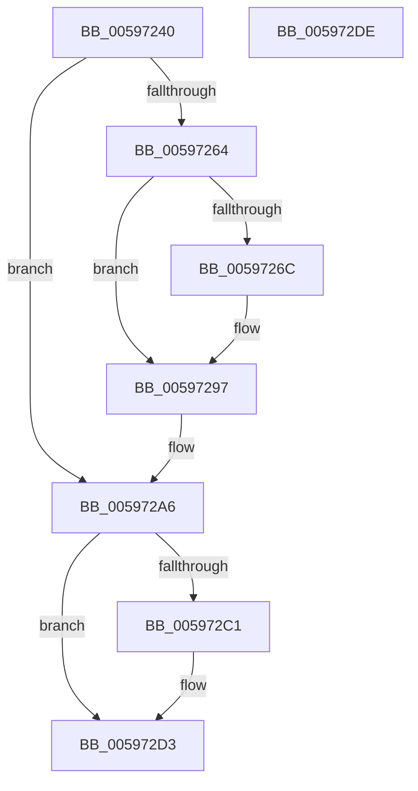

# IopEnableTimer

- RVA: `0x00597240`–`0x005972DF` (길이 `159` bytes)
- VA: `0x0000000140597240`
- 실행 섹션: `.text`
- PDB 이름 있음: `예`; PDB Function 태그: `아니요`
- unwind 정보 RVA: `0x0006E5F8`
- 디코드: `36`개 명령, `159/159` bytes 표시
- 미해석 바이트: `0` (있으면 어셈블리에 `.byte`로 보존)

> 이 문서는 커널 이미지의 기계어와 PDB 기호를 분석해 생성했습니다. 4번과 5번은 함수 원형과 자료형을 바이너리 사용 방식에서 추정한 C 해석이며 원본 소스 복구 결과는 아닙니다.

## 1. Dependencies

- 직접 호출 지점: **4**; 고유 호출 대상: **4**
- 직접 호출자로 확인된 함수: **1**
- RIP 상대 이미지 참조: **6**

### Outgoing calls
- `0x00597254` → [KeAcquireSpinLockRaiseToDpc](../20/KeAcquireSpinLockRaiseToDpc_function_00208470.md) (function, `0x00208470`)
- `0x00597292` → [KeSetCoalescableTimer](../22/KeSetCoalescableTimer_function_0022FFD0.md) (function, `0x0022FFD0`)
- `0x005972B0` → [KeReleaseSpinLock](../39/KeReleaseSpinLock_function_00392BA0.md) (function, `0x00392BA0`)
- `0x005972CE` → [EtwTraceIoTimerEvent](../64/EtwTraceIoTimerEvent_function_0064FAFC.md) (function, `0x0064FAFC`)

### Direct callers
- [IoStartTimer](IoStartTimer_function_00597CF0.md) at `0x00597D07`

### Static image references
- `0x0059724D` → RVA `0x00FCF140` (`CACHEALI`; read)
- `0x00597264` → RVA `0x00F8D500` (`.data`; read)
- `0x0059726C` → RVA `0x00F8D4C0` (`.data`; read)
- `0x0059728B` → RVA `0x00F8D480` (`.data`; read)
- `0x0059729C` → RVA `0x00F8D500` (`.data`; read/write)
- `0x005972B5` → RVA `0x00FC6B08` (`ALMOSTRO`; read)

## 2. Other-region calls and transfers

- 다른 실행 섹션으로 향하는 call: **0**
- 별도 외부 분기/꼬리 이동을 확인하지 못했습니다.

## 3. Assembly (complete function range)

```asm
00597240  48 89 5C 24 08                  mov qword ptr [rsp + 8], rbx
00597245  57                              push rdi
00597246  48 83 EC 30                     sub rsp, 0x30
0059724A  48 8B D9                        mov rbx, rcx
0059724D  48 8D 0D EC 7E A3 00            lea rcx, [rip + 0xa37eec]
00597254  E8 17 12 C7 FF                  call 0x140208470
00597259  40 8A F8                        mov dil, al
0059725C  33 C0                           xor eax, eax
0059725E  66 39 43 02                     cmp word ptr [rbx + 2], ax
00597262  75 42                           jne 0x1405972a6
00597264  39 05 96 62 9F 00               cmp dword ptr [rip + 0x9f6296], eax
0059726A  75 2B                           jne 0x140597297
0059726C  48 8D 05 4D 62 9F 00            lea rax, [rip + 0x9f624d]
00597273  48 C7 C2 80 69 67 FF            mov rdx, 0xffffffffff676980
0059727A  41 B9 23 00 00 00               mov r9d, 0x23
00597280  48 89 44 24 20                  mov qword ptr [rsp + 0x20], rax
00597285  41 B8 E8 03 00 00               mov r8d, 0x3e8
0059728B  48 8D 0D EE 61 9F 00            lea rcx, [rip + 0x9f61ee]
00597292  E8 39 8D C9 FF                  call 0x14022ffd0
00597297  B8 01 00 00 00                  mov eax, 1
0059729C  01 05 5E 62 9F 00               add dword ptr [rip + 0x9f625e], eax
005972A2  66 89 43 02                     mov word ptr [rbx + 2], ax
005972A6  40 8A D7                        mov dl, dil
005972A9  48 8D 0D 90 7E A3 00            lea rcx, [rip + 0xa37e90]
005972B0  E8 EB B8 DF FF                  call 0x140392ba0
005972B5  F7 05 49 F8 A2 00 00 00 80 00   test dword ptr [rip + 0xa2f849], 0x800000
005972BF  74 12                           je 0x1405972d3
005972C1  4C 8B 43 18                     mov r8, qword ptr [rbx + 0x18]
005972C5  B9 5D 0F 00 00                  mov ecx, 0xf5d
005972CA  48 8B 53 28                     mov rdx, qword ptr [rbx + 0x28]
005972CE  E8 29 88 0B 00                  call 0x14064fafc
005972D3  48 8B 5C 24 40                  mov rbx, qword ptr [rsp + 0x40]
005972D8  48 83 C4 30                     add rsp, 0x30
005972DC  5F                              pop rdi
005972DD  C3                              ret
005972DE  CC                              int3
```

## 4. C-style interpretation (structured pseudocode)

```c
__int64 __fastcall IopEnableTimer(__int64 a1)
{
    __int64 result;
    __int64 v_rsp;
    unsigned __int64 v_stack_m18;
    unsigned __int64 v_stack_p8;

    v_stack_p8 = v_rbx;
    v_rsp = (v_rsp) - (48);
    result = KeAcquireSpinLockRaiseToDpc(v_rip + 10714860, a2, a3, a4);
    result = 0;
    if ((*(unsigned __int16 *)(a1 + 2)) != 0) goto loc_005972A6;
    if ((*(unsigned int *)(v_rip + 10445462)) == 0) {
        result = v_rip + 10445389;
        a2 = 0xFFFFFFFFFF676980ULL;
        a4 = 35;
        v_stack_m18 = result;
        a3 = 1000;
        a1 = v_rip + 10445294;
        result = KeSetCoalescableTimer(a1, a2, a3, a4);
    }
    *(unsigned __int16 *)(a1 + 2) = 1;
loc_005972A6:
    result = KeReleaseSpinLock(v_rip + 10714768, (unsigned __int8)((unsigned __int8)(result)), a3, a4);
    if (((*(unsigned int *)(v_rip + 10680393)) & (0x800000ULL)) != 0) {
        a3 = *(unsigned __int64 *)(a1 + 24);
        a1 = 0xF5DULL;
        a2 = *(unsigned __int64 *)(a1 + 40);
        result = EtwTraceIoTimerEvent(a1, a2, a3, a4);
    }
    v_rsp = (v_rsp) + (48);
    return result;
}
```

## 5. (Beta) C Style

```c
int64_t IopEnableTimer(void *Arg1)
{
    uint8_t *arg1 = (uint8_t *)Arg1;

    int64_t result;
    int64_t local_rsp;
    uint64_t v_stack_m18;
    uint64_t v_stack_p8;

    v_stack_p8 = local_rbx;
    local_rsp = (local_rsp) - (48);
    result = KeAcquireSpinLockRaiseToDpc(v_rip + 10714860, a2, a3, a4);
    result = 0;
    if ((*(uint16_t *)(arg1 + 0x2)) != 0) goto loc_005972A6;
    if ((*(uint32_t *)(v_rip + 0x9F6296)) == 0) {
        result = v_rip + 10445389;
        a2 = 0xFFFFFFFFFF676980ULL;
        a4 = 35;
        v_stack_m18 = result;
        a3 = 1000;
        Arg1 = v_rip + 10445294;
        result = KeSetCoalescableTimer(Arg1, a2, a3, a4);
    }
    *(uint16_t *)(arg1 + 0x2) = 1;
loc_005972A6:
    result = KeReleaseSpinLock(v_rip + 10714768, (uint8_t)((uint8_t)(result)), a3, a4);
    if (((*(uint32_t *)(v_rip + 0xA2F849)) & (0x800000ULL)) != 0) {
        a3 = *(uint64_t *)(arg1 + 0x18);
        Arg1 = 0xF5DULL;
        a2 = *(uint64_t *)(arg1 + 0x28);
        result = EtwTraceIoTimerEvent(Arg1, a2, a3, a4);
    }
    local_rsp = (local_rsp) + (48);
    return result;
}
```

### 관측된 메모리 오프셋

구조체 형식이 확인되지 않은 접근은 인자 기준의 오프셋으로만 기록했습니다.

| 기준 인자 | 오프셋 표현 | 폭 (bit) | 접근 |
|---|---:|---:|---|
| `Arg1` | `+ 0x2` | `16` | `R` |
| `Arg1` | `+ 0x2` | `16` | `W` |
| `Arg1` | `+ 0x18` | `64` | `R` |
| `Arg1` | `+ 0x28` | `64` | `R` |

## 6. Execution-region graph

[열기: 2D/3D 그래프와 함수 탐색 컨트롤 패널](../../../control-panel.html?section=text&rva=0x00597240&view=graph)

- 2D 그래프는 위에서 아래로 흐르고, 3D 그래프는 빈 공간을 드래그해 회전합니다. Shift+드래그는 이동, 휠은 확대·축소, 함수 노드 선택은 대상 보고서 이동입니다.

### Static fallback


