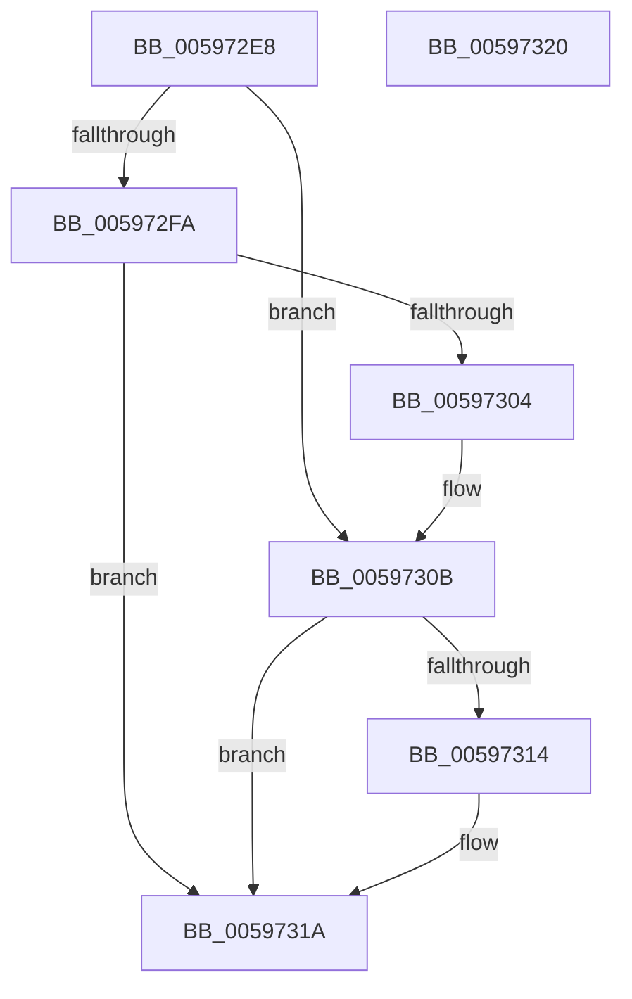

# IopExceptionFilter

- RVA: `0x005972E8`–`0x00597321` (길이 `57` bytes)
- VA: `0x00000001405972E8`
- 실행 섹션: `.text`
- PDB 이름 있음: `예`; PDB Function 태그: `아니요`
- unwind 정보 RVA: `0x000DB714`
- 디코드: `16`개 명령, `57/57` bytes 표시
- 미해석 바이트: `0` (있으면 어셈블리에 `.byte`로 보존)

> 이 문서는 커널 이미지의 기계어와 PDB 기호를 분석해 생성했습니다. 4번과 5번은 함수 원형과 자료형을 바이너리 사용 방식에서 추정한 C 해석이며 원본 소스 복구 결과는 아닙니다.

## 1. Dependencies

- 직접 호출 지점: **0**; 고유 호출 대상: **0**
- 직접 호출자로 확인된 함수: **23**
- RIP 상대 이미지 참조: **0**

### Outgoing calls
- 직접 디코드된 call 명령이 없습니다.

### Direct callers
- [IopProcessBufferedIoCompletion$filt$0](../6D/IopProcessBufferedIoCompletion_filt_0_function_006D2D60.md) at `0x006D2D6D`
- [IopValidateAndGetWriteParameters$filt$0](../6D/IopValidateAndGetWriteParameters_filt_0_function_006D3020.md) at `0x006D302D`
- [NtSubmitIoRing$filt$0](../6D/NtSubmitIoRing_filt_0_function_006D4FC0.md) at `0x006D4FD1`
- [IopFlushBuffersFile$filt$0](../../page/B0/IopFlushBuffersFile_filt_0_function_00B0EADC.md) at `0x00B0EAE9`
- [IopReadFile$filt$0](../../page/B0/IopReadFile_filt_0_function_00B0EB30.md) at `0x00B0EB3D`
- [NtCopyFileChunk$filt$0](../../page/B0/NtCopyFileChunk_filt_0_function_00B0FB55.md) at `0x00B0FB62`
- [NtCopyFileChunk$filt$1](../../page/B0/NtCopyFileChunk_filt_1_function_00B0FB6F.md) at `0x00B0FB7C`
- [NtCopyFileChunk$filt$2](../../page/B0/NtCopyFileChunk_filt_2_function_00B0FB89.md) at `0x00B0FB96`
- [IopReadFileScatter$filt$0](../../page/B1/IopReadFileScatter_filt_0_function_00B13809.md) at `0x00B13816`
- [IopReadFileScatter$filt$1](../../page/B1/IopReadFileScatter_filt_1_function_00B13823.md) at `0x00B13830`
- [IopWriteFileGather$filt$0](../../page/B1/IopWriteFileGather_filt_0_function_00B1387D.md) at `0x00B1388A`
- [IopWriteFileGather$filt$1](../../page/B1/IopWriteFileGather_filt_1_function_00B13897.md) at `0x00B138A4`
- [IopIoRingGetBuffer$filt$0](../../page/B1/IopIoRingGetBuffer_filt_0_function_00B1397E.md) at `0x00B1398B`
- [IopIoRingDispatchRegisterBuffers$filt$0](../../page/B1/IopIoRingDispatchRegisterBuffers_filt_0_function_00B13E8A.md) at `0x00B13E97`
- [IopIoRingDispatchRegisterBuffers$filt$2](../../page/B1/IopIoRingDispatchRegisterBuffers_filt_2_function_00B13EA4.md) at `0x00B13EB1`
- [IopIoRingDispatchRegisterBuffers$filt$1](../../page/B1/IopIoRingDispatchRegisterBuffers_filt_1_function_00B13EBE.md) at `0x00B13ECB`
- [IopIoRingDispatchRegisterFiles$filt$0](../../page/B1/IopIoRingDispatchRegisterFiles_filt_0_function_00B13EDE.md) at `0x00B13EEB`
- [IopIoRingDispatchRegisterFiles$filt$1](../../page/B1/IopIoRingDispatchRegisterFiles_filt_1_function_00B13EF8.md) at `0x00B13F05`
- [NtCreateIoRing$filt$1](../../page/B1/NtCreateIoRing_filt_1_function_00B13F18.md) at `0x00B13F25`
- [NtCreateIoRing$filt$0](../../page/B1/NtCreateIoRing_filt_0_function_00B13F32.md) at `0x00B13F3F`
- [NtQueryIoRingCapabilities$filt$0](../../page/B1/NtQueryIoRingCapabilities_filt_0_function_00B13F52.md) at `0x00B13F5F`
- [NtSetInformationIoRing$filt$0](../../page/B1/NtSetInformationIoRing_filt_0_function_00B13F72.md) at `0x00B13F7F`
- [NtSetInformationIoRing$filt$1](../../page/B1/NtSetInformationIoRing_filt_1_function_00B13F8C.md) at `0x00B13F99`

### Static image references
- 디코드된 RIP-relative 메모리 참조가 없습니다.

## 2. Other-region calls and transfers

- 다른 실행 섹션으로 향하는 call: **0**
- 별도 외부 분기/꼬리 이동을 확인하지 못했습니다.

## 3. Assembly (complete function range)

```asm
005972E8  48 8B 01                        mov rax, qword ptr [rcx]
005972EB  44 8B 00                        mov r8d, dword ptr [rax]
005972EE  44 89 02                        mov dword ptr [rdx], r8d
005972F1  41 81 F8 06 00 00 C0            cmp r8d, 0xc0000006
005972F8  75 11                           jne 0x14059730b
005972FA  4C 8B 01                        mov r8, qword ptr [rcx]
005972FD  41 83 78 18 03                  cmp dword ptr [r8 + 0x18], 3
00597302  72 16                           jb 0x14059731a
00597304  45 8B 40 30                     mov r8d, dword ptr [r8 + 0x30]
00597308  44 89 02                        mov dword ptr [rdx], r8d
0059730B  41 81 F8 02 00 00 80            cmp r8d, 0x80000002
00597312  75 06                           jne 0x14059731a
00597314  C7 02 C5 02 00 C0               mov dword ptr [rdx], 0xc00002c5
0059731A  B8 01 00 00 00                  mov eax, 1
0059731F  C3                              ret
00597320  CC                              int3
```

## 4. C-style interpretation (structured pseudocode)

```c
__int64 __fastcall IopExceptionFilter(__int64 a1, __int64 a2)
{
    *(unsigned int *)(a2) = (unsigned int)((unsigned int)(*(unsigned int *)(*(unsigned __int64 *)(a1))));
    if (((unsigned int)((unsigned int)(*(unsigned int *)(*(unsigned __int64 *)(a1))))) != 0xC0000006ULL) goto loc_0059730B;
    if ((*(unsigned int *)(*(unsigned __int64 *)(a1) + 24)) < 3) goto loc_0059731A;
    *(unsigned int *)(a2) = (unsigned int)((unsigned int)(*(unsigned int *)(*(unsigned __int64 *)(a1) + 48)));
loc_0059730B:
    if (((unsigned int)((unsigned int)(*(unsigned int *)(*(unsigned __int64 *)(a1) + 48)))) == 0x80000002ULL) {
        *(unsigned int *)(a2) = 0xC00002C5ULL;
    }
    return 1;
}
```

## 5. (Beta) C Style

```c
int64_t IopExceptionFilter(void *Arg1, void *Arg2)
{
    uint8_t *arg1 = (uint8_t *)Arg1;
    uint8_t *arg2 = (uint8_t *)Arg2;

    *(uint32_t *)(arg2) = (uint32_t)((uint32_t)(*(uint32_t *)(*(uint64_t *)(arg1))));
    if (((uint32_t)((uint32_t)(*(uint32_t *)(*(uint64_t *)(arg1))))) != 0xC0000006ULL) goto loc_0059730B;
    if ((*(uint32_t *)(*(uint64_t *)(arg1) + 0x18)) < 3) goto loc_0059731A;
    *(uint32_t *)(arg2) = (uint32_t)((uint32_t)(*(uint32_t *)(*(uint64_t *)(arg1) + 0x30)));
loc_0059730B:
    if (((uint32_t)((uint32_t)(*(uint32_t *)(*(uint64_t *)(arg1) + 0x30)))) == 0x80000002ULL) {
        *(uint32_t *)(arg2) = 0xC00002C5ULL;
    }
    return 1;
}
```

### 관측된 메모리 오프셋

구조체 형식이 확인되지 않은 접근은 인자 기준의 오프셋으로만 기록했습니다.

| 기준 인자 | 오프셋 표현 | 폭 (bit) | 접근 |
|---|---:|---:|---|
| `Arg1` | `+ 0x0` | `64` | `R` |
| `Arg2` | `+ 0x0` | `32` | `W` |

## 6. Execution-region graph

[열기: 2D/3D 그래프와 함수 탐색 컨트롤 패널](../../../control-panel.html?section=text&rva=0x005972E8&view=graph)

- 2D 그래프는 위에서 아래로 흐르고, 3D 그래프는 빈 공간을 드래그해 회전합니다. Shift+드래그는 이동, 휠은 확대·축소, 함수 노드 선택은 대상 보고서 이동입니다.

### Static fallback


