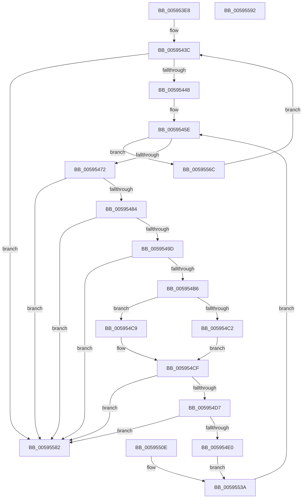

# IopFillTriageDumpDataBlocks

- RVA: `0x005953E8`–`0x00595593` (길이 `427` bytes)
- VA: `0x00000001405953E8`
- 실행 섹션: `.text`
- PDB 이름 있음: `예`; PDB Function 태그: `아니요`
- unwind 정보 RVA: `0x000C7110`
- 디코드: `116`개 명령, `427/427` bytes 표시
- 미해석 바이트: `0` (있으면 어셈블리에 `.byte`로 보존)

> 이 문서는 커널 이미지의 기계어와 PDB 기호를 분석해 생성했습니다. 4번과 5번은 함수 원형과 자료형을 바이너리 사용 방식에서 추정한 C 해석이며 원본 소스 복구 결과는 아닙니다.

## 1. Dependencies

- 직접 호출 지점: **3**; 고유 호출 대상: **3**
- 직접 호출자로 확인된 함수: **1**
- RIP 상대 이미지 참조: **0**

### Outgoing calls
- `0x005954A9` → [RtlULongLongSub](../48/RtlULongLongSub_function_004831AC.md) (function, `0x004831AC`)
- `0x00595507` → [memcpy](../6C/memcpy_function_006C6840.md) (function, `0x006C6840`)
- `0x00595513` → [IoSetBugCheckProgressFlag](IoSetBugCheckProgressFlag_function_005931C0.md) (function, `0x005931C0`)

### Direct callers
- [IoFillTriageDumpBuffer](IoFillTriageDumpBuffer_function_005921CC.md) at `0x00592719`

### Static image references
- 디코드된 RIP-relative 메모리 참조가 없습니다.

## 2. Other-region calls and transfers

- 다른 실행 섹션으로 향하는 call: **0**
- 별도 외부 분기/꼬리 이동을 확인하지 못했습니다.

## 3. Assembly (complete function range)

```asm
005953E8  48 8B C4                        mov rax, rsp
005953EB  4C 89 48 20                     mov qword ptr [rax + 0x20], r9
005953EF  4C 89 40 18                     mov qword ptr [rax + 0x18], r8
005953F3  89 50 10                        mov dword ptr [rax + 0x10], edx
005953F6  48 89 48 08                     mov qword ptr [rax + 8], rcx
005953FA  53                              push rbx
005953FB  56                              push rsi
005953FC  57                              push rdi
005953FD  41 54                           push r12
005953FF  41 55                           push r13
00595401  41 56                           push r14
00595403  41 57                           push r15
00595405  48 83 EC 70                     sub rsp, 0x70
00595409  4D 8B E1                        mov r12, r9
0059540C  8B C2                           mov eax, edx
0059540E  48 83 64 24 28 00               and qword ptr [rsp + 0x28], 0
00595414  44 8B 79 78                     mov r15d, dword ptr [rcx + 0x78]
00595418  4D 03 F9                        add r15, r9
0059541B  4C 89 7C 24 40                  mov qword ptr [rsp + 0x40], r15
00595420  4D 8B D7                        mov r10, r15
00595423  48 8D 51 7C                     lea rdx, [rcx + 0x7c]
00595427  48 89 54 24 60                  mov qword ptr [rsp + 0x60], rdx
0059542C  8B 1A                           mov ebx, dword ptr [rdx]
0059542E  48 C1 E3 04                     shl rbx, 4
00595432  49 03 DF                        add rbx, r15
00595435  48 89 5C 24 30                  mov qword ptr [rsp + 0x30], rbx
0059543A  33 FF                           xor edi, edi
0059543C  89 7C 24 24                     mov dword ptr [rsp + 0x24], edi
00595440  3B F8                           cmp edi, eax
00595442  0F 83 3A 01 00 00               jae 0x140595582
00595448  44 8B EF                        mov r13d, edi
0059544B  49 C1 E5 04                     shl r13, 4
0059544F  4D 03 E8                        add r13, r8
00595452  4C 89 6C 24 48                  mov qword ptr [rsp + 0x48], r13
00595457  49 8B 75 08                     mov rsi, qword ptr [r13 + 8]
0059545B  45 33 F6                        xor r14d, r14d
0059545E  44 89 74 24 20                  mov dword ptr [rsp + 0x20], r14d
00595463  48 89 74 24 38                  mov qword ptr [rsp + 0x38], rsi
00595468  45 3B 75 00                     cmp r14d, dword ptr [r13]
0059546C  0F 83 FA 00 00 00               jae 0x14059556c
00595472  49 8B C2                        mov rax, r10
00595475  49 2B C7                        sub rax, r15
00595478  48 C1 F8 04                     sar rax, 4
0059547C  3B 02                           cmp eax, dword ptr [rdx]
0059547E  0F 83 FE 00 00 00               jae 0x140595582
00595484  44 8B 59 04                     mov r11d, dword ptr [rcx + 4]
00595488  4D 03 DC                        add r11, r12
0059548B  49 8D 42 10                     lea rax, [r10 + 0x10]
0059548F  48 89 44 24 58                  mov qword ptr [rsp + 0x58], rax
00595494  49 3B C3                        cmp rax, r11
00595497  0F 87 E5 00 00 00               ja 0x140595582
0059549D  48 8B 16                        mov rdx, qword ptr [rsi]
005954A0  4C 8D 44 24 28                  lea r8, [rsp + 0x28]
005954A5  48 8B 4E 08                     mov rcx, qword ptr [rsi + 8]
005954A9  E8 FE DC EE FF                  call 0x1404831ac
005954AE  85 C0                           test eax, eax
005954B0  0F 88 CC 00 00 00               js 0x140595582
005954B6  8B 4C 24 28                     mov ecx, dword ptr [rsp + 0x28]
005954BA  48 03 CB                        add rcx, rbx
005954BD  48 3B CB                        cmp rcx, rbx
005954C0  72 07                           jb 0x1405954c9
005954C2  B8 01 00 00 00                  mov eax, 1
005954C7  EB 06                           jmp 0x1405954cf
005954C9  48 83 C9 FF                     or rcx, 0xffffffffffffffff
005954CD  33 C0                           xor eax, eax
005954CF  85 C0                           test eax, eax
005954D1  0F 84 AB 00 00 00               je 0x140595582
005954D7  49 3B CB                        cmp rcx, r11
005954DA  0F 87 A2 00 00 00               ja 0x140595582
005954E0  49 89 12                        mov qword ptr [r10], rdx
005954E3  8B C3                           mov eax, ebx
005954E5  41 2B C4                        sub eax, r12d
005954E8  41 89 42 08                     mov dword ptr [r10 + 8], eax
005954EC  8B 4E 08                        mov ecx, dword ptr [rsi + 8]
005954EF  2B 0E                           sub ecx, dword ptr [rsi]
005954F1  4D 8D 62 0C                     lea r12, [r10 + 0xc]
005954F5  4C 89 64 24 50                  mov qword ptr [rsp + 0x50], r12
005954FA  41 89 0C 24                     mov dword ptr [r12], ecx
005954FE  44 8B C1                        mov r8d, ecx
00595501  48 8B 16                        mov rdx, qword ptr [rsi]
00595504  48 8B CB                        mov rcx, rbx
00595507  E8 34 13 13 00                  call 0x1406c6840
0059550C  EB 2C                           jmp 0x14059553a
0059550E  B9 00 00 20 00                  mov ecx, 0x200000
00595513  E8 A8 DC FF FF                  call 0x1405931c0
00595518  44 8B 74 24 20                  mov r14d, dword ptr [rsp + 0x20]
0059551D  8B 7C 24 24                     mov edi, dword ptr [rsp + 0x24]
00595521  48 8B 74 24 38                  mov rsi, qword ptr [rsp + 0x38]
00595526  48 8B 5C 24 30                  mov rbx, qword ptr [rsp + 0x30]
0059552B  4C 8B 7C 24 40                  mov r15, qword ptr [rsp + 0x40]
00595530  4C 8B 6C 24 48                  mov r13, qword ptr [rsp + 0x48]
00595535  4C 8B 64 24 50                  mov r12, qword ptr [rsp + 0x50]
0059553A  41 8B 04 24                     mov eax, dword ptr [r12]
0059553E  48 03 D8                        add rbx, rax
00595541  48 89 5C 24 30                  mov qword ptr [rsp + 0x30], rbx
00595546  4C 8B 54 24 58                  mov r10, qword ptr [rsp + 0x58]
0059554B  41 FF C6                        inc r14d
0059554E  48 83 C6 10                     add rsi, 0x10
00595552  48 8B 8C 24 B0 00 00 00         mov rcx, qword ptr [rsp + 0xb0]
0059555A  4C 8B A4 24 C8 00 00 00         mov r12, qword ptr [rsp + 0xc8]
00595562  48 8B 54 24 60                  mov rdx, qword ptr [rsp + 0x60]
00595567  E9 F2 FE FF FF                  jmp 0x14059545e
0059556C  FF C7                           inc edi
0059556E  8B 84 24 B8 00 00 00            mov eax, dword ptr [rsp + 0xb8]
00595575  4C 8B 84 24 C0 00 00 00         mov r8, qword ptr [rsp + 0xc0]
0059557D  E9 BA FE FF FF                  jmp 0x14059543c
00595582  48 83 C4 70                     add rsp, 0x70
00595586  41 5F                           pop r15
00595588  41 5E                           pop r14
0059558A  41 5D                           pop r13
0059558C  41 5C                           pop r12
0059558E  5F                              pop rdi
0059558F  5E                              pop rsi
00595590  5B                              pop rbx
00595591  C3                              ret
00595592  CC                              int3
```

## 4. C-style interpretation (structured pseudocode)

```c
__int64 __fastcall IopFillTriageDumpDataBlocks(__int64 a1, int a2, __int64 a3, __int64 a4)
{
    __int64 result;
    __int64 v_r11;
    __int64 v_r13;
    __int64 v_r14;
    __int64 v_r15;
    __int64 v_rbx;
    __int64 v_rdi;
    __int64 v_rsi;
    __int64 v_rsp;
    unsigned __int64 v_stack_m48;
    unsigned __int64 v_stack_m50;
    unsigned __int64 v_stack_m58;
    unsigned __int64 v_stack_m60;
    unsigned __int64 v_stack_m68;
    unsigned __int64 v_stack_m70;
    unsigned __int64 v_stack_m78;
    unsigned __int64 v_stack_m80;
    unsigned int v_stack_m84;
    unsigned int v_stack_m88;
    unsigned int v_stack_p10;
    unsigned __int64 v_stack_p18;
    unsigned __int64 v_stack_p20;
    unsigned __int64 v_stack_p8;

    *(unsigned __int64 *)(v_rsp + 32) = a4;
    *(unsigned __int64 *)(v_rsp + 24) = a3;
    *(unsigned int *)(v_rsp + 16) = a2;
    *(unsigned __int64 *)(v_rsp + 8) = a1;
    v_rsp = (v_rsp) - (112);
    v_r15 = ((unsigned int)(*(unsigned int *)(a1 + 120))) + (a4);
    v_stack_m68 = v_r15;
    v_stack_m48 = a1 + 124;
    v_rbx = ((unsigned int)(*(unsigned int *)(a1 + 124))) << (4);
    v_rbx = (v_rbx) + (v_r15);
    v_stack_m78 = v_rbx;
    v_rdi = 0;
loc_0059543C:
    v_stack_m84 = 0;
    if (0 >= ((unsigned int)((unsigned int)(a2)))) goto loc_00595582;
    v_r13 = (0) << (4);
    v_r13 = (v_r13) + (a3);
    v_stack_m60 = v_r13;
    v_r14 = 0;
loc_0059545E:
    v_stack_m88 = 0;
    v_stack_m70 = *(unsigned __int64 *)(v_r13 + 8);
    if (0 >= (*(unsigned int *)(v_r13))) goto loc_0059556C;
    result = (v_r15) - (v_r15);
    result = (result) >> (4);
    if (((unsigned int)(result)) >= (*(unsigned int *)(a1 + 124))) goto loc_00595582;
    v_r11 = ((unsigned int)(*(unsigned int *)(a1 + 4))) + (a4);
    v_stack_m50 = v_r15 + 16;
    if ((v_r15 + 16) > v_r11) goto loc_00595582;
    result = RtlULongLongSub(*(unsigned __int64 *)(*(unsigned __int64 *)(v_r13 + 8) + 8), *(unsigned __int64 *)(*(unsigned __int64 *)(v_r13 + 8)), v_stack_m80, a4);
    if (sign_flag) goto loc_00595582;
    a1 = ((unsigned int)(v_stack_m80)) + (v_rbx);
    if (a1 < v_rbx) goto loc_005954C9;
    goto loc_005954CF;
loc_005954C9:
    a1 = (a1) | (-1);
    result = 0;
loc_005954CF:
    if (0 == 0) goto loc_00595582;
    if (a1 > v_r11) goto loc_00595582;
    *(unsigned __int64 *)(v_r15) = *(unsigned __int64 *)(*(unsigned __int64 *)(v_r13 + 8));
    result = (unsigned int)(((unsigned int)((unsigned int)(v_rbx))) - ((unsigned int)(a4)));
    *(unsigned int *)(v_r15 + 8) = (unsigned int)(result);
    a1 = (unsigned int)(((unsigned int)(*(unsigned int *)(*(unsigned __int64 *)(v_r13 + 8) + 8))) - (*(unsigned int *)(*(unsigned __int64 *)(v_r13 + 8))));
    v_stack_m58 = v_r15 + 12;
    *(unsigned int *)(v_r15 + 12) = (unsigned int)(a1);
    result = memcpy(v_rbx, *(unsigned __int64 *)(*(unsigned __int64 *)(v_r13 + 8)), (unsigned int)((unsigned int)(a1)), a4);
    goto loc_0059553A;
loc_0059553A:
    v_rbx = (v_rbx) + ((unsigned int)(*(unsigned int *)(v_r15 + 12)));
    v_stack_m78 = v_rbx;
    v_r14 = (unsigned int)((v_r14) + 1);
    v_rsi = (*(unsigned __int64 *)(v_r13 + 8)) + (16);
    goto loc_0059545E;
loc_0059556C:
    v_rdi = (unsigned int)((v_rdi) + 1);
    goto loc_0059543C;
loc_00595582:
    v_rsp = (v_rsp) + (112);
    return (unsigned int)(v_stack_p10);
}
```

## 5. (Beta) C Style

```c
int64_t IopFillTriageDumpDataBlocks(void *Arg1, int32_t Arg2, int64_t Arg3, int64_t Arg4)
{
    uint8_t *arg1 = (uint8_t *)Arg1;

    int64_t result;
    int64_t local_r11;
    int64_t local_r13;
    int64_t local_r14;
    int64_t local_r15;
    int64_t local_rbx;
    int64_t local_rdi;
    int64_t local_rsi;
    int64_t local_rsp;
    uint64_t v_stack_m48;
    uint64_t v_stack_m50;
    uint64_t v_stack_m58;
    uint64_t v_stack_m60;
    uint64_t v_stack_m68;
    uint64_t v_stack_m70;
    uint64_t v_stack_m78;
    uint64_t v_stack_m80;
    uint32_t v_stack_m84;
    uint32_t v_stack_m88;
    uint32_t v_stack_p10;
    uint64_t v_stack_p18;
    uint64_t v_stack_p20;
    uint64_t v_stack_p8;

    *(uint64_t *)(local_rsp + 0x20) = Arg4;
    *(uint64_t *)(local_rsp + 0x18) = Arg3;
    *(uint32_t *)(local_rsp + 0x10) = Arg2;
    *(void **)(local_rsp + 0x8) = Arg1;
    local_rsp = (local_rsp) - (112);
    local_r15 = ((uint32_t)(*(uint32_t *)(arg1 + 0x78))) + (Arg4);
    v_stack_m68 = local_r15;
    v_stack_m48 = Arg1 + 124;
    local_rbx = ((uint32_t)(*(uint32_t *)(arg1 + 0x7C))) << (4);
    local_rbx = (local_rbx) + (local_r15);
    v_stack_m78 = local_rbx;
    local_rdi = 0;
loc_0059543C:
    v_stack_m84 = 0;
    if (0 >= ((uint32_t)((uint32_t)(Arg2)))) goto loc_00595582;
    local_r13 = (0) << (4);
    local_r13 = (local_r13) + (Arg3);
    v_stack_m60 = local_r13;
    local_r14 = 0;
loc_0059545E:
    v_stack_m88 = 0;
    v_stack_m70 = *(uint64_t *)(local_r13 + 0x8);
    if (0 >= (*(uint32_t *)(local_r13))) goto loc_0059556C;
    result = (local_r15) - (local_r15);
    result = (result) >> (4);
    if (((uint32_t)(result)) >= (*(uint32_t *)(arg1 + 0x7C))) goto loc_00595582;
    local_r11 = ((uint32_t)(*(uint32_t *)(arg1 + 0x4))) + (Arg4);
    v_stack_m50 = local_r15 + 16;
    if ((local_r15 + 16) > local_r11) goto loc_00595582;
    result = RtlULongLongSub(*(uint64_t *)(*(uint64_t *)(local_r13 + 0x8) + 0x8), *(uint64_t *)(*(uint64_t *)(local_r13 + 0x8)), v_stack_m80, Arg4);
    if (sign_flag) goto loc_00595582;
    Arg1 = ((uint32_t)(v_stack_m80)) + (local_rbx);
    if (Arg1 < local_rbx) goto loc_005954C9;
    goto loc_005954CF;
loc_005954C9:
    Arg1 = (Arg1) | (-1);
    result = 0;
loc_005954CF:
    if (0 == 0) goto loc_00595582;
    if (Arg1 > local_r11) goto loc_00595582;
    *(uint64_t *)(local_r15) = *(uint64_t *)(*(uint64_t *)(local_r13 + 0x8));
    result = (uint32_t)(((uint32_t)((uint32_t)(local_rbx))) - ((uint32_t)(Arg4)));
    *(uint32_t *)(local_r15 + 0x8) = (uint32_t)(result);
    Arg1 = (uint32_t)(((uint32_t)(*(uint32_t *)(*(uint64_t *)(local_r13 + 0x8) + 0x8))) - (*(uint32_t *)(*(uint64_t *)(local_r13 + 0x8))));
    v_stack_m58 = local_r15 + 12;
    *(uint32_t *)(local_r15 + 0xC) = (uint32_t)(Arg1);
    result = memcpy(local_rbx, *(uint64_t *)(*(uint64_t *)(local_r13 + 0x8)), (uint32_t)((uint32_t)(Arg1)), Arg4);
    goto loc_0059553A;
loc_0059553A:
    local_rbx = (local_rbx) + ((uint32_t)(*(uint32_t *)(local_r15 + 0xC)));
    v_stack_m78 = local_rbx;
    local_r14 = (uint32_t)((local_r14) + 1);
    local_rsi = (*(uint64_t *)(local_r13 + 0x8)) + (16);
    goto loc_0059545E;
loc_0059556C:
    local_rdi = (uint32_t)((local_rdi) + 1);
    goto loc_0059543C;
loc_00595582:
    local_rsp = (local_rsp) + (112);
    return (uint32_t)(v_stack_p10);
}
```

### 관측된 메모리 오프셋

구조체 형식이 확인되지 않은 접근은 인자 기준의 오프셋으로만 기록했습니다.

| 기준 인자 | 오프셋 표현 | 폭 (bit) | 접근 |
|---|---:|---:|---|
| `Arg1` | `+ 0x0` | `32` | `R` |
| `Arg1` | `+ 0x78` | `32` | `R` |
| `Arg1` | `+ 0x7C` | `64` | `R` |

## 6. Execution-region graph

[열기: 2D/3D 그래프와 함수 탐색 컨트롤 패널](../../../control-panel.html?section=text&rva=0x005953E8&view=graph)

- 2D 그래프는 위에서 아래로 흐르고, 3D 그래프는 빈 공간을 드래그해 회전합니다. Shift+드래그는 이동, 휠은 확대·축소, 함수 노드 선택은 대상 보고서 이동입니다.

### Static fallback


