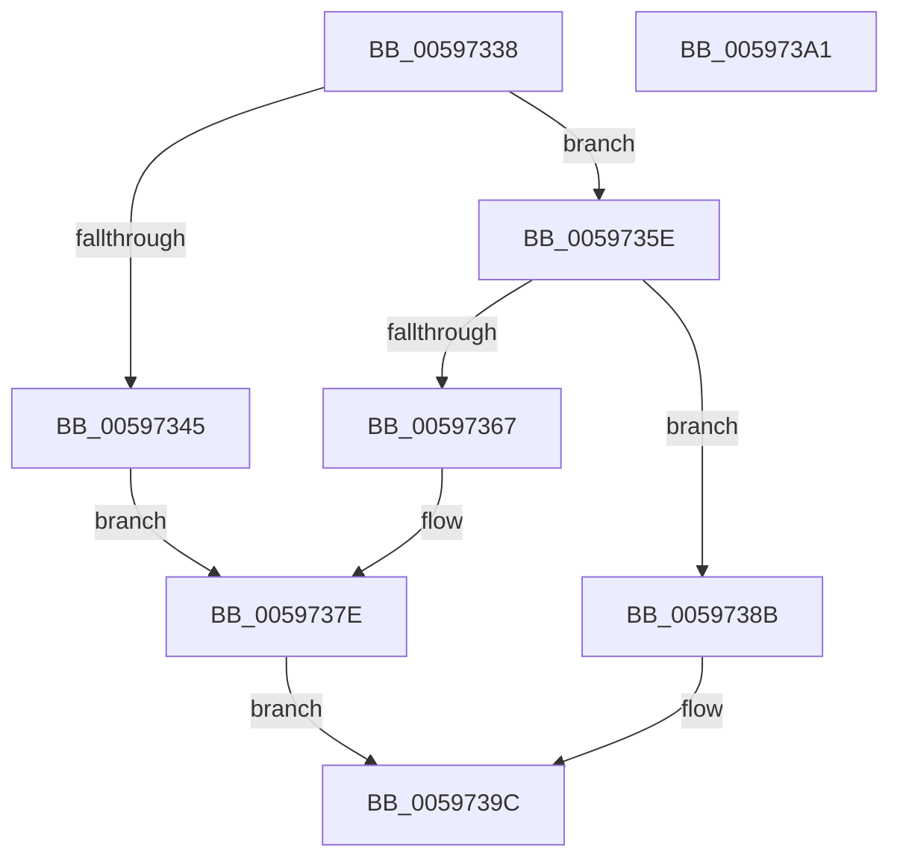

# IopFreeBackpocketIrp

- RVA: `0x00597338`–`0x005973A2` (길이 `106` bytes)
- VA: `0x0000000140597338`
- 실행 섹션: `.text`
- PDB 이름 있음: `예`; PDB Function 태그: `아니요`
- unwind 정보 RVA: `0x0005C788`
- 디코드: `26`개 명령, `106/106` bytes 표시
- 미해석 바이트: `0` (있으면 어셈블리에 `.byte`로 보존)

> 이 문서는 커널 이미지의 기계어와 PDB 기호를 분석해 생성했습니다. 4번과 5번은 함수 원형과 자료형을 바이너리 사용 방식에서 추정한 C 해석이며 원본 소스 복구 결과는 아닙니다.

## 1. Dependencies

- 직접 호출 지점: **1**; 고유 호출 대상: **1**
- 직접 호출자로 확인된 함수: **1**
- RIP 상대 이미지 참조: **10**

### Outgoing calls
- `0x00597384` → [KeSetEvent](../33/KeSetEvent_function_0033F310.md) (function, `0x0033F310`)

### Direct callers
- [IopFreeReserveIrp](../4D/IopFreeReserveIrp_function_004DDE98.md) at `0x004DDEFC`

### Static image references
- `0x0059733C` → RVA `0x00F8D5F8` (`.data`; read)
- `0x00597347` → RVA `0x00F8D610` (`.data`; read)
- `0x0059734E` → RVA `0x00F8D608` (`.data`; write)
- `0x00597356` → RVA `0x00F8D600` (`.data`; read/write)
- `0x0059735E` → RVA `0x00F8D628` (`.data`; read)
- `0x00597369` → RVA `0x00F8D640` (`.data`; read)
- `0x00597370` → RVA `0x00F8D638` (`.data`; write)
- `0x00597378` → RVA `0x00F8D630` (`.data`; read/write)
- `0x0059738B` → RVA `0x00F8D658` (`.data`; read)
- `0x00597395` → RVA `0x00F8D658` (`.data`; write)

## 2. Other-region calls and transfers

- 다른 실행 섹션으로 향하는 call: **0**
- 별도 외부 분기/꼬리 이동을 확인하지 못했습니다.

## 3. Assembly (complete function range)

```asm
00597338  48 83 EC 28                     sub rsp, 0x28
0059733C  48 3B 0D B5 62 9F 00            cmp rcx, qword ptr [rip + 0x9f62b5]
00597343  75 19                           jne 0x14059735e
00597345  33 C0                           xor eax, eax
00597347  48 8D 0D C2 62 9F 00            lea rcx, [rip + 0x9f62c2]
0059734E  48 89 05 B3 62 9F 00            mov qword ptr [rip + 0x9f62b3], rax
00597355  90                              nop
00597356  87 05 A4 62 9F 00               xchg dword ptr [rip + 0x9f62a4], eax
0059735C  EB 20                           jmp 0x14059737e
0059735E  48 3B 0D C3 62 9F 00            cmp rcx, qword ptr [rip + 0x9f62c3]
00597365  75 24                           jne 0x14059738b
00597367  33 C0                           xor eax, eax
00597369  48 8D 0D D0 62 9F 00            lea rcx, [rip + 0x9f62d0]
00597370  48 89 05 C1 62 9F 00            mov qword ptr [rip + 0x9f62c1], rax
00597377  90                              nop
00597378  87 05 B2 62 9F 00               xchg dword ptr [rip + 0x9f62b2], eax
0059737E  45 33 C0                        xor r8d, r8d
00597381  0F BE D2                        movsx edx, dl
00597384  E8 87 7F DA FF                  call 0x14033f310
00597389  EB 11                           jmp 0x14059739c
0059738B  48 8B 05 C6 62 9F 00            mov rax, qword ptr [rip + 0x9f62c6]
00597392  48 89 01                        mov qword ptr [rcx], rax
00597395  48 89 0D BC 62 9F 00            mov qword ptr [rip + 0x9f62bc], rcx
0059739C  48 83 C4 28                     add rsp, 0x28
005973A0  C3                              ret
005973A1  CC                              int3
```

## 4. C-style interpretation (structured pseudocode)

```c
__int64 __fastcall IopFreeBackpocketIrp(__int64 a1, unsigned __int8 a2, int a3)
{
    __int64 result;
    __int64 v_rsp;

    v_rsp = (v_rsp) - (40);
    if (a1 != (*(unsigned __int64 *)(v_rip + 10445493))) goto loc_0059735E;
    result = 0;
    *(unsigned __int64 *)(v_rip + 10445491) = 0;
    goto loc_0059737E;
loc_0059735E:
    if ((v_rip + 10445506) != (*(unsigned __int64 *)(v_rip + 10445507))) goto loc_0059738B;
    result = 0;
    *(unsigned __int64 *)(v_rip + 10445505) = 0;
loc_0059737E:
    a3 = 0;
    result = KeSetEvent(v_rip + 10445520, (__int8)(a2), a3, a4);
    goto loc_0059739C;
loc_0059738B:
    *(unsigned __int64 *)(v_rip + 10445520) = *(unsigned __int64 *)(v_rip + 10445510);
    *(unsigned __int64 *)(v_rip + 10445500) = v_rip + 10445520;
loc_0059739C:
    v_rsp = (v_rsp) + (40);
    return *(unsigned __int64 *)(v_rip + 10445510);
}
```

## 5. (Beta) C Style

```c
int64_t IopFreeBackpocketIrp(int64_t Arg1, uint8_t Arg2, int32_t Arg3)
{
    int64_t result;
    int64_t local_rsp;

    local_rsp = (local_rsp) - (40);
    if (Arg1 != (*(uint64_t *)(v_rip + 0x9F62B5))) goto loc_0059735E;
    result = 0;
    *(uint64_t *)(v_rip + 0x9F62B3) = 0;
    goto loc_0059737E;
loc_0059735E:
    if ((v_rip + 10445506) != (*(uint64_t *)(v_rip + 0x9F62C3))) goto loc_0059738B;
    result = 0;
    *(uint64_t *)(v_rip + 0x9F62C1) = 0;
loc_0059737E:
    Arg3 = 0;
    result = KeSetEvent(v_rip + 10445520, (int8_t)(Arg2), Arg3, a4);
    goto loc_0059739C;
loc_0059738B:
    *(uint64_t *)(v_rip + 0x9F62D0) = *(uint64_t *)(v_rip + 0x9F62C6);
    *(uint64_t *)(v_rip + 0x9F62BC) = v_rip + 10445520;
loc_0059739C:
    local_rsp = (local_rsp) + (40);
    return *(uint64_t *)(v_rip + 0x9F62C6);
}
```

## 6. Execution-region graph

[열기: 2D/3D 그래프와 함수 탐색 컨트롤 패널](../../../control-panel.html?section=text&rva=0x00597338&view=graph)

- 2D 그래프는 위에서 아래로 흐르고, 3D 그래프는 빈 공간을 드래그해 회전합니다. Shift+드래그는 이동, 휠은 확대·축소, 함수 노드 선택은 대상 보고서 이동입니다.

### Static fallback


