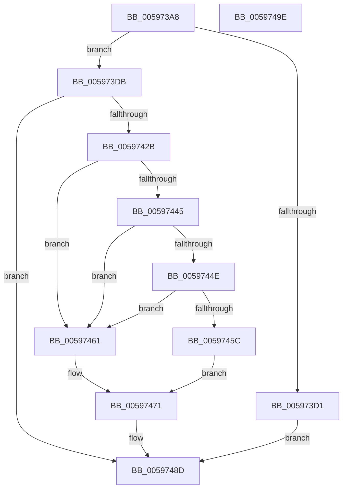

# IopGetDriverPathInformation

- RVA: `0x005973A8`–`0x0059749F` (길이 `247` bytes)
- VA: `0x00000001405973A8`
- 실행 섹션: `.text`
- PDB 이름 있음: `예`; PDB Function 태그: `아니요`
- unwind 정보 RVA: `0x000C73A8`
- 디코드: `65`개 명령, `247/247` bytes 표시
- 미해석 바이트: `0` (있으면 어셈블리에 `.byte`로 보존)

> 이 문서는 커널 이미지의 기계어와 PDB 기호를 분석해 생성했습니다. 4번과 5번은 함수 원형과 자료형을 바이너리 사용 방식에서 추정한 C 해석이며 원본 소스 복구 결과는 아닙니다.

## 1. Dependencies

- 직접 호출 지점: **6**; 고유 호출 대상: **5**
- 직접 호출자로 확인된 함수: **1**
- RIP 상대 이미지 참조: **1**

### Outgoing calls
- `0x00597422` → [ObReferenceObjectByName](../../page/8C/ObReferenceObjectByName_function_008C4A00.md) (function, `0x008C4A00`)
- `0x00597434` → [KeAcquireQueuedSpinLock](../27/KeAcquireQueuedSpinLock_function_00273D80.md) (function, `0x00273D80`)
- `0x00597453` → [IopVerifyDriverObjectOnStack](IopVerifyDriverObjectOnStack_function_0059771C.md) (function, `0x0059771C`)
- `0x0059746A` → [IopVerifyDriverObjectOnStack](IopVerifyDriverObjectOnStack_function_0059771C.md) (function, `0x0059771C`)
- `0x00597477` → [KeReleaseQueuedSpinLock](../27/KeReleaseQueuedSpinLock_function_00272540.md) (function, `0x00272540`)
- `0x00597486` → [ObfDereferenceObjectWithTag](../2F/ObfDereferenceObjectWithTag_function_002F78E0.md) (function, `0x002F78E0`)

### Direct callers
- [sub_00B1A4B8](../../page/B1/Unknown_function_00B1A4B8.md) at `0x00B1A4F7`

### Static image references
- `0x00597411` → RVA `0x00FC6C78` (`ALMOSTRO`; read)

## 2. Other-region calls and transfers

- 다른 실행 섹션으로 향하는 call: **1**
  - `0x00597422` → [ObReferenceObjectByName](../../page/8C/ObReferenceObjectByName_function_008C4A00.md) (`.text` → `PAGE`)
- 별도 외부 분기/꼬리 이동을 확인하지 못했습니다.

## 3. Assembly (complete function range)

```asm
005973A8  48 8B C4                        mov rax, rsp
005973AB  48 89 58 08                     mov qword ptr [rax + 8], rbx
005973AF  48 89 70 18                     mov qword ptr [rax + 0x18], rsi
005973B3  41 56                           push r14
005973B5  48 83 EC 50                     sub rsp, 0x50
005973B9  83 60 EC 00                     and dword ptr [rax - 0x14], 0
005973BD  48 8B DA                        mov rbx, rdx
005973C0  48 83 60 10 00                  and qword ptr [rax + 0x10], 0
005973C5  48 8B F1                        mov rsi, rcx
005973C8  41 8D 40 F8                     lea eax, [r8 - 8]
005973CC  3B 42 04                        cmp eax, dword ptr [rdx + 4]
005973CF  73 0A                           jae 0x1405973db
005973D1  B8 0D 00 00 C0                  mov eax, 0xc000000d
005973D6  E9 B2 00 00 00                  jmp 0x14059748d
005973DB  48 8D 42 08                     lea rax, [rdx + 8]
005973DF  45 33 C9                        xor r9d, r9d
005973E2  48 89 44 24 48                  mov qword ptr [rsp + 0x48], rax
005973E7  48 8D 4C 24 40                  lea rcx, [rsp + 0x40]
005973EC  0F B7 42 04                     movzx eax, word ptr [rdx + 4]
005973F0  45 33 C0                        xor r8d, r8d
005973F3  66 89 44 24 40                  mov word ptr [rsp + 0x40], ax
005973F8  66 89 44 24 42                  mov word ptr [rsp + 0x42], ax
005973FD  41 8D 51 40                     lea edx, [r9 + 0x40]
00597401  48 8D 44 24 68                  lea rax, [rsp + 0x68]
00597406  48 89 44 24 38                  mov qword ptr [rsp + 0x38], rax
0059740B  48 83 64 24 30 00               and qword ptr [rsp + 0x30], 0
00597411  48 8B 05 60 F8 A2 00            mov rax, qword ptr [rip + 0xa2f860]
00597418  C6 44 24 28 00                  mov byte ptr [rsp + 0x28], 0
0059741D  48 89 44 24 20                  mov qword ptr [rsp + 0x20], rax
00597422  E8 D9 D5 32 00                  call 0x1408c4a00
00597427  85 C0                           test eax, eax
00597429  78 62                           js 0x14059748d
0059742B  41 BE 0A 00 00 00               mov r14d, 0xa
00597431  41 8B CE                        mov ecx, r14d
00597434  E8 47 C9 CD FF                  call 0x140273d80
00597439  48 8B 56 10                     mov rdx, qword ptr [rsi + 0x10]
0059743D  44 8A C8                        mov r9b, al
00597440  48 85 D2                        test rdx, rdx
00597443  74 1C                           je 0x140597461
00597445  48 8B 4A 08                     mov rcx, qword ptr [rdx + 8]
00597449  48 85 C9                        test rcx, rcx
0059744C  74 13                           je 0x140597461
0059744E  48 8B 54 24 68                  mov rdx, qword ptr [rsp + 0x68]
00597453  E8 C4 02 00 00                  call 0x14059771c
00597458  84 C0                           test al, al
0059745A  74 05                           je 0x140597461
0059745C  C6 03 01                        mov byte ptr [rbx], 1
0059745F  EB 10                           jmp 0x140597471
00597461  48 8B 54 24 68                  mov rdx, qword ptr [rsp + 0x68]
00597466  48 8B 4E 08                     mov rcx, qword ptr [rsi + 8]
0059746A  E8 AD 02 00 00                  call 0x14059771c
0059746F  88 03                           mov byte ptr [rbx], al
00597471  41 8A D1                        mov dl, r9b
00597474  49 8B CE                        mov rcx, r14
00597477  E8 C4 B0 CD FF                  call 0x140272540
0059747C  48 8B 4C 24 68                  mov rcx, qword ptr [rsp + 0x68]
00597481  BA 44 66 6C 74                  mov edx, 0x746c6644
00597486  E8 55 04 D6 FF                  call 0x1402f78e0
0059748B  33 C0                           xor eax, eax
0059748D  48 8B 5C 24 60                  mov rbx, qword ptr [rsp + 0x60]
00597492  48 8B 74 24 70                  mov rsi, qword ptr [rsp + 0x70]
00597497  48 83 C4 50                     add rsp, 0x50
0059749B  41 5E                           pop r14
0059749D  C3                              ret
0059749E  CC                              int3
```

## 4. C-style interpretation (structured pseudocode)

```c
__int64 __fastcall IopGetDriverPathInformation(__int64 a1, __int64 a2, __int64 a3, int a4)
{
    __int64 result;
    __int64 v_rsp;
    unsigned __int64 v_stack_m10;
    unsigned __int16 v_stack_m16;
    unsigned __int64 v_stack_m18;
    unsigned __int64 v_stack_m20;
    unsigned __int64 v_stack_m28;
    unsigned __int8 v_stack_m30;
    unsigned __int64 v_stack_m38;
    unsigned __int64 v_stack_p10;
    unsigned __int64 v_stack_p18;
    unsigned __int64 v_stack_p8;

    *(unsigned __int64 *)(v_rsp + 8) = v_rbx;
    *(unsigned __int64 *)(v_rsp + 24) = v_rsi;
    v_rsp = (v_rsp) - (80);
    if (((unsigned int)(a3 - 8)) >= (*(unsigned int *)(a2 + 4))) goto loc_005973DB;
    goto loc_0059748D;
loc_005973DB:
    a4 = 0;
    v_stack_m10 = a2 + 8;
    a3 = 0;
    v_stack_m18 = (unsigned __int16)(*(unsigned __int16 *)(a2 + 4));
    v_stack_m16 = (unsigned __int16)(*(unsigned __int16 *)(a2 + 4));
    v_stack_m20 = v_stack_p10;
    v_stack_m30 = 0;
    v_stack_m38 = *(unsigned __int64 *)(v_rip + 10680416);
    result = ObReferenceObjectByName(v_stack_m18, a4 + 64, a3, a4);
    if (sign_flag) goto loc_0059748D;
    result = KeAcquireQueuedSpinLock(10, a4 + 64, a3, a4);
    if (*(unsigned __int64 *)(a1 + 16) == 0) goto loc_00597461;
    if (*(unsigned __int64 *)(*(unsigned __int64 *)(a1 + 16) + 8) == 0) goto loc_00597461;
    result = IopVerifyDriverObjectOnStack(*(unsigned __int64 *)(*(unsigned __int64 *)(a1 + 16) + 8), v_stack_p10, a3, (unsigned __int8)(result));
    if ((unsigned __int8)(result) == 0) goto loc_00597461;
    *(unsigned __int8 *)(a2) = 1;
    goto loc_00597471;
loc_00597461:
    result = IopVerifyDriverObjectOnStack(*(unsigned __int64 *)(a1 + 8), v_stack_p10, a3, (unsigned __int8)(result));
    *(unsigned __int8 *)(a2) = (unsigned __int8)(result);
loc_00597471:
    result = KeReleaseQueuedSpinLock(10, (unsigned __int8)((unsigned __int8)(result)), a3, (unsigned __int8)(result));
    result = ObfDereferenceObjectWithTag(v_stack_p10, (unsigned int)(0x746C6644ULL), a3, (unsigned __int8)(result));
    result = 0;
loc_0059748D:
    v_rsp = (v_rsp) + (80);
    return result;
}
```

## 5. (Beta) C Style

```c
int64_t IopGetDriverPathInformation(void *Arg1, void *Arg2, void *Arg3, int32_t Arg4)
{
    uint8_t *arg1 = (uint8_t *)Arg1;
    uint8_t *arg2 = (uint8_t *)Arg2;
    uint8_t *arg3 = (uint8_t *)Arg3;

    int64_t result;
    int64_t local_rsp;
    uint64_t v_stack_m10;
    uint16_t v_stack_m16;
    uint64_t v_stack_m18;
    uint64_t v_stack_m20;
    uint64_t v_stack_m28;
    uint8_t v_stack_m30;
    uint64_t v_stack_m38;
    uint64_t v_stack_p10;
    uint64_t v_stack_p18;
    uint64_t v_stack_p8;

    *(uint64_t *)(local_rsp + 0x8) = local_rbx;
    *(uint64_t *)(local_rsp + 0x18) = local_rsi;
    local_rsp = (local_rsp) - (80);
    if (((uint32_t)(Arg3 - 8)) >= (*(uint32_t *)(arg2 + 0x4))) goto loc_005973DB;
    goto loc_0059748D;
loc_005973DB:
    Arg4 = 0;
    v_stack_m10 = Arg2 + 8;
    Arg3 = 0;
    v_stack_m18 = (uint16_t)(*(uint16_t *)(arg2 + 0x4));
    v_stack_m16 = (uint16_t)(*(uint16_t *)(arg2 + 0x4));
    v_stack_m20 = v_stack_p10;
    v_stack_m30 = 0;
    v_stack_m38 = *(uint64_t *)(v_rip + 0xA2F860);
    result = ObReferenceObjectByName(v_stack_m18, Arg4 + 64, Arg3, Arg4);
    if (sign_flag) goto loc_0059748D;
    result = KeAcquireQueuedSpinLock(10, Arg4 + 64, Arg3, Arg4);
    if (*(uint64_t *)(arg1 + 0x10) == 0) goto loc_00597461;
    if (*(uint64_t *)(*(uint64_t *)(arg1 + 0x10) + 0x8) == 0) goto loc_00597461;
    result = IopVerifyDriverObjectOnStack(*(uint64_t *)(*(uint64_t *)(arg1 + 0x10) + 0x8), v_stack_p10, Arg3, (uint8_t)(result));
    if ((uint8_t)(result) == 0) goto loc_00597461;
    *(uint8_t *)(arg2) = 1;
    goto loc_00597471;
loc_00597461:
    result = IopVerifyDriverObjectOnStack(*(uint64_t *)(arg1 + 0x8), v_stack_p10, Arg3, (uint8_t)(result));
    *(uint8_t *)(arg2) = (uint8_t)(result);
loc_00597471:
    result = KeReleaseQueuedSpinLock(10, (uint8_t)((uint8_t)(result)), Arg3, (uint8_t)(result));
    result = ObfDereferenceObjectWithTag(v_stack_p10, (uint32_t)(0x746C6644ULL), Arg3, (uint8_t)(result));
    result = 0;
loc_0059748D:
    local_rsp = (local_rsp) + (80);
    return result;
}
```

### 관측된 메모리 오프셋

구조체 형식이 확인되지 않은 접근은 인자 기준의 오프셋으로만 기록했습니다.

| 기준 인자 | 오프셋 표현 | 폭 (bit) | 접근 |
|---|---:|---:|---|
| `Arg1` | `+ 0x8` | `64` | `R` |
| `Arg1` | `+ 0x10` | `64` | `R` |
| `Arg2` | `+ 0x0` | `8` | `W` |
| `Arg2` | `+ 0x4` | `16` | `R` |
| `Arg2` | `+ 0x4` | `32` | `R` |
| `Arg2` | `+ 0x8` | `64` | `R` |
| `Arg3` | `- 0x8` | `32` | `R` |

## 6. Execution-region graph

[열기: 2D/3D 그래프와 함수 탐색 컨트롤 패널](../../../control-panel.html?section=text&rva=0x005973A8&view=graph)

- 2D 그래프는 위에서 아래로 흐르고, 3D 그래프는 빈 공간을 드래그해 회전합니다. Shift+드래그는 이동, 휠은 확대·축소, 함수 노드 선택은 대상 보고서 이동입니다.

### Static fallback


