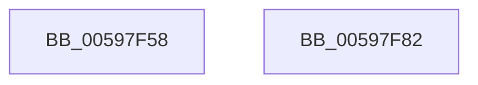

# IopGetFsRegistrationInProgress

- RVA: `0x00597F58`–`0x00597F83` (길이 `43` bytes)
- VA: `0x0000000140597F58`
- 실행 섹션: `.text`
- PDB 이름 있음: `예`; PDB Function 태그: `아니요`
- unwind 정보 RVA: `0x0005CF00`
- 디코드: `13`개 명령, `43/43` bytes 표시
- 미해석 바이트: `0` (있으면 어셈블리에 `.byte`로 보존)

> 이 문서는 커널 이미지의 기계어와 PDB 기호를 분석해 생성했습니다. 4번과 5번은 함수 원형과 자료형을 바이너리 사용 방식에서 추정한 C 해석이며 원본 소스 복구 결과는 아닙니다.

## 1. Dependencies

- 직접 호출 지점: **2**; 고유 호출 대상: **2**
- 직접 호출자로 확인된 함수: **2**
- RIP 상대 이미지 참조: **1**

### Outgoing calls
- `0x00597F63` → [KeAcquireQueuedSpinLock](../27/KeAcquireQueuedSpinLock_function_00273D80.md) (function, `0x00273D80`)
- `0x00597F75` → [KeReleaseQueuedSpinLock](../27/KeReleaseQueuedSpinLock_function_00272540.md) (function, `0x00272540`)

### Direct callers
- [IoEnumerateRegisteredFiltersList](../../page/71/IoEnumerateRegisteredFiltersList_function_0071D450.md) at `0x0071D496`
- [IoRegisterFsRegistrationChangeMountAware](../../page/71/IoRegisterFsRegistrationChangeMountAware_function_0071D890.md) at `0x0071D93C`

### Static image references
- `0x00597F68` → RVA `0x00E66128` (`.data`; read)

## 2. Other-region calls and transfers

- 다른 실행 섹션으로 향하는 call: **0**
- 별도 외부 분기/꼬리 이동을 확인하지 못했습니다.

## 3. Assembly (complete function range)

```asm
00597F58  40 53                           push rbx
00597F5A  48 83 EC 20                     sub rsp, 0x20
00597F5E  B9 0A 00 00 00                  mov ecx, 0xa
00597F63  E8 18 BE CD FF                  call 0x140273d80
00597F68  8A 1D BA E1 8C 00               mov bl, byte ptr [rip + 0x8ce1ba]
00597F6E  8A D0                           mov dl, al
00597F70  B9 0A 00 00 00                  mov ecx, 0xa
00597F75  E8 C6 A5 CD FF                  call 0x140272540
00597F7A  8A C3                           mov al, bl
00597F7C  48 83 C4 20                     add rsp, 0x20
00597F80  5B                              pop rbx
00597F81  C3                              ret
00597F82  CC                              int3
```

## 4. C-style interpretation (structured pseudocode)

```c
__int64 __fastcall IopGetFsRegistrationInProgress(void)
{
    __int64 result;
    __int64 v_rsp;

    v_rsp = (v_rsp) - (32);
    result = KeAcquireQueuedSpinLock(10, a2, a3, a4);
    result = KeReleaseQueuedSpinLock(10, (unsigned __int8)(result), a3, a4);
    v_rsp = (v_rsp) + (32);
    return (unsigned __int8)(*(unsigned __int8 *)(v_rip + 9232826));
}
```

## 5. (Beta) C Style

```c
void IopGetFsRegistrationInProgress(void)
{
    int64_t result;
    int64_t local_rsp;

    local_rsp = (local_rsp) - (32);
    result = KeAcquireQueuedSpinLock(10, a2, a3, a4);
    result = KeReleaseQueuedSpinLock(10, (uint8_t)(result), a3, a4);
    local_rsp = (local_rsp) + (32);
    return (uint8_t)(*(uint8_t *)(v_rip + 0x8CE1BA));
}
```

## 6. Execution-region graph

[열기: 2D/3D 그래프와 함수 탐색 컨트롤 패널](../../../control-panel.html?section=text&rva=0x00597F58&view=graph)

- 2D 그래프는 위에서 아래로 흐르고, 3D 그래프는 빈 공간을 드래그해 회전합니다. Shift+드래그는 이동, 휠은 확대·축소, 함수 노드 선택은 대상 보고서 이동입니다.

### Static fallback


