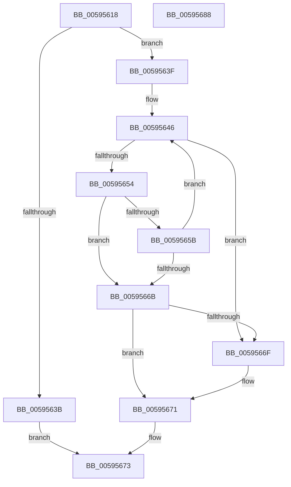

# IopGetMaxValidMemorySizeDown

- RVA: `0x00595618`–`0x00595689` (길이 `113` bytes)
- VA: `0x0000000140595618`
- 실행 섹션: `.text`
- PDB 이름 있음: `예`; PDB Function 태그: `아니요`
- unwind 정보 RVA: `0x0005C954`
- 디코드: `36`개 명령, `113/113` bytes 표시
- 미해석 바이트: `0` (있으면 어셈블리에 `.byte`로 보존)

> 이 문서는 커널 이미지의 기계어와 PDB 기호를 분석해 생성했습니다. 4번과 5번은 함수 원형과 자료형을 바이너리 사용 방식에서 추정한 C 해석이며 원본 소스 복구 결과는 아닙니다.

## 1. Dependencies

- 직접 호출 지점: **1**; 고유 호출 대상: **1**
- 직접 호출자로 확인된 함수: **2**
- RIP 상대 이미지 참조: **0**

### Outgoing calls
- `0x0059564B` → [MmIsAddressValidEx](../27/MmIsAddressValidEx_function_0027FDD0.md) (function, `0x0027FDD0`)

### Direct callers
- [IopAddRunTimeTriageDataBlocks](IopAddRunTimeTriageDataBlocks_function_0059462C.md) at `0x00594658`
- [IopMarkPagesForRunTimeTriageDataBlocks](../5A/IopMarkPagesForRunTimeTriageDataBlocks_function_005A2394.md) at `0x005A23C0`

### Static image references
- 디코드된 RIP-relative 메모리 참조가 없습니다.

## 2. Other-region calls and transfers

- 다른 실행 섹션으로 향하는 call: **0**
- 별도 외부 분기/꼬리 이동을 확인하지 못했습니다.

## 3. Assembly (complete function range)

```asm
00595618  48 89 5C 24 08                  mov qword ptr [rsp + 8], rbx
0059561D  48 89 6C 24 10                  mov qword ptr [rsp + 0x10], rbp
00595622  48 89 74 24 18                  mov qword ptr [rsp + 0x18], rsi
00595627  57                              push rdi
00595628  48 83 EC 20                     sub rsp, 0x20
0059562C  33 DB                           xor ebx, ebx
0059562E  48 8D 71 FF                     lea rsi, [rcx - 1]
00595632  48 81 E6 00 F0 FF FF            and rsi, 0xfffffffffffff000
00595639  75 04                           jne 0x14059563f
0059563B  33 C0                           xor eax, eax
0059563D  EB 34                           jmp 0x140595673
0059563F  33 ED                           xor ebp, ebp
00595641  BF 00 01 00 00                  mov edi, 0x100
00595646  33 D2                           xor edx, edx
00595648  48 8B CE                        mov rcx, rsi
0059564B  E8 80 A7 CE FF                  call 0x14027fdd0
00595650  84 C0                           test al, al
00595652  74 1B                           je 0x14059566f
00595654  03 DD                           add ebx, ebp
00595656  48 85 F6                        test rsi, rsi
00595659  74 10                           je 0x14059566b
0059565B  48 81 EE 00 10 00 00            sub rsi, 0x1000
00595662  BD 00 10 00 00                  mov ebp, 0x1000
00595667  3B DF                           cmp ebx, edi
00595669  72 DB                           jb 0x140595646
0059566B  3B DF                           cmp ebx, edi
0059566D  73 02                           jae 0x140595671
0059566F  8B FB                           mov edi, ebx
00595671  8B C7                           mov eax, edi
00595673  48 8B 5C 24 30                  mov rbx, qword ptr [rsp + 0x30]
00595678  48 8B 6C 24 38                  mov rbp, qword ptr [rsp + 0x38]
0059567D  48 8B 74 24 40                  mov rsi, qword ptr [rsp + 0x40]
00595682  48 83 C4 20                     add rsp, 0x20
00595686  5F                              pop rdi
00595687  C3                              ret
00595688  CC                              int3
```

## 4. C-style interpretation (structured pseudocode)

```c
__int64 __fastcall IopGetMaxValidMemorySizeDown(__int64 a1, int a2)
{
    __int64 result;
    __int64 v_rbp;
    __int64 v_rbx;
    __int64 v_rdi;
    __int64 v_rsi;
    __int64 v_rsp;
    unsigned __int64 v_stack_p10;
    unsigned __int64 v_stack_p18;
    unsigned __int64 v_stack_p8;

    v_stack_p8 = v_rbx;
    v_stack_p10 = v_rbp;
    v_stack_p18 = v_rsi;
    v_rsp = (v_rsp) - (32);
    v_rbx = 0;
    v_rsi = (a1 - 1) & (0xFFFFFFFFFFFFF000ULL);
    if (condition_is_not_equal) goto loc_0059563F;
    result = 0;
    goto loc_00595673;
loc_0059563F:
    v_rbp = 0;
loc_00595646:
    a2 = 0;
    result = MmIsAddressValidEx(v_rsi, a2, a3, a4);
    if ((unsigned __int8)(result) == 0) goto loc_0059566F;
    v_rbx = (unsigned int)((v_rbx) + (0));
    if (v_rsi == 0) goto loc_0059566B;
    v_rsi = (v_rsi) - (0x1000ULL);
    if (((unsigned int)(v_rbx)) < 256) goto loc_00595646;
loc_0059566B:
    v_rdi = 256;
    if (((unsigned int)(v_rbx)) < 256) {
        v_rdi = (unsigned int)(v_rbx);
    }
loc_00595673:
    v_rsp = (v_rsp) + (32);
    return (unsigned int)((unsigned int)(v_rdi));
}
```

## 5. (Beta) C Style

```c
int64_t IopGetMaxValidMemorySizeDown(void *Arg1, int32_t Arg2)
{
    uint8_t *arg1 = (uint8_t *)Arg1;

    int64_t result;
    int64_t local_rbp;
    int64_t local_rbx;
    int64_t local_rdi;
    int64_t local_rsi;
    int64_t local_rsp;
    uint64_t v_stack_p10;
    uint64_t v_stack_p18;
    uint64_t v_stack_p8;

    v_stack_p8 = local_rbx;
    v_stack_p10 = local_rbp;
    v_stack_p18 = local_rsi;
    local_rsp = (local_rsp) - (32);
    local_rbx = 0;
    local_rsi = (Arg1 - 1) & (0xFFFFFFFFFFFFF000ULL);
    if (condition_is_not_equal) goto loc_0059563F;
    result = 0;
    goto loc_00595673;
loc_0059563F:
    local_rbp = 0;
loc_00595646:
    Arg2 = 0;
    result = MmIsAddressValidEx(local_rsi, Arg2, a3, a4);
    if ((uint8_t)(result) == 0) goto loc_0059566F;
    local_rbx = (uint32_t)((local_rbx) + (0));
    if (local_rsi == 0) goto loc_0059566B;
    local_rsi = (local_rsi) - (0x1000ULL);
    if (((uint32_t)(local_rbx)) < 256) goto loc_00595646;
loc_0059566B:
    local_rdi = 256;
    if (((uint32_t)(local_rbx)) < 256) {
        local_rdi = (uint32_t)(local_rbx);
    }
loc_00595673:
    local_rsp = (local_rsp) + (32);
    return (uint32_t)((uint32_t)(local_rdi));
}
```

### 관측된 메모리 오프셋

구조체 형식이 확인되지 않은 접근은 인자 기준의 오프셋으로만 기록했습니다.

| 기준 인자 | 오프셋 표현 | 폭 (bit) | 접근 |
|---|---:|---:|---|
| `Arg1` | `- 0x1` | `64` | `R` |

## 6. Execution-region graph

[열기: 2D/3D 그래프와 함수 탐색 컨트롤 패널](../../../control-panel.html?section=text&rva=0x00595618&view=graph)

- 2D 그래프는 위에서 아래로 흐르고, 3D 그래프는 빈 공간을 드래그해 회전합니다. Shift+드래그는 이동, 휠은 확대·축소, 함수 노드 선택은 대상 보고서 이동입니다.

### Static fallback


