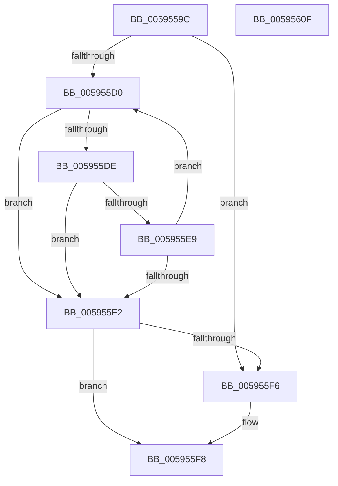

# IopGetMaxValidMemorySize

- RVA: `0x0059559C`–`0x00595610` (길이 `116` bytes)
- VA: `0x000000014059559C`
- 실행 섹션: `.text`
- PDB 이름 있음: `예`; PDB Function 태그: `아니요`
- unwind 정보 RVA: `0x0005C954`
- 디코드: `37`개 명령, `116/116` bytes 표시
- 미해석 바이트: `0` (있으면 어셈블리에 `.byte`로 보존)

> 이 문서는 커널 이미지의 기계어와 PDB 기호를 분석해 생성했습니다. 4번과 5번은 함수 원형과 자료형을 바이너리 사용 방식에서 추정한 C 해석이며 원본 소스 복구 결과는 아닙니다.

## 1. Dependencies

- 직접 호출 지점: **1**; 고유 호출 대상: **1**
- 직접 호출자로 확인된 함수: **6**
- RIP 상대 이미지 참조: **0**

### Outgoing calls
- `0x005955D5` → [MmIsAddressValidEx](../27/MmIsAddressValidEx_function_0027FDD0.md) (function, `0x0027FDD0`)

### Direct callers
- [IoFillTriageDumpBuffer](IoFillTriageDumpBuffer_function_005921CC.md) at `0x005923E0`
- [IopAddRunTimeTriageDataBlocks](IopAddRunTimeTriageDataBlocks_function_0059462C.md) at `0x0059466B`
- [IopUpdateMinidumpContext](IopUpdateMinidumpContext_function_00596360.md) at `0x0059644A`
- [IopUpdateMinidumpContext](IopUpdateMinidumpContext_function_00596360.md) at `0x005964A2`
- [IopUpdateMinidumpContext](IopUpdateMinidumpContext_function_00596360.md) at `0x00596552`
- [IopAddBugcheckTriageThread](../5A/IopAddBugcheckTriageThread_function_005A0CF8.md) at `0x005A0D6E`
- [IopCalculateStackInformation](../5A/IopCalculateStackInformation_function_005A1954.md) at `0x005A19FF`
- [IopMarkPagesForRunTimeTriageDataBlocks](../5A/IopMarkPagesForRunTimeTriageDataBlocks_function_005A2394.md) at `0x005A23D3`

### Static image references
- 디코드된 RIP-relative 메모리 참조가 없습니다.

## 2. Other-region calls and transfers

- 다른 실행 섹션으로 향하는 call: **0**
- 별도 외부 분기/꼬리 이동을 확인하지 못했습니다.

## 3. Assembly (complete function range)

```asm
0059559C  48 89 5C 24 08                  mov qword ptr [rsp + 8], rbx
005955A1  48 89 6C 24 10                  mov qword ptr [rsp + 0x10], rbp
005955A6  48 89 74 24 18                  mov qword ptr [rsp + 0x18], rsi
005955AB  57                              push rdi
005955AC  48 83 EC 20                     sub rsp, 0x20
005955B0  8B C1                           mov eax, ecx
005955B2  48 8B F1                        mov rsi, rcx
005955B5  25 FF 0F 00 00                  and eax, 0xfff
005955BA  BD 00 10 00 00                  mov ebp, 0x1000
005955BF  2B E8                           sub ebp, eax
005955C1  33 DB                           xor ebx, ebx
005955C3  48 81 E6 00 F0 FF FF            and rsi, 0xfffffffffffff000
005955CA  8B FA                           mov edi, edx
005955CC  85 D2                           test edx, edx
005955CE  74 26                           je 0x1405955f6
005955D0  33 D2                           xor edx, edx
005955D2  48 8B CE                        mov rcx, rsi
005955D5  E8 F6 A7 CE FF                  call 0x14027fdd0
005955DA  84 C0                           test al, al
005955DC  74 14                           je 0x1405955f2
005955DE  03 DD                           add ebx, ebp
005955E0  48 81 C6 00 10 00 00            add rsi, 0x1000
005955E7  74 09                           je 0x1405955f2
005955E9  BD 00 10 00 00                  mov ebp, 0x1000
005955EE  3B DF                           cmp ebx, edi
005955F0  72 DE                           jb 0x1405955d0
005955F2  3B DF                           cmp ebx, edi
005955F4  72 02                           jb 0x1405955f8
005955F6  8B DF                           mov ebx, edi
005955F8  48 8B 6C 24 38                  mov rbp, qword ptr [rsp + 0x38]
005955FD  8B C3                           mov eax, ebx
005955FF  48 8B 5C 24 30                  mov rbx, qword ptr [rsp + 0x30]
00595604  48 8B 74 24 40                  mov rsi, qword ptr [rsp + 0x40]
00595609  48 83 C4 20                     add rsp, 0x20
0059560D  5F                              pop rdi
0059560E  C3                              ret
0059560F  CC                              int3
```

## 4. C-style interpretation (structured pseudocode)

```c
__int64 __fastcall IopGetMaxValidMemorySize(__int64 a1, int a2)
{
    __int64 result;
    __int64 v_rbp;
    __int64 v_rbx;
    __int64 v_rsi;
    __int64 v_rsp;
    unsigned __int64 v_stack_p10;
    unsigned __int64 v_stack_p18;
    unsigned __int64 v_stack_p8;

    v_stack_p8 = v_rbx;
    v_stack_p10 = v_rbp;
    v_stack_p18 = v_rsi;
    v_rsp = (v_rsp) - (32);
    result = (unsigned int)(((unsigned int)((unsigned int)(a1))) & (0xFFFULL));
    v_rbp = (unsigned int)(((unsigned int)(0x1000ULL)) - ((unsigned int)(result)));
    v_rbx = 0;
    v_rsi = (a1) & (0xFFFFFFFFFFFFF000ULL);
    if (a2 == 0) goto loc_005955F6;
loc_005955D0:
    a2 = 0;
    result = MmIsAddressValidEx(v_rsi, a2, a3, a4);
    if ((unsigned __int8)(result) == 0) goto loc_005955F2;
    v_rbx = (unsigned int)((v_rbx) + ((unsigned int)(v_rbp)));
    v_rsi = (v_rsi) + (0x1000ULL);
    if (condition_is_equal) goto loc_005955F2;
    if (((unsigned int)(v_rbx)) < ((unsigned int)((unsigned int)(a2)))) goto loc_005955D0;
loc_005955F2:
    if (((unsigned int)(v_rbx)) >= ((unsigned int)((unsigned int)(a2)))) {
        v_rbx = (unsigned int)((unsigned int)(a2));
    }
    v_rsp = (v_rsp) + (32);
    return (unsigned int)((unsigned int)(v_rbx));
}
```

## 5. (Beta) C Style

```c
int64_t IopGetMaxValidMemorySize(int64_t Arg1, int32_t Arg2)
{
    int64_t result;
    int64_t local_rbp;
    int64_t local_rbx;
    int64_t local_rsi;
    int64_t local_rsp;
    uint64_t v_stack_p10;
    uint64_t v_stack_p18;
    uint64_t v_stack_p8;

    v_stack_p8 = local_rbx;
    v_stack_p10 = local_rbp;
    v_stack_p18 = local_rsi;
    local_rsp = (local_rsp) - (32);
    result = (uint32_t)(((uint32_t)((uint32_t)(Arg1))) & (0xFFFULL));
    local_rbp = (uint32_t)(((uint32_t)(0x1000ULL)) - ((uint32_t)(result)));
    local_rbx = 0;
    local_rsi = (Arg1) & (0xFFFFFFFFFFFFF000ULL);
    if (Arg2 == 0) goto loc_005955F6;
loc_005955D0:
    Arg2 = 0;
    result = MmIsAddressValidEx(local_rsi, Arg2, a3, a4);
    if ((uint8_t)(result) == 0) goto loc_005955F2;
    local_rbx = (uint32_t)((local_rbx) + ((uint32_t)(local_rbp)));
    local_rsi = (local_rsi) + (0x1000ULL);
    if (condition_is_equal) goto loc_005955F2;
    if (((uint32_t)(local_rbx)) < ((uint32_t)((uint32_t)(Arg2)))) goto loc_005955D0;
loc_005955F2:
    if (((uint32_t)(local_rbx)) >= ((uint32_t)((uint32_t)(Arg2)))) {
        local_rbx = (uint32_t)((uint32_t)(Arg2));
    }
    local_rsp = (local_rsp) + (32);
    return (uint32_t)((uint32_t)(local_rbx));
}
```

## 6. Execution-region graph

[열기: 2D/3D 그래프와 함수 탐색 컨트롤 패널](../../../control-panel.html?section=text&rva=0x0059559C&view=graph)

- 2D 그래프는 위에서 아래로 흐르고, 3D 그래프는 빈 공간을 드래그해 회전합니다. Shift+드래그는 이동, 휠은 확대·축소, 함수 노드 선택은 대상 보고서 이동입니다.

### Static fallback


