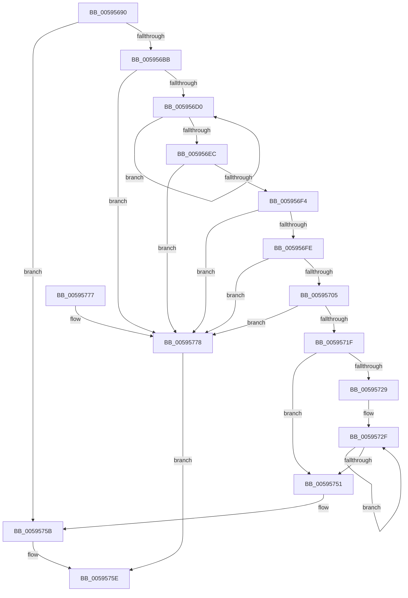

# IopGetPhysicalMemoryBlock

- RVA: `0x00595690`–`0x00595786` (길이 `246` bytes)
- VA: `0x0000000140595690`
- 실행 섹션: `.text`
- PDB 이름 있음: `예`; PDB Function 태그: `아니요`
- unwind 정보 RVA: `0x0007CD9C`
- 디코드: `75`개 명령, `246/246` bytes 표시
- 미해석 바이트: `0` (있으면 어셈블리에 `.byte`로 보존)

> 이 문서는 커널 이미지의 기계어와 PDB 기호를 분석해 생성했습니다. 4번과 5번은 함수 원형과 자료형을 바이너리 사용 방식에서 추정한 C 해석이며 원본 소스 복구 결과는 아닙니다.

## 1. Dependencies

- 직접 호출 지점: **4**; 고유 호출 대상: **3**
- 직접 호출자로 확인된 함수: **3**
- RIP 상대 이미지 참조: **0**

### Outgoing calls
- `0x005956AA` → [MmGetPhysicalMemoryRanges](../../page/7F/MmGetPhysicalMemoryRanges_function_007FB520.md) (function, `0x007FB520`)
- `0x00595712` → [ExAllocatePool2](../../poolcode/B8/ExAllocatePool2_function_00B820F0.md) (function, `0x00B820F0`)
- `0x00595756` → [ExFreePoolWithTag](../../poolcode/B8/ExFreePoolWithTag_function_00B82870.md) (function, `0x00B82870`)
- `0x0059577D` → [ExFreePoolWithTag](../../poolcode/B8/ExFreePoolWithTag_function_00B82870.md) (function, `0x00B82870`)

### Direct callers
- [IopLoadCrashdumpDriver](../4E/IopLoadCrashdumpDriver_function_004E2F70.md) at `0x004E303B`
- [IoUpdateDumpPhysicalRanges](IoUpdateDumpPhysicalRanges_function_0059343C.md) at `0x00593477`
- [IopLiveDumpAllocAndInitResources](IopLiveDumpAllocAndInitResources_function_005993B0.md) at `0x00599428`

### Static image references
- 디코드된 RIP-relative 메모리 참조가 없습니다.

## 2. Other-region calls and transfers

- 다른 실행 섹션으로 향하는 call: **4**
  - `0x005956AA` → [MmGetPhysicalMemoryRanges](../../page/7F/MmGetPhysicalMemoryRanges_function_007FB520.md) (`.text` → `PAGE`)
  - `0x00595712` → [ExAllocatePool2](../../poolcode/B8/ExAllocatePool2_function_00B820F0.md) (`.text` → `POOLCODE`)
  - `0x00595756` → [ExFreePoolWithTag](../../poolcode/B8/ExFreePoolWithTag_function_00B82870.md) (`.text` → `POOLCODE`)
  - `0x0059577D` → [ExFreePoolWithTag](../../poolcode/B8/ExFreePoolWithTag_function_00B82870.md) (`.text` → `POOLCODE`)
- 별도 외부 분기/꼬리 이동을 확인하지 못했습니다.

## 3. Assembly (complete function range)

```asm
00595690  48 89 5C 24 08                  mov qword ptr [rsp + 8], rbx
00595695  48 89 6C 24 10                  mov qword ptr [rsp + 0x10], rbp
0059569A  48 89 74 24 18                  mov qword ptr [rsp + 0x18], rsi
0059569F  57                              push rdi
005956A0  41 56                           push r14
005956A2  41 57                           push r15
005956A4  48 83 EC 20                     sub rsp, 0x20
005956A8  33 FF                           xor edi, edi
005956AA  E8 71 5E 26 00                  call 0x1407fb520
005956AF  48 8B D8                        mov rbx, rax
005956B2  48 85 C0                        test rax, rax
005956B5  0F 84 A0 00 00 00               je 0x14059575b
005956BB  48 8D 70 08                     lea rsi, [rax + 8]
005956BF  33 ED                           xor ebp, ebp
005956C1  48 8B 0E                        mov rcx, qword ptr [rsi]
005956C4  45 33 F6                        xor r14d, r14d
005956C7  48 85 C9                        test rcx, rcx
005956CA  0F 84 A8 00 00 00               je 0x140595778
005956D0  FF C5                           inc ebp
005956D2  48 C1 E9 0C                     shr rcx, 0xc
005956D6  4C 03 F1                        add r14, rcx
005956D9  8B C5                           mov eax, ebp
005956DB  48 C1 E0 04                     shl rax, 4
005956DF  44 8B FD                        mov r15d, ebp
005956E2  48 8B 4C 18 08                  mov rcx, qword ptr [rax + rbx + 8]
005956E7  48 85 C9                        test rcx, rcx
005956EA  75 E4                           jne 0x1405956d0
005956EC  85 ED                           test ebp, ebp
005956EE  0F 84 84 00 00 00               je 0x140595778
005956F4  B9 FF FF FF FF                  mov ecx, 0xffffffff
005956F9  48 3B C1                        cmp rax, rcx
005956FC  77 7A                           ja 0x140595778
005956FE  8D 48 20                        lea ecx, [rax + 0x20]
00595701  3B C8                           cmp ecx, eax
00595703  72 73                           jb 0x140595778
00595705  8B D1                           mov edx, ecx
00595707  41 B8 43 44 6D 70               mov r8d, 0x706d4443
0059570D  B9 40 00 00 00                  mov ecx, 0x40
00595712  E8 D9 C9 5E 00                  call 0x140b820f0
00595717  48 8B F8                        mov rdi, rax
0059571A  48 85 C0                        test rax, rax
0059571D  74 59                           je 0x140595778
0059571F  89 28                           mov dword ptr [rax], ebp
00595721  4C 89 70 08                     mov qword ptr [rax + 8], r14
00595725  85 ED                           test ebp, ebp
00595727  74 28                           je 0x140595751
00595729  48 8B C8                        mov rcx, rax
0059572C  48 2B CB                        sub rcx, rbx
0059572F  48 8B 46 F8                     mov rax, qword ptr [rsi - 8]
00595733  48 C1 E8 0C                     shr rax, 0xc
00595737  48 89 44 31 08                  mov qword ptr [rcx + rsi + 8], rax
0059573C  48 8B 06                        mov rax, qword ptr [rsi]
0059573F  48 8D 76 10                     lea rsi, [rsi + 0x10]
00595743  48 C1 E8 0C                     shr rax, 0xc
00595747  48 89 04 31                     mov qword ptr [rcx + rsi], rax
0059574B  49 83 EF 01                     sub r15, 1
0059574F  75 DE                           jne 0x14059572f
00595751  33 D2                           xor edx, edx
00595753  48 8B CB                        mov rcx, rbx
00595756  E8 15 D1 5E 00                  call 0x140b82870
0059575B  48 8B C7                        mov rax, rdi
0059575E  48 8B 5C 24 40                  mov rbx, qword ptr [rsp + 0x40]
00595763  48 8B 6C 24 48                  mov rbp, qword ptr [rsp + 0x48]
00595768  48 8B 74 24 50                  mov rsi, qword ptr [rsp + 0x50]
0059576D  48 83 C4 20                     add rsp, 0x20
00595771  41 5F                           pop r15
00595773  41 5E                           pop r14
00595775  5F                              pop rdi
00595776  C3                              ret
00595777  CC                              int3
00595778  33 D2                           xor edx, edx
0059577A  48 8B CB                        mov rcx, rbx
0059577D  E8 EE D0 5E 00                  call 0x140b82870
00595782  33 C0                           xor eax, eax
00595784  EB D8                           jmp 0x14059575e
```

## 4. C-style interpretation (structured pseudocode)

```c
__int64 __fastcall IopGetPhysicalMemoryBlock(void)
{
    __int64 result;
    __int64 v_r14;
    __int64 v_r15;
    __int64 v_rbp;
    __int64 v_rdi;
    __int64 v_rsp;
    unsigned __int64 v_stack_p10;
    unsigned __int64 v_stack_p18;
    unsigned __int64 v_stack_p8;

    v_stack_p8 = v_rbx;
    v_stack_p10 = v_rbp;
    v_stack_p18 = v_rsi;
    v_rsp = (v_rsp) - (32);
    v_rdi = 0;
    result = MmGetPhysicalMemoryRanges(a1, a2, a3, a4);
    if (result == 0) goto loc_0059575B;
    v_rbp = 0;
    v_r14 = 0;
    if (*(unsigned __int64 *)(result + 8) == 0) goto loc_00595778;
loc_005956D0:
    v_rbp = (unsigned int)((v_rbp) + 1);
    a1 = (*(unsigned __int64 *)(result + 8)) >> (12);
    v_r14 = (v_r14) + (a1);
    result = ((unsigned int)((unsigned int)(v_rbp))) << (4);
    if (*(unsigned __int64 *)(result + result * 1 + 8) != 0) goto loc_005956D0;
    if ((unsigned int)(v_rbp) == 0) goto loc_00595778;
    if (result > ((unsigned int)(0xFFFFFFFFULL))) goto loc_00595778;
    if (((unsigned int)(result + 32)) < ((unsigned int)(result))) goto loc_00595778;
    result = ExAllocatePool2(64, (unsigned int)((unsigned int)(result + 32)), (unsigned int)(0x706D4443ULL), a4);
    if (result == 0) goto loc_00595778;
    *(unsigned int *)(result) = (unsigned int)(v_rbp);
    *(unsigned __int64 *)(result + 8) = v_r14;
    if ((unsigned int)(v_rbp) == 0) goto loc_00595751;
    a1 = (result) - (result);
loc_0059572F:
    result = (*(unsigned __int64 *)(result + 8 - 8)) >> (12);
    *(unsigned __int64 *)(a1 + result + 8 * 1 + 8) = result;
    result = (*(unsigned __int64 *)(result + 8)) >> (12);
    *(unsigned __int64 *)(a1 + result + 8 + 16 * 1) = result;
    v_r15 = ((unsigned int)((unsigned int)(v_rbp))) - (1);
    if (condition_is_not_equal) goto loc_0059572F;
loc_00595751:
    a2 = 0;
    result = ExFreePoolWithTag(result, a2, (unsigned int)(0x706D4443ULL), a4);
loc_0059575B:
loc_0059575E:
    v_rsp = (v_rsp) + (32);
    return result;
loc_00595778:
    a2 = 0;
    result = ExFreePoolWithTag(v_stack_p8, a2, (unsigned int)(0x706D4443ULL), a4);
    result = 0;
    goto loc_0059575E;
}
```

## 5. (Beta) C Style

```c
void IopGetPhysicalMemoryBlock(void)
{
    int64_t result;
    int64_t local_r14;
    int64_t local_r15;
    int64_t local_rbp;
    int64_t local_rdi;
    int64_t local_rsp;
    uint64_t v_stack_p10;
    uint64_t v_stack_p18;
    uint64_t v_stack_p8;

    v_stack_p8 = local_rbx;
    v_stack_p10 = local_rbp;
    v_stack_p18 = local_rsi;
    local_rsp = (local_rsp) - (32);
    local_rdi = 0;
    result = MmGetPhysicalMemoryRanges(a1, a2, a3, a4);
    if (result == 0) goto loc_0059575B;
    local_rbp = 0;
    local_r14 = 0;
    if (*(uint64_t *)(result + 0x8) == 0) goto loc_00595778;
loc_005956D0:
    local_rbp = (uint32_t)((local_rbp) + 1);
    a1 = (*(uint64_t *)(result + 0x8)) >> (12);
    local_r14 = (local_r14) + (a1);
    result = ((uint32_t)((uint32_t)(local_rbp))) << (4);
    if (*(uint64_t *)(result + result * 1 + 0x8) != 0) goto loc_005956D0;
    if ((uint32_t)(local_rbp) == 0) goto loc_00595778;
    if (result > ((uint32_t)(0xFFFFFFFFULL))) goto loc_00595778;
    if (((uint32_t)(result + 32)) < ((uint32_t)(result))) goto loc_00595778;
    result = ExAllocatePool2(64, (uint32_t)((uint32_t)(result + 32)), (uint32_t)(0x706D4443ULL), a4);
    if (result == 0) goto loc_00595778;
    *(uint32_t *)(result) = (uint32_t)(local_rbp);
    *(uint64_t *)(result + 0x8) = local_r14;
    if ((uint32_t)(local_rbp) == 0) goto loc_00595751;
    a1 = (result) - (result);
loc_0059572F:
    result = (*(uint64_t *)(result + 0x8 - 0x8)) >> (12);
    *(uint64_t *)(a1 + result + 0x8 * 1 + 0x8) = result;
    result = (*(uint64_t *)(result + 0x8)) >> (12);
    *(uint64_t *)(a1 + result + 0x8 + 0x10 * 1) = result;
    local_r15 = ((uint32_t)((uint32_t)(local_rbp))) - (1);
    if (condition_is_not_equal) goto loc_0059572F;
loc_00595751:
    a2 = 0;
    result = ExFreePoolWithTag(result, a2, (uint32_t)(0x706D4443ULL), a4);
loc_0059575B:
loc_0059575E:
    local_rsp = (local_rsp) + (32);
    return result;
loc_00595778:
    a2 = 0;
    result = ExFreePoolWithTag(v_stack_p8, a2, (uint32_t)(0x706D4443ULL), a4);
    result = 0;
    goto loc_0059575E;
}
```

## 6. Execution-region graph

[열기: 2D/3D 그래프와 함수 탐색 컨트롤 패널](../../../control-panel.html?section=text&rva=0x00595690&view=graph)

- 2D 그래프는 위에서 아래로 흐르고, 3D 그래프는 빈 공간을 드래그해 회전합니다. Shift+드래그는 이동, 휠은 확대·축소, 함수 노드 선택은 대상 보고서 이동입니다.

### Static fallback


