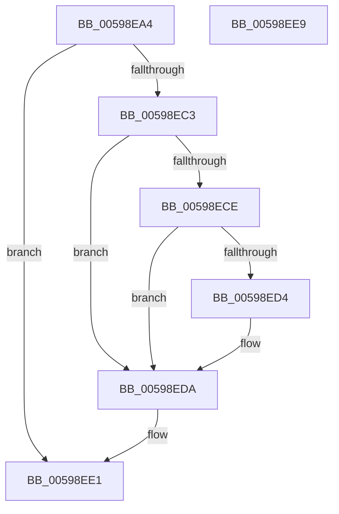

# IopGetRegistryULongValue

- RVA: `0x00598EA4`–`0x00598EEA` (길이 `70` bytes)
- VA: `0x0000000140598EA4`
- 실행 섹션: `.text`
- PDB 이름 있음: `예`; PDB Function 태그: `아니요`
- unwind 정보 RVA: `0x0005CF00`
- 디코드: `23`개 명령, `70/70` bytes 표시
- 미해석 바이트: `0` (있으면 어셈블리에 `.byte`로 보존)

> 이 문서는 커널 이미지의 기계어와 PDB 기호를 분석해 생성했습니다. 4번과 5번은 함수 원형과 자료형을 바이너리 사용 방식에서 추정한 C 해석이며 원본 소스 복구 결과는 아닙니다.

## 1. Dependencies

- 직접 호출 지점: **2**; 고유 호출 대상: **2**
- 직접 호출자로 확인된 함수: **2**
- RIP 상대 이미지 참조: **0**

### Outgoing calls
- `0x00598EBA` → [IopGetRegistryValue](../../page/99/IopGetRegistryValue_function_009990EC.md) (function, `0x009990EC`)
- `0x00598EDC` → [ExFreePoolWithTag](../../poolcode/B8/ExFreePoolWithTag_function_00B82870.md) (function, `0x00B82870`)

### Direct callers
- [IopGetRegistryBoolValue](IopGetRegistryBoolValue_function_00598E84.md) at `0x00598E88`
- [IopLiveDumpInitRegistrySettings](IopLiveDumpInitRegistrySettings_function_0059C8A4.md) at `0x0059C901`

### Static image references
- 디코드된 RIP-relative 메모리 참조가 없습니다.

## 2. Other-region calls and transfers

- 다른 실행 섹션으로 향하는 call: **2**
  - `0x00598EBA` → [IopGetRegistryValue](../../page/99/IopGetRegistryValue_function_009990EC.md) (`.text` → `PAGE`)
  - `0x00598EDC` → [ExFreePoolWithTag](../../poolcode/B8/ExFreePoolWithTag_function_00B82870.md) (`.text` → `POOLCODE`)
- 별도 외부 분기/꼬리 이동을 확인하지 못했습니다.

## 3. Assembly (complete function range)

```asm
00598EA4  40 53                           push rbx
00598EA6  48 83 EC 20                     sub rsp, 0x20
00598EAA  33 DB                           xor ebx, ebx
00598EAC  4C 8D 4C 24 48                  lea r9, [rsp + 0x48]
00598EB1  48 89 5C 24 48                  mov qword ptr [rsp + 0x48], rbx
00598EB6  44 8D 43 04                     lea r8d, [rbx + 4]
00598EBA  E8 2D 02 40 00                  call 0x1409990ec
00598EBF  85 C0                           test eax, eax
00598EC1  78 1E                           js 0x140598ee1
00598EC3  48 8B 4C 24 48                  mov rcx, qword ptr [rsp + 0x48]
00598EC8  83 79 04 04                     cmp dword ptr [rcx + 4], 4
00598ECC  75 0C                           jne 0x140598eda
00598ECE  83 79 0C 04                     cmp dword ptr [rcx + 0xc], 4
00598ED2  75 06                           jne 0x140598eda
00598ED4  8B 41 08                        mov eax, dword ptr [rcx + 8]
00598ED7  8B 1C 08                        mov ebx, dword ptr [rax + rcx]
00598EDA  33 D2                           xor edx, edx
00598EDC  E8 8F 99 5E 00                  call 0x140b82870
00598EE1  8B C3                           mov eax, ebx
00598EE3  48 83 C4 20                     add rsp, 0x20
00598EE7  5B                              pop rbx
00598EE8  C3                              ret
00598EE9  CC                              int3
```

## 4. C-style interpretation (structured pseudocode)

```c
__int64 __fastcall IopGetRegistryULongValue(__int64 a1, int a2)
{
    __int64 result;
    __int64 v_rbx;
    __int64 v_rsp;
    unsigned __int64 v_stack_p20;

    v_rsp = (v_rsp) - (32);
    v_rbx = 0;
    v_stack_p20 = 0;
    result = IopGetRegistryValue(a1, a2, v_rbx + 4, v_stack_p20);
    if (sign_flag) goto loc_00598EE1;
    if ((*(unsigned int *)(v_stack_p20 + 4)) != 4) goto loc_00598EDA;
    if ((*(unsigned int *)(v_stack_p20 + 12)) == 4) {
        result = *(unsigned int *)(v_stack_p20 + 8);
        v_rbx = *(unsigned int *)(result + v_stack_p20 * 1);
    }
    a2 = 0;
    result = ExFreePoolWithTag(v_stack_p20, a2, v_rbx + 4, v_stack_p20);
loc_00598EE1:
    v_rsp = (v_rsp) + (32);
    return (unsigned int)((unsigned int)(v_rbx));
}
```

## 5. (Beta) C Style

```c
int64_t IopGetRegistryULongValue(int64_t Arg1, int32_t Arg2)
{
    int64_t result;
    int64_t local_rbx;
    int64_t local_rsp;
    uint64_t v_stack_p20;

    local_rsp = (local_rsp) - (32);
    local_rbx = 0;
    v_stack_p20 = 0;
    result = IopGetRegistryValue(Arg1, Arg2, local_rbx + 4, v_stack_p20);
    if (sign_flag) goto loc_00598EE1;
    if ((*(uint32_t *)(v_stack_p20 + 0x4)) != 4) goto loc_00598EDA;
    if ((*(uint32_t *)(v_stack_p20 + 0xC)) == 4) {
        result = *(uint32_t *)(v_stack_p20 + 0x8);
        local_rbx = *(uint32_t *)(result + v_stack_p20 * 1);
    }
    Arg2 = 0;
    result = ExFreePoolWithTag(v_stack_p20, Arg2, local_rbx + 4, v_stack_p20);
loc_00598EE1:
    local_rsp = (local_rsp) + (32);
    return (uint32_t)((uint32_t)(local_rbx));
}
```

## 6. Execution-region graph

[열기: 2D/3D 그래프와 함수 탐색 컨트롤 패널](../../../control-panel.html?section=text&rva=0x00598EA4&view=graph)

- 2D 그래프는 위에서 아래로 흐르고, 3D 그래프는 빈 공간을 드래그해 회전합니다. Shift+드래그는 이동, 휠은 확대·축소, 함수 노드 선택은 대상 보고서 이동입니다.

### Static fallback


