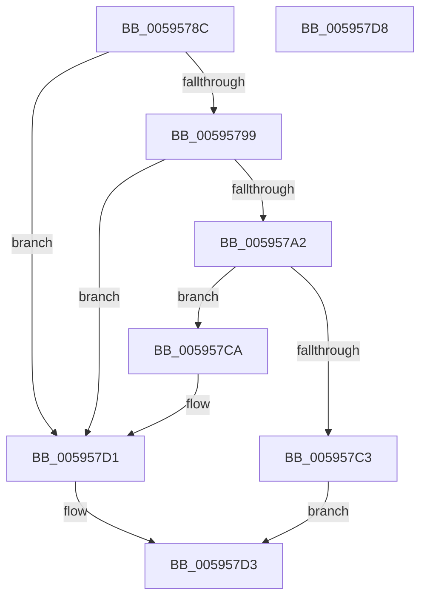

# IopInitDumpCapsuleSupport

- RVA: `0x0059578C`–`0x005957D9` (길이 `77` bytes)
- VA: `0x000000014059578C`
- 실행 섹션: `.text`
- PDB 이름 있음: `예`; PDB Function 태그: `아니요`
- unwind 정보 RVA: `0x0005C788`
- 디코드: `20`개 명령, `77/77` bytes 표시
- 미해석 바이트: `0` (있으면 어셈블리에 `.byte`로 보존)

> 이 문서는 커널 이미지의 기계어와 PDB 기호를 분석해 생성했습니다. 4번과 5번은 함수 원형과 자료형을 바이너리 사용 방식에서 추정한 C 해석이며 원본 소스 복구 결과는 아닙니다.

## 1. Dependencies

- 직접 호출 지점: **2**; 고유 호출 대상: **2**
- 직접 호출자로 확인된 함수: **3**
- RIP 상대 이미지 참조: **3**

### Outgoing calls
- `0x00595799` → [IopIsBitlockerOn](IopIsBitlockerOn_function_00595C3C.md) (function, `0x00595C3C`)
- `0x005957B2` → [ExAllocatePool2](../../poolcode/B8/ExAllocatePool2_function_00B820F0.md) (function, `0x00B820F0`)

### Direct callers
- [IoConfigureCrashDump](IoConfigureCrashDump_function_00591CB4.md) at `0x00591E0C`
- [IoInitializeCrashDump](../../page/71/IoInitializeCrashDump_function_00719D88.md) at `0x00719DFB`
- [IoInitSystemPreDrivers](../../init/C2/IoInitSystemPreDrivers_function_00C2AC3C.md) at `0x00C2BA35`

### Static image references
- `0x00595790` → RVA `0x00E65F60` (`.data`; read)
- `0x005957B7` → RVA `0x00E65F58` (`.data`; write)
- `0x005957CA` → RVA `0x00E65F60` (`.data`; write)

## 2. Other-region calls and transfers

- 다른 실행 섹션으로 향하는 call: **1**
  - `0x005957B2` → [ExAllocatePool2](../../poolcode/B8/ExAllocatePool2_function_00B820F0.md) (`.text` → `POOLCODE`)
- 별도 외부 분기/꼬리 이동을 확인하지 못했습니다.

## 3. Assembly (complete function range)

```asm
0059578C  48 83 EC 28                     sub rsp, 0x28
00595790  80 3D C9 07 8D 00 00            cmp byte ptr [rip + 0x8d07c9], 0
00595797  75 38                           jne 0x1405957d1
00595799  E8 9E 04 00 00                  call 0x140595c3c
0059579E  84 C0                           test al, al
005957A0  75 2F                           jne 0x1405957d1
005957A2  BA 00 18 04 00                  mov edx, 0x41800
005957A7  41 B8 43 44 6D 70               mov r8d, 0x706d4443
005957AD  B9 40 00 00 00                  mov ecx, 0x40
005957B2  E8 39 C9 5E 00                  call 0x140b820f0
005957B7  48 89 05 9A 07 8D 00            mov qword ptr [rip + 0x8d079a], rax
005957BE  48 85 C0                        test rax, rax
005957C1  75 07                           jne 0x1405957ca
005957C3  B8 9A 00 00 C0                  mov eax, 0xc000009a
005957C8  EB 09                           jmp 0x1405957d3
005957CA  C6 05 8F 07 8D 00 01            mov byte ptr [rip + 0x8d078f], 1
005957D1  33 C0                           xor eax, eax
005957D3  48 83 C4 28                     add rsp, 0x28
005957D7  C3                              ret
005957D8  CC                              int3
```

## 4. C-style interpretation (structured pseudocode)

```c
__int64 __fastcall IopInitDumpCapsuleSupport(void)
{
    __int64 result;
    __int64 v_rsp;

    v_rsp = (v_rsp) - (40);
    if ((*(unsigned __int8 *)(v_rip + 9242569)) != 0) goto loc_005957D1;
    result = IopIsBitlockerOn(a1, a2, a3, a4);
    if ((unsigned __int8)(result) != 0) goto loc_005957D1;
    result = ExAllocatePool2(64, (unsigned int)(0x41800ULL), (unsigned int)(0x706D4443ULL), a4);
    *(unsigned __int64 *)(v_rip + 9242522) = result;
    if (result != 0) goto loc_005957CA;
    goto loc_005957D3;
loc_005957CA:
    *(unsigned __int8 *)(v_rip + 9242511) = 1;
loc_005957D1:
    result = 0;
loc_005957D3:
    v_rsp = (v_rsp) + (40);
    return result;
}
```

## 5. (Beta) C Style

```c
void IopInitDumpCapsuleSupport(void)
{
    int64_t result;
    int64_t local_rsp;

    local_rsp = (local_rsp) - (40);
    if ((*(uint8_t *)(v_rip + 0x8D07C9)) != 0) goto loc_005957D1;
    result = IopIsBitlockerOn(a1, a2, a3, a4);
    if ((uint8_t)(result) != 0) goto loc_005957D1;
    result = ExAllocatePool2(64, (uint32_t)(0x41800ULL), (uint32_t)(0x706D4443ULL), a4);
    *(uint64_t *)(v_rip + 0x8D079A) = result;
    if (result != 0) goto loc_005957CA;
    goto loc_005957D3;
loc_005957CA:
    *(uint8_t *)(v_rip + 0x8D078F) = 1;
loc_005957D1:
    result = 0;
loc_005957D3:
    local_rsp = (local_rsp) + (40);
    return result;
}
```

## 6. Execution-region graph

[열기: 2D/3D 그래프와 함수 탐색 컨트롤 패널](../../../control-panel.html?section=text&rva=0x0059578C&view=graph)

- 2D 그래프는 위에서 아래로 흐르고, 3D 그래프는 빈 공간을 드래그해 회전합니다. Shift+드래그는 이동, 휠은 확대·축소, 함수 노드 선택은 대상 보고서 이동입니다.

### Static fallback


