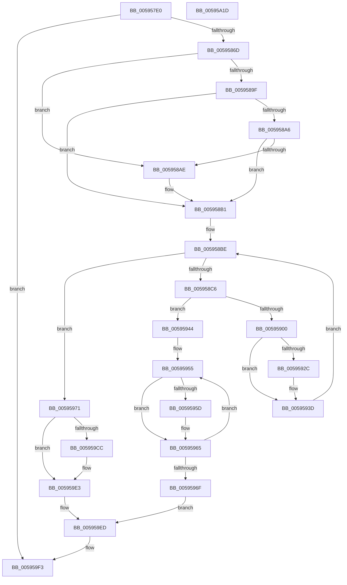

# IopInitializeInMemoryDumpData

- RVA: `0x005957E0`–`0x00595A1E` (길이 `574` bytes)
- VA: `0x00000001405957E0`
- 실행 섹션: `.text`
- PDB 이름 있음: `예`; PDB Function 태그: `아니요`
- unwind 정보 RVA: `0x000C7178`
- 디코드: `129`개 명령, `574/574` bytes 표시
- 미해석 바이트: `0` (있으면 어셈블리에 `.byte`로 보존)

> 이 문서는 커널 이미지의 기계어와 PDB 기호를 분석해 생성했습니다. 4번과 5번은 함수 원형과 자료형을 바이너리 사용 방식에서 추정한 C 해석이며 원본 소스 복구 결과는 아닙니다.

## 1. Dependencies

- 직접 호출 지점: **8**; 고유 호출 대상: **8**
- 직접 호출자로 확인된 함수: **1**
- RIP 상대 이미지 참조: **14**

### Outgoing calls
- `0x00595896` → [ZwFilterBootOption](../6A/ZwFilterBootOption_function_006AEE50.md) (function, `0x006AEE50`)
- `0x005958E7` → [MmAllocateContiguousNodeMemory](../3E/MmAllocateContiguousNodeMemory_function_003E9E40.md) (function, `0x003E9E40`)
- `0x0059590C` → [memset](../6C/memset_function_006C6C40.md) (function, `0x006C6C40`)
- `0x00595938` → [KdCopyDataBlock](../5B/KdCopyDataBlock_function_005B04E4.md) (function, `0x005B04E4`)
- `0x0059595D` → [MmFreeContiguousMemory](../3F/MmFreeContiguousMemory_function_003F6F60.md) (function, `0x003F6F60`)
- `0x00595994` → [ExGenRandom](../41/ExGenRandom_function_0041B010.md) (function, `0x0041B010`)
- `0x005959C3` → [IoSetEnvironmentVariableEx](../../page/A9/IoSetEnvironmentVariableEx_function_00A91A84.md) (function, `0x00A91A84`)
- `0x005959FA` → [_security_check_cookie](../6A/_security_check_cookie_function_006AC640.md) (function, `0x006AC640`)

### Direct callers
- [IopInitializeOfflineCrashDump](IopInitializeOfflineCrashDump_function_00595A24.md) at `0x00595BB7`

### Static image references
- `0x005957FF` → RVA `0x00E0A740` (`.data`; read)
- `0x00595831` → RVA `0x00E65F10` (`.data`; read/write)
- `0x00595871` → RVA `0x00E65F44` (`.data`; write)
- `0x0059587C` → RVA `0x00E65F30` (`.data`; write)
- `0x005958A6` → RVA `0x00F475F8` (`.data`; read)
- `0x005958B1` → RVA `0x00E65F28` (`.data`; write)
- `0x005958C6` → RVA `0x00E65F28` (`.data`; read)
- `0x005958EF` → RVA `0x00E65F10` (`.data`; read)
- `0x0059594E` → RVA `0x00E65F18` (`.data`; read)
- `0x0059597A` → RVA `0x00E65F38` (`.data`; write)
- `0x0059598E` → RVA `0x00E65F3C` (`.data`; write)
- `0x005959B1` → RVA `0x00E65F38` (`.data`; read)
- `0x005959BC` → RVA `0x006C9BC0` (` ?? ::FNODOBFM::`string'`; read)
- `0x005959E3` → RVA `0x00E65F14` (`.data`; write)

## 2. Other-region calls and transfers

- 다른 실행 섹션으로 향하는 call: **1**
  - `0x005959C3` → [IoSetEnvironmentVariableEx](../../page/A9/IoSetEnvironmentVariableEx_function_00A91A84.md) (`.text` → `PAGE`)
- 별도 외부 분기/꼬리 이동을 확인하지 못했습니다.

## 3. Assembly (complete function range)

```asm
005957E0  48 8B C4                        mov rax, rsp
005957E3  48 89 58 08                     mov qword ptr [rax + 8], rbx
005957E7  48 89 70 10                     mov qword ptr [rax + 0x10], rsi
005957EB  48 89 78 18                     mov qword ptr [rax + 0x18], rdi
005957EF  4C 89 68 20                     mov qword ptr [rax + 0x20], r13
005957F3  55                              push rbp
005957F4  41 56                           push r14
005957F6  41 57                           push r15
005957F8  48 8B EC                        mov rbp, rsp
005957FB  48 83 EC 70                     sub rsp, 0x70
005957FF  48 8B 05 3A 4F 87 00            mov rax, qword ptr [rip + 0x874f3a]
00595806  48 33 C4                        xor rax, rsp
00595809  48 89 45 F0                     mov qword ptr [rbp - 0x10], rax
0059580D  33 DB                           xor ebx, ebx
0059580F  C7 45 E0 BD 9A FA 77            mov dword ptr [rbp - 0x20], 0x77fa9abd
00595816  C7 45 E4 59 03 32 4D            mov dword ptr [rbp - 0x1c], 0x4d320359
0059581D  C7 45 E8 BD 60 28 F4            mov dword ptr [rbp - 0x18], 0xf42860bd
00595824  C7 45 EC E7 8F 78 4B            mov dword ptr [rbp - 0x14], 0x4b788fe7
0059582B  8D 43 01                        lea eax, [rbx + 1]
0059582E  88 5D C0                        mov byte ptr [rbp - 0x40], bl
00595831  87 05 D9 06 8D 00               xchg dword ptr [rip + 0x8d06d9], eax
00595837  C7 45 C8 B3 94 35 35            mov dword ptr [rbp - 0x38], 0x353594b3
0059583E  8D 73 02                        lea esi, [rbx + 2]
00595841  C7 45 CC 94 45 2E 30            mov dword ptr [rbp - 0x34], 0x302e4594
00595848  C7 45 D0 D4 CB DA 97            mov dword ptr [rbp - 0x30], 0x97dacbd4
0059584F  C7 45 D4 F1 11 02 B5            mov dword ptr [rbp - 0x2c], 0xb50211f1
00595856  C7 45 D8 E8 36 08 61            mov dword ptr [rbp - 0x28], 0x610836e8
0059585D  C7 45 DC 88 70 9B 19            mov dword ptr [rbp - 0x24], 0x199b7088
00595864  83 F8 01                        cmp eax, 1
00595867  0F 84 86 01 00 00               je 0x1405959f3
0059586D  4C 8D 4D C0                     lea r9, [rbp - 0x40]
00595871  89 1D CD 06 8D 00               mov dword ptr [rip + 0x8d06cd], ebx
00595877  BA 03 00 20 10                  mov edx, 0x10200003
0059587C  89 1D AE 06 8D 00               mov dword ptr [rip + 0x8d06ae], ebx
00595882  8D 4B 01                        lea ecx, [rbx + 1]
00595885  C7 44 24 20 01 00 00 00         mov dword ptr [rsp + 0x20], 1
0059588D  41 B8 A0 00 00 26               mov r8d, 0x260000a0
00595893  44 8A F3                        mov r14b, bl
00595896  E8 B5 95 11 00                  call 0x1406aee50
0059589B  85 C0                           test eax, eax
0059589D  79 0F                           jns 0x1405958ae
0059589F  3D 06 00 43 80                  cmp eax, 0x80430006
005958A4  75 0B                           jne 0x1405958b1
005958A6  38 1D 4C 1D 9B 00               cmp byte ptr [rip + 0x9b1d4c], bl
005958AC  74 03                           je 0x1405958b1
005958AE  41 B6 01                        mov r14b, 1
005958B1  48 C7 05 6C 06 8D 00 B8 23 00 00  mov qword ptr [rip + 0x8d066c], 0x23b8
005958BC  8B FB                           mov edi, ebx
005958BE  3B FE                           cmp edi, esi
005958C0  0F 83 AB 00 00 00               jae 0x140595971
005958C6  48 8B 0D 5B 06 8D 00            mov rcx, qword ptr [rip + 0x8d065b]
005958CD  4C 8B CB                        mov r9, rbx
005958D0  C7 44 24 28 00 00 00 80         mov dword ptr [rsp + 0x28], 0x80000000
005958D8  49 83 C8 FF                     or r8, 0xffffffffffffffff
005958DC  48 8B D3                        mov rdx, rbx
005958DF  C7 44 24 20 04 00 00 00         mov dword ptr [rsp + 0x20], 4
005958E7  E8 54 45 E5 FF                  call 0x1403e9e40
005958EC  44 8B FF                        mov r15d, edi
005958EF  4C 8D 2D 1A 06 8D 00            lea r13, [rip + 0x8d061a]
005958F6  4B 89 44 FD 08                  mov qword ptr [r13 + r15*8 + 8], rax
005958FB  48 85 C0                        test rax, rax
005958FE  74 44                           je 0x140595944
00595900  4C 8B 05 21 06 8D 00            mov r8, qword ptr [rip + 0x8d0621]
00595907  33 D2                           xor edx, edx
00595909  48 8B C8                        mov rcx, rax
0059590C  E8 2F 13 13 00                  call 0x1406c6c40
00595911  4B 8B 44 FD 08                  mov rax, qword ptr [r13 + r15*8 + 8]
00595916  0F 10 45 C8                     movups xmm0, xmmword ptr [rbp - 0x38]
0059591A  0F 11 00                        movups xmmword ptr [rax], xmm0
0059591D  F2 0F 10 45 D8                  movsd xmm0, qword ptr [rbp - 0x28]
00595922  F2 0F 11 40 10                  movsd qword ptr [rax + 0x10], xmm0
00595927  45 84 F6                        test r14b, r14b
0059592A  74 11                           je 0x14059593d
0059592C  4B 8B 4C FD 08                  mov rcx, qword ptr [r13 + r15*8 + 8]
00595931  48 81 C1 18 20 00 00            add rcx, 0x2018
00595938  E8 A7 AB 01 00                  call 0x1405b04e4
0059593D  FF C7                           inc edi
0059593F  E9 7A FF FF FF                  jmp 0x1405958be
00595944  C7 05 F6 05 8D 00 17 00 00 C0   mov dword ptr [rip + 0x8d05f6], 0xc0000017
0059594E  48 8D 3D C3 05 8D 00            lea rdi, [rip + 0x8d05c3]
00595955  48 8B 0F                        mov rcx, qword ptr [rdi]
00595958  48 85 C9                        test rcx, rcx
0059595B  74 08                           je 0x140595965
0059595D  E8 FE 15 E6 FF                  call 0x1403f6f60
00595962  48 89 1F                        mov qword ptr [rdi], rbx
00595965  48 83 C7 08                     add rdi, 8
00595969  48 83 EE 01                     sub rsi, 1
0059596D  75 E6                           jne 0x140595955
0059596F  EB 7C                           jmp 0x1405959ed
00595971  0F 31                           rdtsc
00595973  48 C1 E2 20                     shl rdx, 0x20
00595977  48 0B C2                        or rax, rdx
0059597A  89 05 B8 05 8D 00               mov dword ptr [rip + 0x8d05b8], eax
00595980  0F 31                           rdtsc
00595982  48 C1 E2 20                     shl rdx, 0x20
00595986  B9 01 00 00 00                  mov ecx, 1
0059598B  48 0B C2                        or rax, rdx
0059598E  89 05 A8 05 8D 00               mov dword ptr [rip + 0x8d05a8], eax
00595994  E8 77 56 E8 FF                  call 0x14041b010
00595999  0F BA F0 1F                     btr eax, 0x1f
0059599D  C7 44 24 20 07 00 00 00         mov dword ptr [rsp + 0x20], 7
005959A5  41 B9 08 00 00 00               mov r9d, 8
005959AB  89 05 8B 05 8D 00               mov dword ptr [rip + 0x8d058b], eax
005959B1  4C 8D 05 80 05 8D 00            lea r8, [rip + 0x8d0580]
005959B8  48 8D 55 E0                     lea rdx, [rbp - 0x20]
005959BC  48 8D 0D FD 41 13 00            lea rcx, [rip + 0x1341fd]
005959C3  E8 BC C0 4F 00                  call 0x140a91a84
005959C8  85 C0                           test eax, eax
005959CA  79 17                           jns 0x1405959e3
005959CC  B9 50 41 47 45                  mov ecx, 0x45474150
005959D1  89 05 6D 05 8D 00               mov dword ptr [rip + 0x8d056d], eax
005959D7  89 0D 5B 05 8D 00               mov dword ptr [rip + 0x8d055b], ecx
005959DD  89 0D 59 05 8D 00               mov dword ptr [rip + 0x8d0559], ecx
005959E3  C7 05 27 05 8D 00 01 00 00 00   mov dword ptr [rip + 0x8d0527], 1
005959ED  87 1D 1D 05 8D 00               xchg dword ptr [rip + 0x8d051d], ebx
005959F3  48 8B 4D F0                     mov rcx, qword ptr [rbp - 0x10]
005959F7  48 33 CC                        xor rcx, rsp
005959FA  E8 41 6C 11 00                  call 0x1406ac640
005959FF  4C 8D 5C 24 70                  lea r11, [rsp + 0x70]
00595A04  49 8B 5B 20                     mov rbx, qword ptr [r11 + 0x20]
00595A08  49 8B 73 28                     mov rsi, qword ptr [r11 + 0x28]
00595A0C  49 8B 7B 30                     mov rdi, qword ptr [r11 + 0x30]
00595A10  4D 8B 6B 38                     mov r13, qword ptr [r11 + 0x38]
00595A14  49 8B E3                        mov rsp, r11
00595A17  41 5F                           pop r15
00595A19  41 5E                           pop r14
00595A1B  5D                              pop rbp
00595A1C  C3                              ret
00595A1D  CC                              int3
```

## 4. C-style interpretation (structured pseudocode)

```c
__int64 __fastcall IopInitializeInMemoryDumpData(void)
{
    __int64 result;
    __int64 v_r14;
    __int64 v_rbx;
    __int64 v_rdi;
    __int64 v_rsi;
    __int64 v_rsp;
    unsigned __int64 v_stack_m18;
    unsigned __int64 v_stack_m28;
    unsigned int v_stack_m2C;
    unsigned int v_stack_m30;
    unsigned int v_stack_m34;
    unsigned int v_stack_m38;
    unsigned int v_stack_m3C;
    unsigned int v_stack_m40;
    unsigned int v_stack_m44;
    unsigned int v_stack_m48;
    unsigned int v_stack_m4C;
    unsigned int v_stack_m50;
    unsigned __int8 v_stack_m58;
    unsigned int v_stack_m60;
    unsigned int v_stack_m68;

    *(unsigned __int64 *)(v_rsp + 8) = v_rbx;
    *(unsigned __int64 *)(v_rsp + 16) = v_rsi;
    *(unsigned __int64 *)(v_rsp + 24) = v_rdi;
    *(unsigned __int64 *)(v_rsp + 32) = v_r13;
    v_rsp = (v_rsp) - (112);
    result = (*(unsigned __int64 *)(v_rip + 8867642)) ^ (v_rsp);
    v_stack_m28 = result;
    v_rbx = 0;
    v_stack_m38 = 0x77FA9ABDULL;
    v_stack_m34 = 0x4D320359ULL;
    v_stack_m30 = 0xF42860BDULL;
    v_stack_m2C = 0x4B788FE7ULL;
    v_stack_m58 = 0;
    v_stack_m50 = 0x353594B3ULL;
    v_stack_m4C = 0x302E4594ULL;
    v_stack_m48 = 0x97DACBD4ULL;
    v_stack_m44 = 0xB50211F1ULL;
    v_stack_m40 = 0x610836E8ULL;
    v_stack_m3C = 0x199B7088ULL;
    if (((unsigned int)(v_rbx + 1)) == 1) goto loc_005959F3;
    *(unsigned int *)(v_rip + 9242317) = 0;
    *(unsigned int *)(v_rip + 9242286) = 0;
    v_stack_m68 = 1;
    result = ZwFilterBootOption(v_rbx + 1, (unsigned int)(0x10200003ULL), (unsigned int)(0x260000A0ULL), v_stack_m58);
    if (!sign_flag) goto loc_005958AE;
    if (((unsigned int)(result)) != 0x80430006ULL) goto loc_005958B1;
    v_r14 = 0;
    if ((*(unsigned __int8 *)(v_rip + 10165580)) != 0) {
        v_r14 = 1;
    }
    *(unsigned __int64 *)(v_rip + 9242220) = 0x23B8ULL;
loc_005958BE:
    if (0 >= ((unsigned int)(v_rbx + 2))) goto loc_00595971;
    v_stack_m60 = 0x80000000ULL;
    a3 = ((unsigned int)(0x260000A0ULL)) | (-1);
    v_stack_m68 = 4;
    result = MmAllocateContiguousNodeMemory(*(unsigned __int64 *)(v_rip + 9242203), 0, a3, 0);
    *(unsigned __int64 *)(v_rip + 9242138 + 0 * 8 + 8) = result;
    if (result == 0) goto loc_00595944;
    a2 = 0;
    result = memset(result, a2, *(unsigned __int64 *)(v_rip + 9242145), 0);
    *(unsigned __int64 *)(*(unsigned __int64 *)(v_rip + 9242138 + 0 * 8 + 8)) = v_xmm0;
    *(unsigned __int64 *)(*(unsigned __int64 *)(v_rip + 9242138 + 0 * 8 + 8) + 16) = v_xmm0;
    result = *(unsigned __int64 *)(v_rip + 9242138 + 0 * 8 + 8);
    if ((unsigned __int8)(v_r14) != 0) {
        a1 = *(unsigned __int64 *)(v_rip + 9242138 + 0 * 8 + 8);
        a1 = (a1) + (0x2018ULL);
        result = KdCopyDataBlock(a1, a2, *(unsigned __int64 *)(v_rip + 9242145), 0);
    }
    v_rdi = (unsigned int)((0) + 1);
    goto loc_005958BE;
loc_00595944:
    *(unsigned int *)(v_rip + 9242102) = 0xC0000017ULL;
loc_00595955:
    if (*(unsigned __int64 *)(v_rip + 9242051) != 0) {
        result = MmFreeContiguousMemory(*(unsigned __int64 *)(v_rip + 9242051), a2, *(unsigned __int64 *)(v_rip + 9242145), 0);
        *(unsigned __int64 *)(v_rip + 9242051) = 0;
    }
    v_rdi = (v_rip + 9242051) + (8);
    v_rsi = (v_rbx + 2) - (1);
    if (condition_is_not_equal) goto loc_00595955;
    goto loc_005959ED;
loc_00595971:
    a2 = (a2) << (32);
    result = (result) | (a2);
    *(unsigned int *)(v_rip + 9242040) = (unsigned int)(result);
    a2 = (a2) << (32);
    result = (result) | (a2);
    *(unsigned int *)(v_rip + 9242024) = (unsigned int)(result);
    result = ExGenRandom(1, a2, *(unsigned __int64 *)(v_rip + 9242145), 0);
    v_stack_m68 = 7;
    *(unsigned int *)(v_rip + 9241995) = (unsigned int)(result);
    result = IoSetEnvironmentVariableEx(v_rip + 1262077, v_stack_m38, v_rip + 9241984, 8);
    if (sign_flag) {
        a1 = 0x45474150ULL;
        *(unsigned int *)(v_rip + 9241965) = (unsigned int)(result);
        *(unsigned int *)(v_rip + 9241947) = (unsigned int)(a1);
        *(unsigned int *)(v_rip + 9241945) = (unsigned int)(a1);
    }
    *(unsigned int *)(v_rip + 9241895) = 1;
loc_005959ED:
loc_005959F3:
    a1 = (v_stack_m28) ^ (v_rsp);
    result = _security_check_cookie(a1, v_stack_m38, v_rip + 9241984, 8);
    return result;
}
```

## 5. (Beta) C Style

```c
void IopInitializeInMemoryDumpData(void)
{
    int64_t result;
    int64_t local_r14;
    int64_t local_rbx;
    int64_t local_rdi;
    int64_t local_rsi;
    int64_t local_rsp;
    uint64_t v_stack_m18;
    uint64_t v_stack_m28;
    uint32_t v_stack_m2C;
    uint32_t v_stack_m30;
    uint32_t v_stack_m34;
    uint32_t v_stack_m38;
    uint32_t v_stack_m3C;
    uint32_t v_stack_m40;
    uint32_t v_stack_m44;
    uint32_t v_stack_m48;
    uint32_t v_stack_m4C;
    uint32_t v_stack_m50;
    uint8_t v_stack_m58;
    uint32_t v_stack_m60;
    uint32_t v_stack_m68;

    *(uint64_t *)(local_rsp + 0x8) = local_rbx;
    *(uint64_t *)(local_rsp + 0x10) = local_rsi;
    *(uint64_t *)(local_rsp + 0x18) = local_rdi;
    *(uint64_t *)(local_rsp + 0x20) = local_r13;
    local_rsp = (local_rsp) - (112);
    result = (*(uint64_t *)(v_rip + 0x874F3A)) ^ (local_rsp);
    v_stack_m28 = result;
    local_rbx = 0;
    v_stack_m38 = 0x77FA9ABDULL;
    v_stack_m34 = 0x4D320359ULL;
    v_stack_m30 = 0xF42860BDULL;
    v_stack_m2C = 0x4B788FE7ULL;
    v_stack_m58 = 0;
    v_stack_m50 = 0x353594B3ULL;
    v_stack_m4C = 0x302E4594ULL;
    v_stack_m48 = 0x97DACBD4ULL;
    v_stack_m44 = 0xB50211F1ULL;
    v_stack_m40 = 0x610836E8ULL;
    v_stack_m3C = 0x199B7088ULL;
    if (((uint32_t)(local_rbx + 1)) == 1) goto loc_005959F3;
    *(uint32_t *)(v_rip + 0x8D06CD) = 0;
    *(uint32_t *)(v_rip + 0x8D06AE) = 0;
    v_stack_m68 = 1;
    result = ZwFilterBootOption(local_rbx + 1, (uint32_t)(0x10200003ULL), (uint32_t)(0x260000A0ULL), v_stack_m58);
    if (!sign_flag) goto loc_005958AE;
    if (((uint32_t)(result)) != 0x80430006ULL) goto loc_005958B1;
    local_r14 = 0;
    if ((*(uint8_t *)(v_rip + 0x9B1D4C)) != 0) {
        local_r14 = 1;
    }
    *(uint64_t *)(v_rip + 0x8D066C) = 0x23B8ULL;
loc_005958BE:
    if (0 >= ((uint32_t)(local_rbx + 2))) goto loc_00595971;
    v_stack_m60 = 0x80000000ULL;
    a3 = ((uint32_t)(0x260000A0ULL)) | (-1);
    v_stack_m68 = 4;
    result = MmAllocateContiguousNodeMemory(*(uint64_t *)(v_rip + 0x8D065B), 0, a3, 0);
    *(uint64_t *)(v_rip + 0x8D061A + 0x0 * 8 + 0x8) = result;
    if (result == 0) goto loc_00595944;
    a2 = 0;
    result = memset(result, a2, *(uint64_t *)(v_rip + 0x8D0621), 0);
    *(uint64_t *)(*(uint64_t *)(v_rip + 0x8D061A + 0x0 * 8 + 0x8)) = v_xmm0;
    *(uint64_t *)(*(uint64_t *)(v_rip + 0x8D061A + 0x0 * 8 + 0x8) + 0x10) = v_xmm0;
    result = *(uint64_t *)(v_rip + 0x8D061A + 0x0 * 8 + 0x8);
    if ((uint8_t)(local_r14) != 0) {
        a1 = *(uint64_t *)(v_rip + 0x8D061A + 0x0 * 8 + 0x8);
        a1 = (a1) + (0x2018ULL);
        result = KdCopyDataBlock(a1, a2, *(uint64_t *)(v_rip + 0x8D0621), 0);
    }
    local_rdi = (uint32_t)((0) + 1);
    goto loc_005958BE;
loc_00595944:
    *(uint32_t *)(v_rip + 0x8D05F6) = 0xC0000017ULL;
loc_00595955:
    if (*(uint64_t *)(v_rip + 0x8D05C3) != 0) {
        result = MmFreeContiguousMemory(*(uint64_t *)(v_rip + 0x8D05C3), a2, *(uint64_t *)(v_rip + 0x8D0621), 0);
        *(uint64_t *)(v_rip + 0x8D05C3) = 0;
    }
    local_rdi = (v_rip + 9242051) + (8);
    local_rsi = (local_rbx + 2) - (1);
    if (condition_is_not_equal) goto loc_00595955;
    goto loc_005959ED;
loc_00595971:
    a2 = (a2) << (32);
    result = (result) | (a2);
    *(uint32_t *)(v_rip + 0x8D05B8) = (uint32_t)(result);
    a2 = (a2) << (32);
    result = (result) | (a2);
    *(uint32_t *)(v_rip + 0x8D05A8) = (uint32_t)(result);
    result = ExGenRandom(1, a2, *(uint64_t *)(v_rip + 0x8D0621), 0);
    v_stack_m68 = 7;
    *(uint32_t *)(v_rip + 0x8D058B) = (uint32_t)(result);
    result = IoSetEnvironmentVariableEx(v_rip + 1262077, v_stack_m38, v_rip + 9241984, 8);
    if (sign_flag) {
        a1 = 0x45474150ULL;
        *(uint32_t *)(v_rip + 0x8D056D) = (uint32_t)(result);
        *(uint32_t *)(v_rip + 0x8D055B) = (uint32_t)(a1);
        *(uint32_t *)(v_rip + 0x8D0559) = (uint32_t)(a1);
    }
    *(uint32_t *)(v_rip + 0x8D0527) = 1;
loc_005959ED:
loc_005959F3:
    a1 = (v_stack_m28) ^ (local_rsp);
    result = _security_check_cookie(a1, v_stack_m38, v_rip + 9241984, 8);
    return result;
}
```

## 6. Execution-region graph

[열기: 2D/3D 그래프와 함수 탐색 컨트롤 패널](../../../control-panel.html?section=text&rva=0x005957E0&view=graph)

- 2D 그래프는 위에서 아래로 흐르고, 3D 그래프는 빈 공간을 드래그해 회전합니다. Shift+드래그는 이동, 휠은 확대·축소, 함수 노드 선택은 대상 보고서 이동입니다.

### Static fallback


