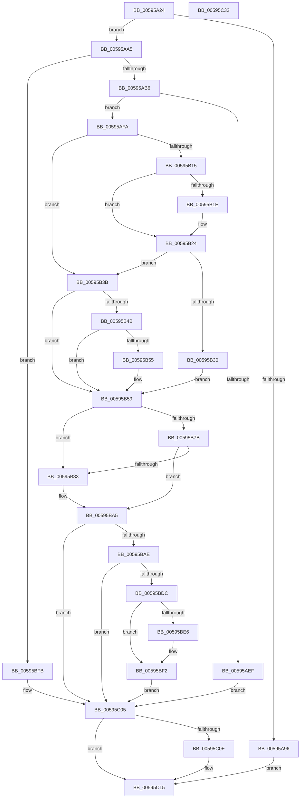

# IopInitializeOfflineCrashDump

- RVA: `0x00595A24`–`0x00595C33` (길이 `527` bytes)
- VA: `0x0000000140595A24`
- 실행 섹션: `.text`
- PDB 이름 있음: `예`; PDB Function 태그: `아니요`
- unwind 정보 RVA: `0x000C71A0`
- 디코드: `122`개 명령, `527/527` bytes 표시
- 미해석 바이트: `0` (있으면 어셈블리에 `.byte`로 보존)

> 이 문서는 커널 이미지의 기계어와 PDB 기호를 분석해 생성했습니다. 4번과 5번은 함수 원형과 자료형을 바이너리 사용 방식에서 추정한 C 해석이며 원본 소스 복구 결과는 아닙니다.

## 1. Dependencies

- 직접 호출 지점: **12**; 고유 호출 대상: **10**
- 직접 호출자로 확인된 함수: **1**
- RIP 상대 이미지 참조: **13**

### Outgoing calls
- `0x00595AE6` → [IopOpenRegistryKey](../../page/A8/IopOpenRegistryKey_function_00A8F200.md) (function, `0x00A8F200`)
- `0x00595B0C` → [IopGetRegistryValue](../../page/99/IopGetRegistryValue_function_009990EC.md) (function, `0x009990EC`)
- `0x00595B26` → [ExFreePoolWithTag](../../poolcode/B8/ExFreePoolWithTag_function_00B82870.md) (function, `0x00B82870`)
- `0x00595B72` → [IoGetEnvironmentVariableEx](../../page/95/IoGetEnvironmentVariableEx_function_00952760.md) (function, `0x00952760`)
- `0x00595BA0` → [IoSetEnvironmentVariableEx](../../page/A9/IoSetEnvironmentVariableEx_function_00A91A84.md) (function, `0x00A91A84`)
- `0x00595BB2` → [IopCachePreviousBootData](../../init/C2/IopCachePreviousBootData_function_00C2A790.md) (function, `0x00C2A790`)
- `0x00595BB7` → [IopInitializeInMemoryDumpData](IopInitializeInMemoryDumpData_function_005957E0.md) (function, `0x005957E0`)
- `0x00595BBC` → [IopConstructInMemoryDumpHeader](IopConstructInMemoryDumpHeader_function_005948A0.md) (function, `0x005948A0`)
- `0x00595BD3` → [IopGetRegistryValue](../../page/99/IopGetRegistryValue_function_009990EC.md) (function, `0x009990EC`)
- `0x00595BF4` → [ExFreePoolWithTag](../../poolcode/B8/ExFreePoolWithTag_function_00B82870.md) (function, `0x00B82870`)
- `0x00595C10` → [ObCloseHandle](../../page/8A/ObCloseHandle_function_008A1870.md) (function, `0x008A1870`)
- `0x00595C1C` → [_security_check_cookie](../6A/_security_check_cookie_function_006AC640.md) (function, `0x006AC640`)

### Direct callers
- [IopInitCrashDumpDuringSysInit](../../init/C2/IopInitCrashDumpDuringSysInit_function_00C2CAE4.md) at `0x00C2CC3E`

### Static image references
- `0x00595A34` → RVA `0x00E0A740` (`.data`; read)
- `0x00595A47` → RVA `0x006C9970` (` ?? ::FNODOBFM::`string'`; read)
- `0x00595A5B` → RVA `0x00E65F40` (`.data`; read/write)
- `0x00595A96` → RVA `0x00E65F40` (`.data`; write)
- `0x00595ACD` → RVA `0x00F0F200` (`.data`; read)
- `0x00595ADF` → RVA `0x00F0F210` (`.data`; read)
- `0x00595B05` → RVA `0x006C9940` (` ?? ::FNODOBFM::`string'`; read)
- `0x00595B30` → RVA `0x00E65F50` (`.data`; write)
- `0x00595B4B` → RVA `0x00F0F208` (`.data`; read)
- `0x00595B6B` → RVA `0x006C9A10` (` ?? ::FNODOBFM::`string'`; read)
- `0x00595BA5` → RVA `0x00E65F50` (`.data`; read)
- `0x00595BCC` → RVA `0x006C99F0` (` ?? ::FNODOBFM::`string'`; read)
- `0x00595BEC` → RVA `0x00E65EFC` (`.data`; write)

## 2. Other-region calls and transfers

- 다른 실행 섹션으로 향하는 call: **9**
  - `0x00595AE6` → [IopOpenRegistryKey](../../page/A8/IopOpenRegistryKey_function_00A8F200.md) (`.text` → `PAGE`)
  - `0x00595B0C` → [IopGetRegistryValue](../../page/99/IopGetRegistryValue_function_009990EC.md) (`.text` → `PAGE`)
  - `0x00595B26` → [ExFreePoolWithTag](../../poolcode/B8/ExFreePoolWithTag_function_00B82870.md) (`.text` → `POOLCODE`)
  - `0x00595B72` → [IoGetEnvironmentVariableEx](../../page/95/IoGetEnvironmentVariableEx_function_00952760.md) (`.text` → `PAGE`)
  - `0x00595BA0` → [IoSetEnvironmentVariableEx](../../page/A9/IoSetEnvironmentVariableEx_function_00A91A84.md) (`.text` → `PAGE`)
  - `0x00595BB2` → [IopCachePreviousBootData](../../init/C2/IopCachePreviousBootData_function_00C2A790.md) (`.text` → `INIT`)
  - `0x00595BD3` → [IopGetRegistryValue](../../page/99/IopGetRegistryValue_function_009990EC.md) (`.text` → `PAGE`)
  - `0x00595BF4` → [ExFreePoolWithTag](../../poolcode/B8/ExFreePoolWithTag_function_00B82870.md) (`.text` → `POOLCODE`)
  - `0x00595C10` → [ObCloseHandle](../../page/8A/ObCloseHandle_function_008A1870.md) (`.text` → `PAGE`)
- 별도 외부 분기/꼬리 이동을 확인하지 못했습니다.

## 3. Assembly (complete function range)

```asm
00595A24  48 89 5C 24 08                  mov qword ptr [rsp + 8], rbx
00595A29  55                              push rbp
00595A2A  48 8B EC                        mov rbp, rsp
00595A2D  48 81 EC 80 00 00 00            sub rsp, 0x80
00595A34  48 8B 05 05 4D 87 00            mov rax, qword ptr [rip + 0x874d05]
00595A3B  48 33 C4                        xor rax, rsp
00595A3E  48 89 45 F0                     mov qword ptr [rbp - 0x10], rax
00595A42  48 83 65 C0 00                  and qword ptr [rbp - 0x40], 0
00595A47  48 8D 05 22 3F 13 00            lea rax, [rip + 0x133f22]
00595A4E  33 DB                           xor ebx, ebx
00595A50  C7 45 E0 BD 9A FA 77            mov dword ptr [rbp - 0x20], 0x77fa9abd
00595A57  48 21 5D B8                     and qword ptr [rbp - 0x48], rbx
00595A5B  21 1D DF 04 8D 00               and dword ptr [rip + 0x8d04df], ebx
00595A61  C7 45 E4 59 03 32 4D            mov dword ptr [rbp - 0x1c], 0x4d320359
00595A68  C7 45 E8 BD 60 28 F4            mov dword ptr [rbp - 0x18], 0xf42860bd
00595A6F  C7 45 EC E7 8F 78 4B            mov dword ptr [rbp - 0x14], 0x4b788fe7
00595A76  48 C7 45 D0 7E 00 80 00         mov qword ptr [rbp - 0x30], 0x80007e
00595A7E  48 89 45 D8                     mov qword ptr [rbp - 0x28], rax
00595A82  C6 45 B1 00                     mov byte ptr [rbp - 0x4f], 0
00595A86  C7 45 C8 01 00 00 00            mov dword ptr [rbp - 0x38], 1
00595A8D  C6 45 B0 00                     mov byte ptr [rbp - 0x50], 0
00595A91  48 85 C9                        test rcx, rcx
00595A94  75 0F                           jne 0x140595aa5
00595A96  C7 05 A0 04 8D 00 25 02 00 C0   mov dword ptr [rip + 0x8d04a0], 0xc0000225
00595AA0  E9 70 01 00 00                  jmp 0x140595c15
00595AA5  8B 81 F8 0A 00 00               mov eax, dword ptr [rcx + 0xaf8]
00595AAB  FF C8                           dec eax
00595AAD  83 F8 02                        cmp eax, 2
00595AB0  0F 87 45 01 00 00               ja 0x140595bfb
00595AB6  0F 10 81 F8 0A 00 00            movups xmm0, xmmword ptr [rcx + 0xaf8]
00595ABD  41 B9 19 00 02 00               mov r9d, 0x20019
00595AC3  88 5C 24 20                     mov byte ptr [rsp + 0x20], bl
00595AC7  4C 8D 45 D0                     lea r8, [rbp - 0x30]
00595ACB  33 D2                           xor edx, edx
00595ACD  0F 11 05 2C 97 97 00            movups xmmword ptr [rip + 0x97972c], xmm0
00595AD4  0F 10 89 08 0B 00 00            movups xmm1, xmmword ptr [rcx + 0xb08]
00595ADB  48 8D 4D B8                     lea rcx, [rbp - 0x48]
00595ADF  0F 11 0D 2A 97 97 00            movups xmmword ptr [rip + 0x97972a], xmm1
00595AE6  E8 15 97 4F 00                  call 0x140a8f200
00595AEB  85 C0                           test eax, eax
00595AED  79 0B                           jns 0x140595afa
00595AEF  89 05 4B 04 8D 00               mov dword ptr [rip + 0x8d044b], eax
00595AF5  E9 0B 01 00 00                  jmp 0x140595c05
00595AFA  48 8B 4D B8                     mov rcx, qword ptr [rbp - 0x48]
00595AFE  4C 8D 4D C0                     lea r9, [rbp - 0x40]
00595B02  45 33 C0                        xor r8d, r8d
00595B05  48 8D 15 34 3E 13 00            lea rdx, [rip + 0x133e34]
00595B0C  E8 DB 35 40 00                  call 0x1409990ec
00595B11  85 C0                           test eax, eax
00595B13  78 26                           js 0x140595b3b
00595B15  48 8B 4D C0                     mov rcx, qword ptr [rbp - 0x40]
00595B19  39 59 0C                        cmp dword ptr [rcx + 0xc], ebx
00595B1C  74 06                           je 0x140595b24
00595B1E  8B 41 08                        mov eax, dword ptr [rcx + 8]
00595B21  8B 1C 08                        mov ebx, dword ptr [rax + rcx]
00595B24  33 D2                           xor edx, edx
00595B26  E8 45 CD 5E 00                  call 0x140b82870
00595B2B  83 FB 01                        cmp ebx, 1
00595B2E  75 0B                           jne 0x140595b3b
00595B30  88 1D 1A 04 8D 00               mov byte ptr [rip + 0x8d041a], bl
00595B36  88 5D B0                        mov byte ptr [rbp - 0x50], bl
00595B39  EB 1E                           jmp 0x140595b59
00595B3B  83 3D BE 96 97 00 02            cmp dword ptr [rip + 0x9796be], 2
00595B42  C6 05 07 04 8D 00 00            mov byte ptr [rip + 0x8d0407], 0
00595B49  72 0E                           jb 0x140595b59
00595B4B  8B 05 B7 96 97 00               mov eax, dword ptr [rip + 0x9796b7]
00595B51  A8 04                           test al, 4
00595B53  74 04                           je 0x140595b59
00595B55  C6 45 B0 04                     mov byte ptr [rbp - 0x50], 4
00595B59  48 83 64 24 20 00               and qword ptr [rsp + 0x20], 0
00595B5F  4C 8D 4D C8                     lea r9, [rbp - 0x38]
00595B63  4C 8D 45 B1                     lea r8, [rbp - 0x4f]
00595B67  48 8D 55 E0                     lea rdx, [rbp - 0x20]
00595B6B  48 8D 0D 9E 3E 13 00            lea rcx, [rip + 0x133e9e]
00595B72  E8 E9 CB 3B 00                  call 0x140952760
00595B77  85 C0                           test eax, eax
00595B79  78 08                           js 0x140595b83
00595B7B  8A 45 B0                        mov al, byte ptr [rbp - 0x50]
00595B7E  38 45 B1                        cmp byte ptr [rbp - 0x4f], al
00595B81  74 22                           je 0x140595ba5
00595B83  41 B9 01 00 00 00               mov r9d, 1
00595B89  C7 44 24 20 07 00 00 00         mov dword ptr [rsp + 0x20], 7
00595B91  4C 8D 45 B0                     lea r8, [rbp - 0x50]
00595B95  48 8D 55 E0                     lea rdx, [rbp - 0x20]
00595B99  48 8D 0D 70 3E 13 00            lea rcx, [rip + 0x133e70]
00595BA0  E8 DF BE 4F 00                  call 0x140a91a84
00595BA5  80 3D A4 03 8D 00 00            cmp byte ptr [rip + 0x8d03a4], 0
00595BAC  74 57                           je 0x140595c05
00595BAE  48 8D 4D B8                     lea rcx, [rbp - 0x48]
00595BB2  E8 D9 4B 69 00                  call 0x140c2a790
00595BB7  E8 24 FC FF FF                  call 0x1405957e0
00595BBC  E8 DF EC FF FF                  call 0x1405948a0
00595BC1  48 8B 4D B8                     mov rcx, qword ptr [rbp - 0x48]
00595BC5  4C 8D 4D C0                     lea r9, [rbp - 0x40]
00595BC9  45 33 C0                        xor r8d, r8d
00595BCC  48 8D 15 1D 3E 13 00            lea rdx, [rip + 0x133e1d]
00595BD3  E8 14 35 40 00                  call 0x1409990ec
00595BD8  85 C0                           test eax, eax
00595BDA  78 29                           js 0x140595c05
00595BDC  48 8B 4D C0                     mov rcx, qword ptr [rbp - 0x40]
00595BE0  83 79 0C 00                     cmp dword ptr [rcx + 0xc], 0
00595BE4  74 0C                           je 0x140595bf2
00595BE6  8B 41 08                        mov eax, dword ptr [rcx + 8]
00595BE9  8B 14 08                        mov edx, dword ptr [rax + rcx]
00595BEC  89 15 0A 03 8D 00               mov dword ptr [rip + 0x8d030a], edx
00595BF2  33 D2                           xor edx, edx
00595BF4  E8 77 CC 5E 00                  call 0x140b82870
00595BF9  EB 0A                           jmp 0x140595c05
00595BFB  C7 05 3B 03 8D 00 58 00 00 C0   mov dword ptr [rip + 0x8d033b], 0xc0000058
00595C05  48 8B 4D B8                     mov rcx, qword ptr [rbp - 0x48]
00595C09  48 85 C9                        test rcx, rcx
00595C0C  74 07                           je 0x140595c15
00595C0E  33 D2                           xor edx, edx
00595C10  E8 5B BC 30 00                  call 0x1408a1870
00595C15  48 8B 4D F0                     mov rcx, qword ptr [rbp - 0x10]
00595C19  48 33 CC                        xor rcx, rsp
00595C1C  E8 1F 6A 11 00                  call 0x1406ac640
00595C21  48 8B 9C 24 90 00 00 00         mov rbx, qword ptr [rsp + 0x90]
00595C29  48 81 C4 80 00 00 00            add rsp, 0x80
00595C30  5D                              pop rbp
00595C31  C3                              ret
00595C32  CC                              int3
```

## 4. C-style interpretation (structured pseudocode)

```c
__int64 __fastcall IopInitializeOfflineCrashDump(__int64 a1, int a2)
{
    __int64 result;
    __int64 v_rbx;
    __int64 v_rsp;
    unsigned __int64 v_stack_m18;
    unsigned int v_stack_m1C;
    unsigned int v_stack_m20;
    unsigned int v_stack_m24;
    unsigned int v_stack_m28;
    unsigned __int64 v_stack_m30;
    unsigned __int64 v_stack_m38;
    unsigned int v_stack_m40;
    unsigned __int64 v_stack_m48;
    unsigned __int64 v_stack_m50;
    unsigned __int8 v_stack_m57;
    unsigned __int8 v_stack_m58;
    unsigned __int8 v_stack_m68;
    unsigned __int64 v_stack_p8;

    v_stack_p8 = v_rbx;
    v_rsp = (v_rsp) - (128);
    result = (*(unsigned __int64 *)(v_rip + 8867077)) ^ (v_rsp);
    v_stack_m18 = result;
    v_rbx = 0;
    v_stack_m28 = 0x77FA9ABDULL;
    v_stack_m24 = 0x4D320359ULL;
    v_stack_m20 = 0xF42860BDULL;
    v_stack_m1C = 0x4B788FE7ULL;
    v_stack_m38 = 0x80007EULL;
    v_stack_m30 = v_rip + 1261346;
    v_stack_m57 = 0;
    v_stack_m40 = 1;
    v_stack_m58 = 0;
    if (a1 != 0) goto loc_00595AA5;
    *(unsigned int *)(v_rip + 9241760) = 0xC0000225ULL;
    goto loc_00595C15;
loc_00595AA5:
    result = (unsigned int)(((unsigned int)(*(unsigned int *)(a1 + 2808))) - 1);
    if (((unsigned int)(result)) > 2) goto loc_00595BFB;
    v_stack_m68 = 0;
    a2 = 0;
    *(unsigned __int64 *)(v_rip + 9934636) = v_xmm0;
    *(unsigned __int64 *)(v_rip + 9934634) = v_xmm1;
    result = IopOpenRegistryKey(v_stack_m50, a2, v_stack_m38, (unsigned int)(0x20019ULL));
    if (!sign_flag) goto loc_00595AFA;
    *(unsigned int *)(v_rip + 9241675) = (unsigned int)(result);
    goto loc_00595C05;
loc_00595AFA:
    a3 = 0;
    result = IopGetRegistryValue(v_stack_m50, v_rip + 1261108, a3, v_stack_m48);
    if (sign_flag) goto loc_00595B3B;
    if ((*(unsigned int *)(v_stack_m48 + 12)) != 0) {
        result = *(unsigned int *)(v_stack_m48 + 8);
        v_rbx = *(unsigned int *)(result + v_stack_m48 * 1);
    }
    a2 = 0;
    result = ExFreePoolWithTag(v_stack_m48, a2, a3, v_stack_m48);
    if (((unsigned int)(v_rbx)) != 1) goto loc_00595B3B;
    *(unsigned __int8 *)(v_rip + 9241626) = (unsigned __int8)(v_rbx);
    v_stack_m58 = (unsigned __int8)(v_rbx);
    goto loc_00595B59;
loc_00595B3B:
    *(unsigned __int8 *)(v_rip + 9241607) = 0;
    if ((*(unsigned int *)(v_rip + 9934526)) < 2) goto loc_00595B59;
    if ((((unsigned __int8)((unsigned int)(*(unsigned int *)(v_rip + 9934519)))) & (4)) != 0) {
        v_stack_m58 = 4;
    }
    result = IoGetEnvironmentVariableEx(v_rip + 1261214, v_stack_m28, v_stack_m57, v_stack_m40);
    if (sign_flag) goto loc_00595B83;
    result = v_stack_m58;
    if (v_stack_m57 != ((unsigned __int8)(v_stack_m58))) {
        a4 = 1;
        v_stack_m68 = 7;
        a3 = v_stack_m58;
        a2 = v_stack_m28;
        a1 = v_rip + 1261168;
        result = IoSetEnvironmentVariableEx(a1, a2, a3, a4);
    }
    if ((*(unsigned __int8 *)(v_rip + 9241508)) == 0) goto loc_00595C05;
    result = IopCachePreviousBootData(v_stack_m50, a2, a3, a4);
    result = IopInitializeInMemoryDumpData(v_stack_m50, a2, a3, a4);
    result = IopConstructInMemoryDumpHeader(v_stack_m50, a2, a3, a4);
    a3 = 0;
    result = IopGetRegistryValue(v_stack_m50, v_rip + 1261085, a3, v_stack_m48);
    if (sign_flag) goto loc_00595C05;
    if ((*(unsigned int *)(v_stack_m48 + 12)) != 0) {
        result = *(unsigned int *)(v_stack_m48 + 8);
        a2 = *(unsigned int *)(result + v_stack_m48 * 1);
        *(unsigned int *)(v_rip + 9241354) = a2;
    }
    a2 = 0;
    result = ExFreePoolWithTag(v_stack_m48, a2, a3, v_stack_m48);
    goto loc_00595C05;
loc_00595BFB:
    *(unsigned int *)(v_rip + 9241403) = 0xC0000058ULL;
loc_00595C05:
    if (v_stack_m50 != 0) {
        a2 = 0;
        result = ObCloseHandle(v_stack_m50, a2, a3, v_stack_m48);
    }
    a1 = (v_stack_m18) ^ (v_rsp);
    result = _security_check_cookie(a1, a2, a3, v_stack_m48);
    v_rsp = (v_rsp) + (128);
    return result;
}
```

## 5. (Beta) C Style

```c
int64_t IopInitializeOfflineCrashDump(int64_t Arg1, int32_t Arg2)
{
    int64_t result;
    int64_t local_rbx;
    int64_t local_rsp;
    uint64_t v_stack_m18;
    uint32_t v_stack_m1C;
    uint32_t v_stack_m20;
    uint32_t v_stack_m24;
    uint32_t v_stack_m28;
    uint64_t v_stack_m30;
    uint64_t v_stack_m38;
    uint32_t v_stack_m40;
    uint64_t v_stack_m48;
    uint64_t v_stack_m50;
    uint8_t v_stack_m57;
    uint8_t v_stack_m58;
    uint8_t v_stack_m68;
    uint64_t v_stack_p8;

    v_stack_p8 = local_rbx;
    local_rsp = (local_rsp) - (128);
    result = (*(uint64_t *)(v_rip + 0x874D05)) ^ (local_rsp);
    v_stack_m18 = result;
    local_rbx = 0;
    v_stack_m28 = 0x77FA9ABDULL;
    v_stack_m24 = 0x4D320359ULL;
    v_stack_m20 = 0xF42860BDULL;
    v_stack_m1C = 0x4B788FE7ULL;
    v_stack_m38 = 0x80007EULL;
    v_stack_m30 = v_rip + 1261346;
    v_stack_m57 = 0;
    v_stack_m40 = 1;
    v_stack_m58 = 0;
    if (Arg1 != 0) goto loc_00595AA5;
    *(uint32_t *)(v_rip + 0x8D04A0) = 0xC0000225ULL;
    goto loc_00595C15;
loc_00595AA5:
    result = (uint32_t)(((uint32_t)(*(uint32_t *)(Arg1 + 0xAF8))) - 1);
    if (((uint32_t)(result)) > 2) goto loc_00595BFB;
    v_stack_m68 = 0;
    Arg2 = 0;
    *(uint64_t *)(v_rip + 0x97972C) = v_xmm0;
    *(uint64_t *)(v_rip + 0x97972A) = v_xmm1;
    result = IopOpenRegistryKey(v_stack_m50, Arg2, v_stack_m38, (uint32_t)(0x20019ULL));
    if (!sign_flag) goto loc_00595AFA;
    *(uint32_t *)(v_rip + 0x8D044B) = (uint32_t)(result);
    goto loc_00595C05;
loc_00595AFA:
    a3 = 0;
    result = IopGetRegistryValue(v_stack_m50, v_rip + 1261108, a3, v_stack_m48);
    if (sign_flag) goto loc_00595B3B;
    if ((*(uint32_t *)(v_stack_m48 + 0xC)) != 0) {
        result = *(uint32_t *)(v_stack_m48 + 0x8);
        local_rbx = *(uint32_t *)(result + v_stack_m48 * 1);
    }
    Arg2 = 0;
    result = ExFreePoolWithTag(v_stack_m48, Arg2, a3, v_stack_m48);
    if (((uint32_t)(local_rbx)) != 1) goto loc_00595B3B;
    *(uint8_t *)(v_rip + 0x8D041A) = (uint8_t)(local_rbx);
    v_stack_m58 = (uint8_t)(local_rbx);
    goto loc_00595B59;
loc_00595B3B:
    *(uint8_t *)(v_rip + 0x8D0407) = 0;
    if ((*(uint32_t *)(v_rip + 0x9796BE)) < 2) goto loc_00595B59;
    if ((((uint8_t)((uint32_t)(*(uint32_t *)(v_rip + 0x9796B7)))) & (4)) != 0) {
        v_stack_m58 = 4;
    }
    result = IoGetEnvironmentVariableEx(v_rip + 1261214, v_stack_m28, v_stack_m57, v_stack_m40);
    if (sign_flag) goto loc_00595B83;
    result = v_stack_m58;
    if (v_stack_m57 != ((uint8_t)(v_stack_m58))) {
        a4 = 1;
        v_stack_m68 = 7;
        a3 = v_stack_m58;
        Arg2 = v_stack_m28;
        Arg1 = v_rip + 1261168;
        result = IoSetEnvironmentVariableEx(Arg1, Arg2, a3, a4);
    }
    if ((*(uint8_t *)(v_rip + 0x8D03A4)) == 0) goto loc_00595C05;
    result = IopCachePreviousBootData(v_stack_m50, Arg2, a3, a4);
    result = IopInitializeInMemoryDumpData(v_stack_m50, Arg2, a3, a4);
    result = IopConstructInMemoryDumpHeader(v_stack_m50, Arg2, a3, a4);
    a3 = 0;
    result = IopGetRegistryValue(v_stack_m50, v_rip + 1261085, a3, v_stack_m48);
    if (sign_flag) goto loc_00595C05;
    if ((*(uint32_t *)(v_stack_m48 + 0xC)) != 0) {
        result = *(uint32_t *)(v_stack_m48 + 0x8);
        Arg2 = *(uint32_t *)(result + v_stack_m48 * 1);
        *(uint32_t *)(v_rip + 0x8D030A) = Arg2;
    }
    Arg2 = 0;
    result = ExFreePoolWithTag(v_stack_m48, Arg2, a3, v_stack_m48);
    goto loc_00595C05;
loc_00595BFB:
    *(uint32_t *)(v_rip + 0x8D033B) = 0xC0000058ULL;
loc_00595C05:
    if (v_stack_m50 != 0) {
        Arg2 = 0;
        result = ObCloseHandle(v_stack_m50, Arg2, a3, v_stack_m48);
    }
    Arg1 = (v_stack_m18) ^ (local_rsp);
    result = _security_check_cookie(Arg1, Arg2, a3, v_stack_m48);
    local_rsp = (local_rsp) + (128);
    return result;
}
```

## 6. Execution-region graph

[열기: 2D/3D 그래프와 함수 탐색 컨트롤 패널](../../../control-panel.html?section=text&rva=0x00595A24&view=graph)

- 2D 그래프는 위에서 아래로 흐르고, 3D 그래프는 빈 공간을 드래그해 회전합니다. Shift+드래그는 이동, 휠은 확대·축소, 함수 노드 선택은 대상 보고서 이동입니다.

### Static fallback


