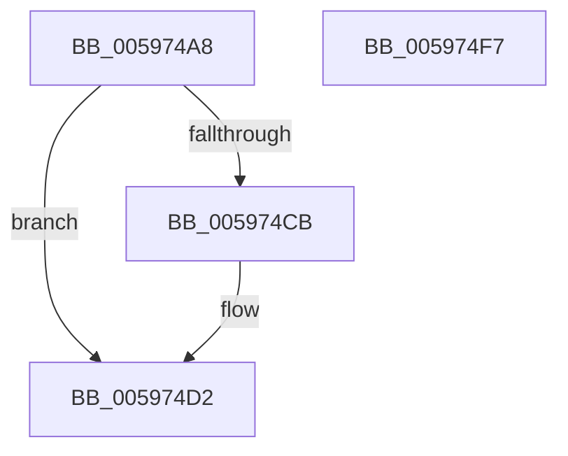

# IopInterlockedInsertHeadList

- RVA: `0x005974A8`–`0x005974F8` (길이 `80` bytes)
- VA: `0x00000001405974A8`
- 실행 섹션: `.text`
- PDB 이름 있음: `예`; PDB Function 태그: `아니요`
- unwind 정보 RVA: `0x0005CAAC`
- 디코드: `24`개 명령, `80/80` bytes 표시
- 미해석 바이트: `0` (있으면 어셈블리에 `.byte`로 보존)

> 이 문서는 커널 이미지의 기계어와 PDB 기호를 분석해 생성했습니다. 4번과 5번은 함수 원형과 자료형을 바이너리 사용 방식에서 추정한 C 해석이며 원본 소스 복구 결과는 아닙니다.

## 1. Dependencies

- 직접 호출 지점: **2**; 고유 호출 대상: **2**
- 직접 호출자로 확인된 함수: **2**
- RIP 상대 이미지 참조: **0**

### Outgoing calls
- `0x005974BD` → [KeAcquireQueuedSpinLock](../27/KeAcquireQueuedSpinLock_function_00273D80.md) (function, `0x00273D80`)
- `0x005974E7` → [KeReleaseQueuedSpinLock](../27/KeReleaseQueuedSpinLock_function_00272540.md) (function, `0x00272540`)

### Direct callers
- [IoRegisterLastChanceShutdownNotification](../../page/71/IoRegisterLastChanceShutdownNotification_function_0071DAD0.md) at `0x0071DB15`
- [IoRegisterShutdownNotification](../../page/71/IoRegisterShutdownNotification_function_0071DB50.md) at `0x0071DB95`

### Static image references
- 디코드된 RIP-relative 메모리 참조가 없습니다.

## 2. Other-region calls and transfers

- 다른 실행 섹션으로 향하는 call: **0**
- 별도 외부 분기/꼬리 이동을 확인하지 못했습니다.

## 3. Assembly (complete function range)

```asm
005974A8  48 89 5C 24 08                  mov qword ptr [rsp + 8], rbx
005974AD  57                              push rdi
005974AE  48 83 EC 20                     sub rsp, 0x20
005974B2  48 8B F9                        mov rdi, rcx
005974B5  48 8B DA                        mov rbx, rdx
005974B8  B9 0A 00 00 00                  mov ecx, 0xa
005974BD  E8 BE C8 CD FF                  call 0x140273d80
005974C2  48 8B 0F                        mov rcx, qword ptr [rdi]
005974C5  48 39 79 08                     cmp qword ptr [rcx + 8], rdi
005974C9  74 07                           je 0x1405974d2
005974CB  B9 03 00 00 00                  mov ecx, 3
005974D0  CD 29                           int 0x29
005974D2  48 89 0B                        mov qword ptr [rbx], rcx
005974D5  8A D0                           mov dl, al
005974D7  48 89 7B 08                     mov qword ptr [rbx + 8], rdi
005974DB  48 89 59 08                     mov qword ptr [rcx + 8], rbx
005974DF  B9 0A 00 00 00                  mov ecx, 0xa
005974E4  48 89 1F                        mov qword ptr [rdi], rbx
005974E7  E8 54 B0 CD FF                  call 0x140272540
005974EC  48 8B 5C 24 30                  mov rbx, qword ptr [rsp + 0x30]
005974F1  48 83 C4 20                     add rsp, 0x20
005974F5  5F                              pop rdi
005974F6  C3                              ret
005974F7  CC                              int3
```

## 4. C-style interpretation (structured pseudocode)

```c
__int64 __fastcall IopInterlockedInsertHeadList(__int64 a1, __int64 a2)
{
    __int64 result;
    __int64 v_rsp;
    unsigned __int64 v_stack_p8;

    v_stack_p8 = v_rbx;
    v_rsp = (v_rsp) - (32);
    result = KeAcquireQueuedSpinLock(10, a2, a3, a4);
    if ((*(unsigned __int64 *)(*(unsigned __int64 *)(a1) + 8)) != a1) {
        a1 = 3;
    }
    *(unsigned __int64 *)(a2) = a1;
    *(unsigned __int64 *)(a2 + 8) = a1;
    *(unsigned __int64 *)(a1 + 8) = a2;
    *(unsigned __int64 *)(a1) = a2;
    result = KeReleaseQueuedSpinLock(10, (unsigned __int8)(result), a3, a4);
    v_rsp = (v_rsp) + (32);
    return result;
}
```

## 5. (Beta) C Style

```c
int64_t IopInterlockedInsertHeadList(void *Arg1, void *Arg2)
{
    uint8_t *arg1 = (uint8_t *)Arg1;
    uint8_t *arg2 = (uint8_t *)Arg2;

    int64_t result;
    int64_t local_rsp;
    uint64_t v_stack_p8;

    v_stack_p8 = local_rbx;
    local_rsp = (local_rsp) - (32);
    result = KeAcquireQueuedSpinLock(10, Arg2, a3, a4);
    if ((*(uint64_t *)(*(uint64_t *)(arg1) + 0x8)) != Arg1) {
        Arg1 = 3;
    }
    *(void **)(arg2) = Arg1;
    *(void **)(arg2 + 0x8) = Arg1;
    *(void **)(arg1 + 0x8) = Arg2;
    *(void **)(arg1) = Arg2;
    result = KeReleaseQueuedSpinLock(10, (uint8_t)(result), a3, a4);
    local_rsp = (local_rsp) + (32);
    return result;
}
```

### 관측된 메모리 오프셋

구조체 형식이 확인되지 않은 접근은 인자 기준의 오프셋으로만 기록했습니다.

| 기준 인자 | 오프셋 표현 | 폭 (bit) | 접근 |
|---|---:|---:|---|
| `Arg1` | `+ 0x0` | `64` | `R` |
| `Arg1` | `+ 0x0` | `64` | `W` |
| `Arg2` | `+ 0x0` | `64` | `W` |
| `Arg2` | `+ 0x8` | `64` | `W` |

## 6. Execution-region graph

[열기: 2D/3D 그래프와 함수 탐색 컨트롤 패널](../../../control-panel.html?section=text&rva=0x005974A8&view=graph)

- 2D 그래프는 위에서 아래로 흐르고, 3D 그래프는 빈 공간을 드래그해 회전합니다. Shift+드래그는 이동, 휠은 확대·축소, 함수 노드 선택은 대상 보고서 이동입니다.

### Static fallback


