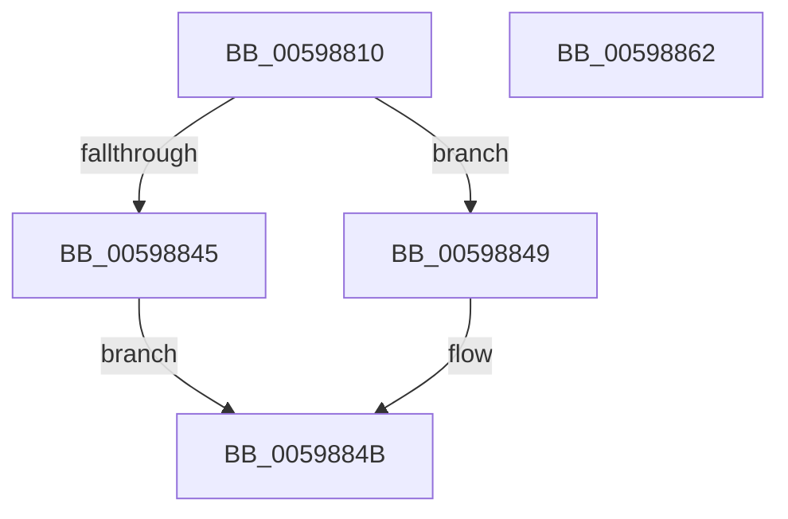

# IopIoRingGetAvailableCqSlots

- RVA: `0x00598810`–`0x00598863` (길이 `83` bytes)
- VA: `0x0000000140598810`
- 실행 섹션: `.text`
- PDB 이름 있음: `예`; PDB Function 태그: `아니요`
- unwind 정보 RVA: `0x0005CAAC`
- 디코드: `28`개 명령, `83/83` bytes 표시
- 미해석 바이트: `0` (있으면 어셈블리에 `.byte`로 보존)

> 이 문서는 커널 이미지의 기계어와 PDB 기호를 분석해 생성했습니다. 4번과 5번은 함수 원형과 자료형을 바이너리 사용 방식에서 추정한 C 해석이며 원본 소스 복구 결과는 아닙니다.

## 1. Dependencies

- 직접 호출 지점: **2**; 고유 호출 대상: **2**
- 직접 호출자로 확인된 함수: **1**
- RIP 상대 이미지 참조: **0**

### Outgoing calls
- `0x00598824` → [KeAcquireSpinLockRaiseToDpc](../20/KeAcquireSpinLockRaiseToDpc_function_00208470.md) (function, `0x00208470`)
- `0x00598850` → [KeReleaseSpinLock](../39/KeReleaseSpinLock_function_00392BA0.md) (function, `0x00392BA0`)

### Direct callers
- [NtSubmitIoRing](../4C/NtSubmitIoRing_function_004CF9E0.md) at `0x004CFC81`

### Static image references
- 디코드된 RIP-relative 메모리 참조가 없습니다.

## 2. Other-region calls and transfers

- 다른 실행 섹션으로 향하는 call: **0**
- 별도 외부 분기/꼬리 이동을 확인하지 못했습니다.

## 3. Assembly (complete function range)

```asm
00598810  48 89 5C 24 08                  mov qword ptr [rsp + 8], rbx
00598815  57                              push rdi
00598816  48 83 EC 20                     sub rsp, 0x20
0059881A  48 8D 79 68                     lea rdi, [rcx + 0x68]
0059881E  48 8B D9                        mov rbx, rcx
00598821  48 8B CF                        mov rcx, rdi
00598824  E8 47 FC C6 FF                  call 0x140208470
00598829  4C 8B 53 78                     mov r10, qword ptr [rbx + 0x78]
0059882D  48 8B 53 50                     mov rdx, qword ptr [rbx + 0x50]
00598831  8B 4A 04                        mov ecx, dword ptr [rdx + 4]
00598834  2B 0A                           sub ecx, dword ptr [rdx]
00598836  48 03 4B 70                     add rcx, qword ptr [rbx + 0x70]
0059883A  8B 5B 1C                        mov ebx, dword ptr [rbx + 0x1c]
0059883D  49 2B CA                        sub rcx, r10
00598840  48 3B CB                        cmp rcx, rbx
00598843  72 04                           jb 0x140598849
00598845  33 DB                           xor ebx, ebx
00598847  EB 02                           jmp 0x14059884b
00598849  2B D9                           sub ebx, ecx
0059884B  8A D0                           mov dl, al
0059884D  48 8B CF                        mov rcx, rdi
00598850  E8 4B A3 DF FF                  call 0x140392ba0
00598855  8B C3                           mov eax, ebx
00598857  48 8B 5C 24 30                  mov rbx, qword ptr [rsp + 0x30]
0059885C  48 83 C4 20                     add rsp, 0x20
00598860  5F                              pop rdi
00598861  C3                              ret
00598862  CC                              int3
```

## 4. C-style interpretation (structured pseudocode)

```c
__int64 __fastcall IopIoRingGetAvailableCqSlots(__int64 a1)
{
    __int64 result;
    __int64 v_rbx;
    __int64 v_rsp;
    unsigned __int64 v_stack_p8;

    v_stack_p8 = v_rbx;
    v_rsp = (v_rsp) - (32);
    result = KeAcquireSpinLockRaiseToDpc(a1 + 104, a2, a3, a4);
    a1 = (unsigned int)(((unsigned int)(*(unsigned int *)(*(unsigned __int64 *)(a1 + 80) + 4))) - (*(unsigned int *)(*(unsigned __int64 *)(a1 + 80))));
    a1 = (a1) + (*(unsigned __int64 *)(a1 + 112));
    a1 = (a1) - (*(unsigned __int64 *)(a1 + 120));
    if (a1 < ((unsigned int)(*(unsigned int *)(a1 + 28)))) goto loc_00598849;
    v_rbx = 0;
    goto loc_0059884B;
loc_00598849:
    v_rbx = (unsigned int)((v_rbx) - ((unsigned int)(a1)));
loc_0059884B:
    result = KeReleaseSpinLock(a1 + 104, (unsigned __int8)(result), a3, a4);
    v_rsp = (v_rsp) + (32);
    return (unsigned int)((unsigned int)(v_rbx));
}
```

## 5. (Beta) C Style

```c
int64_t IopIoRingGetAvailableCqSlots(void *Arg1)
{
    uint8_t *arg1 = (uint8_t *)Arg1;

    int64_t result;
    int64_t local_rbx;
    int64_t local_rsp;
    uint64_t v_stack_p8;

    v_stack_p8 = local_rbx;
    local_rsp = (local_rsp) - (32);
    result = KeAcquireSpinLockRaiseToDpc(Arg1 + 104, a2, a3, a4);
    Arg1 = (uint32_t)(((uint32_t)(*(uint32_t *)(*(uint64_t *)(arg1 + 0x50) + 0x4))) - (*(uint32_t *)(*(uint64_t *)(arg1 + 0x50))));
    Arg1 = (Arg1) + (*(uint64_t *)(arg1 + 0x70));
    Arg1 = (Arg1) - (*(uint64_t *)(arg1 + 0x78));
    if (Arg1 < ((uint32_t)(*(uint32_t *)(arg1 + 0x1C)))) goto loc_00598849;
    local_rbx = 0;
    goto loc_0059884B;
loc_00598849:
    local_rbx = (uint32_t)((local_rbx) - ((uint32_t)(Arg1)));
loc_0059884B:
    result = KeReleaseSpinLock(Arg1 + 104, (uint8_t)(result), a3, a4);
    local_rsp = (local_rsp) + (32);
    return (uint32_t)((uint32_t)(local_rbx));
}
```

### 관측된 메모리 오프셋

구조체 형식이 확인되지 않은 접근은 인자 기준의 오프셋으로만 기록했습니다.

| 기준 인자 | 오프셋 표현 | 폭 (bit) | 접근 |
|---|---:|---:|---|
| `Arg1` | `+ 0x1C` | `32` | `R` |
| `Arg1` | `+ 0x50` | `64` | `R` |
| `Arg1` | `+ 0x68` | `64` | `R` |
| `Arg1` | `+ 0x70` | `64` | `R` |
| `Arg1` | `+ 0x78` | `64` | `R` |

## 6. Execution-region graph

[열기: 2D/3D 그래프와 함수 탐색 컨트롤 패널](../../../control-panel.html?section=text&rva=0x00598810&view=graph)

- 2D 그래프는 위에서 아래로 흐르고, 3D 그래프는 빈 공간을 드래그해 회전합니다. Shift+드래그는 이동, 휠은 확대·축소, 함수 노드 선택은 대상 보고서 이동입니다.

### Static fallback


