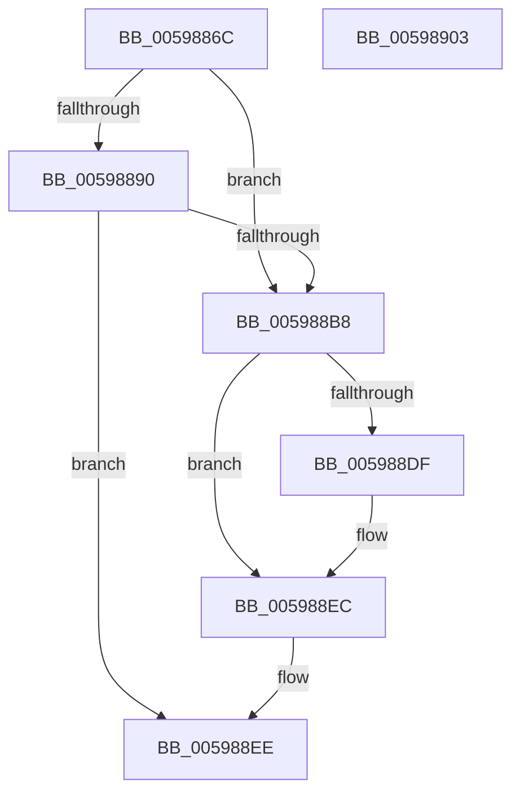

# IopIoRingUpdateCompletionUserEvent

- RVA: `0x0059886C`–`0x00598904` (길이 `152` bytes)
- VA: `0x000000014059886C`
- 실행 섹션: `.text`
- PDB 이름 있음: `예`; PDB Function 태그: `아니요`
- unwind 정보 RVA: `0x000A7960`
- 디코드: `42`개 명령, `152/152` bytes 표시
- 미해석 바이트: `0` (있으면 어셈블리에 `.byte`로 보존)

> 이 문서는 커널 이미지의 기계어와 PDB 기호를 분석해 생성했습니다. 4번과 5번은 함수 원형과 자료형을 바이너리 사용 방식에서 추정한 C 해석이며 원본 소스 복구 결과는 아닙니다.

## 1. Dependencies

- 직접 호출 지점: **4**; 고유 호출 대상: **4**
- 직접 호출자로 확인된 함수: **1**
- RIP 상대 이미지 참조: **1**

### Outgoing calls
- `0x005988AA` → [ObReferenceObjectByHandle](../../page/86/ObReferenceObjectByHandle_function_00868DB0.md) (function, `0x00868DB0`)
- `0x005988BC` → [KeAcquireSpinLockRaiseToDpc](../20/KeAcquireSpinLockRaiseToDpc_function_00208470.md) (function, `0x00208470`)
- `0x005988D5` → [KeReleaseSpinLock](../39/KeReleaseSpinLock_function_00392BA0.md) (function, `0x00392BA0`)
- `0x005988E7` → [ObfDereferenceObjectWithTag](../2F/ObfDereferenceObjectWithTag_function_002F78E0.md) (function, `0x002F78E0`)

### Direct callers
- [NtSetInformationIoRing](../../page/72/NtSetInformationIoRing_function_00720D80.md) at `0x00720E7C`

### Static image references
- `0x00598898` → RVA `0x00FC6B80` (`ALMOSTRO`; read)

## 2. Other-region calls and transfers

- 다른 실행 섹션으로 향하는 call: **1**
  - `0x005988AA` → [ObReferenceObjectByHandle](../../page/86/ObReferenceObjectByHandle_function_00868DB0.md) (`.text` → `PAGE`)
- 별도 외부 분기/꼬리 이동을 확인하지 못했습니다.

## 3. Assembly (complete function range)

```asm
0059886C  4C 8B DC                        mov r11, rsp
0059886F  49 89 5B 08                     mov qword ptr [r11 + 8], rbx
00598873  49 89 6B 18                     mov qword ptr [r11 + 0x18], rbp
00598877  49 89 73 20                     mov qword ptr [r11 + 0x20], rsi
0059887B  57                              push rdi
0059887C  48 83 EC 30                     sub rsp, 0x30
00598880  48 8B F1                        mov rsi, rcx
00598883  33 ED                           xor ebp, ebp
00598885  48 8B 0A                        mov rcx, qword ptr [rdx]
00598888  45 8A C8                        mov r9b, r8b
0059888B  48 85 C9                        test rcx, rcx
0059888E  74 28                           je 0x1405988b8
00598890  49 21 6B F0                     and qword ptr [r11 - 0x10], rbp
00598894  49 8D 43 10                     lea rax, [r11 + 0x10]
00598898  4C 8B 05 E1 E2 A2 00            mov r8, qword ptr [rip + 0xa2e2e1]
0059889F  8D 55 02                        lea edx, [rbp + 2]
005988A2  49 21 6B 10                     and qword ptr [r11 + 0x10], rbp
005988A6  49 89 43 E8                     mov qword ptr [r11 - 0x18], rax
005988AA  E8 01 05 2D 00                  call 0x140868db0
005988AF  48 8B 6C 24 48                  mov rbp, qword ptr [rsp + 0x48]
005988B4  85 C0                           test eax, eax
005988B6  78 36                           js 0x1405988ee
005988B8  48 8D 4E 68                     lea rcx, [rsi + 0x68]
005988BC  E8 AF FB C6 FF                  call 0x140208470
005988C1  48 8B BE A8 00 00 00            mov rdi, qword ptr [rsi + 0xa8]
005988C8  48 8D 4E 68                     lea rcx, [rsi + 0x68]
005988CC  8A D0                           mov dl, al
005988CE  48 89 AE A8 00 00 00            mov qword ptr [rsi + 0xa8], rbp
005988D5  E8 C6 A2 DF FF                  call 0x140392ba0
005988DA  48 85 FF                        test rdi, rdi
005988DD  74 0D                           je 0x1405988ec
005988DF  BA 44 66 6C 74                  mov edx, 0x746c6644
005988E4  48 8B CF                        mov rcx, rdi
005988E7  E8 F4 EF D5 FF                  call 0x1402f78e0
005988EC  33 C0                           xor eax, eax
005988EE  48 8B 5C 24 40                  mov rbx, qword ptr [rsp + 0x40]
005988F3  48 8B 6C 24 50                  mov rbp, qword ptr [rsp + 0x50]
005988F8  48 8B 74 24 58                  mov rsi, qword ptr [rsp + 0x58]
005988FD  48 83 C4 30                     add rsp, 0x30
00598901  5F                              pop rdi
00598902  C3                              ret
00598903  CC                              int3
```

## 4. C-style interpretation (structured pseudocode)

```c
__int64 __fastcall IopIoRingUpdateCompletionUserEvent(__int64 a1, __int64 a2, unsigned __int8 a3)
{
    __int64 result;
    __int64 v_rbp;
    __int64 v_rsp;
    unsigned __int64 v_stack_p10;
    unsigned __int64 v_stack_p18;
    unsigned __int64 v_stack_p20;
    unsigned __int64 v_stack_p8;

    *(unsigned __int64 *)(v_rsp + 8) = v_rbx;
    *(unsigned __int64 *)(v_rsp + 24) = v_rbp;
    *(unsigned __int64 *)(v_rsp + 32) = v_rsi;
    v_rsp = (v_rsp) - (48);
    v_rbp = 0;
    if (*(unsigned __int64 *)(a2) == 0) goto loc_005988B8;
    *(unsigned __int64 *)(v_rsp - 24) = v_rsp + 16;
    result = ObReferenceObjectByHandle(*(unsigned __int64 *)(a2), v_rbp + 2, *(unsigned __int64 *)(v_rip + 10674913), a3);
    if (sign_flag) goto loc_005988EE;
loc_005988B8:
    result = KeAcquireSpinLockRaiseToDpc(a1 + 104, v_rbp + 2, *(unsigned __int64 *)(v_rip + 10674913), a3);
    *(unsigned __int64 *)(a1 + 168) = v_stack_p10;
    result = KeReleaseSpinLock(a1 + 104, (unsigned __int8)(result), *(unsigned __int64 *)(v_rip + 10674913), a3);
    if (*(unsigned __int64 *)(a1 + 168) != 0) {
        a2 = 0x746C6644ULL;
        a1 = *(unsigned __int64 *)(a1 + 168);
        result = ObfDereferenceObjectWithTag(a1, a2, *(unsigned __int64 *)(v_rip + 10674913), a3);
    }
    result = 0;
loc_005988EE:
    v_rsp = (v_rsp) + (48);
    return result;
}
```

## 5. (Beta) C Style

```c
int64_t IopIoRingUpdateCompletionUserEvent(void *Arg1, void *Arg2, uint8_t Arg3)
{
    uint8_t *arg1 = (uint8_t *)Arg1;
    uint8_t *arg2 = (uint8_t *)Arg2;

    int64_t result;
    int64_t local_rbp;
    int64_t local_rsp;
    uint64_t v_stack_p10;
    uint64_t v_stack_p18;
    uint64_t v_stack_p20;
    uint64_t v_stack_p8;

    *(uint64_t *)(local_rsp + 0x8) = local_rbx;
    *(uint64_t *)(local_rsp + 0x18) = local_rbp;
    *(uint64_t *)(local_rsp + 0x20) = local_rsi;
    local_rsp = (local_rsp) - (48);
    local_rbp = 0;
    if (*(uint64_t *)(arg2) == 0) goto loc_005988B8;
    *(uint64_t *)(local_rsp - 0x18) = local_rsp + 16;
    result = ObReferenceObjectByHandle(*(uint64_t *)(arg2), local_rbp + 2, *(uint64_t *)(v_rip + 0xA2E2E1), Arg3);
    if (sign_flag) goto loc_005988EE;
loc_005988B8:
    result = KeAcquireSpinLockRaiseToDpc(Arg1 + 104, local_rbp + 2, *(uint64_t *)(v_rip + 0xA2E2E1), Arg3);
    *(uint64_t *)(arg1 + 0xA8) = v_stack_p10;
    result = KeReleaseSpinLock(Arg1 + 104, (uint8_t)(result), *(uint64_t *)(v_rip + 0xA2E2E1), Arg3);
    if (*(uint64_t *)(arg1 + 0xA8) != 0) {
        Arg2 = 0x746C6644ULL;
        Arg1 = *(uint64_t *)(arg1 + 0xA8);
        result = ObfDereferenceObjectWithTag(Arg1, Arg2, *(uint64_t *)(v_rip + 0xA2E2E1), Arg3);
    }
    result = 0;
loc_005988EE:
    local_rsp = (local_rsp) + (48);
    return result;
}
```

### 관측된 메모리 오프셋

구조체 형식이 확인되지 않은 접근은 인자 기준의 오프셋으로만 기록했습니다.

| 기준 인자 | 오프셋 표현 | 폭 (bit) | 접근 |
|---|---:|---:|---|
| `Arg1` | `+ 0x68` | `64` | `R` |
| `Arg1` | `+ 0xA8` | `64` | `R` |
| `Arg1` | `+ 0xA8` | `64` | `W` |
| `Arg2` | `+ 0x0` | `64` | `R` |

## 6. Execution-region graph

[열기: 2D/3D 그래프와 함수 탐색 컨트롤 패널](../../../control-panel.html?section=text&rva=0x0059886C&view=graph)

- 2D 그래프는 위에서 아래로 흐르고, 3D 그래프는 빈 공간을 드래그해 회전합니다. Shift+드래그는 이동, 휠은 확대·축소, 함수 노드 선택은 대상 보고서 이동입니다.

### Static fallback


