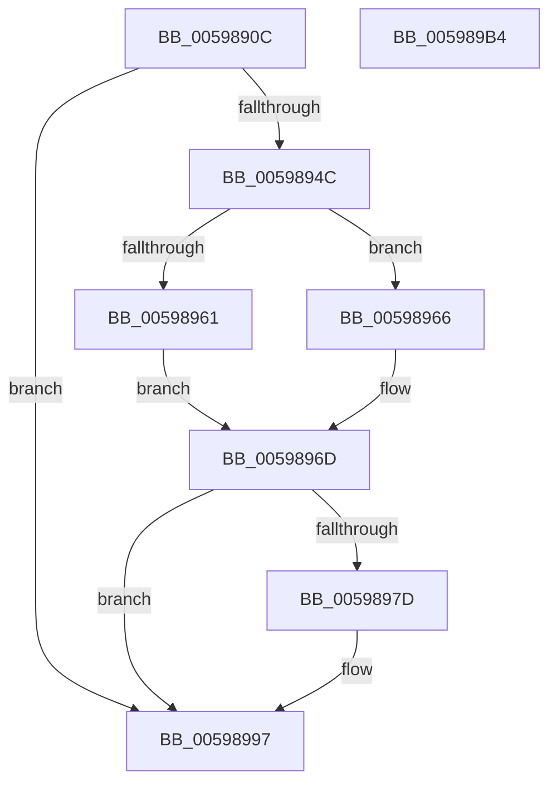

# IopIoRingWaitForCompletionEvent

- RVA: `0x0059890C`–`0x005989B5` (길이 `169` bytes)
- VA: `0x000000014059890C`
- 실행 섹션: `.text`
- PDB 이름 있음: `예`; PDB Function 태그: `아니요`
- unwind 정보 RVA: `0x0005D7BC`
- 디코드: `47`개 명령, `169/169` bytes 표시
- 미해석 바이트: `0` (있으면 어셈블리에 `.byte`로 보존)

> 이 문서는 커널 이미지의 기계어와 PDB 기호를 분석해 생성했습니다. 4번과 5번은 함수 원형과 자료형을 바이너리 사용 방식에서 추정한 C 해석이며 원본 소스 복구 결과는 아닙니다.

## 1. Dependencies

- 직접 호출 지점: **4**; 고유 호출 대상: **3**
- 직접 호출자로 확인된 함수: **2**
- RIP 상대 이미지 참조: **0**

### Outgoing calls
- `0x00598941` → [KeWaitForSingleObject](../20/KeWaitForSingleObject_function_0020E6B0.md) (function, `0x0020E6B0`)
- `0x00598953` → [KeAcquireSpinLockRaiseToDpc](../20/KeAcquireSpinLockRaiseToDpc_function_00208470.md) (function, `0x00208470`)
- `0x00598973` → [KeReleaseSpinLock](../39/KeReleaseSpinLock_function_00392BA0.md) (function, `0x00392BA0`)
- `0x00598990` → [KeWaitForSingleObject](../20/KeWaitForSingleObject_function_0020E6B0.md) (function, `0x0020E6B0`)

### Direct callers
- [NtSubmitIoRing](../4C/NtSubmitIoRing_function_004CF9E0.md) at `0x004CFC11`
- [IopProcessIoRingEntry](../../page/70/IopProcessIoRingEntry_function_00700A38.md) at `0x00700A85`

### Static image references
- 디코드된 RIP-relative 메모리 참조가 없습니다.

## 2. Other-region calls and transfers

- 다른 실행 섹션으로 향하는 call: **0**
- 별도 외부 분기/꼬리 이동을 확인하지 못했습니다.

## 3. Assembly (complete function range)

```asm
0059890C  48 8B C4                        mov rax, rsp
0059890F  48 89 58 08                     mov qword ptr [rax + 8], rbx
00598913  48 89 68 10                     mov qword ptr [rax + 0x10], rbp
00598917  48 89 70 18                     mov qword ptr [rax + 0x18], rsi
0059891B  48 89 78 20                     mov qword ptr [rax + 0x20], rdi
0059891F  41 56                           push r14
00598921  48 83 EC 30                     sub rsp, 0x30
00598925  4C 89 48 E8                     mov qword ptr [rax - 0x18], r9
00598929  4C 8D B1 88 00 00 00            lea r14, [rcx + 0x88]
00598930  45 8A C8                        mov r9b, r8b
00598933  48 8B D9                        mov rbx, rcx
00598936  44 8A C2                        mov r8b, dl
00598939  49 8B CE                        mov rcx, r14
0059893C  BA 28 00 00 00                  mov edx, 0x28
00598941  E8 6A 5D C7 FF                  call 0x14020e6b0
00598946  8B F8                           mov edi, eax
00598948  85 C0                           test eax, eax
0059894A  74 4B                           je 0x140598997
0059894C  48 8D 4B 68                     lea rcx, [rbx + 0x68]
00598950  40 32 F6                        xor sil, sil
00598953  E8 18 FB C6 FF                  call 0x140208470
00598958  40 38 B3 A0 00 00 00            cmp byte ptr [rbx + 0xa0], sil
0059895F  75 05                           jne 0x140598966
00598961  40 B6 01                        mov sil, 1
00598964  EB 07                           jmp 0x14059896d
00598966  40 88 B3 A0 00 00 00            mov byte ptr [rbx + 0xa0], sil
0059896D  8A D0                           mov dl, al
0059896F  48 8D 4B 68                     lea rcx, [rbx + 0x68]
00598973  E8 28 A2 DF FF                  call 0x140392ba0
00598978  40 84 F6                        test sil, sil
0059897B  74 1A                           je 0x140598997
0059897D  48 83 64 24 20 00               and qword ptr [rsp + 0x20], 0
00598983  45 33 C9                        xor r9d, r9d
00598986  45 33 C0                        xor r8d, r8d
00598989  49 8B CE                        mov rcx, r14
0059898C  41 8D 51 28                     lea edx, [r9 + 0x28]
00598990  E8 1B 5D C7 FF                  call 0x14020e6b0
00598995  8B F8                           mov edi, eax
00598997  48 8B 5C 24 40                  mov rbx, qword ptr [rsp + 0x40]
0059899C  8B C7                           mov eax, edi
0059899E  48 8B 7C 24 58                  mov rdi, qword ptr [rsp + 0x58]
005989A3  48 8B 6C 24 48                  mov rbp, qword ptr [rsp + 0x48]
005989A8  48 8B 74 24 50                  mov rsi, qword ptr [rsp + 0x50]
005989AD  48 83 C4 30                     add rsp, 0x30
005989B1  41 5E                           pop r14
005989B3  C3                              ret
005989B4  CC                              int3
```

## 4. C-style interpretation (structured pseudocode)

```c
__int64 __fastcall IopIoRingWaitForCompletionEvent(__int64 a1, unsigned __int8 a2, unsigned __int8 a3, __int64 a4)
{
    __int64 result;
    __int64 v_rdi;
    __int64 v_rsi;
    __int64 v_rsp;
    unsigned __int64 v_stack_m18;
    unsigned __int64 v_stack_p10;
    unsigned __int64 v_stack_p18;
    unsigned __int64 v_stack_p20;
    unsigned __int64 v_stack_p8;

    *(unsigned __int64 *)(v_rsp + 8) = v_rbx;
    *(unsigned __int64 *)(v_rsp + 16) = v_rbp;
    *(unsigned __int64 *)(v_rsp + 24) = v_rsi;
    *(unsigned __int64 *)(v_rsp + 32) = v_rdi;
    v_rsp = (v_rsp) - (48);
    *(unsigned __int64 *)(v_rsp - 24) = a4;
    result = KeWaitForSingleObject(a1 + 136, 40, a2, a3);
    if ((unsigned int)(result) == 0) goto loc_00598997;
    v_rsi = 0;
    result = KeAcquireSpinLockRaiseToDpc(a1 + 104, 40, a2, a3);
    if ((*(unsigned __int8 *)(a1 + 160)) != 0) goto loc_00598966;
    goto loc_0059896D;
loc_00598966:
    *(unsigned __int8 *)(a1 + 160) = 1;
loc_0059896D:
    result = KeReleaseSpinLock(a1 + 104, (unsigned __int8)(result), a2, a3);
    v_rdi = (unsigned int)((unsigned int)(result));
    if (1 != 0) {
        a4 = 0;
        a3 = 0;
        a1 = a1 + 136;
        a2 = a4 + 40;
        result = KeWaitForSingleObject(a1, a2, a3, a4);
        v_rdi = (unsigned int)(result);
    }
    v_rsp = (v_rsp) + (48);
    return (unsigned int)((unsigned int)(v_rdi));
}
```

## 5. (Beta) C Style

```c
int64_t IopIoRingWaitForCompletionEvent(void *Arg1, uint8_t Arg2, uint8_t Arg3, int64_t Arg4)
{
    uint8_t *arg1 = (uint8_t *)Arg1;

    int64_t result;
    int64_t local_rdi;
    int64_t local_rsi;
    int64_t local_rsp;
    uint64_t v_stack_m18;
    uint64_t v_stack_p10;
    uint64_t v_stack_p18;
    uint64_t v_stack_p20;
    uint64_t v_stack_p8;

    *(uint64_t *)(local_rsp + 0x8) = local_rbx;
    *(uint64_t *)(local_rsp + 0x10) = local_rbp;
    *(uint64_t *)(local_rsp + 0x18) = local_rsi;
    *(uint64_t *)(local_rsp + 0x20) = local_rdi;
    local_rsp = (local_rsp) - (48);
    *(uint64_t *)(local_rsp - 0x18) = Arg4;
    result = KeWaitForSingleObject(Arg1 + 136, 40, Arg2, Arg3);
    if ((uint32_t)(result) == 0) goto loc_00598997;
    local_rsi = 0;
    result = KeAcquireSpinLockRaiseToDpc(Arg1 + 104, 40, Arg2, Arg3);
    if ((*(uint8_t *)(arg1 + 0xA0)) != 0) goto loc_00598966;
    goto loc_0059896D;
loc_00598966:
    *(uint8_t *)(arg1 + 0xA0) = 1;
loc_0059896D:
    result = KeReleaseSpinLock(Arg1 + 104, (uint8_t)(result), Arg2, Arg3);
    local_rdi = (uint32_t)((uint32_t)(result));
    if (1 != 0) {
        Arg4 = 0;
        Arg3 = 0;
        Arg1 = Arg1 + 136;
        Arg2 = Arg4 + 40;
        result = KeWaitForSingleObject(Arg1, Arg2, Arg3, Arg4);
        local_rdi = (uint32_t)(result);
    }
    local_rsp = (local_rsp) + (48);
    return (uint32_t)((uint32_t)(local_rdi));
}
```

### 관측된 메모리 오프셋

구조체 형식이 확인되지 않은 접근은 인자 기준의 오프셋으로만 기록했습니다.

| 기준 인자 | 오프셋 표현 | 폭 (bit) | 접근 |
|---|---:|---:|---|
| `Arg1` | `+ 0x68` | `64` | `R` |
| `Arg1` | `+ 0x88` | `64` | `R` |
| `Arg1` | `+ 0xA0` | `8` | `R` |
| `Arg1` | `+ 0xA0` | `8` | `W` |

## 6. Execution-region graph

[열기: 2D/3D 그래프와 함수 탐색 컨트롤 패널](../../../control-panel.html?section=text&rva=0x0059890C&view=graph)

- 2D 그래프는 위에서 아래로 흐르고, 3D 그래프는 빈 공간을 드래그해 회전합니다. Shift+드래그는 이동, 휠은 확대·축소, 함수 노드 선택은 대상 보고서 이동입니다.

### Static fallback


