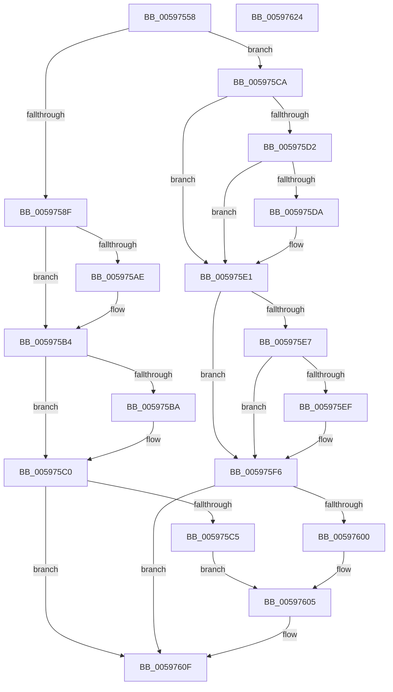

# IopIrpExtensionControl

- RVA: `0x00597558`–`0x00597625` (길이 `205` bytes)
- VA: `0x0000000140597558`
- 실행 섹션: `.text`
- PDB 이름 있음: `예`; PDB Function 태그: `아니요`
- unwind 정보 RVA: `0x00065960`
- 디코드: `57`개 명령, `205/205` bytes 표시
- 미해석 바이트: `0` (있으면 어셈블리에 `.byte`로 보존)

> 이 문서는 커널 이미지의 기계어와 PDB 기호를 분석해 생성했습니다. 4번과 5번은 함수 원형과 자료형을 바이너리 사용 방식에서 추정한 C 해석이며 원본 소스 복구 결과는 아닙니다.

## 1. Dependencies

- 직접 호출 지점: **3**; 고유 호출 대상: **3**
- 직접 호출자로 확인된 함수: **3**
- RIP 상대 이미지 참조: **6**

### Outgoing calls
- `0x00597581` → [KeAcquireInStackQueuedSpinLock](../27/KeAcquireInStackQueuedSpinLock_function_002757A0.md) (function, `0x002757A0`)
- `0x0059760A` → [IopUpdateFunctionPointers](IopUpdateFunctionPointers_function_0059762C.md) (function, `0x0059762C`)
- `0x00597614` → [KeReleaseInStackQueuedSpinLock](../34/KeReleaseInStackQueuedSpinLock_function_00342CE0.md) (function, `0x00342CE0`)

### Direct callers
- [IopEtwEnableCallback](../../page/71/IopEtwEnableCallback_function_0071B450.md) at `0x0071B466`
- [IoRegisterIoTracking](../../page/71/IoRegisterIoTracking_function_0071F600.md) at `0x0071F71C`
- [IoUnregisterIoTracking](../../page/71/IoUnregisterIoTracking_function_0071F750.md) at `0x0071F776`

### Static image references
- `0x00597570` → RVA `0x00F8D430` (`.data`; read)
- `0x0059758F` → RVA `0x00E66108` (`.data`; read)
- `0x005975A3` → RVA `0x00E66108` (`.data`; write)
- `0x005975AE` → RVA `0x00E6610C` (`.data`; read/write)
- `0x005975BA` → RVA `0x00E66110` (`.data`; read/write)
- `0x005975DA` → RVA `0x00E66108` (`.data`; read/write)

## 2. Other-region calls and transfers

- 다른 실행 섹션으로 향하는 call: **0**
- 별도 외부 분기/꼬리 이동을 확인하지 못했습니다.

## 3. Assembly (complete function range)

```asm
00597558  48 89 5C 24 08                  mov qword ptr [rsp + 8], rbx
0059755D  57                              push rdi
0059755E  48 83 EC 40                     sub rsp, 0x40
00597562  8B DA                           mov ebx, edx
00597564  8B F9                           mov edi, ecx
00597566  0F 57 C0                        xorps xmm0, xmm0
00597569  48 8D 54 24 20                  lea rdx, [rsp + 0x20]
0059756E  33 C0                           xor eax, eax
00597570  48 8D 0D B9 5E 9F 00            lea rcx, [rip + 0x9f5eb9]
00597577  0F 11 44 24 20                  movups xmmword ptr [rsp + 0x20], xmm0
0059757C  48 89 44 24 30                  mov qword ptr [rsp + 0x30], rax
00597581  E8 1A E2 CD FF                  call 0x1402757a0
00597586  BA 01 00 00 00                  mov edx, 1
0059758B  3B DA                           cmp ebx, edx
0059758D  75 3B                           jne 0x1405975ca
0059758F  8B 05 73 EB 8C 00               mov eax, dword ptr [rip + 0x8ceb73]
00597595  33 C9                           xor ecx, ecx
00597597  85 C0                           test eax, eax
00597599  44 0F B6 C1                     movzx r8d, cl
0059759D  44 0F 44 C2                     cmove r8d, edx
005975A1  0B C7                           or eax, edi
005975A3  89 05 5F EB 8C 00               mov dword ptr [rip + 0x8ceb5f], eax
005975A9  40 84 FA                        test dl, dil
005975AC  74 06                           je 0x1405975b4
005975AE  01 15 58 EB 8C 00               add dword ptr [rip + 0x8ceb58], edx
005975B4  40 F6 C7 02                     test dil, 2
005975B8  74 06                           je 0x1405975c0
005975BA  01 15 50 EB 8C 00               add dword ptr [rip + 0x8ceb50], edx
005975C0  44 3A C2                        cmp r8b, dl
005975C3  75 4A                           jne 0x14059760f
005975C5  44 8A C2                        mov r8b, dl
005975C8  EB 3B                           jmp 0x140597605
005975CA  83 C8 FF                        or eax, 0xffffffff
005975CD  40 84 FA                        test dl, dil
005975D0  74 0F                           je 0x1405975e1
005975D2  01 05 34 EB 8C 00               add dword ptr [rip + 0x8ceb34], eax
005975D8  75 07                           jne 0x1405975e1
005975DA  83 25 27 EB 8C 00 FE            and dword ptr [rip + 0x8ceb27], 0xfffffffe
005975E1  40 F6 C7 02                     test dil, 2
005975E5  74 0F                           je 0x1405975f6
005975E7  01 05 23 EB 8C 00               add dword ptr [rip + 0x8ceb23], eax
005975ED  75 07                           jne 0x1405975f6
005975EF  83 25 12 EB 8C 00 FD            and dword ptr [rip + 0x8ceb12], 0xfffffffd
005975F6  33 C9                           xor ecx, ecx
005975F8  39 0D 0A EB 8C 00               cmp dword ptr [rip + 0x8ceb0a], ecx
005975FE  75 0F                           jne 0x14059760f
00597600  44 8A C2                        mov r8b, dl
00597603  33 D2                           xor edx, edx
00597605  B9 04 00 00 00                  mov ecx, 4
0059760A  E8 1D 00 00 00                  call 0x14059762c
0059760F  48 8D 4C 24 20                  lea rcx, [rsp + 0x20]
00597614  E8 C7 B6 DA FF                  call 0x140342ce0
00597619  48 8B 5C 24 50                  mov rbx, qword ptr [rsp + 0x50]
0059761E  48 83 C4 40                     add rsp, 0x40
00597622  5F                              pop rdi
00597623  C3                              ret
00597624  CC                              int3
```

## 4. C-style interpretation (structured pseudocode)

```c
__int64 __fastcall IopIrpExtensionControl(int a1, int a2)
{
    __int64 result;
    __int64 v_rsp;
    unsigned __int64 v_stack_m18;
    unsigned __int64 v_stack_m28;
    unsigned __int64 v_stack_p8;

    v_stack_p8 = v_rbx;
    v_rsp = (v_rsp) - (64);
    result = 0;
    v_stack_m28 = v_xmm0;
    v_stack_m18 = 0;
    result = KeAcquireInStackQueuedSpinLock(v_rip + 10444473, v_stack_m28, a3, a4);
    if (((unsigned int)((unsigned int)(a2))) != 1) goto loc_005975CA;
    a1 = 0;
    a3 = 0;
    if ((unsigned int)((unsigned int)(*(unsigned int *)(v_rip + 9235315))) == 0) { a3 = 1; }
    result = (unsigned int)(((unsigned int)(*(unsigned int *)(v_rip + 9235315))) | ((unsigned int)((unsigned int)(a1))));
    *(unsigned int *)(v_rip + 9235295) = (unsigned int)(result);
    if (((1) & ((unsigned __int8)((unsigned int)(a1)))) != 0) {
    }
    if ((((unsigned __int8)((unsigned int)(a1))) & (2)) != 0) {
    }
    if (((unsigned __int8)(a3)) != 1) goto loc_0059760F;
    goto loc_00597605;
loc_005975CA:
    result = (unsigned int)((result) | (0xFFFFFFFFULL));
    if (((1) & ((unsigned __int8)((unsigned int)(a1)))) == 0) goto loc_005975E1;
    if (((1) & ((unsigned __int8)((unsigned int)(a1)))) == 0) {
    }
    if ((((unsigned __int8)((unsigned int)(a1))) & (2)) == 0) goto loc_005975F6;
    if ((((unsigned __int8)((unsigned int)(a1))) & (2)) == 0) {
    }
    a1 = 0;
    if ((*(unsigned int *)(v_rip + 9235210)) != 0) goto loc_0059760F;
    a2 = 0;
loc_00597605:
    result = IopUpdateFunctionPointers(4, a2, 1, a4);
loc_0059760F:
    result = KeReleaseInStackQueuedSpinLock(v_stack_m28, a2, 1, a4);
    v_rsp = (v_rsp) + (64);
    return result;
}
```

## 5. (Beta) C Style

```c
int64_t IopIrpExtensionControl(int32_t Arg1, int32_t Arg2)
{
    int64_t result;
    int64_t local_rsp;
    uint64_t v_stack_m18;
    uint64_t v_stack_m28;
    uint64_t v_stack_p8;

    v_stack_p8 = local_rbx;
    local_rsp = (local_rsp) - (64);
    result = 0;
    v_stack_m28 = v_xmm0;
    v_stack_m18 = 0;
    result = KeAcquireInStackQueuedSpinLock(v_rip + 10444473, v_stack_m28, a3, a4);
    if (((uint32_t)((uint32_t)(Arg2))) != 1) goto loc_005975CA;
    Arg1 = 0;
    a3 = 0;
    if ((uint32_t)((uint32_t)(*(uint32_t *)(v_rip + 0x8CEB73))) == 0) { a3 = 1; }
    result = (uint32_t)(((uint32_t)(*(uint32_t *)(v_rip + 0x8CEB73))) | ((uint32_t)((uint32_t)(Arg1))));
    *(uint32_t *)(v_rip + 0x8CEB5F) = (uint32_t)(result);
    if (((1) & ((uint8_t)((uint32_t)(Arg1)))) != 0) {
    }
    if ((((uint8_t)((uint32_t)(Arg1))) & (2)) != 0) {
    }
    if (((uint8_t)(a3)) != 1) goto loc_0059760F;
    goto loc_00597605;
loc_005975CA:
    result = (uint32_t)((result) | (0xFFFFFFFFULL));
    if (((1) & ((uint8_t)((uint32_t)(Arg1)))) == 0) goto loc_005975E1;
    if (((1) & ((uint8_t)((uint32_t)(Arg1)))) == 0) {
    }
    if ((((uint8_t)((uint32_t)(Arg1))) & (2)) == 0) goto loc_005975F6;
    if ((((uint8_t)((uint32_t)(Arg1))) & (2)) == 0) {
    }
    Arg1 = 0;
    if ((*(uint32_t *)(v_rip + 0x8CEB0A)) != 0) goto loc_0059760F;
    Arg2 = 0;
loc_00597605:
    result = IopUpdateFunctionPointers(4, Arg2, 1, a4);
loc_0059760F:
    result = KeReleaseInStackQueuedSpinLock(v_stack_m28, Arg2, 1, a4);
    local_rsp = (local_rsp) + (64);
    return result;
}
```

## 6. Execution-region graph

[열기: 2D/3D 그래프와 함수 탐색 컨트롤 패널](../../../control-panel.html?section=text&rva=0x00597558&view=graph)

- 2D 그래프는 위에서 아래로 흐르고, 3D 그래프는 빈 공간을 드래그해 회전합니다. Shift+드래그는 이동, 휠은 확대·축소, 함수 노드 선택은 대상 보고서 이동입니다.

### Static fallback


