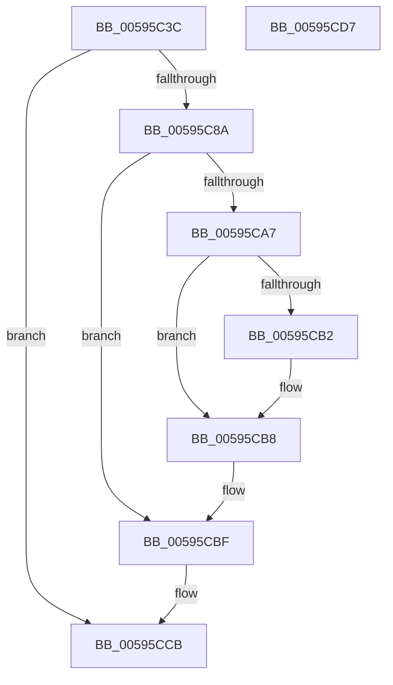

# IopIsBitlockerOn

- RVA: `0x00595C3C`–`0x00595CD8` (길이 `156` bytes)
- VA: `0x0000000140595C3C`
- 실행 섹션: `.text`
- PDB 이름 있음: `예`; PDB Function 태그: `아니요`
- unwind 정보 RVA: `0x0007F554`
- 디코드: `42`개 명령, `156/156` bytes 표시
- 미해석 바이트: `0` (있으면 어셈블리에 `.byte`로 보존)

> 이 문서는 커널 이미지의 기계어와 PDB 기호를 분석해 생성했습니다. 4번과 5번은 함수 원형과 자료형을 바이너리 사용 방식에서 추정한 C 해석이며 원본 소스 복구 결과는 아닙니다.

## 1. Dependencies

- 직접 호출 지점: **5**; 고유 호출 대상: **5**
- 직접 호출자로 확인된 함수: **1**
- RIP 상대 이미지 참조: **2**

### Outgoing calls
- `0x00595C65` → [RtlInitUnicodeString](../42/RtlInitUnicodeString_function_0042A780.md) (function, `0x0042A780`)
- `0x00595C81` → [IopOpenRegistryKey](../../page/A8/IopOpenRegistryKey_function_00A8F200.md) (function, `0x00A8F200`)
- `0x00595C9E` → [IopGetRegistryValue](../../page/99/IopGetRegistryValue_function_009990EC.md) (function, `0x009990EC`)
- `0x00595CBA` → [ExFreePoolWithTag](../../poolcode/B8/ExFreePoolWithTag_function_00B82870.md) (function, `0x00B82870`)
- `0x00595CC6` → [ObCloseHandle](../../page/8A/ObCloseHandle_function_008A1870.md) (function, `0x008A1870`)

### Direct callers
- [IopInitDumpCapsuleSupport](IopInitDumpCapsuleSupport_function_0059578C.md) at `0x00595799`

### Static image references
- `0x00595C49` → RVA `0x006C9DB0` (` ?? ::FNODOBFM::`string'`; read)
- `0x00595C97` → RVA `0x006C9D90` (` ?? ::FNODOBFM::`string'`; read)

## 2. Other-region calls and transfers

- 다른 실행 섹션으로 향하는 call: **4**
  - `0x00595C81` → [IopOpenRegistryKey](../../page/A8/IopOpenRegistryKey_function_00A8F200.md) (`.text` → `PAGE`)
  - `0x00595C9E` → [IopGetRegistryValue](../../page/99/IopGetRegistryValue_function_009990EC.md) (`.text` → `PAGE`)
  - `0x00595CBA` → [ExFreePoolWithTag](../../poolcode/B8/ExFreePoolWithTag_function_00B82870.md) (`.text` → `POOLCODE`)
  - `0x00595CC6` → [ObCloseHandle](../../page/8A/ObCloseHandle_function_008A1870.md) (`.text` → `PAGE`)
- 별도 외부 분기/꼬리 이동을 확인하지 못했습니다.

## 3. Assembly (complete function range)

```asm
00595C3C  48 8B C4                        mov rax, rsp
00595C3F  53                              push rbx
00595C40  48 83 EC 40                     sub rsp, 0x40
00595C44  48 83 60 10 00                  and qword ptr [rax + 0x10], 0
00595C49  48 8D 15 60 41 13 00            lea rdx, [rip + 0x134160]
00595C50  48 83 60 08 00                  and qword ptr [rax + 8], 0
00595C55  48 8D 48 E8                     lea rcx, [rax - 0x18]
00595C59  0F 57 C0                        xorps xmm0, xmm0
00595C5C  BB 01 00 00 00                  mov ebx, 1
00595C61  0F 11 40 E8                     movups xmmword ptr [rax - 0x18], xmm0
00595C65  E8 16 4B E9 FF                  call 0x14042a780
00595C6A  41 B9 19 00 02 00               mov r9d, 0x20019
00595C70  C6 44 24 20 00                  mov byte ptr [rsp + 0x20], 0
00595C75  4C 8D 44 24 30                  lea r8, [rsp + 0x30]
00595C7A  33 D2                           xor edx, edx
00595C7C  48 8D 4C 24 50                  lea rcx, [rsp + 0x50]
00595C81  E8 7A 95 4F 00                  call 0x140a8f200
00595C86  85 C0                           test eax, eax
00595C88  78 41                           js 0x140595ccb
00595C8A  48 8B 4C 24 50                  mov rcx, qword ptr [rsp + 0x50]
00595C8F  4C 8D 4C 24 58                  lea r9, [rsp + 0x58]
00595C94  45 33 C0                        xor r8d, r8d
00595C97  48 8D 15 F2 40 13 00            lea rdx, [rip + 0x1340f2]
00595C9E  E8 49 34 40 00                  call 0x1409990ec
00595CA3  85 C0                           test eax, eax
00595CA5  78 18                           js 0x140595cbf
00595CA7  48 8B 4C 24 58                  mov rcx, qword ptr [rsp + 0x58]
00595CAC  83 79 0C 00                     cmp dword ptr [rcx + 0xc], 0
00595CB0  74 06                           je 0x140595cb8
00595CB2  8B 41 08                        mov eax, dword ptr [rcx + 8]
00595CB5  8B 1C 08                        mov ebx, dword ptr [rax + rcx]
00595CB8  33 D2                           xor edx, edx
00595CBA  E8 B1 CB 5E 00                  call 0x140b82870
00595CBF  48 8B 4C 24 50                  mov rcx, qword ptr [rsp + 0x50]
00595CC4  33 D2                           xor edx, edx
00595CC6  E8 A5 BB 30 00                  call 0x1408a1870
00595CCB  83 FB 01                        cmp ebx, 1
00595CCE  0F 94 C0                        sete al
00595CD1  48 83 C4 40                     add rsp, 0x40
00595CD5  5B                              pop rbx
00595CD6  C3                              ret
00595CD7  CC                              int3
```

## 4. C-style interpretation (structured pseudocode)

```c
__int64 __fastcall IopIsBitlockerOn(void)
{
    __int64 result;
    __int64 v_rbx;
    __int64 v_rsp;
    unsigned __int64 v_stack_m18;
    unsigned __int8 v_stack_m28;
    unsigned __int64 v_stack_p10;
    unsigned __int64 v_stack_p8;

    v_rsp = (v_rsp) - (64);
    *(unsigned __int64 *)(v_rsp - 24) = v_xmm0;
    result = RtlInitUnicodeString(v_rsp - 24, v_rip + 1261920, a3, a4);
    v_stack_m28 = 0;
    a2 = 0;
    result = IopOpenRegistryKey(v_stack_p8, a2, v_stack_m18, (unsigned int)(0x20019ULL));
    if (sign_flag) goto loc_00595CCB;
    a3 = 0;
    result = IopGetRegistryValue(v_stack_p8, v_rip + 1261810, a3, v_stack_p10);
    if (sign_flag) goto loc_00595CBF;
    v_rbx = 1;
    if ((*(unsigned int *)(v_stack_p10 + 12)) != 0) {
        result = *(unsigned int *)(v_stack_p10 + 8);
        v_rbx = *(unsigned int *)(result + v_stack_p10 * 1);
    }
    a2 = 0;
    result = ExFreePoolWithTag(v_stack_p10, a2, a3, v_stack_p10);
loc_00595CBF:
    a2 = 0;
    result = ObCloseHandle(v_stack_p8, a2, a3, v_stack_p10);
loc_00595CCB:
    result = (((unsigned int)(v_rbx)) == 1) ? 1 : 0;
    v_rsp = (v_rsp) + (64);
    return result;
}
```

## 5. (Beta) C Style

```c
void IopIsBitlockerOn(void)
{
    int64_t result;
    int64_t local_rbx;
    int64_t local_rsp;
    uint64_t v_stack_m18;
    uint8_t v_stack_m28;
    uint64_t v_stack_p10;
    uint64_t v_stack_p8;

    local_rsp = (local_rsp) - (64);
    *(uint64_t *)(local_rsp - 0x18) = v_xmm0;
    result = RtlInitUnicodeString(local_rsp - 24, v_rip + 1261920, a3, a4);
    v_stack_m28 = 0;
    a2 = 0;
    result = IopOpenRegistryKey(v_stack_p8, a2, v_stack_m18, (uint32_t)(0x20019ULL));
    if (sign_flag) goto loc_00595CCB;
    a3 = 0;
    result = IopGetRegistryValue(v_stack_p8, v_rip + 1261810, a3, v_stack_p10);
    if (sign_flag) goto loc_00595CBF;
    local_rbx = 1;
    if ((*(uint32_t *)(v_stack_p10 + 0xC)) != 0) {
        result = *(uint32_t *)(v_stack_p10 + 0x8);
        local_rbx = *(uint32_t *)(result + v_stack_p10 * 1);
    }
    a2 = 0;
    result = ExFreePoolWithTag(v_stack_p10, a2, a3, v_stack_p10);
loc_00595CBF:
    a2 = 0;
    result = ObCloseHandle(v_stack_p8, a2, a3, v_stack_p10);
loc_00595CCB:
    result = (((uint32_t)(local_rbx)) == 1) ? 1 : 0;
    local_rsp = (local_rsp) + (64);
    return result;
}
```

## 6. Execution-region graph

[열기: 2D/3D 그래프와 함수 탐색 컨트롤 패널](../../../control-panel.html?section=text&rva=0x00595C3C&view=graph)

- 2D 그래프는 위에서 아래로 흐르고, 3D 그래프는 빈 공간을 드래그해 회전합니다. Shift+드래그는 이동, 휠은 확대·축소, 함수 노드 선택은 대상 보고서 이동입니다.

### Static fallback


