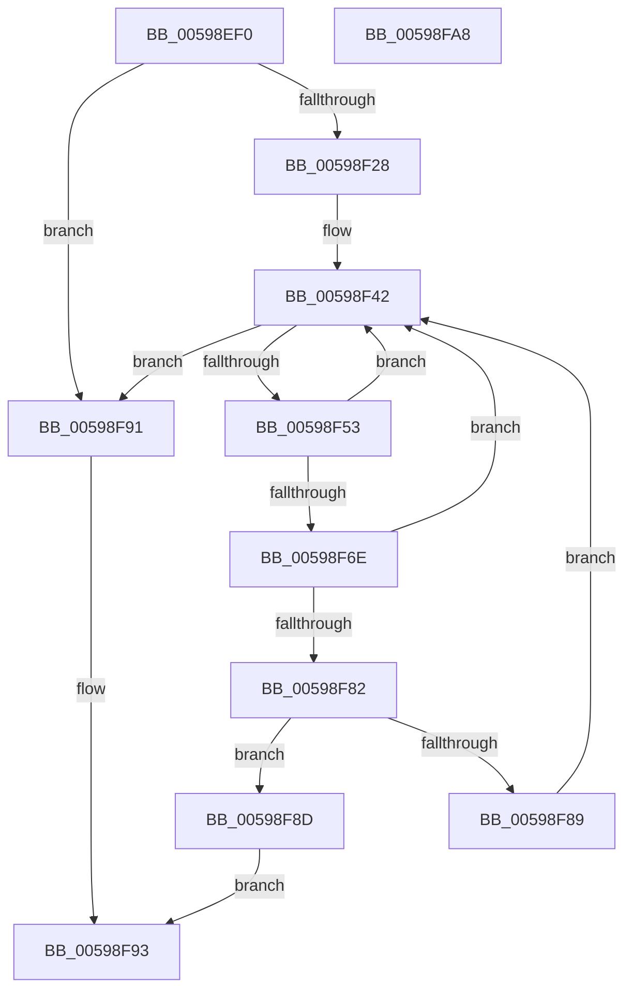

# IopLiveDumpAddIptTraceBuffers

- RVA: `0x00598EF0`–`0x00598FA9` (길이 `185` bytes)
- VA: `0x0000000140598EF0`
- 실행 섹션: `.text`
- PDB 이름 있음: `예`; PDB Function 태그: `아니요`
- unwind 정보 RVA: `0x000C7BEC`
- 디코드: `53`개 명령, `185/185` bytes 표시
- 미해석 바이트: `0` (있으면 어셈블리에 `.byte`로 보존)

> 이 문서는 커널 이미지의 기계어와 PDB 기호를 분석해 생성했습니다. 4번과 5번은 함수 원형과 자료형을 바이너리 사용 방식에서 추정한 C 해석이며 원본 소스 복구 결과는 아닙니다.

## 1. Dependencies

- 직접 호출 지점: **3**; 고유 호출 대상: **3**
- 직접 호출자로 확인된 함수: **0**
- RIP 상대 이미지 참조: **3**

### Outgoing calls
- `0x00598F4A` → [KeEnumerateNextProcessor](../41/KeEnumerateNextProcessor_function_00415480.md) (function, `0x00415480`)
- `0x00598F65` → [guard_dispatch_icall](../6B/guard_dispatch_icall_function_006BAAD0.md) (function, `0x006BAAD0`)
- `0x00598F79` → [MmAddRangeToCrashDump](../67/MmAddRangeToCrashDump_function_0067D8B0.md) (function, `0x0067D8B0`)

### Direct callers
- 이 함수 시작 RVA로 연결되는 직접 call은 확인되지 않았습니다. 간접 호출은 완전히 역산할 수 없습니다.

### Static image references
- `0x00598F0C` → RVA `0x00E66178` (`.data`; read)
- `0x00598F28` → RVA `0x00FC7128` (`ALMOSTRO`; read)
- `0x00598F33` → RVA `0x00FC7120` (`ALMOSTRO`; read)

## 2. Other-region calls and transfers

- 다른 실행 섹션으로 향하는 call: **0**
- 별도 외부 분기/꼬리 이동을 확인하지 못했습니다.

## 3. Assembly (complete function range)

```asm
00598EF0  48 89 5C 24 08                  mov qword ptr [rsp + 8], rbx
00598EF5  48 89 74 24 10                  mov qword ptr [rsp + 0x10], rsi
00598EFA  48 89 7C 24 20                  mov qword ptr [rsp + 0x20], rdi
00598EFF  55                              push rbp
00598F00  48 8B EC                        mov rbp, rsp
00598F03  48 83 EC 50                     sub rsp, 0x50
00598F07  33 F6                           xor esi, esi
00598F09  0F 57 C0                        xorps xmm0, xmm0
00598F0C  48 39 35 65 D2 8C 00            cmp qword ptr [rip + 0x8cd265], rsi
00598F13  48 8B FA                        mov rdi, rdx
00598F16  0F 11 45 D0                     movups xmmword ptr [rbp - 0x30], xmm0
00598F1A  89 75 F2                        mov dword ptr [rbp - 0xe], esi
00598F1D  8B DE                           mov ebx, esi
00598F1F  66 89 75 F6                     mov word ptr [rbp - 0xa], si
00598F23  89 75 20                        mov dword ptr [rbp + 0x20], esi
00598F26  74 69                           je 0x140598f91
00598F28  48 8B 05 F9 E1 A2 00            mov rax, qword ptr [rip + 0xa2e1f9]
00598F2F  48 89 45 E8                     mov qword ptr [rbp - 0x18], rax
00598F33  48 8D 05 E6 E1 A2 00            lea rax, [rip + 0xa2e1e6]
00598F3A  48 89 45 E0                     mov qword ptr [rbp - 0x20], rax
00598F3E  66 89 75 F0                     mov word ptr [rbp - 0x10], si
00598F42  48 8D 55 E0                     lea rdx, [rbp - 0x20]
00598F46  48 8D 4D 20                     lea rcx, [rbp + 0x20]
00598F4A  E8 31 C5 E7 FF                  call 0x140415480
00598F4F  85 C0                           test eax, eax
00598F51  75 3E                           jne 0x140598f91
00598F53  48 8B 05 1E D2 8C 00            mov rax, qword ptr [rip + 0x8cd21e]
00598F5A  48 8D 55 D0                     lea rdx, [rbp - 0x30]
00598F5E  8B 4D 20                        mov ecx, dword ptr [rbp + 0x20]
00598F61  48 8B 40 10                     mov rax, qword ptr [rax + 0x10]
00598F65  E8 66 1B 12 00                  call 0x1406baad0
00598F6A  85 C0                           test eax, eax
00598F6C  78 D4                           js 0x140598f42
00598F6E  4C 8B 45 D8                     mov r8, qword ptr [rbp - 0x28]
00598F72  48 8B CF                        mov rcx, rdi
00598F75  48 8B 55 D0                     mov rdx, qword ptr [rbp - 0x30]
00598F79  E8 32 49 0E 00                  call 0x14067d8b0
00598F7E  85 C0                           test eax, eax
00598F80  79 C0                           jns 0x140598f42
00598F82  3D 23 00 00 C0                  cmp eax, 0xc0000023
00598F87  74 04                           je 0x140598f8d
00598F89  8B D8                           mov ebx, eax
00598F8B  EB B5                           jmp 0x140598f42
00598F8D  33 C0                           xor eax, eax
00598F8F  EB 02                           jmp 0x140598f93
00598F91  8B C3                           mov eax, ebx
00598F93  48 8B 5C 24 60                  mov rbx, qword ptr [rsp + 0x60]
00598F98  48 8B 74 24 68                  mov rsi, qword ptr [rsp + 0x68]
00598F9D  48 8B 7C 24 78                  mov rdi, qword ptr [rsp + 0x78]
00598FA2  48 83 C4 50                     add rsp, 0x50
00598FA6  5D                              pop rbp
00598FA7  C3                              ret
00598FA8  CC                              int3
```

## 4. C-style interpretation (structured pseudocode)

```c
__int64 __fastcall IopLiveDumpAddIptTraceBuffers(__int64 a1, __int64 a2)
{
    __int64 result;
    __int64 v_rsi;
    __int64 v_rsp;
    unsigned __int16 v_stack_m12;
    unsigned int v_stack_m16;
    unsigned __int16 v_stack_m18;
    unsigned __int64 v_stack_m20;
    unsigned __int64 v_stack_m28;
    unsigned __int64 v_stack_m30;
    unsigned __int64 v_stack_m38;
    unsigned __int64 v_stack_p10;
    unsigned int v_stack_p18;
    unsigned __int64 v_stack_p20;
    unsigned __int64 v_stack_p8;

    v_stack_p8 = v_rbx;
    v_stack_p10 = v_rsi;
    v_stack_p20 = v_rdi;
    v_rsp = (v_rsp) - (80);
    v_rsi = 0;
    v_stack_m38 = v_xmm0;
    v_stack_m16 = 0;
    v_stack_m12 = 0;
    v_stack_p18 = 0;
    if ((*(unsigned __int64 *)(v_rip + 9228901)) == 0) goto loc_00598F91;
    v_stack_m20 = *(unsigned __int64 *)(v_rip + 10674681);
    v_stack_m28 = v_rip + 10674662;
    v_stack_m18 = 0;
loc_00598F42:
    result = KeEnumerateNextProcessor(v_stack_p18, v_stack_m28, a3, a4);
    if ((unsigned int)(result) != 0) goto loc_00598F91;
    result = guard_dispatch_icall((unsigned int)(v_stack_p18), v_stack_m38, a3, a4);
    if (sign_flag) goto loc_00598F42;
    result = MmAddRangeToCrashDump(a2, v_stack_m38, v_stack_m30, a4);
    if (!sign_flag) goto loc_00598F42;
    if (((unsigned int)(result)) == 0xC0000023ULL) goto loc_00598F8D;
    goto loc_00598F42;
loc_00598F8D:
    result = 0;
    goto loc_00598F93;
loc_00598F91:
loc_00598F93:
    v_rsp = (v_rsp) + (80);
    return (unsigned int)((unsigned int)((unsigned int)((unsigned int)(result))));
}
```

## 5. (Beta) C Style

```c
int64_t IopLiveDumpAddIptTraceBuffers(int64_t Arg1, int64_t Arg2)
{
    int64_t result;
    int64_t local_rsi;
    int64_t local_rsp;
    uint16_t v_stack_m12;
    uint32_t v_stack_m16;
    uint16_t v_stack_m18;
    uint64_t v_stack_m20;
    uint64_t v_stack_m28;
    uint64_t v_stack_m30;
    uint64_t v_stack_m38;
    uint64_t v_stack_p10;
    uint32_t v_stack_p18;
    uint64_t v_stack_p20;
    uint64_t v_stack_p8;

    v_stack_p8 = local_rbx;
    v_stack_p10 = local_rsi;
    v_stack_p20 = local_rdi;
    local_rsp = (local_rsp) - (80);
    local_rsi = 0;
    v_stack_m38 = v_xmm0;
    v_stack_m16 = 0;
    v_stack_m12 = 0;
    v_stack_p18 = 0;
    if ((*(uint64_t *)(v_rip + 0x8CD265)) == 0) goto loc_00598F91;
    v_stack_m20 = *(uint64_t *)(v_rip + 0xA2E1F9);
    v_stack_m28 = v_rip + 10674662;
    v_stack_m18 = 0;
loc_00598F42:
    result = KeEnumerateNextProcessor(v_stack_p18, v_stack_m28, a3, a4);
    if ((uint32_t)(result) != 0) goto loc_00598F91;
    result = guard_dispatch_icall((uint32_t)(v_stack_p18), v_stack_m38, a3, a4);
    if (sign_flag) goto loc_00598F42;
    result = MmAddRangeToCrashDump(Arg2, v_stack_m38, v_stack_m30, a4);
    if (!sign_flag) goto loc_00598F42;
    if (((uint32_t)(result)) == 0xC0000023ULL) goto loc_00598F8D;
    goto loc_00598F42;
loc_00598F8D:
    result = 0;
    goto loc_00598F93;
loc_00598F91:
loc_00598F93:
    local_rsp = (local_rsp) + (80);
    return (uint32_t)((uint32_t)((uint32_t)((uint32_t)(result))));
}
```

## 6. Execution-region graph

[열기: 2D/3D 그래프와 함수 탐색 컨트롤 패널](../../../control-panel.html?section=text&rva=0x00598EF0&view=graph)

- 2D 그래프는 위에서 아래로 흐르고, 3D 그래프는 빈 공간을 드래그해 회전합니다. Shift+드래그는 이동, 휠은 확대·축소, 함수 노드 선택은 대상 보고서 이동입니다.

### Static fallback


