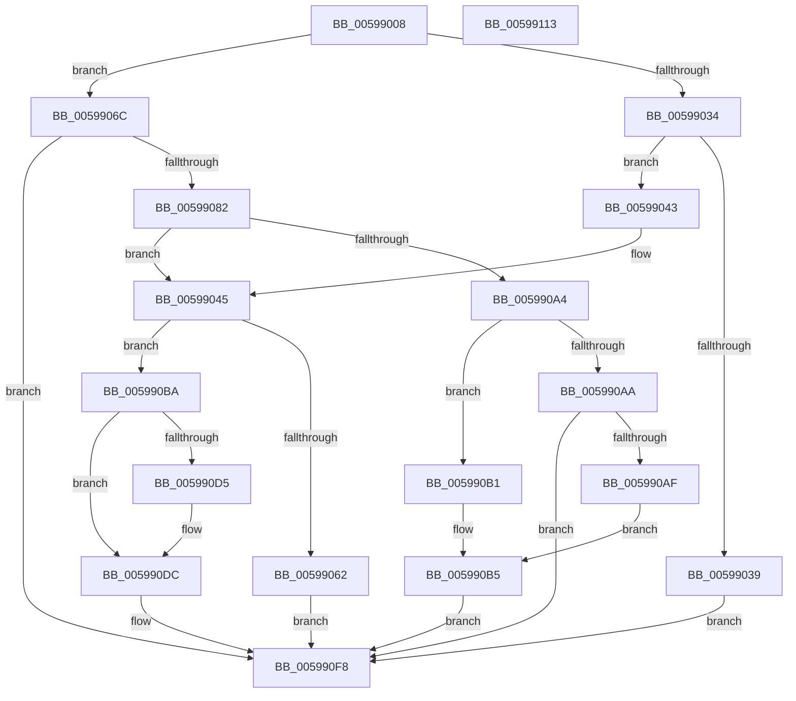

# IopLiveDumpAddProcessFilter

- RVA: `0x00599008`–`0x00599114` (길이 `268` bytes)
- VA: `0x0000000140599008`
- 실행 섹션: `.text`
- PDB 이름 있음: `예`; PDB Function 태그: `아니요`
- unwind 정보 RVA: `0x00095AD0`
- 디코드: `80`개 명령, `268/268` bytes 표시
- 미해석 바이트: `0` (있으면 어셈블리에 `.byte`로 보존)

> 이 문서는 커널 이미지의 기계어와 PDB 기호를 분석해 생성했습니다. 4번과 5번은 함수 원형과 자료형을 바이너리 사용 방식에서 추정한 C 해석이며 원본 소스 복구 결과는 아닙니다.

## 1. Dependencies

- 직접 호출 지점: **5**; 고유 호출 대상: **5**
- 직접 호출자로 확인된 함수: **1**
- RIP 상대 이미지 참조: **0**

### Outgoing calls
- `0x00599058` → [ExAllocatePool2](../../poolcode/B8/ExAllocatePool2_function_00B820F0.md) (function, `0x00B820F0`)
- `0x00599074` → [PsLookupProcessByProcessId](../../page/8A/PsLookupProcessByProcessId_function_008A2AA0.md) (function, `0x008A2AA0`)
- `0x0059908F` → [ObfDereferenceObjectWithTag](../2F/ObfDereferenceObjectWithTag_function_002F78E0.md) (function, `0x002F78E0`)
- `0x0059909A` → [IopLiveDumpLookupProcessFilter](IopLiveDumpLookupProcessFilter_function_0059CC0C.md) (function, `0x0059CC0C`)
- `0x005990F3` → [IopLiveDumpDiscardVirtualAddressRange](../29/IopLiveDumpDiscardVirtualAddressRange_function_002977F4.md) (function, `0x002977F4`)

### Direct callers
- [IopLiveDumpAllocAndInitProcessFilters](IopLiveDumpAllocAndInitProcessFilters_function_00599310.md) at `0x00599367`
- [IopLiveDumpAllocAndInitProcessFilters](IopLiveDumpAllocAndInitProcessFilters_function_00599310.md) at `0x00599384`

### Static image references
- 디코드된 RIP-relative 메모리 참조가 없습니다.

## 2. Other-region calls and transfers

- 다른 실행 섹션으로 향하는 call: **2**
  - `0x00599058` → [ExAllocatePool2](../../poolcode/B8/ExAllocatePool2_function_00B820F0.md) (`.text` → `POOLCODE`)
  - `0x00599074` → [PsLookupProcessByProcessId](../../page/8A/PsLookupProcessByProcessId_function_008A2AA0.md) (`.text` → `PAGE`)
- 별도 외부 분기/꼬리 이동을 확인하지 못했습니다.

## 3. Assembly (complete function range)

```asm
00599008  48 8B C4                        mov rax, rsp
0059900B  48 89 58 08                     mov qword ptr [rax + 8], rbx
0059900F  48 89 68 18                     mov qword ptr [rax + 0x18], rbp
00599013  48 89 70 20                     mov qword ptr [rax + 0x20], rsi
00599017  57                              push rdi
00599018  41 56                           push r14
0059901A  41 57                           push r15
0059901C  48 83 EC 20                     sub rsp, 0x20
00599020  33 F6                           xor esi, esi
00599022  41 8B F8                        mov edi, r8d
00599025  48 89 70 10                     mov qword ptr [rax + 0x10], rsi
00599029  48 8B EA                        mov rbp, rdx
0059902C  4C 8B F9                        mov r15, rcx
0059902F  48 85 D2                        test rdx, rdx
00599032  75 38                           jne 0x14059906c
00599034  45 85 C0                        test r8d, r8d
00599037  74 0A                           je 0x140599043
00599039  BB 0D 00 00 C0                  mov ebx, 0xc000000d
0059903E  E9 B5 00 00 00                  jmp 0x1405990f8
00599043  33 DB                           xor ebx, ebx
00599045  41 BE 28 00 00 00               mov r14d, 0x28
0059904B  41 B8 4C 64 6D 70               mov r8d, 0x706d644c
00599051  41 8B D6                        mov edx, r14d
00599054  41 8D 4E 18                     lea ecx, [r14 + 0x18]
00599058  E8 93 90 5E 00                  call 0x140b820f0
0059905D  48 85 C0                        test rax, rax
00599060  75 58                           jne 0x1405990ba
00599062  BB 9A 00 00 C0                  mov ebx, 0xc000009a
00599067  E9 8C 00 00 00                  jmp 0x1405990f8
0059906C  48 8D 54 24 48                  lea rdx, [rsp + 0x48]
00599071  48 8B CD                        mov rcx, rbp
00599074  E8 27 9A 30 00                  call 0x1408a2aa0
00599079  8B D8                           mov ebx, eax
0059907B  44 8B F0                        mov r14d, eax
0059907E  85 C0                           test eax, eax
00599080  78 76                           js 0x1405990f8
00599082  48 8B 74 24 48                  mov rsi, qword ptr [rsp + 0x48]
00599087  BA 44 66 6C 74                  mov edx, 0x746c6644
0059908C  48 8B CE                        mov rcx, rsi
0059908F  E8 4C E8 D5 FF                  call 0x1402f78e0
00599094  48 8B D5                        mov rdx, rbp
00599097  49 8B CF                        mov rcx, r15
0059909A  E8 6D 3B 00 00                  call 0x14059cc0c
0059909F  48 85 C0                        test rax, rax
005990A2  74 A1                           je 0x140599045
005990A4  48 39 70 18                     cmp qword ptr [rax + 0x18], rsi
005990A8  75 07                           jne 0x1405990b1
005990AA  3B 78 20                        cmp edi, dword ptr [rax + 0x20]
005990AD  7E 49                           jle 0x1405990f8
005990AF  EB 04                           jmp 0x1405990b5
005990B1  48 89 70 18                     mov qword ptr [rax + 0x18], rsi
005990B5  89 78 20                        mov dword ptr [rax + 0x20], edi
005990B8  EB 3E                           jmp 0x1405990f8
005990BA  49 8D 8F B0 04 00 00            lea rcx, [r15 + 0x4b0]
005990C1  48 89 68 10                     mov qword ptr [rax + 0x10], rbp
005990C5  48 89 70 18                     mov qword ptr [rax + 0x18], rsi
005990C9  89 78 20                        mov dword ptr [rax + 0x20], edi
005990CC  48 8B 51 08                     mov rdx, qword ptr [rcx + 8]
005990D0  48 39 0A                        cmp qword ptr [rdx], rcx
005990D3  74 07                           je 0x1405990dc
005990D5  B9 03 00 00 00                  mov ecx, 3
005990DA  CD 29                           int 0x29
005990DC  48 89 08                        mov qword ptr [rax], rcx
005990DF  4D 8B C6                        mov r8, r14
005990E2  48 89 50 08                     mov qword ptr [rax + 8], rdx
005990E6  48 89 02                        mov qword ptr [rdx], rax
005990E9  48 8B D0                        mov rdx, rax
005990EC  48 89 41 08                     mov qword ptr [rcx + 8], rax
005990F0  49 8B CF                        mov rcx, r15
005990F3  E8 FC E6 CF FF                  call 0x1402977f4
005990F8  48 8B 6C 24 50                  mov rbp, qword ptr [rsp + 0x50]
005990FD  8B C3                           mov eax, ebx
005990FF  48 8B 5C 24 40                  mov rbx, qword ptr [rsp + 0x40]
00599104  48 8B 74 24 58                  mov rsi, qword ptr [rsp + 0x58]
00599109  48 83 C4 20                     add rsp, 0x20
0059910D  41 5F                           pop r15
0059910F  41 5E                           pop r14
00599111  5F                              pop rdi
00599112  C3                              ret
00599113  CC                              int3
```

## 4. C-style interpretation (structured pseudocode)

```c
__int64 __fastcall IopLiveDumpAddProcessFilter(__int64 a1, __int64 a2, int a3)
{
    __int64 result;
    __int64 v_rbx;
    __int64 v_rsi;
    __int64 v_rsp;
    unsigned __int64 v_stack_p10;
    unsigned __int64 v_stack_p18;
    unsigned __int64 v_stack_p20;
    unsigned __int64 v_stack_p8;

    *(unsigned __int64 *)(v_rsp + 8) = v_rbx;
    *(unsigned __int64 *)(v_rsp + 24) = v_rbp;
    *(unsigned __int64 *)(v_rsp + 32) = v_rsi;
    v_rsp = (v_rsp) - (32);
    v_rsi = 0;
    *(unsigned __int64 *)(v_rsp + 16) = 0;
    if (a2 != 0) goto loc_0059906C;
    if (a3 == 0) goto loc_00599043;
    goto loc_005990F8;
loc_00599043:
    v_rbx = 0;
loc_00599045:
    result = ExAllocatePool2(40 + 24, 40, (unsigned int)(0x706D644CULL), a4);
    if (result != 0) goto loc_005990BA;
    goto loc_005990F8;
loc_0059906C:
    result = PsLookupProcessByProcessId(a2, v_stack_p10, (unsigned int)(0x706D644CULL), a4);
    if (sign_flag) goto loc_005990F8;
    result = ObfDereferenceObjectWithTag(v_stack_p10, (unsigned int)(0x746C6644ULL), (unsigned int)(0x706D644CULL), a4);
    result = IopLiveDumpLookupProcessFilter(a1, a2, (unsigned int)(0x706D644CULL), a4);
    if (result == 0) goto loc_00599045;
    if ((*(unsigned __int64 *)(result + 24)) != v_stack_p10) goto loc_005990B1;
    if (((unsigned int)((unsigned int)(a3))) <= (*(unsigned int *)(result + 32))) goto loc_005990F8;
    goto loc_005990B5;
loc_005990B1:
    *(unsigned __int64 *)(result + 24) = v_stack_p10;
loc_005990B5:
    *(unsigned int *)(result + 32) = (unsigned int)((unsigned int)(a3));
    goto loc_005990F8;
loc_005990BA:
    *(unsigned __int64 *)(result + 16) = a2;
    *(unsigned __int64 *)(result + 24) = v_stack_p10;
    *(unsigned int *)(result + 32) = (unsigned int)((unsigned int)(a3));
    if ((*(unsigned __int64 *)(*(unsigned __int64 *)(a1 + 1200 + 8))) != (a1 + 1200)) {
        a1 = 3;
    }
    *(unsigned __int64 *)(result) = a1;
    *(unsigned __int64 *)(result + 8) = *(unsigned __int64 *)(a1 + 1200 + 8);
    *(unsigned __int64 *)(*(unsigned __int64 *)(a1 + 1200 + 8)) = result;
    *(unsigned __int64 *)(a1 + 8) = result;
    result = IopLiveDumpDiscardVirtualAddressRange(a1, result, (unsigned int)((unsigned int)(result)), a4);
loc_005990F8:
    v_rsp = (v_rsp) + (32);
    return (unsigned int)((unsigned int)((unsigned int)((unsigned int)(result))));
}
```

## 5. (Beta) C Style

```c
int64_t IopLiveDumpAddProcessFilter(void *Arg1, int64_t Arg2, int32_t Arg3)
{
    uint8_t *arg1 = (uint8_t *)Arg1;

    int64_t result;
    int64_t local_rbx;
    int64_t local_rsi;
    int64_t local_rsp;
    uint64_t v_stack_p10;
    uint64_t v_stack_p18;
    uint64_t v_stack_p20;
    uint64_t v_stack_p8;

    *(uint64_t *)(local_rsp + 0x8) = local_rbx;
    *(uint64_t *)(local_rsp + 0x18) = local_rbp;
    *(uint64_t *)(local_rsp + 0x20) = local_rsi;
    local_rsp = (local_rsp) - (32);
    local_rsi = 0;
    *(uint64_t *)(local_rsp + 0x10) = 0;
    if (Arg2 != 0) goto loc_0059906C;
    if (Arg3 == 0) goto loc_00599043;
    goto loc_005990F8;
loc_00599043:
    local_rbx = 0;
loc_00599045:
    result = ExAllocatePool2(40 + 24, 40, (uint32_t)(0x706D644CULL), a4);
    if (result != 0) goto loc_005990BA;
    goto loc_005990F8;
loc_0059906C:
    result = PsLookupProcessByProcessId(Arg2, v_stack_p10, (uint32_t)(0x706D644CULL), a4);
    if (sign_flag) goto loc_005990F8;
    result = ObfDereferenceObjectWithTag(v_stack_p10, (uint32_t)(0x746C6644ULL), (uint32_t)(0x706D644CULL), a4);
    result = IopLiveDumpLookupProcessFilter(Arg1, Arg2, (uint32_t)(0x706D644CULL), a4);
    if (result == 0) goto loc_00599045;
    if ((*(uint64_t *)(result + 0x18)) != v_stack_p10) goto loc_005990B1;
    if (((uint32_t)((uint32_t)(Arg3))) <= (*(uint32_t *)(result + 0x20))) goto loc_005990F8;
    goto loc_005990B5;
loc_005990B1:
    *(uint64_t *)(result + 0x18) = v_stack_p10;
loc_005990B5:
    *(uint32_t *)(result + 0x20) = (uint32_t)((uint32_t)(Arg3));
    goto loc_005990F8;
loc_005990BA:
    *(uint64_t *)(result + 0x10) = Arg2;
    *(uint64_t *)(result + 0x18) = v_stack_p10;
    *(uint32_t *)(result + 0x20) = (uint32_t)((uint32_t)(Arg3));
    if ((*(uint64_t *)(*(uint64_t *)(arg1 + 0x4B0 + 0x8))) != (Arg1 + 1200)) {
        Arg1 = 3;
    }
    *(void **)(result) = Arg1;
    *(uint64_t *)(result + 0x8) = *(uint64_t *)(arg1 + 0x4B0 + 0x8);
    *(uint64_t *)(*(uint64_t *)(arg1 + 0x4B0 + 0x8)) = result;
    *(uint64_t *)(arg1 + 0x8) = result;
    result = IopLiveDumpDiscardVirtualAddressRange(Arg1, result, (uint32_t)((uint32_t)(result)), a4);
loc_005990F8:
    local_rsp = (local_rsp) + (32);
    return (uint32_t)((uint32_t)((uint32_t)((uint32_t)(result))));
}
```

### 관측된 메모리 오프셋

구조체 형식이 확인되지 않은 접근은 인자 기준의 오프셋으로만 기록했습니다.

| 기준 인자 | 오프셋 표현 | 폭 (bit) | 접근 |
|---|---:|---:|---|
| `Arg1` | `+ 0x8` | `64` | `R` |
| `Arg1` | `+ 0x4B0` | `64` | `R` |

## 6. Execution-region graph

[열기: 2D/3D 그래프와 함수 탐색 컨트롤 패널](../../../control-panel.html?section=text&rva=0x00599008&view=graph)

- 2D 그래프는 위에서 아래로 흐르고, 3D 그래프는 빈 공간을 드래그해 회전합니다. Shift+드래그는 이동, 휠은 확대·축소, 함수 노드 선택은 대상 보고서 이동입니다.

### Static fallback


