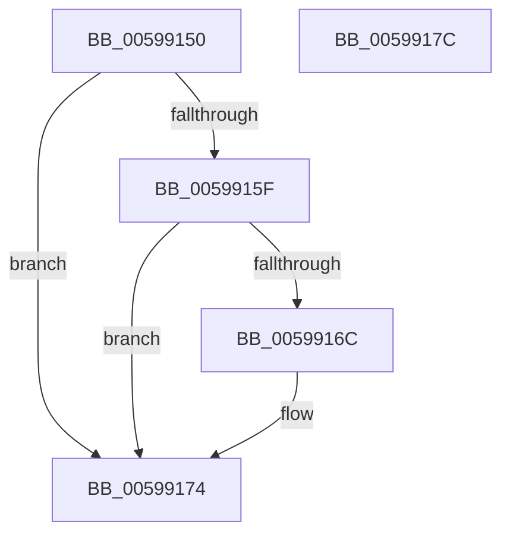

# IopLiveDumpAddProcessesCallback

- RVA: `0x00599150`–`0x0059917D` (길이 `45` bytes)
- VA: `0x0000000140599150`
- 실행 섹션: `.text`
- PDB 이름 있음: `예`; PDB Function 태그: `아니요`
- unwind 정보 RVA: `0x0005C788`
- 디코드: `14`개 명령, `45/45` bytes 표시
- 미해석 바이트: `0` (있으면 어셈블리에 `.byte`로 보존)

> 이 문서는 커널 이미지의 기계어와 PDB 기호를 분석해 생성했습니다. 4번과 5번은 함수 원형과 자료형을 바이너리 사용 방식에서 추정한 C 해석이며 원본 소스 복구 결과는 아닙니다.

## 1. Dependencies

- 직접 호출 지점: **1**; 고유 호출 대상: **1**
- 직접 호출자로 확인된 함수: **0**
- RIP 상대 이미지 참조: **0**

### Outgoing calls
- `0x0059916C` → [IoAddProcessThreadsToDump](../5A/IoAddProcessThreadsToDump_function_005A10AC.md) (function, `0x005A10AC`)

### Direct callers
- 이 함수 시작 RVA로 연결되는 직접 call은 확인되지 않았습니다. 간접 호출은 완전히 역산할 수 없습니다.

### Static image references
- 디코드된 RIP-relative 메모리 참조가 없습니다.

## 2. Other-region calls and transfers

- 다른 실행 섹션으로 향하는 call: **0**
- 별도 외부 분기/꼬리 이동을 확인하지 못했습니다.

## 3. Assembly (complete function range)

```asm
00599150  48 83 EC 28                     sub rsp, 0x28
00599154  41 8B 40 28                     mov eax, dword ptr [r8 + 0x28]
00599158  45 33 C9                        xor r9d, r9d
0059915B  A8 20                           test al, 0x20
0059915D  74 15                           je 0x140599174
0059915F  49 8B 80 90 04 00 00            mov rax, qword ptr [r8 + 0x490]
00599166  F6 40 08 01                     test byte ptr [rax + 8], 1
0059916A  74 08                           je 0x140599174
0059916C  E8 3B 7F 00 00                  call 0x1405a10ac
00599171  44 8B C8                        mov r9d, eax
00599174  41 8B C1                        mov eax, r9d
00599177  48 83 C4 28                     add rsp, 0x28
0059917B  C3                              ret
0059917C  CC                              int3
```

## 4. C-style interpretation (structured pseudocode)

```c
__int64 __fastcall IopLiveDumpAddProcessesCallback(__int64 a1, __int64 a2, __int64 a3, int a4)
{
    __int64 result;
    __int64 v_rsp;

    v_rsp = (v_rsp) - (40);
    a4 = 0;
    if ((((unsigned __int8)((unsigned int)(*(unsigned int *)(a3 + 40)))) & (32)) == 0) goto loc_00599174;
    result = *(unsigned __int64 *)(a3 + 1168);
    if (((*(unsigned __int8 *)(*(unsigned __int64 *)(a3 + 1168) + 8)) & (1)) != 0) {
        result = IoAddProcessThreadsToDump(a1, a2, a3, a4);
        a4 = (unsigned int)(result);
    }
    v_rsp = (v_rsp) + (40);
    return (unsigned int)(a4);
}
```

## 5. (Beta) C Style

```c
int64_t IopLiveDumpAddProcessesCallback(int64_t Arg1, int64_t Arg2, void *Arg3, int32_t Arg4)
{
    uint8_t *arg3 = (uint8_t *)Arg3;

    int64_t result;
    int64_t local_rsp;

    local_rsp = (local_rsp) - (40);
    Arg4 = 0;
    if ((((uint8_t)((uint32_t)(*(uint32_t *)(arg3 + 0x28)))) & (32)) == 0) goto loc_00599174;
    result = *(uint64_t *)(arg3 + 0x490);
    if (((*(uint8_t *)(*(uint64_t *)(arg3 + 0x490) + 0x8)) & (1)) != 0) {
        result = IoAddProcessThreadsToDump(Arg1, Arg2, Arg3, Arg4);
        Arg4 = (uint32_t)(result);
    }
    local_rsp = (local_rsp) + (40);
    return (uint32_t)(Arg4);
}
```

### 관측된 메모리 오프셋

구조체 형식이 확인되지 않은 접근은 인자 기준의 오프셋으로만 기록했습니다.

| 기준 인자 | 오프셋 표현 | 폭 (bit) | 접근 |
|---|---:|---:|---|
| `Arg3` | `+ 0x28` | `32` | `R` |
| `Arg3` | `+ 0x490` | `64` | `R` |

## 6. Execution-region graph

[열기: 2D/3D 그래프와 함수 탐색 컨트롤 패널](../../../control-panel.html?section=text&rva=0x00599150&view=graph)

- 2D 그래프는 위에서 아래로 흐르고, 3D 그래프는 빈 공간을 드래그해 회전합니다. Shift+드래그는 이동, 휠은 확대·축소, 함수 노드 선택은 대상 보고서 이동입니다.

### Static fallback


