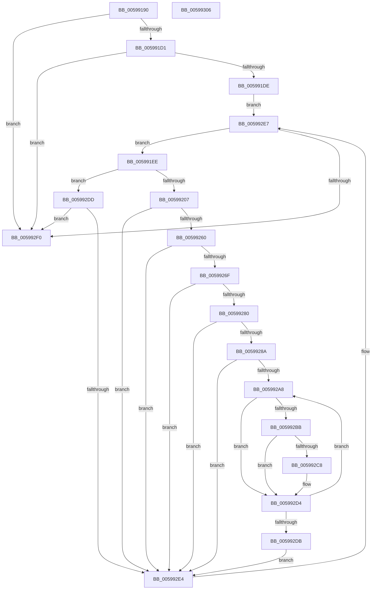

# IopLiveDumpAddTriageDumpData

- RVA: `0x00599190`–`0x00599307` (길이 `375` bytes)
- VA: `0x0000000140599190`
- 실행 섹션: `.text`
- PDB 이름 있음: `예`; PDB Function 태그: `아니요`
- unwind 정보 RVA: `0x000C797C`
- 디코드: `105`개 명령, `375/375` bytes 표시
- 미해석 바이트: `0` (있으면 어셈블리에 `.byte`로 보존)

> 이 문서는 커널 이미지의 기계어와 PDB 기호를 분석해 생성했습니다. 4번과 5번은 함수 원형과 자료형을 바이너리 사용 방식에서 추정한 C 해석이며 원본 소스 복구 결과는 아닙니다.

## 1. Dependencies

- 직접 호출 지점: **6**; 고유 호출 대상: **5**
- 직접 호출자로 확인된 함수: **0**
- RIP 상대 이미지 참조: **2**

### Outgoing calls
- `0x005991FA` → [KeValidateBugCheckCallbackRecord](../5B/KeValidateBugCheckCallbackRecord_function_005B39C0.md) (function, `0x005B39C0`)
- `0x0059924E` → [guard_dispatch_icall](../6B/guard_dispatch_icall_function_006BAAD0.md) (function, `0x006BAAD0`)
- `0x00599266` → [KiValidateTriageDumpDataArray](../5B/KiValidateTriageDumpDataArray_function_005B55E8.md) (function, `0x005B55E8`)
- `0x00599277` → [KiValidateComponentName](../5B/KiValidateComponentName_function_005B553C.md) (function, `0x005B553C`)
- `0x00599298` → [MmAddRangeToCrashDump](../67/MmAddRangeToCrashDump_function_0067D8B0.md) (function, `0x0067D8B0`)
- `0x005992CB` → [MmAddRangeToCrashDump](../67/MmAddRangeToCrashDump_function_0067D8B0.md) (function, `0x0067D8B0`)

### Direct callers
- 이 함수 시작 RVA로 연결되는 직접 call은 확인되지 않았습니다. 간접 호출은 완전히 역산할 수 없습니다.

### Static image references
- `0x005991A3` → RVA `0x00F234A0` (`.data`; read)
- `0x005991D1` → RVA `0x00F234A8` (`.data`; read)

## 2. Other-region calls and transfers

- 다른 실행 섹션으로 향하는 call: **0**
- 별도 외부 분기/꼬리 이동을 확인하지 못했습니다.

## 3. Assembly (complete function range)

```asm
00599190  48 89 5C 24 08                  mov qword ptr [rsp + 8], rbx
00599195  55                              push rbp
00599196  56                              push rsi
00599197  57                              push rdi
00599198  41 54                           push r12
0059919A  41 56                           push r14
0059919C  48 8B EC                        mov rbp, rsp
0059919F  48 83 EC 70                     sub rsp, 0x70
005991A3  48 8B 1D F6 A2 98 00            mov rbx, qword ptr [rip + 0x98a2f6]
005991AA  33 C0                           xor eax, eax
005991AC  21 45 40                        and dword ptr [rbp + 0x40], eax
005991AF  0F 57 C0                        xorps xmm0, xmm0
005991B2  48 89 45 F0                     mov qword ptr [rbp - 0x10], rax
005991B6  48 8B F2                        mov rsi, rdx
005991B9  4C 8B F1                        mov r14, rcx
005991BC  0F 11 45 C0                     movups xmmword ptr [rbp - 0x40], xmm0
005991C0  0F 11 45 D0                     movups xmmword ptr [rbp - 0x30], xmm0
005991C4  0F 11 45 E0                     movups xmmword ptr [rbp - 0x20], xmm0
005991C8  48 85 DB                        test rbx, rbx
005991CB  0F 84 1F 01 00 00               je 0x1405992f0
005991D1  48 39 05 D0 A2 98 00            cmp qword ptr [rip + 0x98a2d0], rax
005991D8  0F 84 12 01 00 00               je 0x1405992f0
005991DE  4C 8D 25 BB A2 98 00            lea r12, [rip + 0x98a2bb]
005991E5  4C 89 65 48                     mov qword ptr [rbp + 0x48], r12
005991E9  E9 F9 00 00 00                  jmp 0x1405992e7
005991EE  4C 8D 45 48                     lea r8, [rbp + 0x48]
005991F2  BA 07 00 00 00                  mov edx, 7
005991F7  48 8B CB                        mov rcx, rbx
005991FA  E8 C1 A7 01 00                  call 0x1405b39c0
005991FF  84 C0                           test al, al
00599201  0F 84 D6 00 00 00               je 0x1405992dd
00599207  41 8B 06                        mov eax, dword ptr [r14]
0059920A  4C 8D 45 C0                     lea r8, [rbp - 0x40]
0059920E  48 83 65 C0 00                  and qword ptr [rbp - 0x40], 0
00599213  41 B9 38 00 00 00               mov r9d, 0x38
00599219  89 45 D0                        mov dword ptr [rbp - 0x30], eax
0059921C  48 8B D3                        mov rdx, rbx
0059921F  49 8B 46 08                     mov rax, qword ptr [r14 + 8]
00599223  48 89 45 D8                     mov qword ptr [rbp - 0x28], rax
00599227  49 8B 46 10                     mov rax, qword ptr [r14 + 0x10]
0059922B  41 8D 49 CF                     lea ecx, [r9 - 0x31]
0059922F  48 89 45 E0                     mov qword ptr [rbp - 0x20], rax
00599233  49 8B 46 18                     mov rax, qword ptr [r14 + 0x18]
00599237  48 89 45 E8                     mov qword ptr [rbp - 0x18], rax
0059923B  49 8B 46 20                     mov rax, qword ptr [r14 + 0x20]
0059923F  48 89 45 F0                     mov qword ptr [rbp - 0x10], rax
00599243  C7 45 CC 00 00 00 02            mov dword ptr [rbp - 0x34], 0x2000000
0059924A  48 8B 43 10                     mov rax, qword ptr [rbx + 0x10]
0059924E  E8 7D 18 12 00                  call 0x1406baad0
00599253  48 8B 4D C0                     mov rcx, qword ptr [rbp - 0x40]
00599257  48 85 C9                        test rcx, rcx
0059925A  0F 84 84 00 00 00               je 0x1405992e4
00599260  41 B8 00 00 00 02               mov r8d, 0x2000000
00599266  E8 7D C3 01 00                  call 0x1405b55e8
0059926B  84 C0                           test al, al
0059926D  74 75                           je 0x1405992e4
0059926F  48 8B 4B 18                     mov rcx, qword ptr [rbx + 0x18]
00599273  48 8D 55 40                     lea rdx, [rbp + 0x40]
00599277  E8 C0 C2 01 00                  call 0x1405b553c
0059927C  84 C0                           test al, al
0059927E  74 64                           je 0x1405992e4
00599280  48 8B 45 C0                     mov rax, qword ptr [rbp - 0x40]
00599284  83 78 10 00                     cmp dword ptr [rax + 0x10], 0
00599288  76 5A                           jbe 0x1405992e4
0059928A  44 8B 45 40                     mov r8d, dword ptr [rbp + 0x40]
0059928E  48 8B CE                        mov rcx, rsi
00599291  48 8B 53 18                     mov rdx, qword ptr [rbx + 0x18]
00599295  49 FF C0                        inc r8
00599298  E8 13 46 0E 00                  call 0x14067d8b0
0059929D  48 8B 4D C0                     mov rcx, qword ptr [rbp - 0x40]
005992A1  33 FF                           xor edi, edi
005992A3  39 79 10                        cmp dword ptr [rcx + 0x10], edi
005992A6  76 3C                           jbe 0x1405992e4
005992A8  48 8D 47 03                     lea rax, [rdi + 3]
005992AC  44 8B C7                        mov r8d, edi
005992AF  48 03 C0                        add rax, rax
005992B2  48 8B 14 C1                     mov rdx, qword ptr [rcx + rax*8]
005992B6  48 85 D2                        test rdx, rdx
005992B9  74 19                           je 0x1405992d4
005992BB  4D 03 C0                        add r8, r8
005992BE  4E 8B 44 C1 38                  mov r8, qword ptr [rcx + r8*8 + 0x38]
005992C3  4D 85 C0                        test r8, r8
005992C6  74 0C                           je 0x1405992d4
005992C8  48 8B CE                        mov rcx, rsi
005992CB  E8 E0 45 0E 00                  call 0x14067d8b0
005992D0  48 8B 4D C0                     mov rcx, qword ptr [rbp - 0x40]
005992D4  FF C7                           inc edi
005992D6  3B 79 10                        cmp edi, dword ptr [rcx + 0x10]
005992D9  72 CD                           jb 0x1405992a8
005992DB  EB 07                           jmp 0x1405992e4
005992DD  48 83 7D 48 00                  cmp qword ptr [rbp + 0x48], 0
005992E2  74 0C                           je 0x1405992f0
005992E4  48 8B 1B                        mov rbx, qword ptr [rbx]
005992E7  49 3B DC                        cmp rbx, r12
005992EA  0F 85 FE FE FF FF               jne 0x1405991ee
005992F0  48 8B 9C 24 A0 00 00 00         mov rbx, qword ptr [rsp + 0xa0]
005992F8  33 C0                           xor eax, eax
005992FA  48 83 C4 70                     add rsp, 0x70
005992FE  41 5E                           pop r14
00599300  41 5C                           pop r12
00599302  5F                              pop rdi
00599303  5E                              pop rsi
00599304  5D                              pop rbp
00599305  C3                              ret
00599306  CC                              int3
```

## 4. C-style interpretation (structured pseudocode)

```c
__int64 __fastcall IopLiveDumpAddTriageDumpData(__int64 a1, __int64 a2)
{
    __int64 result;
    __int64 v_rdi;
    __int64 v_rsp;
    unsigned __int64 v_stack_m38;
    unsigned __int64 v_stack_m40;
    unsigned __int64 v_stack_m48;
    unsigned __int64 v_stack_m50;
    unsigned __int64 v_stack_m58;
    unsigned int v_stack_m5C;
    unsigned __int64 v_stack_m68;
    unsigned int v_stack_p18;
    unsigned __int64 v_stack_p20;
    unsigned __int64 v_stack_p8;

    v_stack_p8 = v_rbx;
    v_rsp = (v_rsp) - (112);
    result = 0;
    v_stack_m38 = 0;
    v_stack_m68 = v_xmm0;
    v_stack_m58 = v_xmm0;
    v_stack_m48 = v_xmm0;
    if (*(unsigned __int64 *)(v_rip + 10003190) == 0) goto loc_005992F0;
    if ((*(unsigned __int64 *)(v_rip + 10003152)) == 0) goto loc_005992F0;
    v_stack_p20 = v_rip + 10003131;
    goto loc_005992E7;
loc_005991EE:
    result = KeValidateBugCheckCallbackRecord(*(unsigned __int64 *)(v_rip + 10003190), 7, v_stack_p20, a4);
    if ((unsigned __int8)(result) == 0) goto loc_005992DD;
    v_stack_m58 = (unsigned int)((unsigned int)(*(unsigned int *)(a1)));
    v_stack_m50 = *(unsigned __int64 *)(a1 + 8);
    v_stack_m48 = *(unsigned __int64 *)(a1 + 16);
    v_stack_m40 = *(unsigned __int64 *)(a1 + 24);
    v_stack_m38 = *(unsigned __int64 *)(a1 + 32);
    v_stack_m5C = 0x2000000ULL;
    result = guard_dispatch_icall(56 - 49, *(unsigned __int64 *)(v_rip + 10003190), v_stack_m68, 56);
    if (v_stack_m68 == 0) goto loc_005992E4;
    result = KiValidateTriageDumpDataArray(v_stack_m68, *(unsigned __int64 *)(v_rip + 10003190), (unsigned int)(0x2000000ULL), 56);
    if ((unsigned __int8)(result) == 0) goto loc_005992E4;
    result = KiValidateComponentName(*(unsigned __int64 *)(*(unsigned __int64 *)(v_rip + 10003190) + 24), v_stack_p18, (unsigned int)(0x2000000ULL), 56);
    if ((unsigned __int8)(result) == 0) goto loc_005992E4;
    if ((*(unsigned int *)(v_stack_m68 + 16)) <= 0) goto loc_005992E4;
    a3 = ((unsigned int)(v_stack_p18)) + 1;
    result = MmAddRangeToCrashDump(a2, *(unsigned __int64 *)(*(unsigned __int64 *)(v_rip + 10003190) + 24), a3, 56);
    v_rdi = 0;
    if ((*(unsigned int *)(v_stack_m68 + 16)) <= 0) goto loc_005992E4;
loc_005992A8:
    result = (v_rdi + 3) + (v_rdi + 3);
    if (*(unsigned __int64 *)(v_stack_m68 + result * 8) == 0) goto loc_005992D4;
    a3 = (0) + (0);
    if (*(unsigned __int64 *)(v_stack_m68 + a3 * 8 + 56) != 0) {
        a1 = a2;
        result = MmAddRangeToCrashDump(a1, *(unsigned __int64 *)(v_stack_m68 + result * 8), *(unsigned __int64 *)(v_stack_m68 + a3 * 8 + 56), 56);
        a1 = v_stack_m68;
    }
    v_rdi = (unsigned int)((v_rdi) + 1);
    if (((unsigned int)(v_rdi)) < (*(unsigned int *)(a1 + 16))) goto loc_005992A8;
    goto loc_005992E4;
loc_005992DD:
    if (v_stack_p20 == 0) goto loc_005992F0;
loc_005992E4:
loc_005992E7:
    if ((*(unsigned __int64 *)(*(unsigned __int64 *)(v_rip + 10003190))) != (v_rip + 10003131)) goto loc_005991EE;
loc_005992F0:
    result = 0;
    v_rsp = (v_rsp) + (112);
    return result;
}
```

## 5. (Beta) C Style

```c
int64_t IopLiveDumpAddTriageDumpData(void *Arg1, int64_t Arg2)
{
    uint8_t *arg1 = (uint8_t *)Arg1;

    int64_t result;
    int64_t local_rdi;
    int64_t local_rsp;
    uint64_t v_stack_m38;
    uint64_t v_stack_m40;
    uint64_t v_stack_m48;
    uint64_t v_stack_m50;
    uint64_t v_stack_m58;
    uint32_t v_stack_m5C;
    uint64_t v_stack_m68;
    uint32_t v_stack_p18;
    uint64_t v_stack_p20;
    uint64_t v_stack_p8;

    v_stack_p8 = local_rbx;
    local_rsp = (local_rsp) - (112);
    result = 0;
    v_stack_m38 = 0;
    v_stack_m68 = v_xmm0;
    v_stack_m58 = v_xmm0;
    v_stack_m48 = v_xmm0;
    if (*(uint64_t *)(v_rip + 0x98A2F6) == 0) goto loc_005992F0;
    if ((*(uint64_t *)(v_rip + 0x98A2D0)) == 0) goto loc_005992F0;
    v_stack_p20 = v_rip + 10003131;
    goto loc_005992E7;
loc_005991EE:
    result = KeValidateBugCheckCallbackRecord(*(uint64_t *)(v_rip + 0x98A2F6), 7, v_stack_p20, a4);
    if ((uint8_t)(result) == 0) goto loc_005992DD;
    v_stack_m58 = (uint32_t)((uint32_t)(*(uint32_t *)(arg1)));
    v_stack_m50 = *(uint64_t *)(arg1 + 0x8);
    v_stack_m48 = *(uint64_t *)(arg1 + 0x10);
    v_stack_m40 = *(uint64_t *)(arg1 + 0x18);
    v_stack_m38 = *(uint64_t *)(arg1 + 0x20);
    v_stack_m5C = 0x2000000ULL;
    result = guard_dispatch_icall(56 - 49, *(uint64_t *)(v_rip + 0x98A2F6), v_stack_m68, 56);
    if (v_stack_m68 == 0) goto loc_005992E4;
    result = KiValidateTriageDumpDataArray(v_stack_m68, *(uint64_t *)(v_rip + 0x98A2F6), (uint32_t)(0x2000000ULL), 56);
    if ((uint8_t)(result) == 0) goto loc_005992E4;
    result = KiValidateComponentName(*(uint64_t *)(*(uint64_t *)(v_rip + 0x98A2F6) + 0x18), v_stack_p18, (uint32_t)(0x2000000ULL), 56);
    if ((uint8_t)(result) == 0) goto loc_005992E4;
    if ((*(uint32_t *)(v_stack_m68 + 0x10)) <= 0) goto loc_005992E4;
    a3 = ((uint32_t)(v_stack_p18)) + 1;
    result = MmAddRangeToCrashDump(Arg2, *(uint64_t *)(*(uint64_t *)(v_rip + 0x98A2F6) + 0x18), a3, 56);
    local_rdi = 0;
    if ((*(uint32_t *)(v_stack_m68 + 0x10)) <= 0) goto loc_005992E4;
loc_005992A8:
    result = (local_rdi + 3) + (local_rdi + 3);
    if (*(uint64_t *)(v_stack_m68 + result * 8) == 0) goto loc_005992D4;
    a3 = (0) + (0);
    if (*(uint64_t *)(v_stack_m68 + a3 * 8 + 0x38) != 0) {
        Arg1 = Arg2;
        result = MmAddRangeToCrashDump(Arg1, *(uint64_t *)(v_stack_m68 + result * 8), *(uint64_t *)(v_stack_m68 + a3 * 8 + 0x38), 56);
        Arg1 = v_stack_m68;
    }
    local_rdi = (uint32_t)((local_rdi) + 1);
    if (((uint32_t)(local_rdi)) < (*(uint32_t *)(arg1 + 0x10))) goto loc_005992A8;
    goto loc_005992E4;
loc_005992DD:
    if (v_stack_p20 == 0) goto loc_005992F0;
loc_005992E4:
loc_005992E7:
    if ((*(uint64_t *)(*(uint64_t *)(v_rip + 0x98A2F6))) != (v_rip + 10003131)) goto loc_005991EE;
loc_005992F0:
    result = 0;
    local_rsp = (local_rsp) + (112);
    return result;
}
```

### 관측된 메모리 오프셋

구조체 형식이 확인되지 않은 접근은 인자 기준의 오프셋으로만 기록했습니다.

| 기준 인자 | 오프셋 표현 | 폭 (bit) | 접근 |
|---|---:|---:|---|
| `Arg1` | `+ 0x0` | `32` | `R` |
| `Arg1` | `+ 0x8` | `64` | `R` |
| `Arg1` | `+ 0x10` | `64` | `R` |
| `Arg1` | `+ 0x18` | `64` | `R` |
| `Arg1` | `+ 0x20` | `64` | `R` |

## 6. Execution-region graph

[열기: 2D/3D 그래프와 함수 탐색 컨트롤 패널](../../../control-panel.html?section=text&rva=0x00599190&view=graph)

- 2D 그래프는 위에서 아래로 흐르고, 3D 그래프는 빈 공간을 드래그해 회전합니다. Shift+드래그는 이동, 휠은 확대·축소, 함수 노드 선택은 대상 보고서 이동입니다.

### Static fallback


