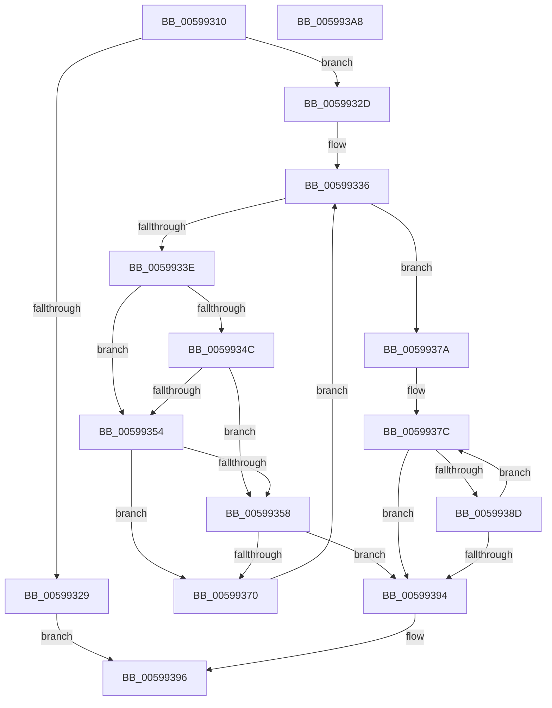

# IopLiveDumpAllocAndInitProcessFilters

- RVA: `0x00599310`–`0x005993A9` (길이 `153` bytes)
- VA: `0x0000000140599310`
- 실행 섹션: `.text`
- PDB 이름 있음: `예`; PDB Function 태그: `아니요`
- unwind 정보 RVA: `0x00060BC4`
- 디코드: `53`개 명령, `153/153` bytes 표시
- 미해석 바이트: `0` (있으면 어셈블리에 `.byte`로 보존)

> 이 문서는 커널 이미지의 기계어와 PDB 기호를 분석해 생성했습니다. 4번과 5번은 함수 원형과 자료형을 바이너리 사용 방식에서 추정한 C 해석이며 원본 소스 복구 결과는 아닙니다.

## 1. Dependencies

- 직접 호출 지점: **4**; 고유 호출 대상: **2**
- 직접 호출자로 확인된 함수: **1**
- RIP 상대 이미지 참조: **0**

### Outgoing calls
- `0x0059932F` → [PsGetNextProcess](../../page/91/PsGetNextProcess_function_0091C900.md) (function, `0x0091C900`)
- `0x00599367` → [IopLiveDumpAddProcessFilter](IopLiveDumpAddProcessFilter_function_00599008.md) (function, `0x00599008`)
- `0x00599373` → [PsGetNextProcess](../../page/91/PsGetNextProcess_function_0091C900.md) (function, `0x0091C900`)
- `0x00599384` → [IopLiveDumpAddProcessFilter](IopLiveDumpAddProcessFilter_function_00599008.md) (function, `0x00599008`)

### Direct callers
- [IopLiveDumpAllocAndInitResources](IopLiveDumpAllocAndInitResources_function_005993B0.md) at `0x00599504`

### Static image references
- 디코드된 RIP-relative 메모리 참조가 없습니다.

## 2. Other-region calls and transfers

- 다른 실행 섹션으로 향하는 call: **2**
  - `0x0059932F` → [PsGetNextProcess](../../page/91/PsGetNextProcess_function_0091C900.md) (`.text` → `PAGE`)
  - `0x00599373` → [PsGetNextProcess](../../page/91/PsGetNextProcess_function_0091C900.md) (`.text` → `PAGE`)
- 별도 외부 분기/꼬리 이동을 확인하지 못했습니다.

## 3. Assembly (complete function range)

```asm
00599310  48 89 5C 24 08                  mov qword ptr [rsp + 8], rbx
00599315  48 89 74 24 10                  mov qword ptr [rsp + 0x10], rsi
0059931A  57                              push rdi
0059931B  48 83 EC 20                     sub rsp, 0x20
0059931F  8B 41 28                        mov eax, dword ptr [rcx + 0x28]
00599322  48 8B F1                        mov rsi, rcx
00599325  A8 04                           test al, 4
00599327  75 04                           jne 0x14059932d
00599329  33 DB                           xor ebx, ebx
0059932B  EB 69                           jmp 0x140599396
0059932D  33 C9                           xor ecx, ecx
0059932F  E8 CC 35 38 00                  call 0x14091c900
00599334  33 DB                           xor ebx, ebx
00599336  48 8B F8                        mov rdi, rax
00599339  48 85 C0                        test rax, rax
0059933C  74 3C                           je 0x14059937a
0059933E  8A 88 FA 05 00 00               mov cl, byte ptr [rax + 0x5fa]
00599344  8A C1                           mov al, cl
00599346  24 07                           and al, 7
00599348  3C 02                           cmp al, 2
0059934A  75 08                           jne 0x140599354
0059934C  80 E1 F0                        and cl, 0xf0
0059934F  80 F9 70                        cmp cl, 0x70
00599352  75 04                           jne 0x140599358
00599354  3C 01                           cmp al, 1
00599356  75 18                           jne 0x140599370
00599358  8B 97 D0 01 00 00               mov edx, dword ptr [rdi + 0x1d0]
0059935E  41 B8 02 00 00 00               mov r8d, 2
00599364  48 8B CE                        mov rcx, rsi
00599367  E8 9C FC FF FF                  call 0x140599008
0059936C  85 C0                           test eax, eax
0059936E  78 24                           js 0x140599394
00599370  48 8B CF                        mov rcx, rdi
00599373  E8 88 35 38 00                  call 0x14091c900
00599378  EB BC                           jmp 0x140599336
0059937A  8B FB                           mov edi, ebx
0059937C  45 33 C0                        xor r8d, r8d
0059937F  33 D2                           xor edx, edx
00599381  48 8B CE                        mov rcx, rsi
00599384  E8 7F FC FF FF                  call 0x140599008
00599389  85 C0                           test eax, eax
0059938B  78 07                           js 0x140599394
0059938D  FF C7                           inc edi
0059938F  83 FF 03                        cmp edi, 3
00599392  7C E8                           jl 0x14059937c
00599394  8B D8                           mov ebx, eax
00599396  48 8B 74 24 38                  mov rsi, qword ptr [rsp + 0x38]
0059939B  8B C3                           mov eax, ebx
0059939D  48 8B 5C 24 30                  mov rbx, qword ptr [rsp + 0x30]
005993A2  48 83 C4 20                     add rsp, 0x20
005993A6  5F                              pop rdi
005993A7  C3                              ret
005993A8  CC                              int3
```

## 4. C-style interpretation (structured pseudocode)

```c
__int64 __fastcall IopLiveDumpAllocAndInitProcessFilters(__int64 a1)
{
    __int64 result;
    __int64 v_rbx;
    __int64 v_rdi;
    __int64 v_rsp;
    unsigned __int64 v_stack_p10;
    unsigned __int64 v_stack_p8;

    v_stack_p8 = v_rbx;
    v_stack_p10 = v_rsi;
    v_rsp = (v_rsp) - (32);
    if ((((unsigned __int8)((unsigned int)(*(unsigned int *)(a1 + 40)))) & (4)) != 0) goto loc_0059932D;
    v_rbx = 0;
    goto loc_00599396;
loc_0059932D:
    a1 = 0;
    result = PsGetNextProcess(a1, a2, a3, a4);
    v_rbx = 0;
loc_00599336:
    if (result == 0) goto loc_0059937A;
    result = (unsigned __int8)(((unsigned __int8)(*(unsigned __int8 *)(result + 1530))) & (7));
    if (((unsigned __int8)(result)) != 2) goto loc_00599354;
    a1 = (unsigned __int8)((*(unsigned __int8 *)(result + 1530)) & (240));
    if (((unsigned __int8)(a1)) != 112) goto loc_00599358;
loc_00599354:
    if (((unsigned __int8)(result)) != 1) goto loc_00599370;
loc_00599358:
    result = IopLiveDumpAddProcessFilter(a1, (unsigned int)(*(unsigned int *)(result + 464)), 2, a4);
    if (sign_flag) goto loc_00599394;
loc_00599370:
    result = PsGetNextProcess(result, (unsigned int)(*(unsigned int *)(result + 464)), 2, a4);
    goto loc_00599336;
loc_0059937A:
loc_0059937C:
    a3 = 0;
    a2 = 0;
    result = IopLiveDumpAddProcessFilter(a1, a2, a3, a4);
    if (sign_flag) goto loc_00599394;
    v_rdi = (unsigned int)((0) + 1);
    if (((unsigned int)(v_rdi)) < 3) goto loc_0059937C;
loc_00599394:
loc_00599396:
    v_rsp = (v_rsp) + (32);
    return (unsigned int)((unsigned int)((unsigned int)((unsigned int)(result))));
}
```

## 5. (Beta) C Style

```c
int64_t IopLiveDumpAllocAndInitProcessFilters(void *Arg1)
{
    uint8_t *arg1 = (uint8_t *)Arg1;

    int64_t result;
    int64_t local_rbx;
    int64_t local_rdi;
    int64_t local_rsp;
    uint64_t v_stack_p10;
    uint64_t v_stack_p8;

    v_stack_p8 = local_rbx;
    v_stack_p10 = local_rsi;
    local_rsp = (local_rsp) - (32);
    if ((((uint8_t)((uint32_t)(*(uint32_t *)(arg1 + 0x28)))) & (4)) != 0) goto loc_0059932D;
    local_rbx = 0;
    goto loc_00599396;
loc_0059932D:
    Arg1 = 0;
    result = PsGetNextProcess(Arg1, a2, a3, a4);
    local_rbx = 0;
loc_00599336:
    if (result == 0) goto loc_0059937A;
    result = (uint8_t)(((uint8_t)(*(uint8_t *)(result + 0x5FA))) & (7));
    if (((uint8_t)(result)) != 2) goto loc_00599354;
    Arg1 = (uint8_t)((*(uint8_t *)(result + 0x5FA)) & (240));
    if (((uint8_t)(Arg1)) != 112) goto loc_00599358;
loc_00599354:
    if (((uint8_t)(result)) != 1) goto loc_00599370;
loc_00599358:
    result = IopLiveDumpAddProcessFilter(Arg1, (uint32_t)(*(uint32_t *)(result + 0x1D0)), 2, a4);
    if (sign_flag) goto loc_00599394;
loc_00599370:
    result = PsGetNextProcess(result, (uint32_t)(*(uint32_t *)(result + 0x1D0)), 2, a4);
    goto loc_00599336;
loc_0059937A:
loc_0059937C:
    a3 = 0;
    a2 = 0;
    result = IopLiveDumpAddProcessFilter(Arg1, a2, a3, a4);
    if (sign_flag) goto loc_00599394;
    local_rdi = (uint32_t)((0) + 1);
    if (((uint32_t)(local_rdi)) < 3) goto loc_0059937C;
loc_00599394:
loc_00599396:
    local_rsp = (local_rsp) + (32);
    return (uint32_t)((uint32_t)((uint32_t)((uint32_t)(result))));
}
```

### 관측된 메모리 오프셋

구조체 형식이 확인되지 않은 접근은 인자 기준의 오프셋으로만 기록했습니다.

| 기준 인자 | 오프셋 표현 | 폭 (bit) | 접근 |
|---|---:|---:|---|
| `Arg1` | `+ 0x28` | `32` | `R` |

## 6. Execution-region graph

[열기: 2D/3D 그래프와 함수 탐색 컨트롤 패널](../../../control-panel.html?section=text&rva=0x00599310&view=graph)

- 2D 그래프는 위에서 아래로 흐르고, 3D 그래프는 빈 공간을 드래그해 회전합니다. Shift+드래그는 이동, 휠은 확대·축소, 함수 노드 선택은 대상 보고서 이동입니다.

### Static fallback


