# IopLiveDumpAllocAndInitResources

- RVA: `0x005993B0`–`0x00599A96` (길이 `1,766` bytes)
- VA: `0x00000001405993B0`
- 실행 섹션: `.text`
- PDB 이름 있음: `예`; PDB Function 태그: `아니요`
- unwind 정보 RVA: `0x000BCB44`
- 디코드: `395`개 명령, `1,766/1,766` bytes 표시
- 미해석 바이트: `0` (있으면 어셈블리에 `.byte`로 보존)

> 이 문서는 커널 이미지의 기계어와 PDB 기호를 분석해 생성했습니다. 4번과 5번은 함수 원형과 자료형을 바이너리 사용 방식에서 추정한 C 해석이며 원본 소스 복구 결과는 아닙니다.

## 1. Dependencies

- 직접 호출 지점: **40**; 고유 호출 대상: **19**
- 직접 호출자로 확인된 함수: **1**
- RIP 상대 이미지 참조: **8**

### Outgoing calls
- `0x005993E6` → [IopLiveDumpGetMillisecondCounter](../3F/IopLiveDumpGetMillisecondCounter_function_003F5964.md) (function, `0x003F5964`)
- `0x00599428` → [IopGetPhysicalMemoryBlock](IopGetPhysicalMemoryBlock_function_00595690.md) (function, `0x00595690`)
- `0x00599494` → [ExAllocatePool2](../../poolcode/B8/ExAllocatePool2_function_00B820F0.md) (function, `0x00B820F0`)
- `0x005994B2` → [IopLiveDumpIsUnderMemoryPressure](../3F/IopLiveDumpIsUnderMemoryPressure_function_003F5EB8.md) (function, `0x003F5EB8`)
- `0x005994E1` → [RtlSetAllBitsEx](../4A/RtlSetAllBitsEx_function_004A9220.md) (function, `0x004A9220`)
- `0x005994F3` → [IopLiveDumpDiscardVirtualAddressRange](../29/IopLiveDumpDiscardVirtualAddressRange_function_002977F4.md) (function, `0x002977F4`)
- `0x00599504` → [IopLiveDumpAllocAndInitProcessFilters](IopLiveDumpAllocAndInitProcessFilters_function_00599310.md) (function, `0x00599310`)
- `0x00599542` → [ExAllocatePool2](../../poolcode/B8/ExAllocatePool2_function_00B820F0.md) (function, `0x00B820F0`)
- `0x0059955A` → [IopLiveDumpIsUnderMemoryPressure](../3F/IopLiveDumpIsUnderMemoryPressure_function_003F5EB8.md) (function, `0x003F5EB8`)
- `0x005995B2` → [memset](../6C/memset_function_006C6C40.md) (function, `0x006C6C40`)
- `0x005995C8` → [IopLiveDumpDiscardVirtualAddressRange](../29/IopLiveDumpDiscardVirtualAddressRange_function_002977F4.md) (function, `0x002977F4`)
- `0x005995DE` → [ExAllocatePool2](../../poolcode/B8/ExAllocatePool2_function_00B820F0.md) (function, `0x00B820F0`)
- `0x005995F6` → [IopLiveDumpIsUnderMemoryPressure](../3F/IopLiveDumpIsUnderMemoryPressure_function_003F5EB8.md) (function, `0x003F5EB8`)
- `0x00599629` → [IopLiveDumpDiscardVirtualAddressRange](../29/IopLiveDumpDiscardVirtualAddressRange_function_002977F4.md) (function, `0x002977F4`)
- `0x005996C1` → [ExAllocatePool2](../../poolcode/B8/ExAllocatePool2_function_00B820F0.md) (function, `0x00B820F0`)
- `0x005996D9` → [IopLiveDumpIsUnderMemoryPressure](../3F/IopLiveDumpIsUnderMemoryPressure_function_003F5EB8.md) (function, `0x003F5EB8`)
- `0x0059970C` → [IopLiveDumpDiscardVirtualAddressRange](../29/IopLiveDumpDiscardVirtualAddressRange_function_002977F4.md) (function, `0x002977F4`)
- `0x0059971F` → [IopLiveDumpDiscardVirtualAddressRange](../29/IopLiveDumpDiscardVirtualAddressRange_function_002977F4.md) (function, `0x002977F4`)
- `0x00599730` → [IopLiveDumpAllocateMappingResources](IopLiveDumpAllocateMappingResources_function_0059A868.md) (function, `0x0059A868`)
- `0x00599742` → [IopLiveDumpIsUnderMemoryPressure](../3F/IopLiveDumpIsUnderMemoryPressure_function_003F5EB8.md) (function, `0x003F5EB8`)
- `0x00599752` → [IopLiveDumpEstimateMemoryPages](IopLiveDumpEstimateMemoryPages_function_0059BA80.md) (function, `0x0059BA80`)
- `0x00599764` → [IopLiveDumpAllocateDumpBuffers](../3F/IopLiveDumpAllocateDumpBuffers_function_003F5AE8.md) (function, `0x003F5AE8`)
- `0x00599772` → [IopLiveDumpAllocateExtraBuffers](IopLiveDumpAllocateExtraBuffers_function_00599A9C.md) (function, `0x00599A9C`)
- `0x00599789` → [IopLiveDumpAllocateIptBuffers](IopLiveDumpAllocateIptBuffers_function_0059A694.md) (function, `0x0059A694`)
- `0x00599797` → [IopLiveDumpTraceBufferAllocation](IopLiveDumpTraceBufferAllocation_function_0059E290.md) (function, `0x0059E290`)
- `0x005997B5` → [ExAllocatePool2](../../poolcode/B8/ExAllocatePool2_function_00B820F0.md) (function, `0x00B820F0`)
- `0x00599807` → [ExAllocatePool2](../../poolcode/B8/ExAllocatePool2_function_00B820F0.md) (function, `0x00B820F0`)
- `0x00599837` → [ExAllocatePool2](../../poolcode/B8/ExAllocatePool2_function_00B820F0.md) (function, `0x00B820F0`)
- `0x0059985A` → [ExAllocatePool2](../../poolcode/B8/ExAllocatePool2_function_00B820F0.md) (function, `0x00B820F0`)
- `0x00599872` → [IopLiveDumpIsUnderMemoryPressure](../3F/IopLiveDumpIsUnderMemoryPressure_function_003F5EB8.md) (function, `0x003F5EB8`)
- `0x0059988C` → [IopLiveDumpDiscardVirtualAddressRange](../29/IopLiveDumpDiscardVirtualAddressRange_function_002977F4.md) (function, `0x002977F4`)
- `0x005998B1` → [IopLiveDumpDiscardVirtualAddressRange](../29/IopLiveDumpDiscardVirtualAddressRange_function_002977F4.md) (function, `0x002977F4`)
- `0x005998CF` → [IopLiveDumpDiscardVirtualAddressRange](../29/IopLiveDumpDiscardVirtualAddressRange_function_002977F4.md) (function, `0x002977F4`)
- `0x005998E1` → [IopLiveDumpDiscardVirtualAddressRange](../29/IopLiveDumpDiscardVirtualAddressRange_function_002977F4.md) (function, `0x002977F4`)
- `0x00599909` → [tlgKeywordOn](../42/tlgKeywordOn_function_0042EAA0.md) (function, `0x0042EAA0`)
- `0x005999FA` → [IopLiveDumpGetMillisecondCounter](../3F/IopLiveDumpGetMillisecondCounter_function_003F5964.md) (function, `0x003F5964`)
- `0x00599A46` → [tlgWriteTransfer_EtwWriteTransfer](../42/tlgWriteTransfer_EtwWriteTransfer_function_004260E0.md) (function, `0x004260E0`)
- `0x00599A55` → [ExFreePoolWithTag](../../poolcode/B8/ExFreePoolWithTag_function_00B82870.md) (function, `0x00B82870`)
- `0x00599A61` → [IopLiveDumpReleaseResources](IopLiveDumpReleaseResources_function_0059DF1C.md) (function, `0x0059DF1C`)
- `0x00599A6F` → [_security_check_cookie](../6A/_security_check_cookie_function_006AC640.md) (function, `0x006AC640`)

### Direct callers
- [IoCaptureLiveDump](../4E/IoCaptureLiveDump_function_004E085C.md) at `0x004E0C72`

### Static image references
- `0x005993D3` → RVA `0x00E0A740` (`.data`; read)
- `0x00599509` → RVA `0x00FC6A84` (`ALMOSTRO`; read)
- `0x00599519` → RVA `0x00FC6A90` (`ALMOSTRO`; read)
- `0x0059977D` → RVA `0x00E66178` (`.data`; read)
- `0x0059979C` → RVA `0x00FC6A80` (`ALMOSTRO`; read)
- `0x005997D5` → RVA `0x00E0A9D4` (`.data`; read)
- `0x005998EB` → RVA `0x00E06EA0` (`.data`; read)
- `0x00599A30` → RVA `0x00046710` (`.rdata`; read)

## 2. Other-region calls and transfers

- 다른 실행 섹션으로 향하는 call: **9**
  - `0x00599494` → [ExAllocatePool2](../../poolcode/B8/ExAllocatePool2_function_00B820F0.md) (`.text` → `POOLCODE`)
  - `0x00599542` → [ExAllocatePool2](../../poolcode/B8/ExAllocatePool2_function_00B820F0.md) (`.text` → `POOLCODE`)
  - `0x005995DE` → [ExAllocatePool2](../../poolcode/B8/ExAllocatePool2_function_00B820F0.md) (`.text` → `POOLCODE`)
  - `0x005996C1` → [ExAllocatePool2](../../poolcode/B8/ExAllocatePool2_function_00B820F0.md) (`.text` → `POOLCODE`)
  - `0x005997B5` → [ExAllocatePool2](../../poolcode/B8/ExAllocatePool2_function_00B820F0.md) (`.text` → `POOLCODE`)
  - `0x00599807` → [ExAllocatePool2](../../poolcode/B8/ExAllocatePool2_function_00B820F0.md) (`.text` → `POOLCODE`)
  - `0x00599837` → [ExAllocatePool2](../../poolcode/B8/ExAllocatePool2_function_00B820F0.md) (`.text` → `POOLCODE`)
  - `0x0059985A` → [ExAllocatePool2](../../poolcode/B8/ExAllocatePool2_function_00B820F0.md) (`.text` → `POOLCODE`)
  - `0x00599A55` → [ExFreePoolWithTag](../../poolcode/B8/ExFreePoolWithTag_function_00B82870.md) (`.text` → `POOLCODE`)
- 별도 외부 분기/꼬리 이동을 확인하지 못했습니다.

## 3. Assembly (complete function range)

```asm
005993B0  48 8B C4                        mov rax, rsp
005993B3  48 89 58 10                     mov qword ptr [rax + 0x10], rbx
005993B7  48 89 70 18                     mov qword ptr [rax + 0x18], rsi
005993BB  48 89 78 20                     mov qword ptr [rax + 0x20], rdi
005993BF  55                              push rbp
005993C0  41 54                           push r12
005993C2  41 55                           push r13
005993C4  41 56                           push r14
005993C6  41 57                           push r15
005993C8  48 8D 68 A8                     lea rbp, [rax - 0x58]
005993CC  48 81 EC 30 01 00 00            sub rsp, 0x130
005993D3  48 8B 05 66 13 87 00            mov rax, qword ptr [rip + 0x871366]
005993DA  48 33 C4                        xor rax, rsp
005993DD  48 89 45 20                     mov qword ptr [rbp + 0x20], rax
005993E1  48 8B D9                        mov rbx, rcx
005993E4  33 C9                           xor ecx, ecx
005993E6  E8 79 C5 E5 FF                  call 0x1403f5964
005993EB  48 89 9B 38 01 00 00            mov qword ptr [rbx + 0x138], rbx
005993F2  45 33 E4                        xor r12d, r12d
005993F5  44 89 A3 40 01 00 00            mov dword ptr [rbx + 0x140], r12d
005993FC  48 8B F0                        mov rsi, rax
005993FF  48 89 44 24 30                  mov qword ptr [rsp + 0x30], rax
00599404  33 C0                           xor eax, eax
00599406  44 89 A3 44 01 00 00            mov dword ptr [rbx + 0x144], r12d
0059940D  44 89 A3 48 01 00 00            mov dword ptr [rbx + 0x148], r12d
00599414  44 89 A3 4C 01 00 00            mov dword ptr [rbx + 0x14c], r12d
0059941B  48 89 83 A8 01 00 00            mov qword ptr [rbx + 0x1a8], rax
00599422  89 83 B0 01 00 00               mov dword ptr [rbx + 0x1b0], eax
00599428  E8 63 C2 FF FF                  call 0x140595690
0059942D  4C 8B E8                        mov r13, rax
00599430  48 85 C0                        test rax, rax
00599433  75 0A                           jne 0x14059943f
00599435  BF 9A 00 00 C0                  mov edi, 0xc000009a
0059943A  E9 AC 04 00 00                  jmp 0x1405998eb
0059943F  8B 00                           mov eax, dword ptr [rax]
00599441  85 C0                           test eax, eax
00599443  75 0A                           jne 0x14059944f
00599445  BF E5 00 00 C0                  mov edi, 0xc00000e5
0059944A  E9 9C 04 00 00                  jmp 0x1405998eb
0059944F  FF C8                           dec eax
00599451  41 BF 4C 64 6D 70               mov r15d, 0x706d644c
00599457  48 FF C0                        inc rax
0059945A  45 8B C7                        mov r8d, r15d
0059945D  48 03 C0                        add rax, rax
00599460  B9 40 00 00 00                  mov ecx, 0x40
00599465  49 8B 54 C5 08                  mov rdx, qword ptr [r13 + rax*8 + 8]
0059946A  49 03 54 C5 00                  add rdx, qword ptr [r13 + rax*8]
0059946F  48 89 53 58                     mov qword ptr [rbx + 0x58], rdx
00599473  48 8D 7A 07                     lea rdi, [rdx + 7]
00599477  48 C1 EF 03                     shr rdi, 3
0059947B  48 83 C7 07                     add rdi, 7
0059947F  48 83 E7 F8                     and rdi, 0xfffffffffffffff8
00599483  48 8D B7 FF 0F 00 00            lea rsi, [rdi + 0xfff]
0059948A  48 81 E6 00 F0 FF FF            and rsi, 0xfffffffffffff000
00599491  48 8B D6                        mov rdx, rsi
00599494  E8 57 8C 5E 00                  call 0x140b820f0
00599499  48 89 83 50 02 00 00            mov qword ptr [rbx + 0x250], rax
005994A0  48 85 C0                        test rax, rax
005994A3  75 0A                           jne 0x1405994af
005994A5  BF 9A 00 00 C0                  mov edi, 0xc000009a
005994AA  E9 37 04 00 00                  jmp 0x1405998e6
005994AF  48 8B CB                        mov rcx, rbx
005994B2  E8 01 CA E5 FF                  call 0x1403f5eb8
005994B7  84 C0                           test al, al
005994B9  74 0A                           je 0x1405994c5
005994BB  BF 40 02 00 C0                  mov edi, 0xc0000240
005994C0  E9 21 04 00 00                  jmp 0x1405998e6
005994C5  48 8B 8B 50 02 00 00            mov rcx, qword ptr [rbx + 0x250]
005994CC  48 8D 93 40 02 00 00            lea rdx, [rbx + 0x240]
005994D3  48 8B 43 58                     mov rax, qword ptr [rbx + 0x58]
005994D7  48 89 4A 08                     mov qword ptr [rdx + 8], rcx
005994DB  48 8B CA                        mov rcx, rdx
005994DE  48 89 02                        mov qword ptr [rdx], rax
005994E1  E8 3A FD F0 FF                  call 0x1404a9220
005994E6  48 8B 93 50 02 00 00            mov rdx, qword ptr [rbx + 0x250]
005994ED  4C 8B C6                        mov r8, rsi
005994F0  48 8B CB                        mov rcx, rbx
005994F3  E8 FC E2 CF FF                  call 0x1402977f4
005994F8  F7 43 50 00 80 00 00            test dword ptr [rbx + 0x50], 0x8000
005994FF  74 08                           je 0x140599509
00599501  48 8B CB                        mov rcx, rbx
00599504  E8 07 FE FF FF                  call 0x140599310
00599509  44 38 25 74 D5 A2 00            cmp byte ptr [rip + 0xa2d574], r12b
00599510  48 8D 8F 80 20 00 00            lea rcx, [rdi + 0x2080]
00599517  74 10                           je 0x140599529
00599519  8B 05 71 D5 A2 00               mov eax, dword ptr [rip + 0xa2d571]
0059951F  48 03 CF                        add rcx, rdi
00599522  A8 02                           test al, 2
00599524  74 03                           je 0x140599529
00599526  48 03 CF                        add rcx, rdi
00599529  4C 8D B1 FF 0F 00 00            lea r14, [rcx + 0xfff]
00599530  45 8B C7                        mov r8d, r15d
00599533  49 81 E6 00 F0 FF FF            and r14, 0xfffffffffffff000
0059953A  B9 40 00 00 00                  mov ecx, 0x40
0059953F  49 8B D6                        mov rdx, r14
00599542  E8 A9 8B 5E 00                  call 0x140b820f0
00599547  48 89 83 30 02 00 00            mov qword ptr [rbx + 0x230], rax
0059954E  48 85 C0                        test rax, rax
00599551  0F 84 4E FF FF FF               je 0x1405994a5
00599557  48 8B CB                        mov rcx, rbx
0059955A  E8 59 C9 E5 FF                  call 0x1403f5eb8
0059955F  84 C0                           test al, al
00599561  0F 85 54 FF FF FF               jne 0x1405994bb
00599567  4C 8B BB 30 02 00 00            mov r15, qword ptr [rbx + 0x230]
0059956E  4D 8B C4                        mov r8, r12
00599571  4C 89 B3 38 02 00 00            mov qword ptr [rbx + 0x238], r14
00599578  4D 89 B7 20 20 00 00            mov qword ptr [r15 + 0x2020], r14
0059957F  49 8D 8F 38 20 00 00            lea rcx, [r15 + 0x2038]
00599586  48 8B 43 58                     mov rax, qword ptr [rbx + 0x58]
0059958A  49 89 87 30 20 00 00            mov qword ptr [r15 + 0x2030], rax
00599591  A8 1F                           test al, 0x1f
00599593  48 89 83 20 02 00 00            mov qword ptr [rbx + 0x220], rax
0059959A  41 0F 95 C0                     setne r8b
0059959E  48 89 8B 28 02 00 00            mov qword ptr [rbx + 0x228], rcx
005995A5  48 C1 E8 05                     shr rax, 5
005995A9  33 D2                           xor edx, edx
005995AB  4C 03 C0                        add r8, rax
005995AE  49 C1 E0 02                     shl r8, 2
005995B2  E8 89 D6 12 00                  call 0x1406c6c40
005995B7  4C 8B 83 38 02 00 00            mov r8, qword ptr [rbx + 0x238]
005995BE  48 8B CB                        mov rcx, rbx
005995C1  48 8B 93 30 02 00 00            mov rdx, qword ptr [rbx + 0x230]
005995C8  E8 27 E2 CF FF                  call 0x1402977f4
005995CD  41 BE 4C 64 6D 70               mov r14d, 0x706d644c
005995D3  48 8B D6                        mov rdx, rsi
005995D6  45 8B C6                        mov r8d, r14d
005995D9  B9 40 00 00 00                  mov ecx, 0x40
005995DE  E8 0D 8B 5E 00                  call 0x140b820f0
005995E3  48 89 83 88 02 00 00            mov qword ptr [rbx + 0x288], rax
005995EA  48 85 C0                        test rax, rax
005995ED  0F 84 B2 FE FF FF               je 0x1405994a5
005995F3  48 8B CB                        mov rcx, rbx
005995F6  E8 BD C8 E5 FF                  call 0x1403f5eb8
005995FB  84 C0                           test al, al
005995FD  0F 85 B8 FE FF FF               jne 0x1405994bb
00599603  48 8B 8B 88 02 00 00            mov rcx, qword ptr [rbx + 0x288]
0059960A  4C 8B C6                        mov r8, rsi
0059960D  48 8B 43 58                     mov rax, qword ptr [rbx + 0x58]
00599611  48 89 8B 60 02 00 00            mov qword ptr [rbx + 0x260], rcx
00599618  48 8B CB                        mov rcx, rbx
0059961B  48 89 83 58 02 00 00            mov qword ptr [rbx + 0x258], rax
00599622  48 8B 93 88 02 00 00            mov rdx, qword ptr [rbx + 0x288]
00599629  E8 C6 E1 CF FF                  call 0x1402977f4
0059962E  44 38 25 4F D4 A2 00            cmp byte ptr [rip + 0xa2d44f], r12b
00599635  48 8B 4B 58                     mov rcx, qword ptr [rbx + 0x58]
00599639  74 4D                           je 0x140599688
0059963B  48 89 8B 78 02 00 00            mov qword ptr [rbx + 0x278], rcx
00599642  49 8D 87 38 20 00 00            lea rax, [r15 + 0x2038]
00599649  48 03 C7                        add rax, rdi
0059964C  48 8D 8B 68 02 00 00            lea rcx, [rbx + 0x268]
00599653  48 89 83 80 02 00 00            mov qword ptr [rbx + 0x280], rax
0059965A  4C 8B C1                        mov r8, rcx
0059965D  8B 05 2D D4 A2 00               mov eax, dword ptr [rip + 0xa2d42d]
00599663  A8 02                           test al, 2
00599665  74 0D                           je 0x140599674
00599667  49 8D 97 38 20 00 00            lea rdx, [r15 + 0x2038]
0059966E  48 8D 14 7A                     lea rdx, [rdx + rdi*2]
00599672  EB 07                           jmp 0x14059967b
00599674  48 8B 93 88 02 00 00            mov rdx, qword ptr [rbx + 0x288]
0059967B  48 8B 43 58                     mov rax, qword ptr [rbx + 0x58]
0059967F  49 89 00                        mov qword ptr [r8], rax
00599682  48 89 51 08                     mov qword ptr [rcx + 8], rdx
00599686  EB 2E                           jmp 0x1405996b6
00599688  48 8B 83 88 02 00 00            mov rax, qword ptr [rbx + 0x288]
0059968F  48 89 83 70 02 00 00            mov qword ptr [rbx + 0x270], rax
00599696  48 89 8B 68 02 00 00            mov qword ptr [rbx + 0x268], rcx
0059969D  48 8B 8B 88 02 00 00            mov rcx, qword ptr [rbx + 0x288]
005996A4  48 8B 43 58                     mov rax, qword ptr [rbx + 0x58]
005996A8  48 89 83 78 02 00 00            mov qword ptr [rbx + 0x278], rax
005996AF  48 89 8B 80 02 00 00            mov qword ptr [rbx + 0x280], rcx
005996B6  45 8B C6                        mov r8d, r14d
005996B9  48 8B D6                        mov rdx, rsi
005996BC  B9 40 00 00 00                  mov ecx, 0x40
005996C1  E8 2A 8A 5E 00                  call 0x140b820f0
005996C6  48 89 83 A0 02 00 00            mov qword ptr [rbx + 0x2a0], rax
005996CD  48 85 C0                        test rax, rax
005996D0  0F 84 CF FD FF FF               je 0x1405994a5
005996D6  48 8B CB                        mov rcx, rbx
005996D9  E8 DA C7 E5 FF                  call 0x1403f5eb8
005996DE  84 C0                           test al, al
005996E0  0F 85 D5 FD FF FF               jne 0x1405994bb
005996E6  48 8B 8B A0 02 00 00            mov rcx, qword ptr [rbx + 0x2a0]
005996ED  4C 8B C6                        mov r8, rsi
005996F0  48 8B 43 58                     mov rax, qword ptr [rbx + 0x58]
005996F4  48 89 8B 98 02 00 00            mov qword ptr [rbx + 0x298], rcx
005996FB  48 8B CB                        mov rcx, rbx
005996FE  48 89 83 90 02 00 00            mov qword ptr [rbx + 0x290], rax
00599705  48 8B 93 A0 02 00 00            mov rdx, qword ptr [rbx + 0x2a0]
0059970C  E8 E3 E0 CF FF                  call 0x1402977f4
00599711  48 8B 7B 38                     mov rdi, qword ptr [rbx + 0x38]
00599715  EB 11                           jmp 0x140599728
00599717  44 8B 47 18                     mov r8d, dword ptr [rdi + 0x18]
0059971B  48 8B 57 10                     mov rdx, qword ptr [rdi + 0x10]
0059971F  E8 D0 E0 CF FF                  call 0x1402977f4
00599724  48 8B 7F 20                     mov rdi, qword ptr [rdi + 0x20]
00599728  48 8B CB                        mov rcx, rbx
0059972B  48 85 FF                        test rdi, rdi
0059972E  75 E7                           jne 0x140599717
00599730  E8 33 11 00 00                  call 0x14059a868
00599735  8B F8                           mov edi, eax
00599737  85 C0                           test eax, eax
00599739  0F 88 A7 01 00 00               js 0x1405998e6
0059973F  48 8B CB                        mov rcx, rbx
00599742  E8 71 C7 E5 FF                  call 0x1403f5eb8
00599747  84 C0                           test al, al
00599749  0F 85 6C FD FF FF               jne 0x1405994bb
0059974F  48 8B CB                        mov rcx, rbx
00599752  E8 29 23 00 00                  call 0x14059ba80
00599757  8B F8                           mov edi, eax
00599759  85 C0                           test eax, eax
0059975B  0F 88 85 01 00 00               js 0x1405998e6
00599761  48 8B CB                        mov rcx, rbx
00599764  E8 7F C3 E5 FF                  call 0x1403f5ae8
00599769  8B F8                           mov edi, eax
0059976B  85 C0                           test eax, eax
0059976D  78 2D                           js 0x14059979c
0059976F  48 8B CB                        mov rcx, rbx
00599772  E8 25 03 00 00                  call 0x140599a9c
00599777  8B F8                           mov edi, eax
00599779  85 C0                           test eax, eax
0059977B  78 1F                           js 0x14059979c
0059977D  4C 39 25 F4 C9 8C 00            cmp qword ptr [rip + 0x8cc9f4], r12
00599784  74 0E                           je 0x140599794
00599786  48 8B CB                        mov rcx, rbx
00599789  E8 06 0F 00 00                  call 0x14059a694
0059978E  8B F8                           mov edi, eax
00599790  85 C0                           test eax, eax
00599792  78 08                           js 0x14059979c
00599794  48 8B CB                        mov rcx, rbx
00599797  E8 F4 4A 00 00                  call 0x14059e290
0059979C  44 8B 25 DD D2 A2 00            mov r12d, dword ptr [rip + 0xa2d2dd]
005997A3  45 8B C6                        mov r8d, r14d
005997A6  45 8B FC                        mov r15d, r12d
005997A9  B9 40 00 00 00                  mov ecx, 0x40
005997AE  49 C1 E7 03                     shl r15, 3
005997B2  49 8B D7                        mov rdx, r15
005997B5  E8 36 89 5E 00                  call 0x140b820f0
005997BA  48 89 83 60 04 00 00            mov qword ptr [rbx + 0x460], rax
005997C1  48 85 C0                        test rax, rax
005997C4  75 0F                           jne 0x1405997d5
005997C6  45 33 E4                        xor r12d, r12d
005997C9  44 89 A3 58 04 00 00            mov dword ptr [rbx + 0x458], r12d
005997D0  E9 D0 FC FF FF                  jmp 0x1405994a5
005997D5  8B 05 F9 11 87 00               mov eax, dword ptr [rip + 0x8711f9]
005997DB  44 89 A3 58 04 00 00            mov dword ptr [rbx + 0x458], r12d
005997E2  48 8D 34 C5 FF 0F 00 00         lea rsi, [rax*8 + 0xfff]
005997EA  48 81 E6 00 F0 FF FF            and rsi, 0xfffffffffffff000
005997F1  45 33 F6                        xor r14d, r14d
005997F4  48 8B D6                        mov rdx, rsi
005997F7  B9 40 00 00 00                  mov ecx, 0x40
005997FC  45 3B F4                        cmp r14d, r12d
005997FF  73 2D                           jae 0x14059982e
00599801  41 B8 4C 64 6D 70               mov r8d, 0x706d644c
00599807  E8 E4 88 5E 00                  call 0x140b820f0
0059980C  48 8B 8B 60 04 00 00            mov rcx, qword ptr [rbx + 0x460]
00599813  4A 89 04 F1                     mov qword ptr [rcx + r14*8], rax
00599817  48 8B 83 60 04 00 00            mov rax, qword ptr [rbx + 0x460]
0059981E  4A 83 3C F0 00                  cmp qword ptr [rax + r14*8], 0
00599823  0F 84 7C FC FF FF               je 0x1405994a5
00599829  41 FF C6                        inc r14d
0059982C  EB C6                           jmp 0x1405997f4
0059982E  41 BE 4C 64 6D 70               mov r14d, 0x706d644c
00599834  45 8B C6                        mov r8d, r14d
00599837  E8 B4 88 5E 00                  call 0x140b820f0
0059983C  45 33 E4                        xor r12d, r12d
0059983F  48 89 83 68 04 00 00            mov qword ptr [rbx + 0x468], rax
00599846  48 85 C0                        test rax, rax
00599849  0F 84 56 FC FF FF               je 0x1405994a5
0059984F  45 8B C6                        mov r8d, r14d
00599852  41 8D 4C 24 40                  lea ecx, [r12 + 0x40]
00599857  48 8B D6                        mov rdx, rsi
0059985A  E8 91 88 5E 00                  call 0x140b820f0
0059985F  48 89 83 70 04 00 00            mov qword ptr [rbx + 0x470], rax
00599866  48 85 C0                        test rax, rax
00599869  0F 84 36 FC FF FF               je 0x1405994a5
0059986F  48 8B CB                        mov rcx, rbx
00599872  E8 41 C6 E5 FF                  call 0x1403f5eb8
00599877  84 C0                           test al, al
00599879  0F 85 3C FC FF FF               jne 0x1405994bb
0059987F  48 8B 93 60 04 00 00            mov rdx, qword ptr [rbx + 0x460]
00599886  4D 8B C7                        mov r8, r15
00599889  48 8B CB                        mov rcx, rbx
0059988C  E8 63 DF CF FF                  call 0x1402977f4
00599891  45 8B F4                        mov r14d, r12d
00599894  44 39 A3 58 04 00 00            cmp dword ptr [rbx + 0x458], r12d
0059989B  76 25                           jbe 0x1405998c2
0059989D  48 8B 93 60 04 00 00            mov rdx, qword ptr [rbx + 0x460]
005998A4  4C 8B C6                        mov r8, rsi
005998A7  41 8B C6                        mov eax, r14d
005998AA  48 8B CB                        mov rcx, rbx
005998AD  48 8B 14 C2                     mov rdx, qword ptr [rdx + rax*8]
005998B1  E8 3E DF CF FF                  call 0x1402977f4
005998B6  41 FF C6                        inc r14d
005998B9  44 3B B3 58 04 00 00            cmp r14d, dword ptr [rbx + 0x458]
005998C0  72 DB                           jb 0x14059989d
005998C2  48 8B 93 68 04 00 00            mov rdx, qword ptr [rbx + 0x468]
005998C9  4C 8B C6                        mov r8, rsi
005998CC  48 8B CB                        mov rcx, rbx
005998CF  E8 20 DF CF FF                  call 0x1402977f4
005998D4  48 8B 93 70 04 00 00            mov rdx, qword ptr [rbx + 0x470]
005998DB  4C 8B C6                        mov r8, rsi
005998DE  48 8B CB                        mov rcx, rbx
005998E1  E8 0E DF CF FF                  call 0x1402977f4
005998E6  48 8B 74 24 30                  mov rsi, qword ptr [rsp + 0x30]
005998EB  83 3D AE D5 86 00 05            cmp dword ptr [rip + 0x86d5ae], 5
005998F2  0F 86 53 01 00 00               jbe 0x140599a4b
005998F8  48 BA 00 00 00 00 00 40 00 00   movabs rdx, 0x400000000000
00599902  48 8D 0D 97 D5 86 00            lea rcx, [rip + 0x86d597]
00599909  E8 92 51 E9 FF                  call 0x14042eaa0
0059990E  84 C0                           test al, al
00599910  0F 84 35 01 00 00               je 0x140599a4b
00599916  8B 4B 50                        mov ecx, dword ptr [rbx + 0x50]
00599919  48 8D 44 24 30                  lea rax, [rsp + 0x30]
0059991E  48 89 45 90                     mov qword ptr [rbp - 0x70], rax
00599922  48 8B 83 A8 02 00 00            mov rax, qword ptr [rbx + 0x2a8]
00599929  48 89 44 24 40                  mov qword ptr [rsp + 0x40], rax
0059992E  48 8D 44 24 40                  lea rax, [rsp + 0x40]
00599933  48 89 45 A0                     mov qword ptr [rbp - 0x60], rax
00599937  8A 43 2C                        mov al, byte ptr [rbx + 0x2c]
0059993A  24 01                           and al, 1
0059993C  48 C7 44 24 30 00 00 00 01      mov qword ptr [rsp + 0x30], 0x1000000
00599945  88 44 24 38                     mov byte ptr [rsp + 0x38], al
00599949  48 8D 44 24 38                  lea rax, [rsp + 0x38]
0059994E  48 89 45 B0                     mov qword ptr [rbp - 0x50], rax
00599952  48 8B 83 B8 02 00 00            mov rax, qword ptr [rbx + 0x2b8]
00599959  48 89 44 24 48                  mov qword ptr [rsp + 0x48], rax
0059995E  48 8D 44 24 48                  lea rax, [rsp + 0x48]
00599963  48 89 45 C0                     mov qword ptr [rbp - 0x40], rax
00599967  48 8B 83 C0 02 00 00            mov rax, qword ptr [rbx + 0x2c0]
0059996E  48 89 44 24 50                  mov qword ptr [rsp + 0x50], rax
00599973  48 8D 44 24 50                  lea rax, [rsp + 0x50]
00599978  48 89 45 D0                     mov qword ptr [rbp - 0x30], rax
0059997C  8B C1                           mov eax, ecx
0059997E  C1 E8 09                        shr eax, 9
00599981  24 01                           and al, 1
00599983  C1 E9 0A                        shr ecx, 0xa
00599986  88 44 24 39                     mov byte ptr [rsp + 0x39], al
0059998A  80 E1 01                        and cl, 1
0059998D  48 8D 44 24 39                  lea rax, [rsp + 0x39]
00599992  88 4C 24 3A                     mov byte ptr [rsp + 0x3a], cl
00599996  48 89 45 E0                     mov qword ptr [rbp - 0x20], rax
0059999A  33 C9                           xor ecx, ecx
0059999C  48 8B 83 78 04 00 00            mov rax, qword ptr [rbx + 0x478]
005999A3  48 89 44 24 58                  mov qword ptr [rsp + 0x58], rax
005999A8  48 8D 44 24 58                  lea rax, [rsp + 0x58]
005999AD  48 89 45 F0                     mov qword ptr [rbp - 0x10], rax
005999B1  48 8D 44 24 3A                  lea rax, [rsp + 0x3a]
005999B6  48 89 45 00                     mov qword ptr [rbp], rax
005999BA  48 C7 45 98 08 00 00 00         mov qword ptr [rbp - 0x68], 8
005999C2  48 C7 45 A8 08 00 00 00         mov qword ptr [rbp - 0x58], 8
005999CA  48 C7 45 B8 01 00 00 00         mov qword ptr [rbp - 0x48], 1
005999D2  48 C7 45 C8 08 00 00 00         mov qword ptr [rbp - 0x38], 8
005999DA  48 C7 45 D8 08 00 00 00         mov qword ptr [rbp - 0x28], 8
005999E2  48 C7 45 E8 01 00 00 00         mov qword ptr [rbp - 0x18], 1
005999EA  48 C7 45 F8 08 00 00 00         mov qword ptr [rbp - 8], 8
005999F2  48 C7 45 08 01 00 00 00         mov qword ptr [rbp + 8], 1
005999FA  E8 65 BF E5 FF                  call 0x1403f5964
005999FF  48 2B C6                        sub rax, rsi
00599A02  48 C7 45 18 08 00 00 00         mov qword ptr [rbp + 0x18], 8
00599A0A  48 89 44 24 60                  mov qword ptr [rsp + 0x60], rax
00599A0F  4C 8D 8B B8 03 00 00            lea r9, [rbx + 0x3b8]
00599A16  48 8D 44 24 60                  lea rax, [rsp + 0x60]
00599A1B  48 89 45 10                     mov qword ptr [rbp + 0x10], rax
00599A1F  4C 8D 83 C8 03 00 00            lea r8, [rbx + 0x3c8]
00599A26  48 8D 44 24 70                  lea rax, [rsp + 0x70]
00599A2B  48 89 44 24 28                  mov qword ptr [rsp + 0x28], rax
00599A30  48 8D 15 D9 CC AA FF            lea rdx, [rip - 0x553327]
00599A37  48 8D 0D 62 D4 86 00            lea rcx, [rip + 0x86d462]
00599A3E  C7 44 24 20 0B 00 00 00         mov dword ptr [rsp + 0x20], 0xb
00599A46  E8 95 C6 E8 FF                  call 0x1404260e0
00599A4B  4D 85 ED                        test r13, r13
00599A4E  74 0A                           je 0x140599a5a
00599A50  33 D2                           xor edx, edx
00599A52  49 8B CD                        mov rcx, r13
00599A55  E8 16 8E 5E 00                  call 0x140b82870
00599A5A  85 FF                           test edi, edi
00599A5C  79 08                           jns 0x140599a66
00599A5E  48 8B CB                        mov rcx, rbx
00599A61  E8 B6 44 00 00                  call 0x14059df1c
00599A66  8B C7                           mov eax, edi
00599A68  48 8B 4D 20                     mov rcx, qword ptr [rbp + 0x20]
00599A6C  48 33 CC                        xor rcx, rsp
00599A6F  E8 CC 2B 11 00                  call 0x1406ac640
00599A74  4C 8D 9C 24 30 01 00 00         lea r11, [rsp + 0x130]
00599A7C  49 8B 5B 38                     mov rbx, qword ptr [r11 + 0x38]
00599A80  49 8B 73 40                     mov rsi, qword ptr [r11 + 0x40]
00599A84  49 8B 7B 48                     mov rdi, qword ptr [r11 + 0x48]
00599A88  49 8B E3                        mov rsp, r11
00599A8B  41 5F                           pop r15
00599A8D  41 5E                           pop r14
00599A8F  41 5D                           pop r13
00599A91  41 5C                           pop r12
00599A93  5D                              pop rbp
00599A94  C3                              ret
00599A95  CC                              int3
```

## 4. C-style interpretation (structured pseudocode)

```c
__int64 __fastcall IopLiveDumpAllocAndInitResources(__int64 a1)
{
    __int64 result;
    __int64 v_r12;
    __int64 v_r14;
    __int64 v_r15;
    __int64 v_rdi;
    __int64 v_rsi;
    __int64 v_rsp;
    unsigned __int64 v_stack_m100;
    unsigned __int64 v_stack_m108;
    unsigned __int64 v_stack_m110;
    unsigned __int64 v_stack_m118;
    unsigned __int8 v_stack_m11E;
    unsigned __int8 v_stack_m11F;
    unsigned __int8 v_stack_m120;
    unsigned __int64 v_stack_m128;
    unsigned __int64 v_stack_m130;
    unsigned int v_stack_m138;
    unsigned __int64 v_stack_m28;
    unsigned __int64 v_stack_mE8;
    unsigned __int64 v_stack_mF8;

    *(unsigned __int64 *)(v_rsp + 16) = v_rbx;
    *(unsigned __int64 *)(v_rsp + 24) = v_rsi;
    *(unsigned __int64 *)(v_rsp + 32) = v_rdi;
    v_rsp = (v_rsp) - (304);
    result = (*(unsigned __int64 *)(v_rip + 8852326)) ^ (v_rsp);
    *(unsigned __int64 *)(v_rsp - 88 + 32) = result;
    a1 = 0;
    result = IopLiveDumpGetMillisecondCounter(a1, a2, a3, a4);
    *(unsigned __int64 *)(a1 + 312) = 0;
    v_r12 = 0;
    *(unsigned int *)(a1 + 320) = 0;
    v_stack_m128 = result;
    result = 0;
    *(unsigned int *)(a1 + 324) = 0;
    *(unsigned int *)(a1 + 328) = 0;
    *(unsigned int *)(a1 + 332) = 0;
    *(unsigned __int64 *)(a1 + 424) = 0;
    *(unsigned int *)(a1 + 432) = 0;
    result = IopGetPhysicalMemoryBlock(a1, a2, a3, a4);
    if (result != 0) goto loc_0059943F;
    goto loc_005998EB;
loc_0059943F:
    if ((unsigned int)((unsigned int)(*(unsigned int *)(result))) != 0) goto loc_0059944F;
    goto loc_005998EB;
loc_0059944F:
    result = (unsigned int)(((unsigned int)(*(unsigned int *)(result))) - 1);
    result = (result) + 1;
    result = (result) + (result);
    a2 = (*(unsigned __int64 *)(result + result * 8 + 8)) + (*(unsigned __int64 *)(result + result * 8));
    *(unsigned __int64 *)(a1 + 88) = a2;
    v_rdi = (a2 + 7) >> (3);
    v_rdi = (v_rdi) + (7);
    v_rdi = (v_rdi) & (-8);
    v_rsi = (v_rdi + 4095) & (0xFFFFFFFFFFFFF000ULL);
    result = ExAllocatePool2(64, v_rsi, (unsigned int)((unsigned int)((unsigned int)(0x706D644CULL))), a4);
    *(unsigned __int64 *)(a1 + 592) = result;
    if (result != 0) goto loc_005994AF;
loc_005994A5:
    goto loc_005998E6;
loc_005994AF:
    result = IopLiveDumpIsUnderMemoryPressure(0, v_rsi, (unsigned int)((unsigned int)((unsigned int)(0x706D644CULL))), a4);
    if ((unsigned __int8)(result) == 0) goto loc_005994C5;
loc_005994BB:
    goto loc_005998E6;
loc_005994C5:
    *(unsigned __int64 *)(a1 + 576 + 8) = *(unsigned __int64 *)(a1 + 592);
    *(unsigned __int64 *)(a1 + 576) = *(unsigned __int64 *)(a1 + 88);
    result = RtlSetAllBitsEx(a1 + 576, a1 + 576, (unsigned int)((unsigned int)((unsigned int)(0x706D644CULL))), a4);
    result = IopLiveDumpDiscardVirtualAddressRange(0, *(unsigned __int64 *)(a1 + 592), v_rsi, a4);
    if (((*(unsigned int *)(a1 + 80)) & (0x8000ULL)) != 0) {
        a1 = 0;
        result = IopLiveDumpAllocAndInitProcessFilters(a1, *(unsigned __int64 *)(a1 + 592), v_rsi, a4);
    }
    if ((*(unsigned __int8 *)(v_rip + 10671476)) == 0) goto loc_00599529;
    a1 = ((unsigned int)(0xC0000240ULL) + 8320) + ((unsigned int)(0xC0000240ULL));
    if ((((unsigned __int8)((unsigned int)(*(unsigned int *)(v_rip + 10671473)))) & (2)) != 0) {
        a1 = (a1) + ((unsigned int)(0xC0000240ULL));
    }
    v_r14 = (a1 + 4095) & (0xFFFFFFFFFFFFF000ULL);
    result = ExAllocatePool2(64, v_r14, (unsigned int)((unsigned int)((unsigned int)(0x706D644CULL))), a4);
    *(unsigned __int64 *)(a1 + 560) = result;
    if (result == 0) goto loc_005994A5;
    result = IopLiveDumpIsUnderMemoryPressure(a1, v_r14, (unsigned int)((unsigned int)((unsigned int)(0x706D644CULL))), a4);
    if ((unsigned __int8)(result) != 0) goto loc_005994BB;
    *(unsigned __int64 *)(a1 + 568) = v_r14;
    *(unsigned __int64 *)(*(unsigned __int64 *)(a1 + 560) + 8224) = v_r14;
    *(unsigned __int64 *)(*(unsigned __int64 *)(a1 + 560) + 8240) = *(unsigned __int64 *)(a1 + 88);
    *(unsigned __int64 *)(a1 + 544) = *(unsigned __int64 *)(a1 + 88);
    a3 = ((((unsigned __int8)(*(unsigned __int64 *)(a1 + 88))) & (31)) != 0) ? 1 : 0;
    *(unsigned __int64 *)(a1 + 552) = *(unsigned __int64 *)(a1 + 560) + 8248;
    result = (*(unsigned __int64 *)(a1 + 88)) >> (5);
    a2 = 0;
    a3 = (a3) + (result);
    a3 = (a3) << (2);
    result = memset(*(unsigned __int64 *)(a1 + 560) + 8248, a2, a3, a4);
    result = IopLiveDumpDiscardVirtualAddressRange(a1, *(unsigned __int64 *)(a1 + 560), *(unsigned __int64 *)(a1 + 568), a4);
    result = ExAllocatePool2(64, v_rsi, (unsigned int)((unsigned int)((unsigned int)(0x706D644CULL))), a4);
    *(unsigned __int64 *)(a1 + 648) = result;
    if (result == 0) goto loc_005994A5;
    result = IopLiveDumpIsUnderMemoryPressure(a1, v_rsi, (unsigned int)((unsigned int)((unsigned int)(0x706D644CULL))), a4);
    if ((unsigned __int8)(result) != 0) goto loc_005994BB;
    *(unsigned __int64 *)(a1 + 608) = *(unsigned __int64 *)(a1 + 648);
    *(unsigned __int64 *)(a1 + 600) = *(unsigned __int64 *)(a1 + 88);
    result = IopLiveDumpDiscardVirtualAddressRange(a1, *(unsigned __int64 *)(a1 + 648), v_rsi, a4);
    if ((*(unsigned __int8 *)(v_rip + 10671183)) == 0) goto loc_00599688;
    *(unsigned __int64 *)(a1 + 632) = *(unsigned __int64 *)(a1 + 88);
    result = (*(unsigned __int64 *)(a1 + 560) + 8248) + ((unsigned int)(0xC0000240ULL));
    *(unsigned __int64 *)(a1 + 640) = result;
    if ((((unsigned __int8)((unsigned int)(*(unsigned int *)(v_rip + 10671149)))) & (2)) == 0) goto loc_00599674;
    goto loc_0059967B;
loc_00599674:
loc_0059967B:
    *(unsigned __int64 *)(a1 + 616) = *(unsigned __int64 *)(a1 + 88);
    *(unsigned __int64 *)(a1 + 616 + 8) = *(unsigned __int64 *)(a1 + 648);
    goto loc_005996B6;
loc_00599688:
    *(unsigned __int64 *)(a1 + 624) = *(unsigned __int64 *)(a1 + 648);
    *(unsigned __int64 *)(a1 + 616) = a1 + 616;
    *(unsigned __int64 *)(a1 + 632) = *(unsigned __int64 *)(a1 + 88);
    *(unsigned __int64 *)(a1 + 640) = *(unsigned __int64 *)(a1 + 648);
loc_005996B6:
    result = ExAllocatePool2(64, v_rsi, (unsigned int)((unsigned int)((unsigned int)(0x706D644CULL))), a4);
    *(unsigned __int64 *)(a1 + 672) = result;
    if (result == 0) goto loc_005994A5;
    result = IopLiveDumpIsUnderMemoryPressure(a1, v_rsi, (unsigned int)((unsigned int)((unsigned int)(0x706D644CULL))), a4);
    if ((unsigned __int8)(result) != 0) goto loc_005994BB;
    *(unsigned __int64 *)(a1 + 664) = *(unsigned __int64 *)(a1 + 672);
    *(unsigned __int64 *)(a1 + 656) = *(unsigned __int64 *)(a1 + 88);
    result = IopLiveDumpDiscardVirtualAddressRange(a1, *(unsigned __int64 *)(a1 + 672), v_rsi, a4);
    goto loc_00599728;
loc_00599717:
    result = IopLiveDumpDiscardVirtualAddressRange(a1, *(unsigned __int64 *)(*(unsigned __int64 *)(a1 + 56) + 16), (unsigned int)(*(unsigned int *)(*(unsigned __int64 *)(a1 + 56) + 24)), a4);
loc_00599728:
    if (*(unsigned __int64 *)(*(unsigned __int64 *)(a1 + 56) + 32) != 0) goto loc_00599717;
    result = IopLiveDumpAllocateMappingResources(a1, *(unsigned __int64 *)(*(unsigned __int64 *)(a1 + 56) + 16), (unsigned int)(*(unsigned int *)(*(unsigned __int64 *)(a1 + 56) + 24)), a4);
    if (sign_flag) goto loc_005998E6;
    result = IopLiveDumpIsUnderMemoryPressure(a1, *(unsigned __int64 *)(*(unsigned __int64 *)(a1 + 56) + 16), (unsigned int)(*(unsigned int *)(*(unsigned __int64 *)(a1 + 56) + 24)), a4);
    if ((unsigned __int8)(result) != 0) goto loc_005994BB;
    result = IopLiveDumpEstimateMemoryPages(a1, *(unsigned __int64 *)(*(unsigned __int64 *)(a1 + 56) + 16), (unsigned int)(*(unsigned int *)(*(unsigned __int64 *)(a1 + 56) + 24)), a4);
    if (sign_flag) goto loc_005998E6;
    result = IopLiveDumpAllocateDumpBuffers(a1, *(unsigned __int64 *)(*(unsigned __int64 *)(a1 + 56) + 16), (unsigned int)(*(unsigned int *)(*(unsigned __int64 *)(a1 + 56) + 24)), a4);
    if (sign_flag) goto loc_0059979C;
    result = IopLiveDumpAllocateExtraBuffers(a1, *(unsigned __int64 *)(*(unsigned __int64 *)(a1 + 56) + 16), (unsigned int)(*(unsigned int *)(*(unsigned __int64 *)(a1 + 56) + 24)), a4);
    if (sign_flag) goto loc_0059979C;
    if ((*(unsigned __int64 *)(v_rip + 9226740)) == 0) goto loc_00599794;
    result = IopLiveDumpAllocateIptBuffers(a1, *(unsigned __int64 *)(*(unsigned __int64 *)(a1 + 56) + 16), (unsigned int)(*(unsigned int *)(*(unsigned __int64 *)(a1 + 56) + 24)), a4);
    if (!(sign_flag)) {
        a1 = a1;
        result = IopLiveDumpTraceBufferAllocation(a1, *(unsigned __int64 *)(*(unsigned __int64 *)(a1 + 56) + 16), (unsigned int)(*(unsigned int *)(*(unsigned __int64 *)(a1 + 56) + 24)), a4);
    }
    v_r15 = ((unsigned int)((unsigned int)((unsigned int)(*(unsigned int *)(v_rip + 10670813))))) << (3);
    result = ExAllocatePool2(64, v_r15, (unsigned int)((unsigned int)((unsigned int)(0x706D644CULL))), a4);
    *(unsigned __int64 *)(a1 + 1120) = result;
    if (result != 0) goto loc_005997D5;
    v_r12 = 0;
    *(unsigned int *)(a1 + 1112) = 0;
    goto loc_005994A5;
loc_005997D5:
    *(unsigned int *)(a1 + 1112) = 0;
    v_rsi = ((unsigned int)(*(unsigned int *)(v_rip + 8851961)) * 8 + 4095) & (0xFFFFFFFFFFFFF000ULL);
    v_r14 = 0;
loc_005997F4:
    if (0 >= 0) goto loc_0059982E;
    result = ExAllocatePool2(64, v_rsi, (unsigned int)(0x706D644CULL), a4);
    *(unsigned __int64 *)(*(unsigned __int64 *)(a1 + 1120) + v_r14 * 8) = result;
    if ((*(unsigned __int64 *)(*(unsigned __int64 *)(a1 + 1120) + v_r14 * 8)) == 0) goto loc_005994A5;
    v_r14 = (unsigned int)((v_r14) + 1);
    goto loc_005997F4;
loc_0059982E:
    result = ExAllocatePool2(*(unsigned __int64 *)(a1 + 1120), v_rsi, (unsigned int)((unsigned int)((unsigned int)(0x706D644CULL))), a4);
    v_r12 = 0;
    *(unsigned __int64 *)(a1 + 1128) = result;
    if (result == 0) goto loc_005994A5;
    result = ExAllocatePool2(v_r12 + 64, v_rsi, (unsigned int)((unsigned int)((unsigned int)(0x706D644CULL))), a4);
    *(unsigned __int64 *)(a1 + 1136) = result;
    if (result == 0) goto loc_005994A5;
    result = IopLiveDumpIsUnderMemoryPressure(a1, v_rsi, (unsigned int)((unsigned int)((unsigned int)(0x706D644CULL))), a4);
    if ((unsigned __int8)(result) != 0) goto loc_005994BB;
    result = IopLiveDumpDiscardVirtualAddressRange(a1, *(unsigned __int64 *)(a1 + 1120), v_r15, a4);
    if ((*(unsigned int *)(a1 + 1112)) <= 0) goto loc_005998C2;
loc_0059989D:
    result = IopLiveDumpDiscardVirtualAddressRange(a1, *(unsigned __int64 *)(*(unsigned __int64 *)(a1 + 1120) + 0 * 8), v_rsi, a4);
    v_r14 = (unsigned int)((0) + 1);
    if (((unsigned int)(v_r14)) < (*(unsigned int *)(a1 + 1112))) goto loc_0059989D;
loc_005998C2:
    result = IopLiveDumpDiscardVirtualAddressRange(a1, *(unsigned __int64 *)(a1 + 1128), v_rsi, a4);
    result = IopLiveDumpDiscardVirtualAddressRange(a1, *(unsigned __int64 *)(a1 + 1136), v_rsi, a4);
loc_005998E6:
loc_005998EB:
    if ((*(unsigned int *)(v_rip + 8836526)) <= 5) goto loc_00599A4B;
    result = tlgKeywordOn(v_rip + 8836503, *(unsigned __int64 *)(a1 + 1136), v_rsi, a4);
    if ((unsigned __int8)(result) != 0) {
        a1 = *(unsigned int *)(a1 + 80);
        result = v_stack_m128;
        *(unsigned __int64 *)(v_rsp - 88 - 112) = result;
        result = *(unsigned __int64 *)(a1 + 680);
        v_stack_m118 = result;
        result = v_stack_m118;
        *(unsigned __int64 *)(v_rsp - 88 - 96) = result;
        result = *(unsigned __int8 *)(a1 + 44);
        result = (unsigned __int8)((result) & (1));
        v_stack_m128 = 0x1000000ULL;
        v_stack_m120 = (unsigned __int8)(result);
        result = v_stack_m120;
        *(unsigned __int64 *)(v_rsp - 88 - 80) = result;
        result = *(unsigned __int64 *)(a1 + 696);
        v_stack_m110 = result;
        result = v_stack_m110;
        *(unsigned __int64 *)(v_rsp - 88 - 64) = result;
        result = *(unsigned __int64 *)(a1 + 704);
        v_stack_m108 = result;
        result = v_stack_m108;
        *(unsigned __int64 *)(v_rsp - 88 - 48) = result;
        result = (unsigned int)(a1);
        result = (unsigned int)((result) >> (9));
        result = (unsigned __int8)((result) & (1));
        a1 = (unsigned int)((a1) >> (10));
        v_stack_m11F = (unsigned __int8)(result);
        a1 = (unsigned __int8)((a1) & (1));
        result = v_stack_m11F;
        v_stack_m11E = (unsigned __int8)(a1);
        *(unsigned __int64 *)(v_rsp - 88 - 32) = result;
        a1 = 0;
        result = *(unsigned __int64 *)(a1 + 1144);
        v_stack_m100 = result;
        result = v_stack_m100;
        *(unsigned __int64 *)(v_rsp - 88 - 16) = result;
        result = v_stack_m11E;
        *(unsigned __int64 *)(v_rsp - 88) = result;
        *(unsigned __int64 *)(v_rsp - 88 - 104) = 8;
        *(unsigned __int64 *)(v_rsp - 88 - 88) = 8;
        *(unsigned __int64 *)(v_rsp - 88 - 72) = 1;
        *(unsigned __int64 *)(v_rsp - 88 - 56) = 8;
        *(unsigned __int64 *)(v_rsp - 88 - 40) = 8;
        *(unsigned __int64 *)(v_rsp - 88 - 24) = 1;
        *(unsigned __int64 *)(v_rsp - 88 - 8) = 8;
        *(unsigned __int64 *)(v_rsp - 88 + 8) = 1;
        result = IopLiveDumpGetMillisecondCounter(a1, *(unsigned __int64 *)(a1 + 1136), v_rsi, a4);
        result = (result) - (v_stack_m128);
        *(unsigned __int64 *)(v_rsp - 88 + 24) = 8;
        v_stack_mF8 = result;
        a4 = a1 + 952;
        result = v_stack_mF8;
        *(unsigned __int64 *)(v_rsp - 88 + 16) = result;
        a3 = a1 + 968;
        result = v_stack_mE8;
        v_stack_m130 = result;
        a2 = v_rip - 5583655;
        a1 = v_rip + 8836194;
        v_stack_m138 = 11;
        result = tlgWriteTransfer_EtwWriteTransfer(a1, a2, a3, a4);
    }
    if (result != 0) {
        a2 = 0;
        a1 = result;
        result = ExFreePoolWithTag(a1, a2, a3, a4);
    }
    if (sign_flag) {
        a1 = a1;
        result = IopLiveDumpReleaseResources(a1, a2, a3, a4);
    }
    a1 = (*(unsigned __int64 *)(v_rsp - 88 + 32)) ^ (v_rsp);
    result = _security_check_cookie(a1, a2, a3, a4);
    return result;
}
```

## 5. (Beta) C Style

```c
int64_t IopLiveDumpAllocAndInitResources(void *Arg1)
{
    uint8_t *arg1 = (uint8_t *)Arg1;

    int64_t result;
    int64_t local_r12;
    int64_t local_r14;
    int64_t local_r15;
    int64_t local_rdi;
    int64_t local_rsi;
    int64_t local_rsp;
    uint64_t v_stack_m100;
    uint64_t v_stack_m108;
    uint64_t v_stack_m110;
    uint64_t v_stack_m118;
    uint8_t v_stack_m11E;
    uint8_t v_stack_m11F;
    uint8_t v_stack_m120;
    uint64_t v_stack_m128;
    uint64_t v_stack_m130;
    uint32_t v_stack_m138;
    uint64_t v_stack_m28;
    uint64_t v_stack_mE8;
    uint64_t v_stack_mF8;

    *(uint64_t *)(local_rsp + 0x10) = local_rbx;
    *(uint64_t *)(local_rsp + 0x18) = local_rsi;
    *(uint64_t *)(local_rsp + 0x20) = local_rdi;
    local_rsp = (local_rsp) - (304);
    result = (*(uint64_t *)(v_rip + 0x871366)) ^ (local_rsp);
    *(uint64_t *)(local_rsp - 0x58 + 0x20) = result;
    Arg1 = 0;
    result = IopLiveDumpGetMillisecondCounter(Arg1, a2, a3, a4);
    *(uint64_t *)(arg1 + 0x138) = 0;
    local_r12 = 0;
    *(uint32_t *)(arg1 + 0x140) = 0;
    v_stack_m128 = result;
    result = 0;
    *(uint32_t *)(arg1 + 0x144) = 0;
    *(uint32_t *)(arg1 + 0x148) = 0;
    *(uint32_t *)(arg1 + 0x14C) = 0;
    *(uint64_t *)(arg1 + 0x1A8) = 0;
    *(uint32_t *)(arg1 + 0x1B0) = 0;
    result = IopGetPhysicalMemoryBlock(Arg1, a2, a3, a4);
    if (result != 0) goto loc_0059943F;
    goto loc_005998EB;
loc_0059943F:
    if ((uint32_t)((uint32_t)(*(uint32_t *)(result))) != 0) goto loc_0059944F;
    goto loc_005998EB;
loc_0059944F:
    result = (uint32_t)(((uint32_t)(*(uint32_t *)(result))) - 1);
    result = (result) + 1;
    result = (result) + (result);
    a2 = (*(uint64_t *)(result + result * 8 + 0x8)) + (*(uint64_t *)(result + result * 8));
    *(uint64_t *)(arg1 + 0x58) = a2;
    local_rdi = (a2 + 7) >> (3);
    local_rdi = (local_rdi) + (7);
    local_rdi = (local_rdi) & (-8);
    local_rsi = (local_rdi + 4095) & (0xFFFFFFFFFFFFF000ULL);
    result = ExAllocatePool2(64, local_rsi, (uint32_t)((uint32_t)((uint32_t)(0x706D644CULL))), a4);
    *(uint64_t *)(arg1 + 0x250) = result;
    if (result != 0) goto loc_005994AF;
loc_005994A5:
    goto loc_005998E6;
loc_005994AF:
    result = IopLiveDumpIsUnderMemoryPressure(0, local_rsi, (uint32_t)((uint32_t)((uint32_t)(0x706D644CULL))), a4);
    if ((uint8_t)(result) == 0) goto loc_005994C5;
loc_005994BB:
    goto loc_005998E6;
loc_005994C5:
    *(uint64_t *)(arg1 + 0x240 + 0x8) = *(uint64_t *)(arg1 + 0x250);
    *(uint64_t *)(arg1 + 0x240) = *(uint64_t *)(arg1 + 0x58);
    result = RtlSetAllBitsEx(Arg1 + 576, Arg1 + 576, (uint32_t)((uint32_t)((uint32_t)(0x706D644CULL))), a4);
    result = IopLiveDumpDiscardVirtualAddressRange(0, *(uint64_t *)(arg1 + 0x250), local_rsi, a4);
    if (((*(uint32_t *)(arg1 + 0x50)) & (0x8000ULL)) != 0) {
        Arg1 = 0;
        result = IopLiveDumpAllocAndInitProcessFilters(Arg1, *(uint64_t *)(arg1 + 0x250), local_rsi, a4);
    }
    if ((*(uint8_t *)(v_rip + 0xA2D574)) == 0) goto loc_00599529;
    Arg1 = ((uint32_t)(0xC0000240ULL) + 8320) + ((uint32_t)(0xC0000240ULL));
    if ((((uint8_t)((uint32_t)(*(uint32_t *)(v_rip + 0xA2D571)))) & (2)) != 0) {
        Arg1 = (Arg1) + ((uint32_t)(0xC0000240ULL));
    }
    local_r14 = (Arg1 + 4095) & (0xFFFFFFFFFFFFF000ULL);
    result = ExAllocatePool2(64, local_r14, (uint32_t)((uint32_t)((uint32_t)(0x706D644CULL))), a4);
    *(uint64_t *)(arg1 + 0x230) = result;
    if (result == 0) goto loc_005994A5;
    result = IopLiveDumpIsUnderMemoryPressure(Arg1, local_r14, (uint32_t)((uint32_t)((uint32_t)(0x706D644CULL))), a4);
    if ((uint8_t)(result) != 0) goto loc_005994BB;
    *(uint64_t *)(arg1 + 0x238) = local_r14;
    *(uint64_t *)(*(uint64_t *)(arg1 + 0x230) + 0x2020) = local_r14;
    *(uint64_t *)(*(uint64_t *)(arg1 + 0x230) + 0x2030) = *(uint64_t *)(arg1 + 0x58);
    *(uint64_t *)(arg1 + 0x220) = *(uint64_t *)(arg1 + 0x58);
    a3 = ((((uint8_t)(*(uint64_t *)(arg1 + 0x58))) & (31)) != 0) ? 1 : 0;
    *(uint64_t *)(arg1 + 0x228) = *(uint64_t *)(arg1 + 0x230) + 8248;
    result = (*(uint64_t *)(arg1 + 0x58)) >> (5);
    a2 = 0;
    a3 = (a3) + (result);
    a3 = (a3) << (2);
    result = memset(*(uint64_t *)(arg1 + 0x230) + 8248, a2, a3, a4);
    result = IopLiveDumpDiscardVirtualAddressRange(Arg1, *(uint64_t *)(arg1 + 0x230), *(uint64_t *)(arg1 + 0x238), a4);
    result = ExAllocatePool2(64, local_rsi, (uint32_t)((uint32_t)((uint32_t)(0x706D644CULL))), a4);
    *(uint64_t *)(arg1 + 0x288) = result;
    if (result == 0) goto loc_005994A5;
    result = IopLiveDumpIsUnderMemoryPressure(Arg1, local_rsi, (uint32_t)((uint32_t)((uint32_t)(0x706D644CULL))), a4);
    if ((uint8_t)(result) != 0) goto loc_005994BB;
    *(uint64_t *)(arg1 + 0x260) = *(uint64_t *)(arg1 + 0x288);
    *(uint64_t *)(arg1 + 0x258) = *(uint64_t *)(arg1 + 0x58);
    result = IopLiveDumpDiscardVirtualAddressRange(Arg1, *(uint64_t *)(arg1 + 0x288), local_rsi, a4);
    if ((*(uint8_t *)(v_rip + 0xA2D44F)) == 0) goto loc_00599688;
    *(uint64_t *)(arg1 + 0x278) = *(uint64_t *)(arg1 + 0x58);
    result = (*(uint64_t *)(arg1 + 0x230) + 8248) + ((uint32_t)(0xC0000240ULL));
    *(uint64_t *)(arg1 + 0x280) = result;
    if ((((uint8_t)((uint32_t)(*(uint32_t *)(v_rip + 0xA2D42D)))) & (2)) == 0) goto loc_00599674;
    goto loc_0059967B;
loc_00599674:
loc_0059967B:
    *(uint64_t *)(arg1 + 0x268) = *(uint64_t *)(arg1 + 0x58);
    *(uint64_t *)(arg1 + 0x268 + 0x8) = *(uint64_t *)(arg1 + 0x288);
    goto loc_005996B6;
loc_00599688:
    *(uint64_t *)(arg1 + 0x270) = *(uint64_t *)(arg1 + 0x288);
    *(void **)(arg1 + 0x268) = Arg1 + 616;
    *(uint64_t *)(arg1 + 0x278) = *(uint64_t *)(arg1 + 0x58);
    *(uint64_t *)(arg1 + 0x280) = *(uint64_t *)(arg1 + 0x288);
loc_005996B6:
    result = ExAllocatePool2(64, local_rsi, (uint32_t)((uint32_t)((uint32_t)(0x706D644CULL))), a4);
    *(uint64_t *)(arg1 + 0x2A0) = result;
    if (result == 0) goto loc_005994A5;
    result = IopLiveDumpIsUnderMemoryPressure(Arg1, local_rsi, (uint32_t)((uint32_t)((uint32_t)(0x706D644CULL))), a4);
    if ((uint8_t)(result) != 0) goto loc_005994BB;
    *(uint64_t *)(arg1 + 0x298) = *(uint64_t *)(arg1 + 0x2A0);
    *(uint64_t *)(arg1 + 0x290) = *(uint64_t *)(arg1 + 0x58);
    result = IopLiveDumpDiscardVirtualAddressRange(Arg1, *(uint64_t *)(arg1 + 0x2A0), local_rsi, a4);
    goto loc_00599728;
loc_00599717:
    result = IopLiveDumpDiscardVirtualAddressRange(Arg1, *(uint64_t *)(*(uint64_t *)(arg1 + 0x38) + 0x10), (uint32_t)(*(uint32_t *)(*(uint64_t *)(arg1 + 0x38) + 0x18)), a4);
loc_00599728:
    if (*(uint64_t *)(*(uint64_t *)(arg1 + 0x38) + 0x20) != 0) goto loc_00599717;
    result = IopLiveDumpAllocateMappingResources(Arg1, *(uint64_t *)(*(uint64_t *)(arg1 + 0x38) + 0x10), (uint32_t)(*(uint32_t *)(*(uint64_t *)(arg1 + 0x38) + 0x18)), a4);
    if (sign_flag) goto loc_005998E6;
    result = IopLiveDumpIsUnderMemoryPressure(Arg1, *(uint64_t *)(*(uint64_t *)(arg1 + 0x38) + 0x10), (uint32_t)(*(uint32_t *)(*(uint64_t *)(arg1 + 0x38) + 0x18)), a4);
    if ((uint8_t)(result) != 0) goto loc_005994BB;
    result = IopLiveDumpEstimateMemoryPages(Arg1, *(uint64_t *)(*(uint64_t *)(arg1 + 0x38) + 0x10), (uint32_t)(*(uint32_t *)(*(uint64_t *)(arg1 + 0x38) + 0x18)), a4);
    if (sign_flag) goto loc_005998E6;
    result = IopLiveDumpAllocateDumpBuffers(Arg1, *(uint64_t *)(*(uint64_t *)(arg1 + 0x38) + 0x10), (uint32_t)(*(uint32_t *)(*(uint64_t *)(arg1 + 0x38) + 0x18)), a4);
    if (sign_flag) goto loc_0059979C;
    result = IopLiveDumpAllocateExtraBuffers(Arg1, *(uint64_t *)(*(uint64_t *)(arg1 + 0x38) + 0x10), (uint32_t)(*(uint32_t *)(*(uint64_t *)(arg1 + 0x38) + 0x18)), a4);
    if (sign_flag) goto loc_0059979C;
    if ((*(uint64_t *)(v_rip + 0x8CC9F4)) == 0) goto loc_00599794;
    result = IopLiveDumpAllocateIptBuffers(Arg1, *(uint64_t *)(*(uint64_t *)(arg1 + 0x38) + 0x10), (uint32_t)(*(uint32_t *)(*(uint64_t *)(arg1 + 0x38) + 0x18)), a4);
    if (!(sign_flag)) {
        Arg1 = Arg1;
        result = IopLiveDumpTraceBufferAllocation(Arg1, *(uint64_t *)(*(uint64_t *)(arg1 + 0x38) + 0x10), (uint32_t)(*(uint32_t *)(*(uint64_t *)(arg1 + 0x38) + 0x18)), a4);
    }
    local_r15 = ((uint32_t)((uint32_t)((uint32_t)(*(uint32_t *)(v_rip + 0xA2D2DD))))) << (3);
    result = ExAllocatePool2(64, local_r15, (uint32_t)((uint32_t)((uint32_t)(0x706D644CULL))), a4);
    *(uint64_t *)(arg1 + 0x460) = result;
    if (result != 0) goto loc_005997D5;
    local_r12 = 0;
    *(uint32_t *)(arg1 + 0x458) = 0;
    goto loc_005994A5;
loc_005997D5:
    *(uint32_t *)(arg1 + 0x458) = 0;
    local_rsi = ((uint32_t)(*(uint32_t *)(v_rip + 0x8711F9)) * 8 + 4095) & (0xFFFFFFFFFFFFF000ULL);
    local_r14 = 0;
loc_005997F4:
    if (0 >= 0) goto loc_0059982E;
    result = ExAllocatePool2(64, local_rsi, (uint32_t)(0x706D644CULL), a4);
    *(uint64_t *)(*(uint64_t *)(arg1 + 0x460) + local_r14 * 8) = result;
    if ((*(uint64_t *)(*(uint64_t *)(arg1 + 0x460) + local_r14 * 8)) == 0) goto loc_005994A5;
    local_r14 = (uint32_t)((local_r14) + 1);
    goto loc_005997F4;
loc_0059982E:
    result = ExAllocatePool2(*(uint64_t *)(arg1 + 0x460), local_rsi, (uint32_t)((uint32_t)((uint32_t)(0x706D644CULL))), a4);
    local_r12 = 0;
    *(uint64_t *)(arg1 + 0x468) = result;
    if (result == 0) goto loc_005994A5;
    result = ExAllocatePool2(local_r12 + 64, local_rsi, (uint32_t)((uint32_t)((uint32_t)(0x706D644CULL))), a4);
    *(uint64_t *)(arg1 + 0x470) = result;
    if (result == 0) goto loc_005994A5;
    result = IopLiveDumpIsUnderMemoryPressure(Arg1, local_rsi, (uint32_t)((uint32_t)((uint32_t)(0x706D644CULL))), a4);
    if ((uint8_t)(result) != 0) goto loc_005994BB;
    result = IopLiveDumpDiscardVirtualAddressRange(Arg1, *(uint64_t *)(arg1 + 0x460), local_r15, a4);
    if ((*(uint32_t *)(arg1 + 0x458)) <= 0) goto loc_005998C2;
loc_0059989D:
    result = IopLiveDumpDiscardVirtualAddressRange(Arg1, *(uint64_t *)(*(uint64_t *)(arg1 + 0x460) + 0x0 * 8), local_rsi, a4);
    local_r14 = (uint32_t)((0) + 1);
    if (((uint32_t)(local_r14)) < (*(uint32_t *)(arg1 + 0x458))) goto loc_0059989D;
loc_005998C2:
    result = IopLiveDumpDiscardVirtualAddressRange(Arg1, *(uint64_t *)(arg1 + 0x468), local_rsi, a4);
    result = IopLiveDumpDiscardVirtualAddressRange(Arg1, *(uint64_t *)(arg1 + 0x470), local_rsi, a4);
loc_005998E6:
loc_005998EB:
    if ((*(uint32_t *)(v_rip + 0x86D5AE)) <= 5) goto loc_00599A4B;
    result = tlgKeywordOn(v_rip + 8836503, *(uint64_t *)(arg1 + 0x470), local_rsi, a4);
    if ((uint8_t)(result) != 0) {
        Arg1 = *(uint32_t *)(arg1 + 0x50);
        result = v_stack_m128;
        *(uint64_t *)(local_rsp - 0x58 - 0x70) = result;
        result = *(uint64_t *)(arg1 + 0x2A8);
        v_stack_m118 = result;
        result = v_stack_m118;
        *(uint64_t *)(local_rsp - 0x58 - 0x60) = result;
        result = *(uint8_t *)(arg1 + 0x2C);
        result = (uint8_t)((result) & (1));
        v_stack_m128 = 0x1000000ULL;
        v_stack_m120 = (uint8_t)(result);
        result = v_stack_m120;
        *(uint64_t *)(local_rsp - 0x58 - 0x50) = result;
        result = *(uint64_t *)(arg1 + 0x2B8);
        v_stack_m110 = result;
        result = v_stack_m110;
        *(uint64_t *)(local_rsp - 0x58 - 0x40) = result;
        result = *(uint64_t *)(arg1 + 0x2C0);
        v_stack_m108 = result;
        result = v_stack_m108;
        *(uint64_t *)(local_rsp - 0x58 - 0x30) = result;
        result = (uint32_t)(Arg1);
        result = (uint32_t)((result) >> (9));
        result = (uint8_t)((result) & (1));
        Arg1 = (uint32_t)((Arg1) >> (10));
        v_stack_m11F = (uint8_t)(result);
        Arg1 = (uint8_t)((Arg1) & (1));
        result = v_stack_m11F;
        v_stack_m11E = (uint8_t)(Arg1);
        *(uint64_t *)(local_rsp - 0x58 - 0x20) = result;
        Arg1 = 0;
        result = *(uint64_t *)(arg1 + 0x478);
        v_stack_m100 = result;
        result = v_stack_m100;
        *(uint64_t *)(local_rsp - 0x58 - 0x10) = result;
        result = v_stack_m11E;
        *(uint64_t *)(local_rsp - 0x58) = result;
        *(uint64_t *)(local_rsp - 0x58 - 0x68) = 8;
        *(uint64_t *)(local_rsp - 0x58 - 0x58) = 8;
        *(uint64_t *)(local_rsp - 0x58 - 0x48) = 1;
        *(uint64_t *)(local_rsp - 0x58 - 0x38) = 8;
        *(uint64_t *)(local_rsp - 0x58 - 0x28) = 8;
        *(uint64_t *)(local_rsp - 0x58 - 0x18) = 1;
        *(uint64_t *)(local_rsp - 0x58 - 0x8) = 8;
        *(uint64_t *)(local_rsp - 0x58 + 0x8) = 1;
        result = IopLiveDumpGetMillisecondCounter(Arg1, *(uint64_t *)(arg1 + 0x470), local_rsi, a4);
        result = (result) - (v_stack_m128);
        *(uint64_t *)(local_rsp - 0x58 + 0x18) = 8;
        v_stack_mF8 = result;
        a4 = Arg1 + 952;
        result = v_stack_mF8;
        *(uint64_t *)(local_rsp - 0x58 + 0x10) = result;
        a3 = Arg1 + 968;
        result = v_stack_mE8;
        v_stack_m130 = result;
        a2 = v_rip - 5583655;
        Arg1 = v_rip + 8836194;
        v_stack_m138 = 11;
        result = tlgWriteTransfer_EtwWriteTransfer(Arg1, a2, a3, a4);
    }
    if (result != 0) {
        a2 = 0;
        Arg1 = result;
        result = ExFreePoolWithTag(Arg1, a2, a3, a4);
    }
    if (sign_flag) {
        Arg1 = Arg1;
        result = IopLiveDumpReleaseResources(Arg1, a2, a3, a4);
    }
    Arg1 = (*(uint64_t *)(local_rsp - 0x58 + 0x20)) ^ (local_rsp);
    result = _security_check_cookie(Arg1, a2, a3, a4);
    return result;
}
```

### 관측된 메모리 오프셋

구조체 형식이 확인되지 않은 접근은 인자 기준의 오프셋으로만 기록했습니다.

| 기준 인자 | 오프셋 표현 | 폭 (bit) | 접근 |
|---|---:|---:|---|
| `Arg1` | `+ 0x0` | `64` | `W` |
| `Arg1` | `+ 0x8` | `64` | `W` |
| `Arg1` | `+ 0x2C` | `8` | `R` |
| `Arg1` | `+ 0x38` | `64` | `R` |
| `Arg1` | `+ 0x50` | `32` | `R` |
| `Arg1` | `+ 0x58` | `64` | `R` |
| `Arg1` | `+ 0x58` | `64` | `W` |
| `Arg1` | `+ 0x138` | `64` | `W` |
| `Arg1` | `+ 0x140` | `32` | `W` |
| `Arg1` | `+ 0x144` | `32` | `W` |
| `Arg1` | `+ 0x148` | `32` | `W` |
| `Arg1` | `+ 0x14C` | `32` | `W` |
| `Arg1` | `+ 0x1A8` | `64` | `W` |
| `Arg1` | `+ 0x1B0` | `32` | `W` |
| `Arg1` | `+ 0x220` | `64` | `W` |
| `Arg1` | `+ 0x228` | `64` | `W` |
| `Arg1` | `+ 0x230` | `64` | `R` |
| `Arg1` | `+ 0x230` | `64` | `W` |
| `Arg1` | `+ 0x238` | `64` | `R` |
| `Arg1` | `+ 0x238` | `64` | `W` |
| `Arg1` | `+ 0x240` | `64` | `R` |
| `Arg1` | `+ 0x250` | `64` | `R` |
| `Arg1` | `+ 0x250` | `64` | `W` |
| `Arg1` | `+ 0x258` | `64` | `W` |
| `Arg1` | `+ 0x260` | `64` | `W` |
| `Arg1` | `+ 0x268` | `64` | `R` |
| `Arg1` | `+ 0x268` | `64` | `W` |
| `Arg1` | `+ 0x270` | `64` | `W` |
| `Arg1` | `+ 0x278` | `64` | `W` |
| `Arg1` | `+ 0x280` | `64` | `W` |
| `Arg1` | `+ 0x288` | `64` | `R` |
| `Arg1` | `+ 0x288` | `64` | `W` |

추가 오프셋 18개는 표에서 생략했습니다.

## 6. Execution-region graph

[열기: 2D/3D 그래프와 함수 탐색 컨트롤 패널](../../../control-panel.html?section=text&rva=0x005993B0&view=graph)

- 2D 그래프는 위에서 아래로 흐르고, 3D 그래프는 빈 공간을 드래그해 회전합니다. Shift+드래그는 이동, 휠은 확대·축소, 함수 노드 선택은 대상 보고서 이동입니다.

### Static fallback

```mermaid
flowchart TD
  bb_005993B0[BB_005993B0]
  bb_00599435[BB_00599435]
  bb_0059943F[BB_0059943F]
  bb_00599445[BB_00599445]
  bb_0059944F[BB_0059944F]
  bb_005994A5[BB_005994A5]
  bb_005994AF[BB_005994AF]
  bb_005994BB[BB_005994BB]
  bb_005994C5[BB_005994C5]
  bb_00599501[BB_00599501]
  bb_00599509[BB_00599509]
  bb_00599519[BB_00599519]
  bb_00599526[BB_00599526]
  bb_00599529[BB_00599529]
  bb_00599557[BB_00599557]
  bb_00599567[BB_00599567]
  bb_005995F3[BB_005995F3]
  bb_00599603[BB_00599603]
  bb_0059963B[BB_0059963B]
  bb_00599667[BB_00599667]
  bb_00599674[BB_00599674]
  bb_0059967B[BB_0059967B]
  bb_00599688[BB_00599688]
  bb_005996B6[BB_005996B6]
  bb_005996D6[BB_005996D6]
  bb_005996E6[BB_005996E6]
  bb_00599717[BB_00599717]
  bb_00599728[BB_00599728]
  bb_00599730[BB_00599730]
  bb_0059973F[BB_0059973F]
  bb_0059974F[BB_0059974F]
  bb_00599761[BB_00599761]
  bb_0059976F[BB_0059976F]
  bb_0059977D[BB_0059977D]
  bb_00599786[BB_00599786]
  bb_00599794[BB_00599794]
  bb_0059979C[BB_0059979C]
  bb_005997C6[BB_005997C6]
  bb_005997D5[BB_005997D5]
  bb_005997F4[BB_005997F4]
  bb_00599801[BB_00599801]
  bb_00599829[BB_00599829]
  bb_0059982E[BB_0059982E]
  bb_0059984F[BB_0059984F]
  bb_0059986F[BB_0059986F]
  bb_0059987F[BB_0059987F]
  bb_0059989D[BB_0059989D]
  bb_005998C2[BB_005998C2]
  bb_005998E6[BB_005998E6]
  bb_005998EB[BB_005998EB]
  bb_005998F8[BB_005998F8]
  bb_00599916[BB_00599916]
  bb_00599A4B[BB_00599A4B]
  bb_00599A50[BB_00599A50]
  bb_00599A5A[BB_00599A5A]
  bb_00599A5E[BB_00599A5E]
  bb_00599A66[BB_00599A66]
  bb_00599A95[BB_00599A95]
  bb_005993B0 -->|branch| bb_0059943F
  bb_005993B0 -->|fallthrough| bb_00599435
  bb_00599435 -->|branch| bb_005998EB
  bb_0059943F -->|branch| bb_0059944F
  bb_0059943F -->|fallthrough| bb_00599445
  bb_00599445 -->|branch| bb_005998EB
  bb_0059944F -->|branch| bb_005994AF
  bb_0059944F -->|fallthrough| bb_005994A5
  bb_005994A5 -->|branch| bb_005998E6
  bb_005994AF -->|branch| bb_005994C5
  bb_005994AF -->|fallthrough| bb_005994BB
  bb_005994BB -->|branch| bb_005998E6
  bb_005994C5 -->|branch| bb_00599509
  bb_005994C5 -->|fallthrough| bb_00599501
  bb_00599501 -->|flow| bb_00599509
  bb_00599509 -->|branch| bb_00599529
  bb_00599509 -->|fallthrough| bb_00599519
  bb_00599519 -->|branch| bb_00599529
  bb_00599519 -->|fallthrough| bb_00599526
  bb_00599526 -->|flow| bb_00599529
  bb_00599529 -->|branch| bb_005994A5
  bb_00599529 -->|fallthrough| bb_00599557
  bb_00599557 -->|branch| bb_005994BB
  bb_00599557 -->|fallthrough| bb_00599567
  bb_00599567 -->|branch| bb_005994A5
  bb_00599567 -->|fallthrough| bb_005995F3
  bb_005995F3 -->|branch| bb_005994BB
  bb_005995F3 -->|fallthrough| bb_00599603
  bb_00599603 -->|branch| bb_00599688
  bb_00599603 -->|fallthrough| bb_0059963B
  bb_0059963B -->|branch| bb_00599674
  bb_0059963B -->|fallthrough| bb_00599667
  bb_00599667 -->|branch| bb_0059967B
  bb_00599674 -->|flow| bb_0059967B
  bb_0059967B -->|branch| bb_005996B6
  bb_00599688 -->|flow| bb_005996B6
  bb_005996B6 -->|branch| bb_005994A5
  bb_005996B6 -->|fallthrough| bb_005996D6
  bb_005996D6 -->|branch| bb_005994BB
  bb_005996D6 -->|fallthrough| bb_005996E6
  bb_005996E6 -->|branch| bb_00599728
  bb_00599717 -->|flow| bb_00599728
  bb_00599728 -->|branch| bb_00599717
  bb_00599728 -->|fallthrough| bb_00599730
  bb_00599730 -->|branch| bb_005998E6
  bb_00599730 -->|fallthrough| bb_0059973F
  bb_0059973F -->|branch| bb_005994BB
  bb_0059973F -->|fallthrough| bb_0059974F
  bb_0059974F -->|branch| bb_005998E6
  bb_0059974F -->|fallthrough| bb_00599761
  bb_00599761 -->|branch| bb_0059979C
  bb_00599761 -->|fallthrough| bb_0059976F
  bb_0059976F -->|branch| bb_0059979C
  bb_0059976F -->|fallthrough| bb_0059977D
  bb_0059977D -->|branch| bb_00599794
  bb_0059977D -->|fallthrough| bb_00599786
  bb_00599786 -->|branch| bb_0059979C
  bb_00599786 -->|fallthrough| bb_00599794
  bb_00599794 -->|flow| bb_0059979C
  bb_0059979C -->|branch| bb_005997D5
  bb_0059979C -->|fallthrough| bb_005997C6
  bb_005997C6 -->|branch| bb_005994A5
  bb_005997D5 -->|flow| bb_005997F4
  bb_005997F4 -->|branch| bb_0059982E
  bb_005997F4 -->|fallthrough| bb_00599801
  bb_00599801 -->|branch| bb_005994A5
  bb_00599801 -->|fallthrough| bb_00599829
  bb_00599829 -->|branch| bb_005997F4
  bb_0059982E -->|branch| bb_005994A5
  bb_0059982E -->|fallthrough| bb_0059984F
  bb_0059984F -->|branch| bb_005994A5
  bb_0059984F -->|fallthrough| bb_0059986F
  bb_0059986F -->|branch| bb_005994BB
  bb_0059986F -->|fallthrough| bb_0059987F
  bb_0059987F -->|branch| bb_005998C2
  bb_0059987F -->|fallthrough| bb_0059989D
  bb_0059989D -->|branch| bb_0059989D
  bb_0059989D -->|fallthrough| bb_005998C2
  bb_005998C2 -->|flow| bb_005998E6
  bb_005998E6 -->|flow| bb_005998EB
  bb_005998EB -->|branch| bb_00599A4B
  bb_005998EB -->|fallthrough| bb_005998F8
  bb_005998F8 -->|branch| bb_00599A4B
  bb_005998F8 -->|fallthrough| bb_00599916
  bb_00599916 -->|flow| bb_00599A4B
  bb_00599A4B -->|branch| bb_00599A5A
  bb_00599A4B -->|fallthrough| bb_00599A50
  bb_00599A50 -->|flow| bb_00599A5A
  bb_00599A5A -->|branch| bb_00599A66
  bb_00599A5A -->|fallthrough| bb_00599A5E
  bb_00599A5E -->|flow| bb_00599A66
```


