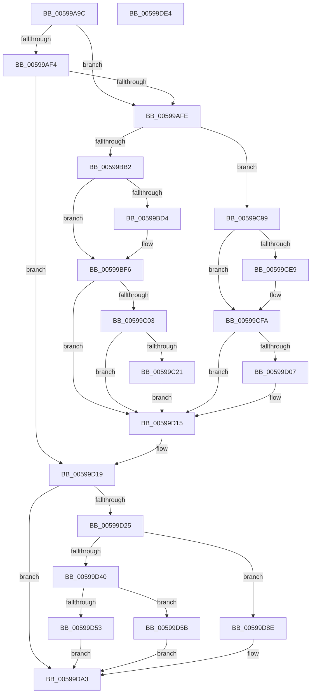

# IopLiveDumpAllocateExtraBuffers

- RVA: `0x00599A9C`–`0x00599DE5` (길이 `841` bytes)
- VA: `0x0000000140599A9C`
- 실행 섹션: `.text`
- PDB 이름 있음: `예`; PDB Function 태그: `아니요`
- unwind 정보 RVA: `0x000C7A90`
- 디코드: `192`개 명령, `841/841` bytes 표시
- 미해석 바이트: `0` (있으면 어셈블리에 `.byte`로 보존)

> 이 문서는 커널 이미지의 기계어와 PDB 기호를 분석해 생성했습니다. 4번과 5번은 함수 원형과 자료형을 바이너리 사용 방식에서 추정한 C 해석이며 원본 소스 복구 결과는 아닙니다.

## 1. Dependencies

- 직접 호출 지점: **14**; 고유 호출 대상: **11**
- 직접 호출자로 확인된 함수: **1**
- RIP 상대 이미지 참조: **6**

### Outgoing calls
- `0x00599AD2` → [IopLiveDumpGetMillisecondCounter](../3F/IopLiveDumpGetMillisecondCounter_function_003F5964.md) (function, `0x003F5964`)
- `0x00599B2E` → [IopLiveDumpGetMillisecondCounter](../3F/IopLiveDumpGetMillisecondCounter_function_003F5964.md) (function, `0x003F5964`)
- `0x00599B92` → [HvlPrepareLivedumpDescriptor](../58/HvlPrepareLivedumpDescriptor_function_0058B734.md) (function, `0x0058B734`)
- `0x00599B9B` → [IopLiveDumpGetMillisecondCounter](../3F/IopLiveDumpGetMillisecondCounter_function_003F5964.md) (function, `0x003F5964`)
- `0x00599BC6` → [IopLiveDumpIsTracingEnabled](../4F/IopLiveDumpIsTracingEnabled_function_004FC5AC.md) (function, `0x004FC5AC`)
- `0x00599BF1` → [IopLiveDumpTrace](../5A/IopLiveDumpTrace_function_005A4070.md) (function, `0x005A4070`)
- `0x00599C14` → [tlgKeywordOn](../42/tlgKeywordOn_function_0042EAA0.md) (function, `0x0042EAA0`)
- `0x00599C92` → [tlgWriteTransfer_EtwWriteTransfer](../42/tlgWriteTransfer_EtwWriteTransfer_function_004260E0.md) (function, `0x004260E0`)
- `0x00599D2F` → [MmAllocateIndependentPages](../../page/AA/MmAllocateIndependentPages_function_00AA0CE0.md) (function, `0x00AA0CE0`)
- `0x00599D4A` → [IopLiveDumpIsUnderMemoryPressure](../3F/IopLiveDumpIsUnderMemoryPressure_function_003F5EB8.md) (function, `0x003F5EB8`)
- `0x00599D68` → [IopLiveDumpDiscardVirtualAddressRange](../29/IopLiveDumpDiscardVirtualAddressRange_function_002977F4.md) (function, `0x002977F4`)
- `0x00599D87` → [memset](../6C/memset_function_006C6C40.md) (function, `0x006C6C40`)
- `0x00599DA5` → [IopLiveDumpGetMillisecondCounter](../3F/IopLiveDumpGetMillisecondCounter_function_003F5964.md) (function, `0x003F5964`)
- `0x00599DBE` → [_security_check_cookie](../6A/_security_check_cookie_function_006AC640.md) (function, `0x006AC640`)

### Direct callers
- [IopLiveDumpAllocAndInitResources](IopLiveDumpAllocAndInitResources_function_005993B0.md) at `0x00599772`

### Static image references
- `0x00599ABF` → RVA `0x00E0A740` (`.data`; read)
- `0x00599AFE` → RVA `0x00E0A9D4` (`.data`; read)
- `0x00599BEA` → RVA `0x00022978` (`.rdata`; read)
- `0x00599BF6` → RVA `0x00E06EA0` (`.data`; read)
- `0x00599C46` → RVA `0x0004669C` (`.rdata`; read)
- `0x00599C99` → RVA `0x00E0A9D0` (`.data`; read)

## 2. Other-region calls and transfers

- 다른 실행 섹션으로 향하는 call: **1**
  - `0x00599D2F` → [MmAllocateIndependentPages](../../page/AA/MmAllocateIndependentPages_function_00AA0CE0.md) (`.text` → `PAGE`)
- 별도 외부 분기/꼬리 이동을 확인하지 못했습니다.

## 3. Assembly (complete function range)

```asm
00599A9C  48 8B C4                        mov rax, rsp
00599A9F  48 89 58 10                     mov qword ptr [rax + 0x10], rbx
00599AA3  48 89 70 18                     mov qword ptr [rax + 0x18], rsi
00599AA7  48 89 78 20                     mov qword ptr [rax + 0x20], rdi
00599AAB  55                              push rbp
00599AAC  41 54                           push r12
00599AAE  41 55                           push r13
00599AB0  41 56                           push r14
00599AB2  41 57                           push r15
00599AB4  48 8D 68 A1                     lea rbp, [rax - 0x5f]
00599AB8  48 81 EC E0 00 00 00            sub rsp, 0xe0
00599ABF  48 8B 05 7A 0C 87 00            mov rax, qword ptr [rip + 0x870c7a]
00599AC6  48 33 C4                        xor rax, rsp
00599AC9  48 89 45 27                     mov qword ptr [rbp + 0x27], rax
00599ACD  4C 8B F1                        mov r14, rcx
00599AD0  33 C9                           xor ecx, ecx
00599AD2  E8 8D BE E5 FF                  call 0x1403f5964
00599AD7  4D 8B AE B8 02 00 00            mov r13, qword ptr [r14 + 0x2b8]
00599ADE  4D 8D A6 C0 02 00 00            lea r12, [r14 + 0x2c0]
00599AE5  45 33 FF                        xor r15d, r15d
00599AE8  48 89 45 B7                     mov qword ptr [rbp - 0x49], rax
00599AEC  48 8B F8                        mov rdi, rax
00599AEF  4D 85 ED                        test r13, r13
00599AF2  75 0A                           jne 0x140599afe
00599AF4  4D 39 3C 24                     cmp qword ptr [r12], r15
00599AF8  0F 84 1B 02 00 00               je 0x140599d19
00599AFE  8B 1D D0 0E 87 00               mov ebx, dword ptr [rip + 0x870ed0]
00599B04  33 D2                           xor edx, edx
00599B06  49 8B 04 24                     mov rax, qword ptr [r12]
00599B0A  33 C9                           xor ecx, ecx
00599B0C  48 F7 F3                        div rbx
00599B0F  4D 89 BE F0 00 00 00            mov qword ptr [r14 + 0xf0], r15
00599B16  48 8B F0                        mov rsi, rax
00599B19  4D 89 BE 10 01 00 00            mov qword ptr [r14 + 0x110], r15
00599B20  4D 89 BE F8 00 00 00            mov qword ptr [r14 + 0xf8], r15
00599B27  4D 89 BE 18 01 00 00            mov qword ptr [r14 + 0x118], r15
00599B2E  E8 31 BE E5 FF                  call 0x1403f5964
00599B33  49 8B 8E D8 00 00 00            mov rcx, qword ptr [r14 + 0xd8]
00599B3A  4D 8D 86 D0 00 00 00            lea r8, [r14 + 0xd0]
00599B41  48 8B F8                        mov rdi, rax
00599B44  4C 89 44 24 40                  mov qword ptr [rsp + 0x40], r8
00599B49  33 D2                           xor edx, edx
00599B4B  4D 8D 8E 00 01 00 00            lea r9, [r14 + 0x100]
00599B52  49 8B C5                        mov rax, r13
00599B55  4C 89 4C 24 38                  mov qword ptr [rsp + 0x38], r9
00599B5A  48 F7 F3                        div rbx
00599B5D  4D 8D 96 08 01 00 00            lea r10, [r14 + 0x108]
00599B64  44 8B C6                        mov r8d, esi
00599B67  4C 89 54 24 30                  mov qword ptr [rsp + 0x30], r10
00599B6C  4D 8D 9E E0 00 00 00            lea r11, [r14 + 0xe0]
00599B73  48 8B D0                        mov rdx, rax
00599B76  4C 89 5C 24 28                  mov qword ptr [rsp + 0x28], r11
00599B7B  49 8B 86 F0 02 00 00            mov rax, qword ptr [r14 + 0x2f0]
00599B82  4D 8D AE E8 00 00 00            lea r13, [r14 + 0xe8]
00599B89  4C 89 6C 24 20                  mov qword ptr [rsp + 0x20], r13
00599B8E  48 8D 0C C8                     lea rcx, [rax + rcx*8]
00599B92  E8 9D 1B FF FF                  call 0x14058b734
00599B97  33 C9                           xor ecx, ecx
00599B99  8B D8                           mov ebx, eax
00599B9B  E8 C4 BD E5 FF                  call 0x1403f5964
00599BA0  48 2B C7                        sub rax, rdi
00599BA3  49 89 86 28 01 00 00            mov qword ptr [r14 + 0x128], rax
00599BAA  85 DB                           test ebx, ebx
00599BAC  0F 89 E7 00 00 00               jns 0x140599c99
00599BB2  41 0F BA 6E 50 0E               bts dword ptr [r14 + 0x50], 0xe
00599BB8  4D 89 BE B8 02 00 00            mov qword ptr [r14 + 0x2b8], r15
00599BBF  4D 89 3C 24                     mov qword ptr [r12], r15
00599BC3  89 5D AF                        mov dword ptr [rbp - 0x51], ebx
00599BC6  E8 E1 29 F6 FF                  call 0x1404fc5ac
00599BCB  BF 01 00 00 00                  mov edi, 1
00599BD0  84 C0                           test al, al
00599BD2  74 22                           je 0x140599bf6
00599BD4  48 8D 45 AF                     lea rax, [rbp - 0x51]
00599BD8  48 C7 45 C7 04 00 00 00         mov qword ptr [rbp - 0x39], 4
00599BE0  4C 8D 45 BF                     lea r8, [rbp - 0x41]
00599BE4  48 89 45 BF                     mov qword ptr [rbp - 0x41], rax
00599BE8  8B D7                           mov edx, edi
00599BEA  48 8D 0D 87 8D A8 FF            lea rcx, [rip - 0x577279]
00599BF1  E8 7A A4 00 00                  call 0x1405a4070
00599BF6  83 3D A3 D2 86 00 05            cmp dword ptr [rip + 0x86d2a3], 5
00599BFD  0F 86 12 01 00 00               jbe 0x140599d15
00599C03  48 BA 00 00 00 00 00 40 00 00   movabs rdx, 0x400000000000
00599C0D  48 8D 0D 8C D2 86 00            lea rcx, [rip + 0x86d28c]
00599C14  E8 87 4E E9 FF                  call 0x14042eaa0
00599C19  84 C0                           test al, al
00599C1B  0F 84 F4 00 00 00               je 0x140599d15
00599C21  48 8D 45 BF                     lea rax, [rbp - 0x41]
00599C25  48 C7 45 BF 00 00 00 01         mov qword ptr [rbp - 0x41], 0x1000000
00599C2D  48 89 45 F7                     mov qword ptr [rbp - 9], rax
00599C31  4D 8D 8E B8 03 00 00            lea r9, [r14 + 0x3b8]
00599C38  41 8B 46 50                     mov eax, dword ptr [r14 + 0x50]
00599C3C  4D 8D 86 C8 03 00 00            lea r8, [r14 + 0x3c8]
00599C43  C1 E8 0E                        shr eax, 0xe
00599C46  48 8D 15 4F CA AA FF            lea rdx, [rip - 0x5535b1]
00599C4D  40 22 C7                        and al, dil
00599C50  48 C7 45 FF 08 00 00 00         mov qword ptr [rbp - 1], 8
00599C58  88 45 A7                        mov byte ptr [rbp - 0x59], al
00599C5B  48 8D 0D 3E D2 86 00            lea rcx, [rip + 0x86d23e]
00599C62  48 8D 45 A7                     lea rax, [rbp - 0x59]
00599C66  48 89 7D 0F                     mov qword ptr [rbp + 0xf], rdi
00599C6A  48 89 45 07                     mov qword ptr [rbp + 7], rax
00599C6E  48 8D 45 AF                     lea rax, [rbp - 0x51]
00599C72  48 89 45 17                     mov qword ptr [rbp + 0x17], rax
00599C76  48 8D 45 D7                     lea rax, [rbp - 0x29]
00599C7A  48 89 44 24 28                  mov qword ptr [rsp + 0x28], rax
00599C7F  C7 44 24 20 05 00 00 00         mov dword ptr [rsp + 0x20], 5
00599C87  89 5D AF                        mov dword ptr [rbp - 0x51], ebx
00599C8A  48 C7 45 1F 04 00 00 00         mov qword ptr [rbp + 0x1f], 4
00599C92  E8 49 C4 E8 FF                  call 0x1404260e0
00599C97  EB 7C                           jmp 0x140599d15
00599C99  44 8B 0D 30 0D 87 00            mov r9d, dword ptr [rip + 0x870d30]
00599CA0  49 8D 8E E0 00 00 00            lea rcx, [r14 + 0xe0]
00599CA7  48 8B 01                        mov rax, qword ptr [rcx]
00599CAA  49 8D 96 08 01 00 00            lea rdx, [r14 + 0x108]
00599CB1  48 C1 E0 0C                     shl rax, 0xc
00599CB5  48 89 01                        mov qword ptr [rcx], rax
00599CB8  49 8D 8E 00 01 00 00            lea rcx, [r14 + 0x100]
00599CBF  4C 8B 01                        mov r8, qword ptr [rcx]
00599CC2  49 C1 E0 0C                     shl r8, 0xc
00599CC6  4C 89 01                        mov qword ptr [rcx], r8
00599CC9  49 8B 4D 00                     mov rcx, qword ptr [r13]
00599CCD  48 C1 E1 0C                     shl rcx, 0xc
00599CD1  49 89 4D 00                     mov qword ptr [r13], rcx
00599CD5  48 8B 0A                        mov rcx, qword ptr [rdx]
00599CD8  48 C1 E1 0C                     shl rcx, 0xc
00599CDC  48 89 0A                        mov qword ptr [rdx], rcx
00599CDF  33 D2                           xor edx, edx
00599CE1  49 F7 F1                        div r9
00599CE4  48 85 D2                        test rdx, rdx
00599CE7  74 11                           je 0x140599cfa
00599CE9  49 8B 96 D8 00 00 00            mov rdx, qword ptr [r14 + 0xd8]
00599CF0  48 03 D0                        add rdx, rax
00599CF3  49 89 96 F8 00 00 00            mov qword ptr [r14 + 0xf8], rdx
00599CFA  33 D2                           xor edx, edx
00599CFC  49 8B C0                        mov rax, r8
00599CFF  49 F7 F1                        div r9
00599D02  48 85 D2                        test rdx, rdx
00599D05  74 0E                           je 0x140599d15
00599D07  49 03 86 D8 00 00 00            add rax, qword ptr [r14 + 0xd8]
00599D0E  49 89 86 18 01 00 00            mov qword ptr [r14 + 0x118], rax
00599D15  48 8B 7D B7                     mov rdi, qword ptr [rbp - 0x49]
00599D19  49 8B 9E 88 00 00 00            mov rbx, qword ptr [r14 + 0x88]
00599D20  48 85 DB                        test rbx, rbx
00599D23  74 7E                           je 0x140599da3
00599D25  48 C1 E3 0C                     shl rbx, 0xc
00599D29  83 CA FF                        or edx, 0xffffffff
00599D2C  48 8B CB                        mov rcx, rbx
00599D2F  E8 AC 6F 50 00                  call 0x140aa0ce0
00599D34  49 89 86 90 00 00 00            mov qword ptr [r14 + 0x90], rax
00599D3B  48 85 C0                        test rax, rax
00599D3E  74 4E                           je 0x140599d8e
00599D40  49 8B CE                        mov rcx, r14
00599D43  41 89 9E 98 00 00 00            mov dword ptr [r14 + 0x98], ebx
00599D4A  E8 69 C1 E5 FF                  call 0x1403f5eb8
00599D4F  84 C0                           test al, al
00599D51  74 08                           je 0x140599d5b
00599D53  41 BF 40 02 00 C0               mov r15d, 0xc0000240
00599D59  EB 48                           jmp 0x140599da3
00599D5B  49 8B 96 90 00 00 00            mov rdx, qword ptr [r14 + 0x90]
00599D62  4C 8B C3                        mov r8, rbx
00599D65  49 8B CE                        mov rcx, r14
00599D68  E8 87 DA CF FF                  call 0x1402977f4
00599D6D  49 8B 8E 90 00 00 00            mov rcx, qword ptr [r14 + 0x90]
00599D74  4C 8B C3                        mov r8, rbx
00599D77  33 D2                           xor edx, edx
00599D79  49 89 8E B0 00 00 00            mov qword ptr [r14 + 0xb0], rcx
00599D80  45 89 BE B8 00 00 00            mov dword ptr [r14 + 0xb8], r15d
00599D87  E8 B4 CE 12 00                  call 0x1406c6c40
00599D8C  EB 15                           jmp 0x140599da3
00599D8E  4D 89 BE B0 00 00 00            mov qword ptr [r14 + 0xb0], r15
00599D95  45 89 BE B8 00 00 00            mov dword ptr [r14 + 0xb8], r15d
00599D9C  45 89 BE 98 00 00 00            mov dword ptr [r14 + 0x98], r15d
00599DA3  33 C9                           xor ecx, ecx
00599DA5  E8 BA BB E5 FF                  call 0x1403f5964
00599DAA  48 2B C7                        sub rax, rdi
00599DAD  49 89 86 08 03 00 00            mov qword ptr [r14 + 0x308], rax
00599DB4  41 8B C7                        mov eax, r15d
00599DB7  48 8B 4D 27                     mov rcx, qword ptr [rbp + 0x27]
00599DBB  48 33 CC                        xor rcx, rsp
00599DBE  E8 7D 28 11 00                  call 0x1406ac640
00599DC3  4C 8D 9C 24 E0 00 00 00         lea r11, [rsp + 0xe0]
00599DCB  49 8B 5B 38                     mov rbx, qword ptr [r11 + 0x38]
00599DCF  49 8B 73 40                     mov rsi, qword ptr [r11 + 0x40]
00599DD3  49 8B 7B 48                     mov rdi, qword ptr [r11 + 0x48]
00599DD7  49 8B E3                        mov rsp, r11
00599DDA  41 5F                           pop r15
00599DDC  41 5E                           pop r14
00599DDE  41 5D                           pop r13
00599DE0  41 5C                           pop r12
00599DE2  5D                              pop rbp
00599DE3  C3                              ret
00599DE4  CC                              int3
```

## 4. C-style interpretation (structured pseudocode)

```c
__int64 __fastcall IopLiveDumpAllocateExtraBuffers(__int64 a1, int a2)
{
    __int64 result;
    __int64 v_r15;
    __int64 v_rbx;
    __int64 v_rsp;
    unsigned __int64 v_stack_m28;
    unsigned __int64 v_stack_mC8;
    unsigned __int64 v_stack_mD0;
    unsigned __int64 v_stack_mD8;
    unsigned __int64 v_stack_mE0;
    unsigned __int64 v_stack_mE8;

    *(unsigned __int64 *)(v_rsp + 16) = v_rbx;
    *(unsigned __int64 *)(v_rsp + 24) = v_rsi;
    *(unsigned __int64 *)(v_rsp + 32) = v_rdi;
    v_rsp = (v_rsp) - (224);
    result = (*(unsigned __int64 *)(v_rip + 8850554)) ^ (v_rsp);
    *(unsigned __int64 *)(v_rsp - 95 + 39) = result;
    a1 = 0;
    result = IopLiveDumpGetMillisecondCounter(a1, a2, a3, a4);
    v_r15 = 0;
    *(unsigned __int64 *)(v_rsp - 95 - 73) = result;
    if (*(unsigned __int64 *)(a1 + 696) != 0) goto loc_00599AFE;
    if ((*(unsigned __int64 *)(a1 + 704)) == 0) goto loc_00599D19;
loc_00599AFE:
    a2 = 0;
    a1 = 0;
    *(unsigned __int64 *)(a1 + 240) = 0;
    *(unsigned __int64 *)(a1 + 272) = 0;
    *(unsigned __int64 *)(a1 + 248) = 0;
    *(unsigned __int64 *)(a1 + 280) = 0;
    result = IopLiveDumpGetMillisecondCounter(a1, a2, a3, a4);
    v_stack_mC8 = a1 + 208;
    a2 = 0;
    v_stack_mD0 = a1 + 256;
    v_stack_mD8 = a1 + 264;
    v_stack_mE0 = a1 + 224;
    v_stack_mE8 = a1 + 232;
    result = HvlPrepareLivedumpDescriptor(*(unsigned __int64 *)(a1 + 752) + *(unsigned __int64 *)(a1 + 216) * 8, *(unsigned __int64 *)(a1 + 696), (unsigned int)((unsigned int)(*(unsigned __int64 *)(a1 + 704))), a1 + 256);
    a1 = 0;
    result = IopLiveDumpGetMillisecondCounter(a1, *(unsigned __int64 *)(a1 + 696), (unsigned int)((unsigned int)(*(unsigned __int64 *)(a1 + 704))), a1 + 256);
    result = (result) - (result);
    *(unsigned __int64 *)(a1 + 296) = result;
    if (!sign_flag) goto loc_00599C99;
    *(unsigned __int64 *)(a1 + 696) = 0;
    *(unsigned __int64 *)(a1 + 704) = 0;
    *(unsigned int *)(v_rsp - 95 - 81) = (unsigned int)((unsigned int)((unsigned int)(result)));
    result = IopLiveDumpIsTracingEnabled(a1, *(unsigned __int64 *)(a1 + 696), (unsigned int)((unsigned int)(*(unsigned __int64 *)(a1 + 704))), a1 + 256);
    if ((unsigned __int8)(result) != 0) {
        result = v_rsp - 95 - 81;
        *(unsigned __int64 *)(v_rsp - 95 - 57) = 4;
        a3 = v_rsp - 95 - 65;
        *(unsigned __int64 *)(v_rsp - 95 - 65) = result;
        a2 = 1;
        a1 = v_rip - 5730937;
        result = IopLiveDumpTrace(a1, a2, a3, a1 + 256);
    }
    if ((*(unsigned int *)(v_rip + 8835747)) <= 5) goto loc_00599D15;
    result = tlgKeywordOn(v_rip + 8835724, a2, a3, a1 + 256);
    if ((unsigned __int8)(result) == 0) goto loc_00599D15;
    *(unsigned __int64 *)(v_rsp - 95 - 65) = 0x1000000ULL;
    *(unsigned __int64 *)(v_rsp - 95 - 9) = v_rsp - 95 - 65;
    result = (unsigned int)(((unsigned int)(*(unsigned int *)(a1 + 80))) >> (14));
    result = (unsigned __int8)((result) & (1));
    *(unsigned __int64 *)(v_rsp - 95 - 1) = 8;
    *(unsigned __int8 *)(v_rsp - 95 - 89) = (unsigned __int8)(result);
    *(unsigned __int64 *)(v_rsp - 95 + 15) = 1;
    *(unsigned __int64 *)(v_rsp - 95 + 7) = v_rsp - 95 - 89;
    *(unsigned __int64 *)(v_rsp - 95 + 23) = v_rsp - 95 - 81;
    v_stack_mE0 = v_rsp - 95 - 41;
    v_stack_mE8 = 5;
    *(unsigned int *)(v_rsp - 95 - 81) = (unsigned int)((unsigned int)((unsigned int)(result)));
    *(unsigned __int64 *)(v_rsp - 95 + 31) = 4;
    result = tlgWriteTransfer_EtwWriteTransfer(v_rip + 8835646, v_rip - 5584305, a1 + 968, a1 + 952);
    goto loc_00599D15;
loc_00599C99:
    result = (*(unsigned __int64 *)(a1 + 224)) << (12);
    *(unsigned __int64 *)(a1 + 224) = result;
    a3 = (*(unsigned __int64 *)(a1 + 256)) << (12);
    *(unsigned __int64 *)(a1 + 256) = a3;
    a1 = (*(unsigned __int64 *)(a1 + 232)) << (12);
    *(unsigned __int64 *)(a1 + 232) = a1;
    a1 = (*(unsigned __int64 *)(a1 + 264)) << (12);
    *(unsigned __int64 *)(a1 + 264) = a1;
    a2 = 0;
    if (0 != 0) {
        a2 = *(unsigned __int64 *)(a1 + 216);
        a2 = (a2) + (result);
        *(unsigned __int64 *)(a1 + 248) = a2;
    }
    a2 = 0;
    result = a3;
    if (0 != 0) {
        result = (a3) + (*(unsigned __int64 *)(a1 + 216));
        *(unsigned __int64 *)(a1 + 280) = result;
    }
loc_00599D19:
    if (*(unsigned __int64 *)(a1 + 136) == 0) goto loc_00599DA3;
    v_rbx = (*(unsigned __int64 *)(a1 + 136)) << (12);
    a2 = (unsigned int)((a2) | (0xFFFFFFFFULL));
    result = MmAllocateIndependentPages(v_rbx, a2, a3, (unsigned int)(*(unsigned int *)(v_rip + 8850736)));
    *(unsigned __int64 *)(a1 + 144) = result;
    if (result == 0) goto loc_00599D8E;
    *(unsigned int *)(a1 + 152) = (unsigned int)(v_rbx);
    result = IopLiveDumpIsUnderMemoryPressure(a1, a2, a3, (unsigned int)(*(unsigned int *)(v_rip + 8850736)));
    if ((unsigned __int8)(result) == 0) goto loc_00599D5B;
    goto loc_00599DA3;
loc_00599D5B:
    result = IopLiveDumpDiscardVirtualAddressRange(a1, *(unsigned __int64 *)(a1 + 144), v_rbx, (unsigned int)(*(unsigned int *)(v_rip + 8850736)));
    a2 = 0;
    *(unsigned __int64 *)(a1 + 176) = *(unsigned __int64 *)(a1 + 144);
    *(unsigned int *)(a1 + 184) = (unsigned int)((unsigned int)(0xC0000240ULL));
    result = memset(*(unsigned __int64 *)(a1 + 144), a2, v_rbx, (unsigned int)(*(unsigned int *)(v_rip + 8850736)));
    goto loc_00599DA3;
loc_00599D8E:
    *(unsigned __int64 *)(a1 + 176) = (unsigned int)(0xC0000240ULL);
    *(unsigned int *)(a1 + 184) = (unsigned int)((unsigned int)(0xC0000240ULL));
    *(unsigned int *)(a1 + 152) = (unsigned int)((unsigned int)(0xC0000240ULL));
loc_00599DA3:
    a1 = 0;
    result = IopLiveDumpGetMillisecondCounter(a1, a2, v_rbx, (unsigned int)(*(unsigned int *)(v_rip + 8850736)));
    result = (result) - (*(unsigned __int64 *)(v_rsp - 95 - 73));
    *(unsigned __int64 *)(a1 + 776) = result;
    a1 = (*(unsigned __int64 *)(v_rsp - 95 + 39)) ^ (v_rsp);
    result = _security_check_cookie(a1, a2, v_rbx, (unsigned int)(*(unsigned int *)(v_rip + 8850736)));
    return result;
}
```

## 5. (Beta) C Style

```c
int64_t IopLiveDumpAllocateExtraBuffers(void *Arg1, int32_t Arg2)
{
    uint8_t *arg1 = (uint8_t *)Arg1;

    int64_t result;
    int64_t local_r15;
    int64_t local_rbx;
    int64_t local_rsp;
    uint64_t v_stack_m28;
    uint64_t v_stack_mC8;
    uint64_t v_stack_mD0;
    uint64_t v_stack_mD8;
    uint64_t v_stack_mE0;
    uint64_t v_stack_mE8;

    *(uint64_t *)(local_rsp + 0x10) = local_rbx;
    *(uint64_t *)(local_rsp + 0x18) = local_rsi;
    *(uint64_t *)(local_rsp + 0x20) = local_rdi;
    local_rsp = (local_rsp) - (224);
    result = (*(uint64_t *)(v_rip + 0x870C7A)) ^ (local_rsp);
    *(uint64_t *)(local_rsp - 0x5F + 0x27) = result;
    Arg1 = 0;
    result = IopLiveDumpGetMillisecondCounter(Arg1, Arg2, a3, a4);
    local_r15 = 0;
    *(uint64_t *)(local_rsp - 0x5F - 0x49) = result;
    if (*(uint64_t *)(arg1 + 0x2B8) != 0) goto loc_00599AFE;
    if ((*(uint64_t *)(arg1 + 0x2C0)) == 0) goto loc_00599D19;
loc_00599AFE:
    Arg2 = 0;
    Arg1 = 0;
    *(uint64_t *)(arg1 + 0xF0) = 0;
    *(uint64_t *)(arg1 + 0x110) = 0;
    *(uint64_t *)(arg1 + 0xF8) = 0;
    *(uint64_t *)(arg1 + 0x118) = 0;
    result = IopLiveDumpGetMillisecondCounter(Arg1, Arg2, a3, a4);
    v_stack_mC8 = Arg1 + 208;
    Arg2 = 0;
    v_stack_mD0 = Arg1 + 256;
    v_stack_mD8 = Arg1 + 264;
    v_stack_mE0 = Arg1 + 224;
    v_stack_mE8 = Arg1 + 232;
    result = HvlPrepareLivedumpDescriptor(*(uint64_t *)(arg1 + 0x2F0) + *(uint64_t *)(arg1 + 0xD8) * 8, *(uint64_t *)(arg1 + 0x2B8), (uint32_t)((uint32_t)(*(uint64_t *)(arg1 + 0x2C0))), Arg1 + 256);
    Arg1 = 0;
    result = IopLiveDumpGetMillisecondCounter(Arg1, *(uint64_t *)(arg1 + 0x2B8), (uint32_t)((uint32_t)(*(uint64_t *)(arg1 + 0x2C0))), Arg1 + 256);
    result = (result) - (result);
    *(uint64_t *)(arg1 + 0x128) = result;
    if (!sign_flag) goto loc_00599C99;
    *(uint64_t *)(arg1 + 0x2B8) = 0;
    *(uint64_t *)(arg1 + 0x2C0) = 0;
    *(uint32_t *)(local_rsp - 0x5F - 0x51) = (uint32_t)((uint32_t)((uint32_t)(result)));
    result = IopLiveDumpIsTracingEnabled(Arg1, *(uint64_t *)(arg1 + 0x2B8), (uint32_t)((uint32_t)(*(uint64_t *)(arg1 + 0x2C0))), Arg1 + 256);
    if ((uint8_t)(result) != 0) {
        result = local_rsp - 95 - 81;
        *(uint64_t *)(local_rsp - 0x5F - 0x39) = 4;
        a3 = local_rsp - 95 - 65;
        *(uint64_t *)(local_rsp - 0x5F - 0x41) = result;
        Arg2 = 1;
        Arg1 = v_rip - 5730937;
        result = IopLiveDumpTrace(Arg1, Arg2, a3, Arg1 + 256);
    }
    if ((*(uint32_t *)(v_rip + 0x86D2A3)) <= 5) goto loc_00599D15;
    result = tlgKeywordOn(v_rip + 8835724, Arg2, a3, Arg1 + 256);
    if ((uint8_t)(result) == 0) goto loc_00599D15;
    *(uint64_t *)(local_rsp - 0x5F - 0x41) = 0x1000000ULL;
    *(uint64_t *)(local_rsp - 0x5F - 0x9) = local_rsp - 95 - 65;
    result = (uint32_t)(((uint32_t)(*(uint32_t *)(arg1 + 0x50))) >> (14));
    result = (uint8_t)((result) & (1));
    *(uint64_t *)(local_rsp - 0x5F - 0x1) = 8;
    *(uint8_t *)(local_rsp - 0x5F - 0x59) = (uint8_t)(result);
    *(uint64_t *)(local_rsp - 0x5F + 0xF) = 1;
    *(uint64_t *)(local_rsp - 0x5F + 0x7) = local_rsp - 95 - 89;
    *(uint64_t *)(local_rsp - 0x5F + 0x17) = local_rsp - 95 - 81;
    v_stack_mE0 = local_rsp - 95 - 41;
    v_stack_mE8 = 5;
    *(uint32_t *)(local_rsp - 0x5F - 0x51) = (uint32_t)((uint32_t)((uint32_t)(result)));
    *(uint64_t *)(local_rsp - 0x5F + 0x1F) = 4;
    result = tlgWriteTransfer_EtwWriteTransfer(v_rip + 8835646, v_rip - 5584305, Arg1 + 968, Arg1 + 952);
    goto loc_00599D15;
loc_00599C99:
    result = (*(uint64_t *)(arg1 + 0xE0)) << (12);
    *(uint64_t *)(arg1 + 0xE0) = result;
    a3 = (*(uint64_t *)(arg1 + 0x100)) << (12);
    *(uint64_t *)(arg1 + 0x100) = a3;
    Arg1 = (*(uint64_t *)(arg1 + 0xE8)) << (12);
    *(void **)(arg1 + 0xE8) = Arg1;
    Arg1 = (*(uint64_t *)(arg1 + 0x108)) << (12);
    *(void **)(arg1 + 0x108) = Arg1;
    Arg2 = 0;
    if (0 != 0) {
        Arg2 = *(uint64_t *)(arg1 + 0xD8);
        Arg2 = (Arg2) + (result);
        *(uint64_t *)(arg1 + 0xF8) = Arg2;
    }
    Arg2 = 0;
    result = a3;
    if (0 != 0) {
        result = (a3) + (*(uint64_t *)(arg1 + 0xD8));
        *(uint64_t *)(arg1 + 0x118) = result;
    }
loc_00599D19:
    if (*(uint64_t *)(arg1 + 0x88) == 0) goto loc_00599DA3;
    local_rbx = (*(uint64_t *)(arg1 + 0x88)) << (12);
    Arg2 = (uint32_t)((Arg2) | (0xFFFFFFFFULL));
    result = MmAllocateIndependentPages(local_rbx, Arg2, a3, (uint32_t)(*(uint32_t *)(v_rip + 0x870D30)));
    *(uint64_t *)(arg1 + 0x90) = result;
    if (result == 0) goto loc_00599D8E;
    *(uint32_t *)(arg1 + 0x98) = (uint32_t)(local_rbx);
    result = IopLiveDumpIsUnderMemoryPressure(Arg1, Arg2, a3, (uint32_t)(*(uint32_t *)(v_rip + 0x870D30)));
    if ((uint8_t)(result) == 0) goto loc_00599D5B;
    goto loc_00599DA3;
loc_00599D5B:
    result = IopLiveDumpDiscardVirtualAddressRange(Arg1, *(uint64_t *)(arg1 + 0x90), local_rbx, (uint32_t)(*(uint32_t *)(v_rip + 0x870D30)));
    Arg2 = 0;
    *(uint64_t *)(arg1 + 0xB0) = *(uint64_t *)(arg1 + 0x90);
    *(uint32_t *)(arg1 + 0xB8) = (uint32_t)((uint32_t)(0xC0000240ULL));
    result = memset(*(uint64_t *)(arg1 + 0x90), Arg2, local_rbx, (uint32_t)(*(uint32_t *)(v_rip + 0x870D30)));
    goto loc_00599DA3;
loc_00599D8E:
    *(uint64_t *)(arg1 + 0xB0) = (uint32_t)(0xC0000240ULL);
    *(uint32_t *)(arg1 + 0xB8) = (uint32_t)((uint32_t)(0xC0000240ULL));
    *(uint32_t *)(arg1 + 0x98) = (uint32_t)((uint32_t)(0xC0000240ULL));
loc_00599DA3:
    Arg1 = 0;
    result = IopLiveDumpGetMillisecondCounter(Arg1, Arg2, local_rbx, (uint32_t)(*(uint32_t *)(v_rip + 0x870D30)));
    result = (result) - (*(uint64_t *)(local_rsp - 0x5F - 0x49));
    *(uint64_t *)(arg1 + 0x308) = result;
    Arg1 = (*(uint64_t *)(local_rsp - 0x5F + 0x27)) ^ (local_rsp);
    result = _security_check_cookie(Arg1, Arg2, local_rbx, (uint32_t)(*(uint32_t *)(v_rip + 0x870D30)));
    return result;
}
```

### 관측된 메모리 오프셋

구조체 형식이 확인되지 않은 접근은 인자 기준의 오프셋으로만 기록했습니다.

| 기준 인자 | 오프셋 표현 | 폭 (bit) | 접근 |
|---|---:|---:|---|
| `Arg1` | `+ 0x0` | `64` | `R` |
| `Arg1` | `+ 0x0` | `64` | `W` |
| `Arg1` | `+ 0x50` | `32` | `R` |
| `Arg1` | `+ 0x50` | `32` | `R/W` |
| `Arg1` | `+ 0x88` | `64` | `R` |
| `Arg1` | `+ 0x90` | `64` | `R` |
| `Arg1` | `+ 0x90` | `64` | `W` |
| `Arg1` | `+ 0x98` | `32` | `W` |
| `Arg1` | `+ 0xB0` | `64` | `W` |
| `Arg1` | `+ 0xB8` | `32` | `W` |
| `Arg1` | `+ 0xD0` | `64` | `R` |
| `Arg1` | `+ 0xD8` | `64` | `R` |
| `Arg1` | `+ 0xE0` | `64` | `R` |
| `Arg1` | `+ 0xE8` | `64` | `R` |
| `Arg1` | `+ 0xF0` | `64` | `W` |
| `Arg1` | `+ 0xF8` | `64` | `W` |
| `Arg1` | `+ 0x100` | `64` | `R` |
| `Arg1` | `+ 0x108` | `64` | `R` |
| `Arg1` | `+ 0x110` | `64` | `W` |
| `Arg1` | `+ 0x118` | `64` | `W` |
| `Arg1` | `+ 0x128` | `64` | `W` |
| `Arg1` | `+ 0x2B8` | `64` | `R` |
| `Arg1` | `+ 0x2B8` | `64` | `W` |
| `Arg1` | `+ 0x2C0` | `64` | `R` |
| `Arg1` | `+ 0x2F0` | `64` | `R` |
| `Arg1` | `+ 0x308` | `64` | `W` |
| `Arg1` | `+ 0x3B8` | `64` | `R` |
| `Arg1` | `+ 0x3C8` | `64` | `R` |

## 6. Execution-region graph

[열기: 2D/3D 그래프와 함수 탐색 컨트롤 패널](../../../control-panel.html?section=text&rva=0x00599A9C&view=graph)

- 2D 그래프는 위에서 아래로 흐르고, 3D 그래프는 빈 공간을 드래그해 회전합니다. Shift+드래그는 이동, 휠은 확대·축소, 함수 노드 선택은 대상 보고서 이동입니다.

### Static fallback


