# IopLiveDumpAllocateFromIOSpace

- RVA: `0x00599DEC`–`0x0059A2D2` (길이 `1,254` bytes)
- VA: `0x0000000140599DEC`
- 실행 섹션: `.text`
- PDB 이름 있음: `예`; PDB Function 태그: `아니요`
- unwind 정보 RVA: `0x000C7944`
- 디코드: `320`개 명령, `1,254/1,254` bytes 표시
- 미해석 바이트: `0` (있으면 어셈블리에 `.byte`로 보존)

> 이 문서는 커널 이미지의 기계어와 PDB 기호를 분석해 생성했습니다. 4번과 5번은 함수 원형과 자료형을 바이너리 사용 방식에서 추정한 C 해석이며 원본 소스 복구 결과는 아닙니다.

## 1. Dependencies

- 직접 호출 지점: **13**; 고유 호출 대상: **12**
- 직접 호출자로 확인된 함수: **1**
- RIP 상대 이미지 참조: **11**

### Outgoing calls
- `0x00599E7A` → [IopLiveDumpQueryIOSpaceRanges](IopLiveDumpQueryIOSpaceRanges_function_0059DD60.md) (function, `0x0059DD60`)
- `0x00599ECE` → [IopLiveDumpAllocateIoSpaceRanges](IopLiveDumpAllocateIoSpaceRanges_function_0059A50C.md) (function, `0x0059A50C`)
- `0x00599F36` → [IopLiveDumpTraceEventGeneric](../5A/IopLiveDumpTraceEventGeneric_function_005A41E4.md) (function, `0x005A41E4`)
- `0x00599F66` → [IopLiveDumpUnpackMemoryRun](IopLiveDumpUnpackMemoryRun_function_0059F5EC.md) (function, `0x0059F5EC`)
- `0x00599FCC` → [IopLiveDumpTraceEventGeneric](../5A/IopLiveDumpTraceEventGeneric_function_005A41E4.md) (function, `0x005A41E4`)
- `0x0059A039` → [IopLiveDumpTraceRunPageCountLoop](../5A/IopLiveDumpTraceRunPageCountLoop_function_005A43E4.md) (function, `0x005A43E4`)
- `0x0059A052` → [ExAllocatePool2](../../poolcode/B8/ExAllocatePool2_function_00B820F0.md) (function, `0x00B820F0`)
- `0x0059A0D6` → [MmMapLockedPagesSpecifyCache](../31/MmMapLockedPagesSpecifyCache_function_00318800.md) (function, `0x00318800`)
- `0x0059A1DB` → [IopLiveDumpDiscardVirtualAddressRange](../29/IopLiveDumpDiscardVirtualAddressRange_function_002977F4.md) (function, `0x002977F4`)
- `0x0059A23E` → [MmUnmapLockedPages](../24/MmUnmapLockedPages_function_00246E60.md) (function, `0x00246E60`)
- `0x0059A24B` → [ExFreePoolWithTag](../../poolcode/B8/ExFreePoolWithTag_function_00B82870.md) (function, `0x00B82870`)
- `0x0059A25F` → [IopLiveDumpFreeIoSpaceRanges](IopLiveDumpFreeIoSpaceRanges_function_0059BEE4.md) (function, `0x0059BEE4`)
- `0x0059A26B` → [_security_check_cookie](../6A/_security_check_cookie_function_006AC640.md) (function, `0x006AC640`)

### Direct callers
- [sub_006EB392](../6E/Unknown_function_006EB392.md) at `0x006EB3F5`
- [sub_006EB392](../6E/Unknown_function_006EB392.md) at `0x006EB4C4`

### Static image references
- `0x00599E05` → RVA `0x00E0A740` (`.data`; read)
- `0x00599E95` → RVA `0x00E0A9D4` (`.data`; read)
- `0x00599EF7` → RVA `0x006CAAC0` (` ?? ::FNODOBFM::`string'`; read)
- `0x00599F0A` → RVA `0x006CAD10` (` ?? ::FNODOBFM::`string'`; read)
- `0x00599F1D` → RVA `0x006CAD30` (` ?? ::FNODOBFM::`string'`; read)
- `0x00599F2F` → RVA `0x006CAD60` (` ?? ::FNODOBFM::`string'`; read)
- `0x00599F8B` → RVA `0x006CADB0` (` ?? ::FNODOBFM::`string'`; read)
- `0x00599F9E` → RVA `0x006CAEE0` (` ?? ::FNODOBFM::`string'`; read)
- `0x00599FB1` → RVA `0x006CAF00` (` ?? ::FNODOBFM::`string'`; read)
- `0x00599FC5` → RVA `0x006CAF20` (` ?? ::FNODOBFM::`string'`; read)
- `0x0059A10D` → RVA `0x00E0A9D0` (`.data`; read)

## 2. Other-region calls and transfers

- 다른 실행 섹션으로 향하는 call: **2**
  - `0x0059A052` → [ExAllocatePool2](../../poolcode/B8/ExAllocatePool2_function_00B820F0.md) (`.text` → `POOLCODE`)
  - `0x0059A24B` → [ExFreePoolWithTag](../../poolcode/B8/ExFreePoolWithTag_function_00B82870.md) (`.text` → `POOLCODE`)
- 별도 외부 분기/꼬리 이동을 확인하지 못했습니다.

## 3. Assembly (complete function range)

```asm
00599DEC  40 55                           push rbp
00599DEE  53                              push rbx
00599DEF  56                              push rsi
00599DF0  57                              push rdi
00599DF1  41 54                           push r12
00599DF3  41 55                           push r13
00599DF5  41 56                           push r14
00599DF7  41 57                           push r15
00599DF9  48 8D 6C 24 E1                  lea rbp, [rsp - 0x1f]
00599DFE  48 81 EC E8 00 00 00            sub rsp, 0xe8
00599E05  48 8B 05 34 09 87 00            mov rax, qword ptr [rip + 0x870934]
00599E0C  48 33 C4                        xor rax, rsp
00599E0F  48 89 45 07                     mov qword ptr [rbp + 7], rax
00599E13  33 FF                           xor edi, edi
00599E15  4C 89 4D 8F                     mov qword ptr [rbp - 0x71], r9
00599E19  48 8D B1 A8 02 00 00            lea rsi, [rcx + 0x2a8]
00599E20  4C 89 45 B7                     mov qword ptr [rbp - 0x49], r8
00599E24  48 89 4C 24 48                  mov qword ptr [rsp + 0x48], rcx
00599E29  4C 8B E2                        mov r12, rdx
00599E2C  48 89 7D AF                     mov qword ptr [rbp - 0x51], rdi
00599E30  4C 8B E9                        mov r13, rcx
00599E33  48 89 7C 24 40                  mov qword ptr [rsp + 0x40], rdi
00599E38  8B DF                           mov ebx, edi
00599E3A  48 89 7D 87                     mov qword ptr [rbp - 0x79], rdi
00599E3E  44 8B FF                        mov r15d, edi
00599E41  89 7C 24 30                     mov dword ptr [rsp + 0x30], edi
00599E45  48 89 7D 9F                     mov qword ptr [rbp - 0x61], rdi
00599E49  89 7C 24 34                     mov dword ptr [rsp + 0x34], edi
00599E4D  48 89 7D A7                     mov qword ptr [rbp - 0x59], rdi
00599E51  48 89 7D 97                     mov qword ptr [rbp - 0x69], rdi
00599E55  48 85 F6                        test rsi, rsi
00599E58  0F 84 06 04 00 00               je 0x14059a264
00599E5E  48 8B C2                        mov rax, rdx
00599E61  4C 8D 44 24 40                  lea r8, [rsp + 0x40]
00599E66  48 F7 D8                        neg rax
00599E69  48 8B CA                        mov rcx, rdx
00599E6C  49 8B 01                        mov rax, qword ptr [r9]
00599E6F  4D 1B F6                        sbb r14, r14
00599E72  48 89 45 CF                     mov qword ptr [rbp - 0x31], rax
00599E76  49 83 E6 D8                     and r14, 0xffffffffffffffd8
00599E7A  E8 E1 3E 00 00                  call 0x14059dd60
00599E7F  85 C0                           test eax, eax
00599E81  0F 88 D1 03 00 00               js 0x14059a258
00599E87  48 8B 7C 24 40                  mov rdi, qword ptr [rsp + 0x40]
00599E8C  48 85 FF                        test rdi, rdi
00599E8F  0F 84 F5 03 00 00               je 0x14059a28a
00599E95  8B 05 39 0B 87 00               mov eax, dword ptr [rip + 0x870b39]
00599E9B  4C 8D 4D 87                     lea r9, [rbp - 0x79]
00599E9F  48 0F AF 45 B7                  imul rax, qword ptr [rbp - 0x49]
00599EA4  49 8B CC                        mov rcx, r12
00599EA7  48 05 FF FF 03 00               add rax, 0x3ffff
00599EAD  48 C1 E8 12                     shr rax, 0x12
00599EB1  48 3B C7                        cmp rax, rdi
00599EB4  48 0F 42 F8                     cmovb rdi, rax
00599EB8  48 8D 45 9F                     lea rax, [rbp - 0x61]
00599EBC  48 89 44 24 28                  mov qword ptr [rsp + 0x28], rax
00599EC1  4C 8B C7                        mov r8, rdi
00599EC4  48 8D 44 24 30                  lea rax, [rsp + 0x30]
00599EC9  48 89 44 24 20                  mov qword ptr [rsp + 0x20], rax
00599ECE  E8 39 06 00 00                  call 0x14059a50c
00599ED3  85 C0                           test eax, eax
00599ED5  0F 88 F0 03 00 00               js 0x14059a2cb
00599EDB  48 8B 4D 9F                     mov rcx, qword ptr [rbp - 0x61]
00599EDF  48 85 C9                        test rcx, rcx
00599EE2  0F 84 9D 03 00 00               je 0x14059a285
00599EE8  41 F7 45 50 00 00 02 00         test dword ptr [r13 + 0x50], 0x20000
00599EF0  44 8B 7C 24 30                  mov r15d, dword ptr [rsp + 0x30]
00599EF5  74 44                           je 0x140599f3b
00599EF7  48 8D 05 C2 0B 13 00            lea rax, [rip + 0x130bc2]
00599EFE  48 89 4D E7                     mov qword ptr [rbp - 0x19], rcx
00599F02  48 89 45 EF                     mov qword ptr [rbp - 0x11], rax
00599F06  4C 8D 4D D7                     lea r9, [rbp - 0x29]
00599F0A  48 8D 05 FF 0D 13 00            lea rax, [rip + 0x130dff]
00599F11  48 89 7D D7                     mov qword ptr [rbp - 0x29], rdi
00599F15  48 89 45 F7                     mov qword ptr [rbp - 9], rax
00599F19  4C 8D 45 EF                     lea r8, [rbp - 0x11]
00599F1D  48 8D 05 0C 0E 13 00            lea rax, [rip + 0x130e0c]
00599F24  4C 89 7D DF                     mov qword ptr [rbp - 0x21], r15
00599F28  8D 53 03                        lea edx, [rbx + 3]
00599F2B  48 89 45 FF                     mov qword ptr [rbp - 1], rax
00599F2F  48 8D 0D 2A 0E 13 00            lea rcx, [rip + 0x130e2a]
00599F36  E8 A9 A2 00 00                  call 0x1405a41e4
00599F3B  45 33 D2                        xor r10d, r10d
00599F3E  41 BB 00 00 0C 00               mov r11d, 0xc0000
00599F44  44 89 54 24 38                  mov dword ptr [rsp + 0x38], r10d
00599F49  45 3B D7                        cmp r10d, r15d
00599F4C  0F 83 38 03 00 00               jae 0x14059a28a
00599F52  48 8B 45 87                     mov rax, qword ptr [rbp - 0x79]
00599F56  4C 8D 44 24 34                  lea r8, [rsp + 0x34]
00599F5B  48 8D 55 A7                     lea rdx, [rbp - 0x59]
00599F5F  41 8B FA                        mov edi, r10d
00599F62  4A 8B 0C D0                     mov rcx, qword ptr [rax + r10*8]
00599F66  E8 81 56 00 00                  call 0x14059f5ec
00599F6B  85 C0                           test eax, eax
00599F6D  0F 88 B6 02 00 00               js 0x14059a229
00599F73  41 8B 45 50                     mov eax, dword ptr [r13 + 0x50]
00599F77  48 8B 55 A7                     mov rdx, qword ptr [rbp - 0x59]
00599F7B  44 8B 6C 24 34                  mov r13d, dword ptr [rsp + 0x34]
00599F80  48 89 54 24 40                  mov qword ptr [rsp + 0x40], rdx
00599F85  0F BA E0 11                     bt eax, 0x11
00599F89  73 56                           jae 0x140599fe1
00599F8B  48 8D 05 1E 0E 13 00            lea rax, [rip + 0x130e1e]
00599F92  48 89 55 F7                     mov qword ptr [rbp - 9], rdx
00599F96  48 89 45 D7                     mov qword ptr [rbp - 0x29], rax
00599F9A  4C 8D 4D EF                     lea r9, [rbp - 0x11]
00599F9E  48 8D 05 3B 0F 13 00            lea rax, [rip + 0x130f3b]
00599FA5  48 89 7D EF                     mov qword ptr [rbp - 0x11], rdi
00599FA9  48 89 45 DF                     mov qword ptr [rbp - 0x21], rax
00599FAD  4C 8D 45 D7                     lea r8, [rbp - 0x29]
00599FB1  48 8D 05 48 0F 13 00            lea rax, [rip + 0x130f48]
00599FB8  4C 89 6D FF                     mov qword ptr [rbp - 1], r13
00599FBC  BA 03 00 00 00                  mov edx, 3
00599FC1  48 89 45 E7                     mov qword ptr [rbp - 0x19], rax
00599FC5  48 8D 0D 54 0F 13 00            lea rcx, [rip + 0x130f54]
00599FCC  E8 13 A2 00 00                  call 0x1405a41e4
00599FD1  44 8B 54 24 38                  mov r10d, dword ptr [rsp + 0x38]
00599FD6  41 BB 00 00 0C 00               mov r11d, 0xc0000
00599FDC  48 8B 54 24 40                  mov rdx, qword ptr [rsp + 0x40]
00599FE1  33 C0                           xor eax, eax
00599FE3  89 44 24 30                     mov dword ptr [rsp + 0x30], eax
00599FE7  45 85 ED                        test r13d, r13d
00599FEA  0F 84 2C 02 00 00               je 0x14059a21c
00599FF0  48 8B 4C 24 48                  mov rcx, qword ptr [rsp + 0x48]
00599FF5  41 8B FD                        mov edi, r13d
00599FF8  8B 49 50                        mov ecx, dword ptr [rcx + 0x50]
00599FFB  0F BA E1 13                     bt ecx, 0x13
00599FFF  73 10                           jae 0x14059a011
0059A001  44 39 2D CC 09 87 00            cmp dword ptr [rip + 0x8709cc], r13d
0059A008  0F 42 3D C5 09 87 00            cmovb edi, dword ptr [rip + 0x8709c5]
0059A00F  EB 07                           jmp 0x14059a018
0059A011  45 3B EB                        cmp r13d, r11d
0059A014  41 0F 47 FB                     cmova edi, r11d
0059A018  44 2B EF                        sub r13d, edi
0059A01B  44 8B E7                        mov r12d, edi
0059A01E  44 89 6C 24 34                  mov dword ptr [rsp + 0x34], r13d
0059A023  0F BA E1 11                     bt ecx, 0x11
0059A027  73 15                           jae 0x14059a03e
0059A029  48 89 54 24 20                  mov qword ptr [rsp + 0x20], rdx
0059A02E  45 8B CC                        mov r9d, r12d
0059A031  8B D0                           mov edx, eax
0059A033  45 8B C5                        mov r8d, r13d
0059A036  41 8B CA                        mov ecx, r10d
0059A039  E8 A6 A3 00 00                  call 0x1405a43e4
0059A03E  8D 3C FD 30 00 00 00            lea edi, [rdi*8 + 0x30]
0059A045  B9 40 00 00 00                  mov ecx, 0x40
0059A04A  8B D7                           mov edx, edi
0059A04C  41 B8 4C 64 6D 70               mov r8d, 0x706d644c
0059A052  E8 99 80 5E 00                  call 0x140b820f0
0059A057  48 8B C8                        mov rcx, rax
0059A05A  48 85 C0                        test rax, rax
0059A05D  0F 84 C6 01 00 00               je 0x14059a229
0059A063  48 83 20 00                     and qword ptr [rax], 0
0059A067  33 D2                           xor edx, edx
0059A069  66 89 78 08                     mov word ptr [rax + 8], di
0059A06D  49 8B C4                        mov rax, r12
0059A070  48 C1 E0 0C                     shl rax, 0xc
0059A074  89 41 28                        mov dword ptr [rcx + 0x28], eax
0059A077  66 C7 41 0A 02 08               mov word ptr [rcx + 0xa], 0x802
0059A07D  4D 85 E4                        test r12, r12
0059A080  74 1B                           je 0x14059a09d
0059A082  48 8B 7C 24 40                  mov rdi, qword ptr [rsp + 0x40]
0059A087  48 89 7C D1 30                  mov qword ptr [rcx + rdx*8 + 0x30], rdi
0059A08C  FF C2                           inc edx
0059A08E  8B C2                           mov eax, edx
0059A090  48 FF C7                        inc rdi
0059A093  49 3B C4                        cmp rax, r12
0059A096  72 EF                           jb 0x14059a087
0059A098  48 89 7C 24 40                  mov qword ptr [rsp + 0x40], rdi
0059A09D  48 8B 45 AF                     mov rax, qword ptr [rbp - 0x51]
0059A0A1  48 85 DB                        test rbx, rbx
0059A0A4  48 0F 44 D9                     cmove rbx, rcx
0059A0A8  48 85 C0                        test rax, rax
0059A0AB  74 03                           je 0x14059a0b0
0059A0AD  48 89 08                        mov qword ptr [rax], rcx
0059A0B0  F6 41 0A 05                     test byte ptr [rcx + 0xa], 5
0059A0B4  48 89 4D AF                     mov qword ptr [rbp - 0x51], rcx
0059A0B8  74 06                           je 0x14059a0c0
0059A0BA  48 8B 79 18                     mov rdi, qword ptr [rcx + 0x18]
0059A0BE  EB 1E                           jmp 0x14059a0de
0059A0C0  45 33 C9                        xor r9d, r9d
0059A0C3  C7 44 24 28 20 00 00 40         mov dword ptr [rsp + 0x28], 0x40000020
0059A0CB  83 64 24 20 00                  and dword ptr [rsp + 0x20], 0
0059A0D0  33 D2                           xor edx, edx
0059A0D2  45 8D 41 01                     lea r8d, [r9 + 1]
0059A0D6  E8 25 E7 D7 FF                  call 0x140318800
0059A0DB  48 8B F8                        mov rdi, rax
0059A0DE  48 89 7D BF                     mov qword ptr [rbp - 0x41], rdi
0059A0E2  48 85 FF                        test rdi, rdi
0059A0E5  0F 84 3E 01 00 00               je 0x14059a229
0059A0EB  8B 0D E3 08 87 00               mov ecx, dword ptr [rip + 0x8708e3]
0059A0F1  33 D2                           xor edx, edx
0059A0F3  49 8B C4                        mov rax, r12
0059A0F6  48 F7 F1                        div rcx
0059A0F9  45 33 E4                        xor r12d, r12d
0059A0FC  48 89 45 C7                     mov qword ptr [rbp - 0x39], rax
0059A100  4C 3B E0                        cmp r12, rax
0059A103  0F 83 F8 00 00 00               jae 0x14059a201
0059A109  48 8B 46 48                     mov rax, qword ptr [rsi + 0x48]
0059A10D  44 8B 05 BC 08 87 00            mov r8d, dword ptr [rip + 0x8708bc]
0059A114  41 8B D0                        mov edx, r8d
0059A117  49 0F AF D4                     imul rdx, r12
0059A11B  48 03 D7                        add rdx, rdi
0059A11E  48 8B 7D 8F                     mov rdi, qword ptr [rbp - 0x71]
0059A122  48 8B 0F                        mov rcx, qword ptr [rdi]
0059A125  48 89 14 C8                     mov qword ptr [rax + rcx*8], rdx
0059A129  48 8B 44 24 48                  mov rax, qword ptr [rsp + 0x48]
0059A12E  F7 40 50 00 00 04 00            test dword ptr [rax + 0x50], 0x40000
0059A135  74 73                           je 0x14059a1aa
0059A137  4C 8B 1F                        mov r11, qword ptr [rdi]
0059A13A  33 C9                           xor ecx, ecx
0059A13C  48 8B 46 48                     mov rax, qword ptr [rsi + 0x48]
0059A140  49 C1 E8 03                     shr r8, 3
0059A144  4E 8B 14 D8                     mov r10, qword ptr [rax + r11*8]
0059A148  4D 85 C0                        test r8, r8
0059A14B  74 5D                           je 0x14059a1aa
0059A14D  49 83 F8 02                     cmp r8, 2
0059A151  72 48                           jb 0x14059a19b
0059A153  49 8D 40 FF                     lea rax, [r8 - 1]
0059A157  49 8D 04 C2                     lea rax, [r10 + rax*8]
0059A15B  4C 3B D7                        cmp r10, rdi
0059A15E  77 05                           ja 0x14059a165
0059A160  48 3B C7                        cmp rax, rdi
0059A163  73 36                           jae 0x14059a19b
0059A165  49 8B D0                        mov rdx, r8
0059A168  48 83 E2 FE                     and rdx, 0xfffffffffffffffe
0059A16C  48 83 C1 02                     add rcx, 2
0059A170  4C 8B C9                        mov r9, rcx
0059A173  48 3B CA                        cmp rcx, rdx
0059A176  72 F4                           jb 0x14059a16c
0059A178  48 D1 EA                        shr rdx, 1
0059A17B  49 8B FA                        mov rdi, r10
0059A17E  48 C1 E2 04                     shl rdx, 4
0059A182  49 8B C3                        mov rax, r11
0059A185  48 C1 EA 03                     shr rdx, 3
0059A189  48 8B CA                        mov rcx, rdx
0059A18C  F3 48 AB                        rep stosq qword ptr [rdi], rax
0059A18F  48 8B 7D 8F                     mov rdi, qword ptr [rbp - 0x71]
0059A193  49 8B C9                        mov rcx, r9
0059A196  4D 3B C8                        cmp r9, r8
0059A199  73 0F                           jae 0x14059a1aa
0059A19B  48 8B 07                        mov rax, qword ptr [rdi]
0059A19E  49 89 04 CA                     mov qword ptr [r10 + rcx*8], rax
0059A1A2  48 FF C1                        inc rcx
0059A1A5  49 3B C8                        cmp rcx, r8
0059A1A8  72 F1                           jb 0x14059a19b
0059A1AA  48 FF 46 40                     inc qword ptr [rsi + 0x40]
0059A1AE  8B 05 20 08 87 00               mov eax, dword ptr [rip + 0x870820]
0059A1B4  48 01 06                        add qword ptr [rsi], rax
0059A1B7  48 8B 46 50                     mov rax, qword ptr [rsi + 0x50]
0059A1BB  44 8B 05 0E 08 87 00            mov r8d, dword ptr [rip + 0x87080e]
0059A1C2  48 8B 4C 24 48                  mov rcx, qword ptr [rsp + 0x48]
0059A1C7  48 FF 45 97                     inc qword ptr [rbp - 0x69]
0059A1CB  4A 83 24 E0 00                  and qword ptr [rax + r12*8], 0
0059A1D0  48 8B 07                        mov rax, qword ptr [rdi]
0059A1D3  48 8B 56 48                     mov rdx, qword ptr [rsi + 0x48]
0059A1D7  48 8B 14 C2                     mov rdx, qword ptr [rdx + rax*8]
0059A1DB  E8 14 D6 CF FF                  call 0x1402977f4
0059A1E0  48 8B 45 97                     mov rax, qword ptr [rbp - 0x69]
0059A1E4  48 FF 07                        inc qword ptr [rdi]
0059A1E7  48 3B 45 B7                     cmp rax, qword ptr [rbp - 0x49]
0059A1EB  0F 84 99 00 00 00               je 0x14059a28a
0059A1F1  48 8B 7D BF                     mov rdi, qword ptr [rbp - 0x41]
0059A1F5  49 FF C4                        inc r12
0059A1F8  48 8B 45 C7                     mov rax, qword ptr [rbp - 0x39]
0059A1FC  E9 FF FE FF FF                  jmp 0x14059a100
0059A201  8B 44 24 30                     mov eax, dword ptr [rsp + 0x30]
0059A205  41 BB 00 00 0C 00               mov r11d, 0xc0000
0059A20B  44 8B 54 24 38                  mov r10d, dword ptr [rsp + 0x38]
0059A210  FF C0                           inc eax
0059A212  48 8B 54 24 40                  mov rdx, qword ptr [rsp + 0x40]
0059A217  E9 C7 FD FF FF                  jmp 0x140599fe3
0059A21C  4C 8B 6C 24 48                  mov r13, qword ptr [rsp + 0x48]
0059A221  41 FF C2                        inc r10d
0059A224  E9 1B FD FF FF                  jmp 0x140599f44
0059A229  48 85 DB                        test rbx, rbx
0059A22C  74 2A                           je 0x14059a258
0059A22E  F6 43 0A 01                     test byte ptr [rbx + 0xa], 1
0059A232  48 8B 3B                        mov rdi, qword ptr [rbx]
0059A235  74 0C                           je 0x14059a243
0059A237  48 8B 4B 18                     mov rcx, qword ptr [rbx + 0x18]
0059A23B  48 8B D3                        mov rdx, rbx
0059A23E  E8 1D CC CA FF                  call 0x140246e60
0059A243  BA 4C 64 6D 70                  mov edx, 0x706d644c
0059A248  48 8B CB                        mov rcx, rbx
0059A24B  E8 20 86 5E 00                  call 0x140b82870
0059A250  48 8B DF                        mov rbx, rdi
0059A253  48 85 FF                        test rdi, rdi
0059A256  75 D6                           jne 0x14059a22e
0059A258  41 8B D7                        mov edx, r15d
0059A25B  48 8D 4D 87                     lea rcx, [rbp - 0x79]
0059A25F  E8 80 1C 00 00                  call 0x14059bee4
0059A264  48 8B 4D 07                     mov rcx, qword ptr [rbp + 7]
0059A268  48 33 CC                        xor rcx, rsp
0059A26B  E8 D0 23 11 00                  call 0x1406ac640
0059A270  48 81 C4 E8 00 00 00            add rsp, 0xe8
0059A277  41 5F                           pop r15
0059A279  41 5E                           pop r14
0059A27B  41 5D                           pop r13
0059A27D  41 5C                           pop r12
0059A27F  5F                              pop rdi
0059A280  5E                              pop rsi
0059A281  5B                              pop rbx
0059A282  5D                              pop rbp
0059A283  C3                              ret
0059A284  CC                              int3
0059A285  44 8B 7C 24 30                  mov r15d, dword ptr [rsp + 0x30]
0059A28A  48 8B 45 CF                     mov rax, qword ptr [rbp - 0x31]
0059A28E  33 D2                           xor edx, edx
0059A290  8B 0D 3E 07 87 00               mov ecx, dword ptr [rip + 0x87073e]
0059A296  49 89 84 36 A0 00 00 00         mov qword ptr [r14 + rsi + 0xa0], rax
0059A29E  48 8B 45 9F                     mov rax, qword ptr [rbp - 0x61]
0059A2A2  48 F7 F1                        div rcx
0059A2A5  49 89 9C 36 B0 00 00 00         mov qword ptr [r14 + rsi + 0xb0], rbx
0059A2AD  49 89 84 36 A8 00 00 00         mov qword ptr [r14 + rsi + 0xa8], rax
0059A2B5  48 8B 45 87                     mov rax, qword ptr [rbp - 0x79]
0059A2B9  49 89 84 36 B8 00 00 00         mov qword ptr [r14 + rsi + 0xb8], rax
0059A2C1  45 89 BC 36 C0 00 00 00         mov dword ptr [r14 + rsi + 0xc0], r15d
0059A2C9  EB 99                           jmp 0x14059a264
0059A2CB  44 8B 7C 24 30                  mov r15d, dword ptr [rsp + 0x30]
0059A2D0  EB 86                           jmp 0x14059a258
```

## 4. C-style interpretation (structured pseudocode)

```c
__int64 __fastcall IopLiveDumpAllocateFromIOSpace(__int64 a1, __int64 a2, __int64 a3, __int64 a4)
{
    __int64 result;
    __int64 v_r10;
    __int64 v_r11;
    __int64 v_r12;
    __int64 v_r13;
    __int64 v_r14;
    __int64 v_rbx;
    __int64 v_rdi;
    __int64 v_rsp;
    unsigned __int64 v_stack_m100;
    unsigned __int64 v_stack_m108;
    unsigned __int64 v_stack_m58;
    unsigned __int64 v_stack_m5F;
    unsigned __int64 v_stack_m60;
    unsigned __int64 v_stack_m68;
    unsigned __int64 v_stack_m70;
    unsigned __int64 v_stack_m78;
    unsigned __int64 v_stack_m80;
    unsigned __int64 v_stack_m88;
    unsigned __int64 v_stack_m90;
    unsigned __int64 v_stack_m98;
    unsigned __int64 v_stack_mA0;
    unsigned __int64 v_stack_mA8;
    unsigned __int64 v_stack_mB0;
    unsigned __int64 v_stack_mB8;
    unsigned __int64 v_stack_mC0;
    unsigned __int64 v_stack_mC8;
    unsigned __int64 v_stack_mD0;
    unsigned __int64 v_stack_mD8;
    unsigned __int64 v_stack_mE0;
    unsigned __int64 v_stack_mE8;
    unsigned int v_stack_mF0;
    unsigned int v_stack_mF4;
    unsigned int v_stack_mF8;
    unsigned int v_stack_p30;

    v_rsp = (v_rsp) - (232);
    result = (*(unsigned __int64 *)(v_rip + 8849716)) ^ (v_rsp);
    v_stack_m58 = result;
    v_rdi = 0;
    v_stack_mD0 = a4;
    v_stack_mA8 = a3;
    v_stack_mE0 = a1;
    v_stack_mB0 = 0;
    v_stack_mE8 = 0;
    v_stack_mD8 = 0;
    v_stack_mF8 = 0;
    v_stack_mC0 = 0;
    v_stack_mF4 = 0;
    v_stack_mB8 = 0;
    v_stack_mC8 = 0;
    if (a1 + 680 == 0) goto loc_0059A264;
    result = -(a2);
    v_stack_m90 = *(unsigned __int64 *)(a4);
    v_r14 = (v_r14) & (-40);
    result = IopLiveDumpQueryIOSpaceRanges(a2, a2, v_stack_mE8, a4);
    if (sign_flag) goto loc_0059A258;
    if (v_stack_mE8 == 0) goto loc_0059A28A;
    result = ((unsigned int)(*(unsigned int *)(v_rip + 8850233))) * (v_stack_mA8);
    result = (result) + (0x3FFFFULL);
    result = (result) >> (18);
    v_rdi = v_stack_mE8;
    if (result < v_stack_mE8) { v_rdi = result; }
    v_stack_m100 = v_stack_mC0;
    v_stack_m108 = v_stack_mF8;
    result = IopLiveDumpAllocateIoSpaceRanges(a2, a2, v_rdi, v_stack_mD8);
    if (sign_flag) goto loc_0059A2CB;
    if (v_stack_mC0 == 0) goto loc_0059A285;
    if (((*(unsigned int *)(a1 + 80)) & (0x20000ULL)) != 0) {
        result = v_rip + 1248194;
        v_stack_m78 = v_stack_mC0;
        v_stack_m70 = result;
        a4 = v_stack_m88;
        result = v_rip + 1248767;
        v_stack_m88 = v_rdi;
        v_stack_m68 = result;
        a3 = v_stack_m70;
        result = v_rip + 1248780;
        v_stack_m80 = (unsigned int)(v_stack_mF8);
        a2 = 0 + 3;
        v_stack_m60 = result;
        a1 = v_rip + 1248810;
        result = IopLiveDumpTraceEventGeneric(a1, a2, a3, a4);
    }
    v_r10 = 0;
loc_00599F44:
    v_stack_mF0 = 0;
    if (0 >= ((unsigned int)((unsigned int)(v_stack_mF8)))) goto loc_0059A28A;
    result = IopLiveDumpUnpackMemoryRun(*(unsigned __int64 *)(v_stack_mD8 + v_r10 * 8), v_stack_mB8, v_stack_mF4, a4);
    if (sign_flag) goto loc_0059A229;
    v_stack_mE8 = v_stack_mB8;
    result = (unsigned int)(*(unsigned int *)(a1 + 80));
    v_r11 = (unsigned int)(0xC0000ULL);
    if (!(condition_is_above_or_equal)) {
        result = v_rip + 1248798;
        v_stack_m68 = v_stack_mB8;
        v_stack_m88 = result;
        a4 = v_stack_m70;
        result = v_rip + 1249083;
        v_stack_m70 = 0;
        v_stack_m80 = result;
        a3 = v_stack_m88;
        result = v_rip + 1249096;
        v_stack_m60 = (unsigned int)(v_stack_mF4);
        a2 = 3;
        v_stack_m78 = result;
        a1 = v_rip + 1249108;
        result = IopLiveDumpTraceEventGeneric(a1, a2, a3, a4);
        v_r10 = v_stack_mF0;
        v_r11 = 0xC0000ULL;
        a2 = v_stack_mE8;
    }
    result = 0;
loc_00599FE3:
    v_stack_mF8 = 0;
    if ((unsigned int)((unsigned int)(v_stack_mF4)) == 0) goto loc_0059A21C;
    if (condition_is_above_or_equal) goto loc_0059A011;
    v_rdi = (unsigned int)((unsigned int)((unsigned int)(v_stack_mF4)));
    if ((*(unsigned int *)(v_rip + 8849868)) < ((unsigned int)((unsigned int)(v_stack_mF4)))) { v_rdi = *(unsigned int *)(v_rip + 8849861); }
    goto loc_0059A018;
loc_0059A011:
    if (((unsigned int)((unsigned int)(v_stack_mF4))) > ((unsigned int)(v_r11))) { v_rdi = (unsigned int)(v_r11); }
loc_0059A018:
    v_r13 = (unsigned int)(((unsigned int)(v_stack_mF4)) - ((unsigned int)(v_rdi)));
    v_stack_mF4 = (unsigned int)(v_r13);
    if (!(condition_is_above_or_equal)) {
        v_stack_m108 = a2;
        a4 = (unsigned int)((unsigned int)((unsigned int)(v_rdi)));
        a2 = 0;
        a3 = (unsigned int)(v_r13);
        a1 = (unsigned int)(v_r10);
        result = IopLiveDumpTraceRunPageCountLoop(a1, a2, a3, a4);
    }
    result = ExAllocatePool2(64, (unsigned int)((unsigned int)(v_rdi * 8 + 48)), (unsigned int)(0x706D644CULL), a4);
    if (result == 0) goto loc_0059A229;
    a2 = 0;
    *(unsigned __int16 *)(result + 8) = (unsigned __int16)(v_rdi * 8 + 48);
    result = ((unsigned int)((unsigned int)(v_rdi))) << (12);
    *(unsigned int *)(result + 40) = (unsigned int)(result);
    *(unsigned __int16 *)(result + 10) = 0x802ULL;
    if ((unsigned int)((unsigned int)(v_rdi)) == 0) goto loc_0059A09D;
loc_0059A087:
    *(unsigned __int64 *)(result + a2 * 8 + 48) = v_stack_mE8;
    a2 = (unsigned int)((a2) + 1);
    v_rdi = (v_stack_mE8) + 1;
    if (((unsigned int)((unsigned int)(a2))) < ((unsigned int)((unsigned int)(v_rdi)))) goto loc_0059A087;
    v_stack_mE8 = v_rdi;
loc_0059A09D:
    v_rbx = 0;
    if (0 == 0) { v_rbx = result; }
    if (v_stack_mB0 != 0) {
        *(unsigned __int64 *)(v_stack_mB0) = result;
    }
    v_stack_mB0 = result;
    if (((*(unsigned __int8 *)(result + 10)) & (5)) == 0) goto loc_0059A0C0;
    goto loc_0059A0DE;
loc_0059A0C0:
    a4 = 0;
    v_stack_m100 = 0x40000020ULL;
    a2 = 0;
    result = MmMapLockedPagesSpecifyCache(result, a2, a4 + 1, a4);
loc_0059A0DE:
    v_stack_mA0 = result;
    if (result == 0) goto loc_0059A229;
    a2 = 0;
    v_r12 = 0;
    v_stack_m98 = (unsigned int)((unsigned int)(v_rdi));
loc_0059A100:
    if (0 >= ((unsigned int)((unsigned int)(v_rdi)))) goto loc_0059A201;
    a2 = ((unsigned int)((unsigned int)((unsigned int)(*(unsigned int *)(v_rip + 8849596))))) * (0);
    a2 = (a2) + (result);
    *(unsigned __int64 *)(*(unsigned __int64 *)(a1 + 680 + 72) + *(unsigned __int64 *)(v_stack_mD0) * 8) = a2;
    if (((*(unsigned int *)(v_stack_mE0 + 80)) & (0x40000ULL)) == 0) goto loc_0059A1AA;
    a1 = 0;
    a3 = ((unsigned int)(*(unsigned int *)(v_rip + 8849596))) >> (3);
    if (a3 == 0) goto loc_0059A1AA;
    if (a3 < 2) goto loc_0059A19B;
    if ((*(unsigned __int64 *)(*(unsigned __int64 *)(a1 + 680 + 72) + *(unsigned __int64 *)(v_stack_mD0) * 8)) > v_stack_mD0) goto loc_0059A165;
    if ((*(unsigned __int64 *)(*(unsigned __int64 *)(a1 + 680 + 72) + *(unsigned __int64 *)(v_stack_mD0) * 8) + a3 - 1 * 8) >= v_stack_mD0) goto loc_0059A19B;
loc_0059A165:
    a2 = (a3) & (-2);
loc_0059A16C:
    a1 = (a1) + (2);
    if (a1 < a2) goto loc_0059A16C;
    a2 = (a2) >> (1);
    a2 = (a2) << (4);
    a2 = (a2) >> (3);
    if (a1 >= a3) goto loc_0059A1AA;
loc_0059A19B:
    *(unsigned __int64 *)(*(unsigned __int64 *)(*(unsigned __int64 *)(a1 + 680 + 72) + *(unsigned __int64 *)(v_stack_mD0) * 8) + a1 * 8) = *(unsigned __int64 *)(v_stack_mD0);
    a1 = (a1) + 1;
    if (a1 < a3) goto loc_0059A19B;
loc_0059A1AA:
    result = IopLiveDumpDiscardVirtualAddressRange(v_stack_mE0, *(unsigned __int64 *)(*(unsigned __int64 *)(a1 + 680 + 72) + *(unsigned __int64 *)(v_stack_mD0) * 8), (unsigned int)(*(unsigned int *)(v_rip + 8849422)), a1);
    if (v_stack_mC8 == v_stack_mA8) goto loc_0059A28A;
    v_r12 = (v_r12) + 1;
    goto loc_0059A100;
loc_0059A201:
    result = (unsigned int)(((unsigned int)(v_stack_mF8)) + 1);
    goto loc_00599FE3;
loc_0059A21C:
    v_r10 = (unsigned int)(((unsigned int)(v_stack_mF0)) + 1);
    goto loc_00599F44;
loc_0059A229:
    if (v_rbx == 0) goto loc_0059A258;
loc_0059A22E:
    if (((*(unsigned __int8 *)(v_rbx + 10)) & (1)) != 0) {
        a1 = *(unsigned __int64 *)(v_rbx + 24);
        a2 = v_rbx;
        result = MmUnmapLockedPages(a1, a2, (unsigned int)(*(unsigned int *)(v_rip + 8849422)), a1);
    }
    result = ExFreePoolWithTag(v_rbx, (unsigned int)(0x706D644CULL), (unsigned int)(*(unsigned int *)(v_rip + 8849422)), a1);
    if (*(unsigned __int64 *)(v_rbx) != 0) goto loc_0059A22E;
loc_0059A258:
    result = IopLiveDumpFreeIoSpaceRanges(v_stack_mD8, (unsigned int)((unsigned int)((unsigned int)(v_stack_mF8))), (unsigned int)(*(unsigned int *)(v_rip + 8849422)), a1);
loc_0059A264:
    a1 = (v_stack_m58) ^ (v_rsp);
    result = _security_check_cookie(a1, (unsigned int)((unsigned int)((unsigned int)(v_stack_mF8))), (unsigned int)(*(unsigned int *)(v_rip + 8849422)), a1);
    v_rsp = (v_rsp) + (232);
    return result;
loc_0059A285:
loc_0059A28A:
    a2 = 0;
    *(unsigned __int64 *)(v_r14 + a1 + 680 * 1 + 160) = v_stack_m90;
    *(unsigned __int64 *)(v_r14 + a1 + 680 * 1 + 176) = *(unsigned __int64 *)(v_rbx);
    *(unsigned __int64 *)(v_r14 + a1 + 680 * 1 + 168) = v_stack_mC0;
    *(unsigned __int64 *)(v_r14 + a1 + 680 * 1 + 184) = v_stack_mD8;
    *(unsigned int *)(v_r14 + a1 + 680 * 1 + 192) = (unsigned int)((unsigned int)(v_stack_p30));
    goto loc_0059A264;
loc_0059A2CB:
    goto loc_0059A258;
}
```

## 5. (Beta) C Style

```c
int64_t IopLiveDumpAllocateFromIOSpace(void *Arg1, int64_t Arg2, int64_t Arg3, void *Arg4)
{
    uint8_t *arg1 = (uint8_t *)Arg1;
    uint8_t *arg4 = (uint8_t *)Arg4;

    int64_t result;
    int64_t local_r10;
    int64_t local_r11;
    int64_t local_r12;
    int64_t local_r13;
    int64_t local_r14;
    int64_t local_rbx;
    int64_t local_rdi;
    int64_t local_rsp;
    uint64_t v_stack_m100;
    uint64_t v_stack_m108;
    uint64_t v_stack_m58;
    uint64_t v_stack_m5F;
    uint64_t v_stack_m60;
    uint64_t v_stack_m68;
    uint64_t v_stack_m70;
    uint64_t v_stack_m78;
    uint64_t v_stack_m80;
    uint64_t v_stack_m88;
    uint64_t v_stack_m90;
    uint64_t v_stack_m98;
    uint64_t v_stack_mA0;
    uint64_t v_stack_mA8;
    uint64_t v_stack_mB0;
    uint64_t v_stack_mB8;
    uint64_t v_stack_mC0;
    uint64_t v_stack_mC8;
    uint64_t v_stack_mD0;
    uint64_t v_stack_mD8;
    uint64_t v_stack_mE0;
    uint64_t v_stack_mE8;
    uint32_t v_stack_mF0;
    uint32_t v_stack_mF4;
    uint32_t v_stack_mF8;
    uint32_t v_stack_p30;

    local_rsp = (local_rsp) - (232);
    result = (*(uint64_t *)(v_rip + 0x870934)) ^ (local_rsp);
    v_stack_m58 = result;
    local_rdi = 0;
    v_stack_mD0 = Arg4;
    v_stack_mA8 = Arg3;
    v_stack_mE0 = Arg1;
    v_stack_mB0 = 0;
    v_stack_mE8 = 0;
    v_stack_mD8 = 0;
    v_stack_mF8 = 0;
    v_stack_mC0 = 0;
    v_stack_mF4 = 0;
    v_stack_mB8 = 0;
    v_stack_mC8 = 0;
    if (Arg1 + 680 == 0) goto loc_0059A264;
    result = -(Arg2);
    v_stack_m90 = *(uint64_t *)(arg4);
    local_r14 = (local_r14) & (-40);
    result = IopLiveDumpQueryIOSpaceRanges(Arg2, Arg2, v_stack_mE8, Arg4);
    if (sign_flag) goto loc_0059A258;
    if (v_stack_mE8 == 0) goto loc_0059A28A;
    result = ((uint32_t)(*(uint32_t *)(v_rip + 0x870B39))) * (v_stack_mA8);
    result = (result) + (0x3FFFFULL);
    result = (result) >> (18);
    local_rdi = v_stack_mE8;
    if (result < v_stack_mE8) { local_rdi = result; }
    v_stack_m100 = v_stack_mC0;
    v_stack_m108 = v_stack_mF8;
    result = IopLiveDumpAllocateIoSpaceRanges(Arg2, Arg2, local_rdi, v_stack_mD8);
    if (sign_flag) goto loc_0059A2CB;
    if (v_stack_mC0 == 0) goto loc_0059A285;
    if (((*(uint32_t *)(arg1 + 0x50)) & (0x20000ULL)) != 0) {
        result = v_rip + 1248194;
        v_stack_m78 = v_stack_mC0;
        v_stack_m70 = result;
        Arg4 = v_stack_m88;
        result = v_rip + 1248767;
        v_stack_m88 = local_rdi;
        v_stack_m68 = result;
        Arg3 = v_stack_m70;
        result = v_rip + 1248780;
        v_stack_m80 = (uint32_t)(v_stack_mF8);
        Arg2 = 0 + 3;
        v_stack_m60 = result;
        Arg1 = v_rip + 1248810;
        result = IopLiveDumpTraceEventGeneric(Arg1, Arg2, Arg3, Arg4);
    }
    local_r10 = 0;
loc_00599F44:
    v_stack_mF0 = 0;
    if (0 >= ((uint32_t)((uint32_t)(v_stack_mF8)))) goto loc_0059A28A;
    result = IopLiveDumpUnpackMemoryRun(*(uint64_t *)(v_stack_mD8 + local_r10 * 8), v_stack_mB8, v_stack_mF4, Arg4);
    if (sign_flag) goto loc_0059A229;
    v_stack_mE8 = v_stack_mB8;
    result = (uint32_t)(*(uint32_t *)(arg1 + 0x50));
    local_r11 = (uint32_t)(0xC0000ULL);
    if (!(condition_is_above_or_equal)) {
        result = v_rip + 1248798;
        v_stack_m68 = v_stack_mB8;
        v_stack_m88 = result;
        Arg4 = v_stack_m70;
        result = v_rip + 1249083;
        v_stack_m70 = 0;
        v_stack_m80 = result;
        Arg3 = v_stack_m88;
        result = v_rip + 1249096;
        v_stack_m60 = (uint32_t)(v_stack_mF4);
        Arg2 = 3;
        v_stack_m78 = result;
        Arg1 = v_rip + 1249108;
        result = IopLiveDumpTraceEventGeneric(Arg1, Arg2, Arg3, Arg4);
        local_r10 = v_stack_mF0;
        local_r11 = 0xC0000ULL;
        Arg2 = v_stack_mE8;
    }
    result = 0;
loc_00599FE3:
    v_stack_mF8 = 0;
    if ((uint32_t)((uint32_t)(v_stack_mF4)) == 0) goto loc_0059A21C;
    if (condition_is_above_or_equal) goto loc_0059A011;
    local_rdi = (uint32_t)((uint32_t)((uint32_t)(v_stack_mF4)));
    if ((*(uint32_t *)(v_rip + 0x8709CC)) < ((uint32_t)((uint32_t)(v_stack_mF4)))) { local_rdi = *(uint32_t *)(v_rip + 0x8709C5); }
    goto loc_0059A018;
loc_0059A011:
    if (((uint32_t)((uint32_t)(v_stack_mF4))) > ((uint32_t)(local_r11))) { local_rdi = (uint32_t)(local_r11); }
loc_0059A018:
    local_r13 = (uint32_t)(((uint32_t)(v_stack_mF4)) - ((uint32_t)(local_rdi)));
    v_stack_mF4 = (uint32_t)(local_r13);
    if (!(condition_is_above_or_equal)) {
        v_stack_m108 = Arg2;
        Arg4 = (uint32_t)((uint32_t)((uint32_t)(local_rdi)));
        Arg2 = 0;
        Arg3 = (uint32_t)(local_r13);
        Arg1 = (uint32_t)(local_r10);
        result = IopLiveDumpTraceRunPageCountLoop(Arg1, Arg2, Arg3, Arg4);
    }
    result = ExAllocatePool2(64, (uint32_t)((uint32_t)(local_rdi * 8 + 48)), (uint32_t)(0x706D644CULL), Arg4);
    if (result == 0) goto loc_0059A229;
    Arg2 = 0;
    *(uint16_t *)(result + 0x8) = (uint16_t)(local_rdi * 8 + 48);
    result = ((uint32_t)((uint32_t)(local_rdi))) << (12);
    *(uint32_t *)(result + 0x28) = (uint32_t)(result);
    *(uint16_t *)(result + 0xA) = 0x802ULL;
    if ((uint32_t)((uint32_t)(local_rdi)) == 0) goto loc_0059A09D;
loc_0059A087:
    *(uint64_t *)(result + Arg2 * 8 + 0x30) = v_stack_mE8;
    Arg2 = (uint32_t)((Arg2) + 1);
    local_rdi = (v_stack_mE8) + 1;
    if (((uint32_t)((uint32_t)(Arg2))) < ((uint32_t)((uint32_t)(local_rdi)))) goto loc_0059A087;
    v_stack_mE8 = local_rdi;
loc_0059A09D:
    local_rbx = 0;
    if (0 == 0) { local_rbx = result; }
    if (v_stack_mB0 != 0) {
        *(uint64_t *)(v_stack_mB0) = result;
    }
    v_stack_mB0 = result;
    if (((*(uint8_t *)(result + 0xA)) & (5)) == 0) goto loc_0059A0C0;
    goto loc_0059A0DE;
loc_0059A0C0:
    Arg4 = 0;
    v_stack_m100 = 0x40000020ULL;
    Arg2 = 0;
    result = MmMapLockedPagesSpecifyCache(result, Arg2, Arg4 + 1, Arg4);
loc_0059A0DE:
    v_stack_mA0 = result;
    if (result == 0) goto loc_0059A229;
    Arg2 = 0;
    local_r12 = 0;
    v_stack_m98 = (uint32_t)((uint32_t)(local_rdi));
loc_0059A100:
    if (0 >= ((uint32_t)((uint32_t)(local_rdi)))) goto loc_0059A201;
    Arg2 = ((uint32_t)((uint32_t)((uint32_t)(*(uint32_t *)(v_rip + 0x8708BC))))) * (0);
    Arg2 = (Arg2) + (result);
    *(uint64_t *)(*(uint64_t *)(arg1 + 0x2A8 + 0x48) + *(uint64_t *)(v_stack_mD0) * 8) = Arg2;
    if (((*(uint32_t *)(v_stack_mE0 + 0x50)) & (0x40000ULL)) == 0) goto loc_0059A1AA;
    Arg1 = 0;
    Arg3 = ((uint32_t)(*(uint32_t *)(v_rip + 0x8708BC))) >> (3);
    if (Arg3 == 0) goto loc_0059A1AA;
    if (Arg3 < 2) goto loc_0059A19B;
    if ((*(uint64_t *)(*(uint64_t *)(arg1 + 0x2A8 + 0x48) + *(uint64_t *)(v_stack_mD0) * 8)) > v_stack_mD0) goto loc_0059A165;
    if ((*(uint64_t *)(*(uint64_t *)(arg1 + 0x2A8 + 0x48) + *(uint64_t *)(v_stack_mD0) * 8) + Arg3 - 1 * 8) >= v_stack_mD0) goto loc_0059A19B;
loc_0059A165:
    Arg2 = (Arg3) & (-2);
loc_0059A16C:
    Arg1 = (Arg1) + (2);
    if (Arg1 < Arg2) goto loc_0059A16C;
    Arg2 = (Arg2) >> (1);
    Arg2 = (Arg2) << (4);
    Arg2 = (Arg2) >> (3);
    if (Arg1 >= Arg3) goto loc_0059A1AA;
loc_0059A19B:
    *(uint64_t *)(*(uint64_t *)(*(uint64_t *)(arg1 + 0x2A8 + 0x48) + *(uint64_t *)(v_stack_mD0) * 8) + arg1 * 8) = *(uint64_t *)(v_stack_mD0);
    Arg1 = (Arg1) + 1;
    if (Arg1 < Arg3) goto loc_0059A19B;
loc_0059A1AA:
    result = IopLiveDumpDiscardVirtualAddressRange(v_stack_mE0, *(uint64_t *)(*(uint64_t *)(arg1 + 0x2A8 + 0x48) + *(uint64_t *)(v_stack_mD0) * 8), (uint32_t)(*(uint32_t *)(v_rip + 0x87080E)), Arg1);
    if (v_stack_mC8 == v_stack_mA8) goto loc_0059A28A;
    local_r12 = (local_r12) + 1;
    goto loc_0059A100;
loc_0059A201:
    result = (uint32_t)(((uint32_t)(v_stack_mF8)) + 1);
    goto loc_00599FE3;
loc_0059A21C:
    local_r10 = (uint32_t)(((uint32_t)(v_stack_mF0)) + 1);
    goto loc_00599F44;
loc_0059A229:
    if (local_rbx == 0) goto loc_0059A258;
loc_0059A22E:
    if (((*(uint8_t *)(local_rbx + 0xA)) & (1)) != 0) {
        Arg1 = *(uint64_t *)(local_rbx + 0x18);
        Arg2 = local_rbx;
        result = MmUnmapLockedPages(Arg1, Arg2, (uint32_t)(*(uint32_t *)(v_rip + 0x87080E)), Arg1);
    }
    result = ExFreePoolWithTag(local_rbx, (uint32_t)(0x706D644CULL), (uint32_t)(*(uint32_t *)(v_rip + 0x87080E)), Arg1);
    if (*(uint64_t *)(local_rbx) != 0) goto loc_0059A22E;
loc_0059A258:
    result = IopLiveDumpFreeIoSpaceRanges(v_stack_mD8, (uint32_t)((uint32_t)((uint32_t)(v_stack_mF8))), (uint32_t)(*(uint32_t *)(v_rip + 0x87080E)), Arg1);
loc_0059A264:
    Arg1 = (v_stack_m58) ^ (local_rsp);
    result = _security_check_cookie(Arg1, (uint32_t)((uint32_t)((uint32_t)(v_stack_mF8))), (uint32_t)(*(uint32_t *)(v_rip + 0x87080E)), Arg1);
    local_rsp = (local_rsp) + (232);
    return result;
loc_0059A285:
loc_0059A28A:
    Arg2 = 0;
    *(uint64_t *)(local_r14 + arg1 + 0x2A8 * 1 + 0xA0) = v_stack_m90;
    *(uint64_t *)(local_r14 + arg1 + 0x2A8 * 1 + 0xB0) = *(uint64_t *)(local_rbx);
    *(uint64_t *)(local_r14 + arg1 + 0x2A8 * 1 + 0xA8) = v_stack_mC0;
    *(uint64_t *)(local_r14 + arg1 + 0x2A8 * 1 + 0xB8) = v_stack_mD8;
    *(uint32_t *)(local_r14 + arg1 + 0x2A8 * 1 + 0xC0) = (uint32_t)((uint32_t)(v_stack_p30));
    goto loc_0059A264;
loc_0059A2CB:
    goto loc_0059A258;
}
```

### 관측된 메모리 오프셋

구조체 형식이 확인되지 않은 접근은 인자 기준의 오프셋으로만 기록했습니다.

| 기준 인자 | 오프셋 표현 | 폭 (bit) | 접근 |
|---|---:|---:|---|
| `Arg1` | `+ 0x50` | `32` | `R` |
| `Arg1` | `+ 0x2A8` | `64` | `R` |
| `Arg4` | `+ 0x0` | `64` | `R` |

## 6. Execution-region graph

[열기: 2D/3D 그래프와 함수 탐색 컨트롤 패널](../../../control-panel.html?section=text&rva=0x00599DEC&view=graph)

- 2D 그래프는 위에서 아래로 흐르고, 3D 그래프는 빈 공간을 드래그해 회전합니다. Shift+드래그는 이동, 휠은 확대·축소, 함수 노드 선택은 대상 보고서 이동입니다.

### Static fallback

```mermaid
flowchart TD
  bb_00599DEC[BB_00599DEC]
  bb_00599E5E[BB_00599E5E]
  bb_00599E87[BB_00599E87]
  bb_00599E95[BB_00599E95]
  bb_00599EDB[BB_00599EDB]
  bb_00599EE8[BB_00599EE8]
  bb_00599EF7[BB_00599EF7]
  bb_00599F3B[BB_00599F3B]
  bb_00599F44[BB_00599F44]
  bb_00599F52[BB_00599F52]
  bb_00599F73[BB_00599F73]
  bb_00599F8B[BB_00599F8B]
  bb_00599FE1[BB_00599FE1]
  bb_00599FE3[BB_00599FE3]
  bb_00599FF0[BB_00599FF0]
  bb_0059A001[BB_0059A001]
  bb_0059A011[BB_0059A011]
  bb_0059A018[BB_0059A018]
  bb_0059A029[BB_0059A029]
  bb_0059A03E[BB_0059A03E]
  bb_0059A063[BB_0059A063]
  bb_0059A082[BB_0059A082]
  bb_0059A087[BB_0059A087]
  bb_0059A098[BB_0059A098]
  bb_0059A09D[BB_0059A09D]
  bb_0059A0AD[BB_0059A0AD]
  bb_0059A0B0[BB_0059A0B0]
  bb_0059A0BA[BB_0059A0BA]
  bb_0059A0C0[BB_0059A0C0]
  bb_0059A0DE[BB_0059A0DE]
  bb_0059A0EB[BB_0059A0EB]
  bb_0059A100[BB_0059A100]
  bb_0059A109[BB_0059A109]
  bb_0059A137[BB_0059A137]
  bb_0059A14D[BB_0059A14D]
  bb_0059A153[BB_0059A153]
  bb_0059A160[BB_0059A160]
  bb_0059A165[BB_0059A165]
  bb_0059A16C[BB_0059A16C]
  bb_0059A178[BB_0059A178]
  bb_0059A19B[BB_0059A19B]
  bb_0059A1AA[BB_0059A1AA]
  bb_0059A1F1[BB_0059A1F1]
  bb_0059A201[BB_0059A201]
  bb_0059A21C[BB_0059A21C]
  bb_0059A229[BB_0059A229]
  bb_0059A22E[BB_0059A22E]
  bb_0059A237[BB_0059A237]
  bb_0059A243[BB_0059A243]
  bb_0059A258[BB_0059A258]
  bb_0059A264[BB_0059A264]
  bb_0059A284[BB_0059A284]
  bb_0059A285[BB_0059A285]
  bb_0059A28A[BB_0059A28A]
  bb_0059A2CB[BB_0059A2CB]
  bb_00599DEC -->|branch| bb_0059A264
  bb_00599DEC -->|fallthrough| bb_00599E5E
  bb_00599E5E -->|branch| bb_0059A258
  bb_00599E5E -->|fallthrough| bb_00599E87
  bb_00599E87 -->|branch| bb_0059A28A
  bb_00599E87 -->|fallthrough| bb_00599E95
  bb_00599E95 -->|branch| bb_0059A2CB
  bb_00599E95 -->|fallthrough| bb_00599EDB
  bb_00599EDB -->|branch| bb_0059A285
  bb_00599EDB -->|fallthrough| bb_00599EE8
  bb_00599EE8 -->|branch| bb_00599F3B
  bb_00599EE8 -->|fallthrough| bb_00599EF7
  bb_00599EF7 -->|flow| bb_00599F3B
  bb_00599F3B -->|flow| bb_00599F44
  bb_00599F44 -->|branch| bb_0059A28A
  bb_00599F44 -->|fallthrough| bb_00599F52
  bb_00599F52 -->|branch| bb_0059A229
  bb_00599F52 -->|fallthrough| bb_00599F73
  bb_00599F73 -->|branch| bb_00599FE1
  bb_00599F73 -->|fallthrough| bb_00599F8B
  bb_00599F8B -->|flow| bb_00599FE1
  bb_00599FE1 -->|flow| bb_00599FE3
  bb_00599FE3 -->|branch| bb_0059A21C
  bb_00599FE3 -->|fallthrough| bb_00599FF0
  bb_00599FF0 -->|branch| bb_0059A011
  bb_00599FF0 -->|fallthrough| bb_0059A001
  bb_0059A001 -->|branch| bb_0059A018
  bb_0059A011 -->|flow| bb_0059A018
  bb_0059A018 -->|branch| bb_0059A03E
  bb_0059A018 -->|fallthrough| bb_0059A029
  bb_0059A029 -->|flow| bb_0059A03E
  bb_0059A03E -->|branch| bb_0059A229
  bb_0059A03E -->|fallthrough| bb_0059A063
  bb_0059A063 -->|branch| bb_0059A09D
  bb_0059A063 -->|fallthrough| bb_0059A082
  bb_0059A082 -->|flow| bb_0059A087
  bb_0059A087 -->|branch| bb_0059A087
  bb_0059A087 -->|fallthrough| bb_0059A098
  bb_0059A098 -->|flow| bb_0059A09D
  bb_0059A09D -->|branch| bb_0059A0B0
  bb_0059A09D -->|fallthrough| bb_0059A0AD
  bb_0059A0AD -->|flow| bb_0059A0B0
  bb_0059A0B0 -->|branch| bb_0059A0C0
  bb_0059A0B0 -->|fallthrough| bb_0059A0BA
  bb_0059A0BA -->|branch| bb_0059A0DE
  bb_0059A0C0 -->|flow| bb_0059A0DE
  bb_0059A0DE -->|branch| bb_0059A229
  bb_0059A0DE -->|fallthrough| bb_0059A0EB
  bb_0059A0EB -->|flow| bb_0059A100
  bb_0059A100 -->|branch| bb_0059A201
  bb_0059A100 -->|fallthrough| bb_0059A109
  bb_0059A109 -->|branch| bb_0059A1AA
  bb_0059A109 -->|fallthrough| bb_0059A137
  bb_0059A137 -->|branch| bb_0059A1AA
  bb_0059A137 -->|fallthrough| bb_0059A14D
  bb_0059A14D -->|branch| bb_0059A19B
  bb_0059A14D -->|fallthrough| bb_0059A153
  bb_0059A153 -->|branch| bb_0059A165
  bb_0059A153 -->|fallthrough| bb_0059A160
  bb_0059A160 -->|branch| bb_0059A19B
  bb_0059A160 -->|fallthrough| bb_0059A165
  bb_0059A165 -->|flow| bb_0059A16C
  bb_0059A16C -->|branch| bb_0059A16C
  bb_0059A16C -->|fallthrough| bb_0059A178
  bb_0059A178 -->|branch| bb_0059A1AA
  bb_0059A178 -->|fallthrough| bb_0059A19B
  bb_0059A19B -->|branch| bb_0059A19B
  bb_0059A19B -->|fallthrough| bb_0059A1AA
  bb_0059A1AA -->|branch| bb_0059A28A
  bb_0059A1AA -->|fallthrough| bb_0059A1F1
  bb_0059A1F1 -->|branch| bb_0059A100
  bb_0059A201 -->|branch| bb_00599FE3
  bb_0059A21C -->|branch| bb_00599F44
  bb_0059A229 -->|branch| bb_0059A258
  bb_0059A229 -->|fallthrough| bb_0059A22E
  bb_0059A22E -->|branch| bb_0059A243
  bb_0059A22E -->|fallthrough| bb_0059A237
  bb_0059A237 -->|flow| bb_0059A243
  bb_0059A243 -->|branch| bb_0059A22E
  bb_0059A243 -->|fallthrough| bb_0059A258
  bb_0059A258 -->|flow| bb_0059A264
  bb_0059A284 -->|flow| bb_0059A285
  bb_0059A285 -->|flow| bb_0059A28A
  bb_0059A28A -->|branch| bb_0059A264
  bb_0059A2CB -->|branch| bb_0059A258
```


