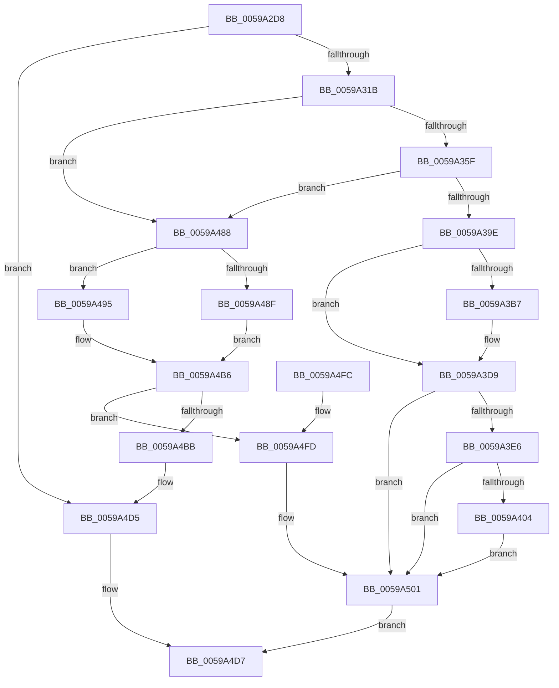

# IopLiveDumpAllocateFromVMMemoryPartition

- RVA: `0x0059A2D8`–`0x0059A506` (길이 `558` bytes)
- VA: `0x000000014059A2D8`
- 실행 섹션: `.text`
- PDB 이름 있음: `예`; PDB Function 태그: `아니요`
- unwind 정보 RVA: `0x000C7994`
- 디코드: `132`개 명령, `558/558` bytes 표시
- 미해석 바이트: `0` (있으면 어셈블리에 `.byte`로 보존)

> 이 문서는 커널 이미지의 기계어와 PDB 기호를 분석해 생성했습니다. 4번과 5번은 함수 원형과 자료형을 바이너리 사용 방식에서 추정한 C 해석이며 원본 소스 복구 결과는 아닙니다.

## 1. Dependencies

- 직접 호출 지점: **10**; 고유 호출 대상: **9**
- 직접 호출자로 확인된 함수: **1**
- RIP 상대 이미지 참조: **5**

### Outgoing calls
- `0x0059A34E` → [MmAllocatePartitionNodePagesForMdlEx](../3E/MmAllocatePartitionNodePagesForMdlEx_function_003EA960.md) (function, `0x003EA960`)
- `0x0059A38D` → [MmAllocatePartitionNodePagesForMdlEx](../3E/MmAllocatePartitionNodePagesForMdlEx_function_003EA960.md) (function, `0x003EA960`)
- `0x0059A3AA` → [IopLiveDumpIsTracingEnabled](../4F/IopLiveDumpIsTracingEnabled_function_004FC5AC.md) (function, `0x004FC5AC`)
- `0x0059A3D4` → [IopLiveDumpTrace](../5A/IopLiveDumpTrace_function_005A4070.md) (function, `0x005A4070`)
- `0x0059A3F7` → [tlgKeywordOn](../42/tlgKeywordOn_function_0042EAA0.md) (function, `0x0042EAA0`)
- `0x0059A481` → [tlgWriteTransfer_EtwWriteTransfer](../42/tlgWriteTransfer_EtwWriteTransfer_function_004260E0.md) (function, `0x004260E0`)
- `0x0059A4AE` → [MmMapLockedPagesSpecifyCache](../31/MmMapLockedPagesSpecifyCache_function_00318800.md) (function, `0x00318800`)
- `0x0059A4C6` → [MiFreePagesFromMdl](../3F/MiFreePagesFromMdl_function_003F8300.md) (function, `0x003F8300`)
- `0x0059A4D0` → [ExFreePoolWithTag](../../poolcode/B8/ExFreePoolWithTag_function_00B82870.md) (function, `0x00B82870`)
- `0x0059A4DE` → [_security_check_cookie](../6A/_security_check_cookie_function_006AC640.md) (function, `0x006AC640`)

### Direct callers
- [sub_006EB392](../6E/Unknown_function_006EB392.md) at `0x006EB43F`
- [sub_006EB392](../6E/Unknown_function_006EB392.md) at `0x006EB5AF`

### Static image references
- `0x0059A2F2` → RVA `0x00E0A740` (`.data`; read)
- `0x0059A325` → RVA `0x00E0A9D0` (`.data`; read)
- `0x0059A3CD` → RVA `0x000214E8` (`.rdata`; read)
- `0x0059A3D9` → RVA `0x00E06EA0` (`.data`; read)
- `0x0059A426` → RVA `0x00046563` (`.rdata`; read)

## 2. Other-region calls and transfers

- 다른 실행 섹션으로 향하는 call: **1**
  - `0x0059A4D0` → [ExFreePoolWithTag](../../poolcode/B8/ExFreePoolWithTag_function_00B82870.md) (`.text` → `POOLCODE`)
- 별도 외부 분기/꼬리 이동을 확인하지 못했습니다.

## 3. Assembly (complete function range)

```asm
0059A2D8  48 89 74 24 20                  mov qword ptr [rsp + 0x20], rsi
0059A2DD  55                              push rbp
0059A2DE  41 54                           push r12
0059A2E0  41 55                           push r13
0059A2E2  41 56                           push r14
0059A2E4  41 57                           push r15
0059A2E6  48 8D 6C 24 C9                  lea rbp, [rsp - 0x37]
0059A2EB  48 81 EC C0 00 00 00            sub rsp, 0xc0
0059A2F2  48 8B 05 47 04 87 00            mov rax, qword ptr [rip + 0x870447]
0059A2F9  48 33 C4                        xor rax, rsp
0059A2FC  48 89 45 27                     mov qword ptr [rbp + 0x27], rax
0059A300  45 33 FF                        xor r15d, r15d
0059A303  48 89 55 BF                     mov qword ptr [rbp - 0x41], rdx
0059A307  4D 21 38                        and qword ptr [r8], r15
0059A30A  4D 8B E0                        mov r12, r8
0059A30D  8B 41 50                        mov eax, dword ptr [rcx + 0x50]
0059A310  4C 8B E9                        mov r13, rcx
0059A313  A8 0C                           test al, 0xc
0059A315  0F 85 BA 01 00 00               jne 0x14059a4d5
0059A31B  48 8B 81 50 04 00 00            mov rax, qword ptr [rcx + 0x450]
0059A322  4C 8B CA                        mov r9, rdx
0059A325  8B 35 A5 06 87 00               mov esi, dword ptr [rip + 0x8706a5]
0059A32B  48 83 CA FF                     or rdx, 0xffffffffffffffff
0059A32F  48 89 44 24 38                  mov qword ptr [rsp + 0x38], rax
0059A334  44 8B C6                        mov r8d, esi
0059A337  C7 44 24 30 65 00 00 00         mov dword ptr [rsp + 0x30], 0x65
0059A33F  33 C9                           xor ecx, ecx
0059A341  44 21 7C 24 28                  and dword ptr [rsp + 0x28], r15d
0059A346  C7 44 24 20 01 00 00 00         mov dword ptr [rsp + 0x20], 1
0059A34E  E8 0D 06 E5 FF                  call 0x1403ea960
0059A353  4C 8B F0                        mov r14, rax
0059A356  48 85 C0                        test rax, rax
0059A359  0F 85 29 01 00 00               jne 0x14059a488
0059A35F  49 8B 85 50 04 00 00            mov rax, qword ptr [r13 + 0x450]
0059A366  44 8B C6                        mov r8d, esi
0059A369  4C 8B 4D BF                     mov r9, qword ptr [rbp - 0x41]
0059A36D  48 83 CA FF                     or rdx, 0xffffffffffffffff
0059A371  48 89 44 24 38                  mov qword ptr [rsp + 0x38], rax
0059A376  33 C9                           xor ecx, ecx
0059A378  C7 44 24 30 25 00 00 00         mov dword ptr [rsp + 0x30], 0x25
0059A380  44 21 7C 24 28                  and dword ptr [rsp + 0x28], r15d
0059A385  C7 44 24 20 01 00 00 00         mov dword ptr [rsp + 0x20], 1
0059A38D  E8 CE 05 E5 FF                  call 0x1403ea960
0059A392  4C 8B F0                        mov r14, rax
0059A395  48 85 C0                        test rax, rax
0059A398  0F 85 EA 00 00 00               jne 0x14059a488
0059A39E  41 83 4D 50 08                  or dword ptr [r13 + 0x50], 8
0059A3A3  C7 45 BF 17 00 00 C0            mov dword ptr [rbp - 0x41], 0xc0000017
0059A3AA  E8 FD 21 F6 FF                  call 0x1404fc5ac
0059A3AF  41 8D 77 04                     lea esi, [r15 + 4]
0059A3B3  84 C0                           test al, al
0059A3B5  74 22                           je 0x14059a3d9
0059A3B7  44 21 7D D3                     and dword ptr [rbp - 0x2d], r15d
0059A3BB  48 8D 45 BF                     lea rax, [rbp - 0x41]
0059A3BF  4C 8D 45 C7                     lea r8, [rbp - 0x39]
0059A3C3  48 89 45 C7                     mov qword ptr [rbp - 0x39], rax
0059A3C7  8D 56 FD                        lea edx, [rsi - 3]
0059A3CA  89 75 CF                        mov dword ptr [rbp - 0x31], esi
0059A3CD  48 8D 0D 14 71 A8 FF            lea rcx, [rip - 0x578eec]
0059A3D4  E8 97 9C 00 00                  call 0x1405a4070
0059A3D9  83 3D C0 CA 86 00 05            cmp dword ptr [rip + 0x86cac0], 5
0059A3E0  0F 86 1B 01 00 00               jbe 0x14059a501
0059A3E6  48 BA 00 00 00 00 00 40 00 00   movabs rdx, 0x400000000000
0059A3F0  48 8D 0D A9 CA 86 00            lea rcx, [rip + 0x86caa9]
0059A3F7  E8 A4 46 E9 FF                  call 0x14042eaa0
0059A3FC  84 C0                           test al, al
0059A3FE  0F 84 FD 00 00 00               je 0x14059a501
0059A404  44 21 7D 03                     and dword ptr [rbp + 3], r15d
0059A408  48 8D 45 C7                     lea rax, [rbp - 0x39]
0059A40C  44 21 7D 13                     and dword ptr [rbp + 0x13], r15d
0059A410  4D 8D 8D B8 03 00 00            lea r9, [r13 + 0x3b8]
0059A417  44 21 7D 23                     and dword ptr [rbp + 0x23], r15d
0059A41B  4D 8D 85 C8 03 00 00            lea r8, [r13 + 0x3c8]
0059A422  48 89 45 F7                     mov qword ptr [rbp - 9], rax
0059A426  48 8D 15 36 C1 AA FF            lea rdx, [rip - 0x553eca]
0059A42D  41 8B 45 50                     mov eax, dword ptr [r13 + 0x50]
0059A431  48 8D 0D 68 CA 86 00            lea rcx, [rip + 0x86ca68]
0059A438  C1 E8 03                        shr eax, 3
0059A43B  24 01                           and al, 1
0059A43D  48 C7 45 C7 00 00 00 01         mov qword ptr [rbp - 0x39], 0x1000000
0059A445  88 45 B7                        mov byte ptr [rbp - 0x49], al
0059A448  48 8D 45 B7                     lea rax, [rbp - 0x49]
0059A44C  48 89 45 07                     mov qword ptr [rbp + 7], rax
0059A450  48 8D 45 BF                     lea rax, [rbp - 0x41]
0059A454  48 89 45 17                     mov qword ptr [rbp + 0x17], rax
0059A458  48 8D 45 D7                     lea rax, [rbp - 0x29]
0059A45C  48 89 44 24 28                  mov qword ptr [rsp + 0x28], rax
0059A461  C7 44 24 20 05 00 00 00         mov dword ptr [rsp + 0x20], 5
0059A469  C7 45 FF 08 00 00 00            mov dword ptr [rbp - 1], 8
0059A470  C7 45 0F 01 00 00 00            mov dword ptr [rbp + 0xf], 1
0059A477  C7 45 BF 17 00 00 C0            mov dword ptr [rbp - 0x41], 0xc0000017
0059A47E  89 75 1F                        mov dword ptr [rbp + 0x1f], esi
0059A481  E8 5A BC E8 FF                  call 0x1404260e0
0059A486  EB 79                           jmp 0x14059a501
0059A488  41 F6 46 0A 05                  test byte ptr [r14 + 0xa], 5
0059A48D  74 06                           je 0x14059a495
0059A48F  4D 8B 7E 18                     mov r15, qword ptr [r14 + 0x18]
0059A493  EB 21                           jmp 0x14059a4b6
0059A495  45 33 C9                        xor r9d, r9d
0059A498  C7 44 24 28 20 00 00 40         mov dword ptr [rsp + 0x28], 0x40000020
0059A4A0  44 21 7C 24 20                  and dword ptr [rsp + 0x20], r15d
0059A4A5  33 D2                           xor edx, edx
0059A4A7  49 8B CE                        mov rcx, r14
0059A4AA  45 8D 41 01                     lea r8d, [r9 + 1]
0059A4AE  E8 4D E3 D7 FF                  call 0x140318800
0059A4B3  4C 8B F8                        mov r15, rax
0059A4B6  4D 85 FF                        test r15, r15
0059A4B9  75 42                           jne 0x14059a4fd
0059A4BB  45 33 C9                        xor r9d, r9d
0059A4BE  45 33 C0                        xor r8d, r8d
0059A4C1  33 D2                           xor edx, edx
0059A4C3  49 8B CE                        mov rcx, r14
0059A4C6  E8 35 DE E5 FF                  call 0x1403f8300
0059A4CB  33 D2                           xor edx, edx
0059A4CD  49 8B CE                        mov rcx, r14
0059A4D0  E8 9B 83 5E 00                  call 0x140b82870
0059A4D5  33 C0                           xor eax, eax
0059A4D7  48 8B 4D 27                     mov rcx, qword ptr [rbp + 0x27]
0059A4DB  48 33 CC                        xor rcx, rsp
0059A4DE  E8 5D 21 11 00                  call 0x1406ac640
0059A4E3  48 8B B4 24 08 01 00 00         mov rsi, qword ptr [rsp + 0x108]
0059A4EB  48 81 C4 C0 00 00 00            add rsp, 0xc0
0059A4F2  41 5F                           pop r15
0059A4F4  41 5E                           pop r14
0059A4F6  41 5D                           pop r13
0059A4F8  41 5C                           pop r12
0059A4FA  5D                              pop rbp
0059A4FB  C3                              ret
0059A4FC  CC                              int3
0059A4FD  4D 89 34 24                     mov qword ptr [r12], r14
0059A501  49 8B C7                        mov rax, r15
0059A504  EB D1                           jmp 0x14059a4d7
```

## 4. C-style interpretation (structured pseudocode)

```c
__int64 __fastcall IopLiveDumpAllocateFromVMMemoryPartition(__int64 a1, __int64 a2, __int64 a3)
{
    __int64 result;
    __int64 v_r15;
    __int64 v_rsp;
    unsigned __int64 v_stack_m38;
    unsigned int v_stack_m3C;
    unsigned int v_stack_m40;
    unsigned __int64 v_stack_m48;
    unsigned int v_stack_m4C;
    unsigned int v_stack_m50;
    unsigned __int64 v_stack_m58;
    unsigned int v_stack_m5C;
    unsigned __int64 v_stack_m5F;
    unsigned int v_stack_m60;
    unsigned __int64 v_stack_m68;
    unsigned __int64 v_stack_m88;
    unsigned int v_stack_m8C;
    unsigned int v_stack_m90;
    unsigned __int64 v_stack_m98;
    unsigned __int64 v_stack_mA0;
    unsigned __int8 v_stack_mA8;
    unsigned __int64 v_stack_mB0;
    unsigned int v_stack_mB8;
    unsigned int v_stack_mC0;
    unsigned int v_stack_mC8;
    unsigned __int64 v_stack_p20;

    v_stack_p20 = v_rsi;
    v_rsp = (v_rsp) - (192);
    result = (*(unsigned __int64 *)(v_rip + 8848455)) ^ (v_rsp);
    v_stack_m38 = result;
    v_r15 = 0;
    v_stack_mA0 = a2;
    if ((((unsigned __int8)((unsigned int)(*(unsigned int *)(a1 + 80)))) & (12)) != 0) goto loc_0059A4D5;
    a2 = (a2) | (-1);
    v_stack_mB0 = *(unsigned __int64 *)(a1 + 1104);
    v_stack_mB8 = 101;
    a1 = 0;
    v_stack_mC8 = 1;
    result = MmAllocatePartitionNodePagesForMdlEx(a1, a2, (unsigned int)((unsigned int)((unsigned int)(*(unsigned int *)(v_rip + 8849061)))), a2);
    if (result != 0) goto loc_0059A488;
    a2 = (a2) | (-1);
    v_stack_mB0 = *(unsigned __int64 *)(a1 + 1104);
    a1 = 0;
    v_stack_mB8 = 37;
    v_stack_mC8 = 1;
    result = MmAllocatePartitionNodePagesForMdlEx(a1, a2, (unsigned int)((unsigned int)((unsigned int)(*(unsigned int *)(v_rip + 8849061)))), v_stack_mA0);
    if (result != 0) goto loc_0059A488;
    v_stack_mA0 = 0xC0000017ULL;
    result = IopLiveDumpIsTracingEnabled(a1, a2, (unsigned int)((unsigned int)((unsigned int)(*(unsigned int *)(v_rip + 8849061)))), v_stack_mA0);
    if ((unsigned __int8)(result) != 0) {
        result = v_stack_mA0;
        a3 = v_stack_m98;
        v_stack_m98 = result;
        a2 = v_r15 + 4 - 3;
        v_stack_m90 = (unsigned int)(v_r15 + 4);
        a1 = v_rip - 5738220;
        result = IopLiveDumpTrace(a1, a2, a3, v_stack_mA0);
    }
    if ((*(unsigned int *)(v_rip + 8833728)) <= 5) goto loc_0059A501;
    result = tlgKeywordOn(v_rip + 8833705, a2, a3, v_stack_mA0);
    if ((unsigned __int8)(result) == 0) goto loc_0059A501;
    v_stack_m68 = v_stack_m98;
    result = (unsigned int)(((unsigned int)(*(unsigned int *)(a1 + 80))) >> (3));
    result = (unsigned __int8)((result) & (1));
    v_stack_m98 = 0x1000000ULL;
    v_stack_mA8 = (unsigned __int8)(result);
    v_stack_m58 = v_stack_mA8;
    v_stack_m48 = v_stack_mA0;
    v_stack_mC0 = v_stack_m88;
    v_stack_mC8 = 5;
    v_stack_m60 = 8;
    v_stack_m50 = 1;
    v_stack_mA0 = 0xC0000017ULL;
    v_stack_m40 = (unsigned int)(v_r15 + 4);
    result = tlgWriteTransfer_EtwWriteTransfer(v_rip + 8833640, v_rip - 5586634, a1 + 968, a1 + 952);
    goto loc_0059A501;
loc_0059A488:
    if (((*(unsigned __int8 *)(result + 10)) & (5)) == 0) goto loc_0059A495;
    goto loc_0059A4B6;
loc_0059A495:
    a4 = 0;
    v_stack_mC0 = 0x40000020ULL;
    a2 = 0;
    result = MmMapLockedPagesSpecifyCache(result, a2, a4 + 1, a4);
loc_0059A4B6:
    if (result != 0) goto loc_0059A4FD;
    a4 = 0;
    a3 = 0;
    a2 = 0;
    result = MiFreePagesFromMdl(result, a2, a3, a4);
    a2 = 0;
    result = ExFreePoolWithTag(result, a2, a3, a4);
loc_0059A4D5:
    result = 0;
loc_0059A4D7:
    a1 = (v_stack_m38) ^ (v_rsp);
    result = _security_check_cookie(a1, a2, a3, a4);
    v_rsp = (v_rsp) + (192);
    return result;
loc_0059A4FD:
    *(unsigned __int64 *)(a3) = result;
loc_0059A501:
    goto loc_0059A4D7;
}
```

## 5. (Beta) C Style

```c
int64_t IopLiveDumpAllocateFromVMMemoryPartition(void *Arg1, int64_t Arg2, void *Arg3)
{
    uint8_t *arg1 = (uint8_t *)Arg1;
    uint8_t *arg3 = (uint8_t *)Arg3;

    int64_t result;
    int64_t local_r15;
    int64_t local_rsp;
    uint64_t v_stack_m38;
    uint32_t v_stack_m3C;
    uint32_t v_stack_m40;
    uint64_t v_stack_m48;
    uint32_t v_stack_m4C;
    uint32_t v_stack_m50;
    uint64_t v_stack_m58;
    uint32_t v_stack_m5C;
    uint64_t v_stack_m5F;
    uint32_t v_stack_m60;
    uint64_t v_stack_m68;
    uint64_t v_stack_m88;
    uint32_t v_stack_m8C;
    uint32_t v_stack_m90;
    uint64_t v_stack_m98;
    uint64_t v_stack_mA0;
    uint8_t v_stack_mA8;
    uint64_t v_stack_mB0;
    uint32_t v_stack_mB8;
    uint32_t v_stack_mC0;
    uint32_t v_stack_mC8;
    uint64_t v_stack_p20;

    v_stack_p20 = local_rsi;
    local_rsp = (local_rsp) - (192);
    result = (*(uint64_t *)(v_rip + 0x870447)) ^ (local_rsp);
    v_stack_m38 = result;
    local_r15 = 0;
    v_stack_mA0 = Arg2;
    if ((((uint8_t)((uint32_t)(*(uint32_t *)(arg1 + 0x50)))) & (12)) != 0) goto loc_0059A4D5;
    Arg2 = (Arg2) | (-1);
    v_stack_mB0 = *(uint64_t *)(arg1 + 0x450);
    v_stack_mB8 = 101;
    Arg1 = 0;
    v_stack_mC8 = 1;
    result = MmAllocatePartitionNodePagesForMdlEx(Arg1, Arg2, (uint32_t)((uint32_t)((uint32_t)(*(uint32_t *)(v_rip + 0x8706A5)))), Arg2);
    if (result != 0) goto loc_0059A488;
    Arg2 = (Arg2) | (-1);
    v_stack_mB0 = *(uint64_t *)(arg1 + 0x450);
    Arg1 = 0;
    v_stack_mB8 = 37;
    v_stack_mC8 = 1;
    result = MmAllocatePartitionNodePagesForMdlEx(Arg1, Arg2, (uint32_t)((uint32_t)((uint32_t)(*(uint32_t *)(v_rip + 0x8706A5)))), v_stack_mA0);
    if (result != 0) goto loc_0059A488;
    v_stack_mA0 = 0xC0000017ULL;
    result = IopLiveDumpIsTracingEnabled(Arg1, Arg2, (uint32_t)((uint32_t)((uint32_t)(*(uint32_t *)(v_rip + 0x8706A5)))), v_stack_mA0);
    if ((uint8_t)(result) != 0) {
        result = v_stack_mA0;
        Arg3 = v_stack_m98;
        v_stack_m98 = result;
        Arg2 = local_r15 + 4 - 3;
        v_stack_m90 = (uint32_t)(local_r15 + 4);
        Arg1 = v_rip - 5738220;
        result = IopLiveDumpTrace(Arg1, Arg2, Arg3, v_stack_mA0);
    }
    if ((*(uint32_t *)(v_rip + 0x86CAC0)) <= 5) goto loc_0059A501;
    result = tlgKeywordOn(v_rip + 8833705, Arg2, Arg3, v_stack_mA0);
    if ((uint8_t)(result) == 0) goto loc_0059A501;
    v_stack_m68 = v_stack_m98;
    result = (uint32_t)(((uint32_t)(*(uint32_t *)(arg1 + 0x50))) >> (3));
    result = (uint8_t)((result) & (1));
    v_stack_m98 = 0x1000000ULL;
    v_stack_mA8 = (uint8_t)(result);
    v_stack_m58 = v_stack_mA8;
    v_stack_m48 = v_stack_mA0;
    v_stack_mC0 = v_stack_m88;
    v_stack_mC8 = 5;
    v_stack_m60 = 8;
    v_stack_m50 = 1;
    v_stack_mA0 = 0xC0000017ULL;
    v_stack_m40 = (uint32_t)(local_r15 + 4);
    result = tlgWriteTransfer_EtwWriteTransfer(v_rip + 8833640, v_rip - 5586634, Arg1 + 968, Arg1 + 952);
    goto loc_0059A501;
loc_0059A488:
    if (((*(uint8_t *)(result + 0xA)) & (5)) == 0) goto loc_0059A495;
    goto loc_0059A4B6;
loc_0059A495:
    a4 = 0;
    v_stack_mC0 = 0x40000020ULL;
    Arg2 = 0;
    result = MmMapLockedPagesSpecifyCache(result, Arg2, a4 + 1, a4);
loc_0059A4B6:
    if (result != 0) goto loc_0059A4FD;
    a4 = 0;
    Arg3 = 0;
    Arg2 = 0;
    result = MiFreePagesFromMdl(result, Arg2, Arg3, a4);
    Arg2 = 0;
    result = ExFreePoolWithTag(result, Arg2, Arg3, a4);
loc_0059A4D5:
    result = 0;
loc_0059A4D7:
    Arg1 = (v_stack_m38) ^ (local_rsp);
    result = _security_check_cookie(Arg1, Arg2, Arg3, a4);
    local_rsp = (local_rsp) + (192);
    return result;
loc_0059A4FD:
    *(uint64_t *)(arg3) = result;
loc_0059A501:
    goto loc_0059A4D7;
}
```

### 관측된 메모리 오프셋

구조체 형식이 확인되지 않은 접근은 인자 기준의 오프셋으로만 기록했습니다.

| 기준 인자 | 오프셋 표현 | 폭 (bit) | 접근 |
|---|---:|---:|---|
| `Arg1` | `+ 0x50` | `32` | `R` |
| `Arg1` | `+ 0x50` | `32` | `R/W` |
| `Arg1` | `+ 0x3B8` | `64` | `R` |
| `Arg1` | `+ 0x3C8` | `64` | `R` |
| `Arg1` | `+ 0x450` | `64` | `R` |
| `Arg3` | `+ 0x0` | `64` | `R/W` |
| `Arg3` | `+ 0x0` | `64` | `W` |

## 6. Execution-region graph

[열기: 2D/3D 그래프와 함수 탐색 컨트롤 패널](../../../control-panel.html?section=text&rva=0x0059A2D8&view=graph)

- 2D 그래프는 위에서 아래로 흐르고, 3D 그래프는 빈 공간을 드래그해 회전합니다. Shift+드래그는 이동, 휠은 확대·축소, 함수 노드 선택은 대상 보고서 이동입니다.

### Static fallback


