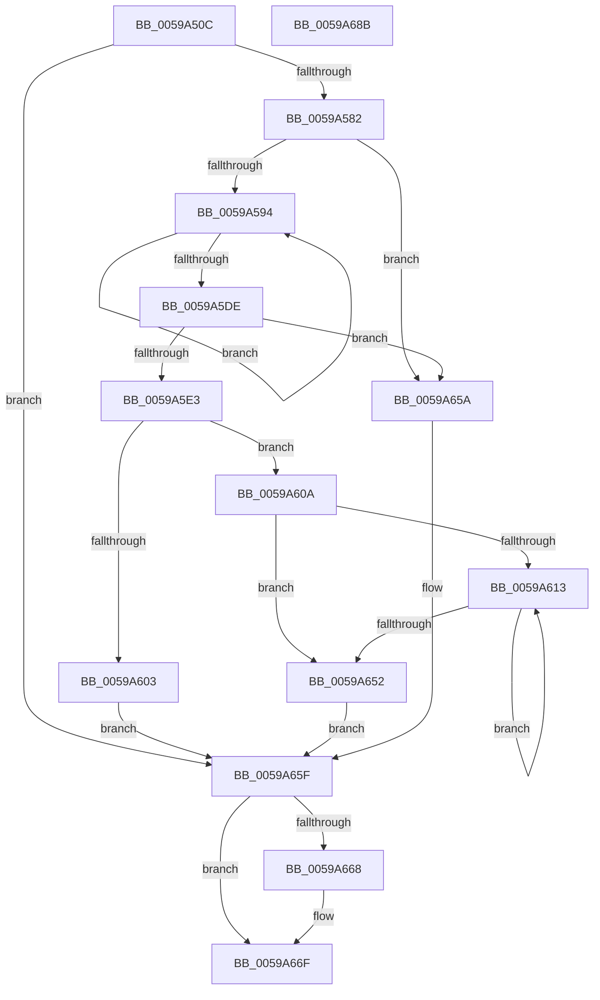

# IopLiveDumpAllocateIoSpaceRanges

- RVA: `0x0059A50C`–`0x0059A68C` (길이 `384` bytes)
- VA: `0x000000014059A50C`
- 실행 섹션: `.text`
- PDB 이름 있음: `예`; PDB Function 태그: `아니요`
- unwind 정보 RVA: `0x000991EC`
- 디코드: `102`개 명령, `384/384` bytes 표시
- 미해석 바이트: `0` (있으면 어셈블리에 `.byte`로 보존)

> 이 문서는 커널 이미지의 기계어와 PDB 기호를 분석해 생성했습니다. 4번과 5번은 함수 원형과 자료형을 바이너리 사용 방식에서 추정한 C 해석이며 원본 소스 복구 결과는 아닙니다.

## 1. Dependencies

- 직접 호출 지점: **3**; 고유 호출 대상: **3**
- 직접 호출자로 확인된 함수: **1**
- RIP 상대 이미지 참조: **0**

### Outgoing calls
- `0x0059A573` → [MmAllocateMemoryRanges](../../page/7F/MmAllocateMemoryRanges_function_007FC0C0.md) (function, `0x007FC0C0`)
- `0x0059A5F6` → [ExAllocatePool2](../../poolcode/B8/ExAllocatePool2_function_00B820F0.md) (function, `0x00B820F0`)
- `0x0059A66A` → [ExFreePoolWithTag](../../poolcode/B8/ExFreePoolWithTag_function_00B82870.md) (function, `0x00B82870`)

### Direct callers
- [IopLiveDumpAllocateFromIOSpace](IopLiveDumpAllocateFromIOSpace_function_00599DEC.md) at `0x00599ECE`

### Static image references
- 디코드된 RIP-relative 메모리 참조가 없습니다.

## 2. Other-region calls and transfers

- 다른 실행 섹션으로 향하는 call: **3**
  - `0x0059A573` → [MmAllocateMemoryRanges](../../page/7F/MmAllocateMemoryRanges_function_007FC0C0.md) (`.text` → `PAGE`)
  - `0x0059A5F6` → [ExAllocatePool2](../../poolcode/B8/ExAllocatePool2_function_00B820F0.md) (`.text` → `POOLCODE`)
  - `0x0059A66A` → [ExFreePoolWithTag](../../poolcode/B8/ExFreePoolWithTag_function_00B82870.md) (`.text` → `POOLCODE`)
- 별도 외부 분기/꼬리 이동을 확인하지 못했습니다.

## 3. Assembly (complete function range)

```asm
0059A50C  48 89 5C 24 08                  mov qword ptr [rsp + 8], rbx
0059A511  48 89 74 24 10                  mov qword ptr [rsp + 0x10], rsi
0059A516  48 89 7C 24 18                  mov qword ptr [rsp + 0x18], rdi
0059A51B  55                              push rbp
0059A51C  41 56                           push r14
0059A51E  41 57                           push r15
0059A520  48 8B EC                        mov rbp, rsp
0059A523  48 83 EC 60                     sub rsp, 0x60
0059A527  4C 8B 75 40                     mov r14, qword ptr [rbp + 0x40]
0059A52B  33 C0                           xor eax, eax
0059A52D  21 45 F4                        and dword ptr [rbp - 0xc], eax
0059A530  0F 57 C0                        xorps xmm0, xmm0
0059A533  4C 8B 7D 48                     mov r15, qword ptr [rbp + 0x48]
0059A537  83 C8 07                        or eax, 7
0059A53A  49 83 21 00                     and qword ptr [r9], 0
0059A53E  49 8B F1                        mov rsi, r9
0059A541  41 83 26 00                     and dword ptr [r14], 0
0059A545  48 89 4D C8                     mov qword ptr [rbp - 0x38], rcx
0059A549  48 8D 4D C0                     lea rcx, [rbp - 0x40]
0059A54D  49 83 27 00                     and qword ptr [r15], 0
0059A551  89 45 C4                        mov dword ptr [rbp - 0x3c], eax
0059A554  F3 0F 7F 45 E4                  movdqu xmmword ptr [rbp - 0x1c], xmm0
0059A559  C7 45 C0 01 00 00 00            mov dword ptr [rbp - 0x40], 1
0059A560  48 C7 45 D8 00 00 00 40         mov qword ptr [rbp - 0x28], 0x40000000
0059A568  C7 45 E0 00 00 00 80            mov dword ptr [rbp - 0x20], 0x80000000
0059A56F  4C 89 45 D0                     mov qword ptr [rbp - 0x30], r8
0059A573  E8 48 1B 26 00                  call 0x1407fc0c0
0059A578  8B F8                           mov edi, eax
0059A57A  85 C0                           test eax, eax
0059A57C  0F 88 DD 00 00 00               js 0x14059a65f
0059A582  4C 8B 4D E8                     mov r9, qword ptr [rbp - 0x18]
0059A586  33 DB                           xor ebx, ebx
0059A588  45 33 D2                        xor r10d, r10d
0059A58B  4D 85 C9                        test r9, r9
0059A58E  0F 84 C6 00 00 00               je 0x14059a65a
0059A594  48 8B 4D F0                     mov rcx, qword ptr [rbp - 0x10]
0059A598  48 B8 01 00 01 00 00 01 00 00   movabs rax, 0x10000010001
0059A5A2  46 8B 04 D1                     mov r8d, dword ptr [rcx + r10*8]
0059A5A6  49 FF C2                        inc r10
0059A5A9  41 81 E0 FF FF FF 3F            and r8d, 0x3fffffff
0059A5B0  49 C1 E0 1E                     shl r8, 0x1e
0059A5B4  49 81 C0 00 00 00 40            add r8, 0x40000000
0059A5BB  49 C1 E8 0C                     shr r8, 0xc
0059A5BF  49 81 C0 FE FF FF 00            add r8, 0xfffffe
0059A5C6  49 F7 E0                        mul r8
0059A5C9  4C 2B C2                        sub r8, rdx
0059A5CC  49 D1 E8                        shr r8, 1
0059A5CF  4C 03 C2                        add r8, rdx
0059A5D2  49 C1 E8 17                     shr r8, 0x17
0059A5D6  49 03 D8                        add rbx, r8
0059A5D9  4D 3B D1                        cmp r10, r9
0059A5DC  72 B6                           jb 0x14059a594
0059A5DE  48 85 DB                        test rbx, rbx
0059A5E1  74 77                           je 0x14059a65a
0059A5E3  48 8D 14 DD 00 00 00 00         lea rdx, [rbx*8]
0059A5EB  B9 40 00 00 00                  mov ecx, 0x40
0059A5F0  41 B8 4C 64 6D 70               mov r8d, 0x706d644c
0059A5F6  E8 F5 7A 5E 00                  call 0x140b820f0
0059A5FB  48 8B D0                        mov rdx, rax
0059A5FE  48 85 C0                        test rax, rax
0059A601  75 07                           jne 0x14059a60a
0059A603  BF 9A 00 00 C0                  mov edi, 0xc000009a
0059A608  EB 55                           jmp 0x14059a65f
0059A60A  45 33 C0                        xor r8d, r8d
0059A60D  4C 39 45 E8                     cmp qword ptr [rbp - 0x18], r8
0059A611  76 3F                           jbe 0x14059a652
0059A613  48 8B 45 F0                     mov rax, qword ptr [rbp - 0x10]
0059A617  49 B9 00 00 FC FF FF FF 0F 00   movabs r9, 0xffffffffc0000
0059A621  4A 8B 0C C0                     mov rcx, qword ptr [rax + r8*8]
0059A625  48 8B C1                        mov rax, rcx
0059A628  48 C1 E9 0C                     shr rcx, 0xc
0059A62C  25 FF FF FF 3F                  and eax, 0x3fffffff
0059A631  49 23 C9                        and rcx, r9
0059A634  48 FF C0                        inc rax
0059A637  48 C1 E0 12                     shl rax, 0x12
0059A63B  49 01 07                        add qword ptr [r15], rax
0059A63E  48 C1 E0 28                     shl rax, 0x28
0059A642  48 0B C8                        or rcx, rax
0059A645  4A 89 0C C2                     mov qword ptr [rdx + r8*8], rcx
0059A649  49 FF C0                        inc r8
0059A64C  4C 3B 45 E8                     cmp r8, qword ptr [rbp - 0x18]
0059A650  72 C1                           jb 0x14059a613
0059A652  48 89 16                        mov qword ptr [rsi], rdx
0059A655  41 89 1E                        mov dword ptr [r14], ebx
0059A658  EB 05                           jmp 0x14059a65f
0059A65A  BF 01 00 00 C0                  mov edi, 0xc0000001
0059A65F  48 8B 4D F0                     mov rcx, qword ptr [rbp - 0x10]
0059A663  48 85 C9                        test rcx, rcx
0059A666  74 07                           je 0x14059a66f
0059A668  33 D2                           xor edx, edx
0059A66A  E8 01 82 5E 00                  call 0x140b82870
0059A66F  4C 8D 5C 24 60                  lea r11, [rsp + 0x60]
0059A674  8B C7                           mov eax, edi
0059A676  49 8B 5B 20                     mov rbx, qword ptr [r11 + 0x20]
0059A67A  49 8B 73 28                     mov rsi, qword ptr [r11 + 0x28]
0059A67E  49 8B 7B 30                     mov rdi, qword ptr [r11 + 0x30]
0059A682  49 8B E3                        mov rsp, r11
0059A685  41 5F                           pop r15
0059A687  41 5E                           pop r14
0059A689  5D                              pop rbp
0059A68A  C3                              ret
0059A68B  CC                              int3
```

## 4. C-style interpretation (structured pseudocode)

```c
__int64 __fastcall IopLiveDumpAllocateIoSpaceRanges(__int64 a1, __int64 a2, __int64 a3, __int64 a4, __int64 a5, __int64 a6)
{
    __int64 result;
    __int64 v_r10;
    __int64 v_rbx;
    __int64 v_rsp;
    unsigned __int64 v_stack_m18;
    unsigned int v_stack_m24;
    unsigned __int64 v_stack_m28;
    unsigned __int64 v_stack_m30;
    unsigned __int64 v_stack_m34;
    unsigned int v_stack_m38;
    unsigned __int64 v_stack_m40;
    unsigned __int64 v_stack_m48;
    unsigned __int64 v_stack_m50;
    unsigned int v_stack_m54;
    unsigned __int64 v_stack_m58;
    unsigned __int64 v_stack_p10;
    unsigned __int64 v_stack_p18;
    unsigned __int64 v_stack_p8;

    v_stack_p8 = v_rbx;
    v_stack_p10 = v_rsi;
    v_stack_p18 = v_rdi;
    v_rsp = (v_rsp) - (96);
    result = 0;
    result = (unsigned int)((result) | (7));
    v_stack_m50 = a1;
    v_stack_m54 = (unsigned int)(result);
    v_stack_m34 = v_xmm0;
    v_stack_m58 = 1;
    v_stack_m40 = 0x40000000ULL;
    v_stack_m38 = 0x80000000ULL;
    v_stack_m48 = a3;
    result = MmAllocateMemoryRanges(v_stack_m58, a2, a3, a4);
    if (sign_flag) goto loc_0059A65F;
    v_rbx = 0;
    v_r10 = 0;
    if (v_stack_m30 == 0) goto loc_0059A65A;
loc_0059A594:
    v_r10 = (v_r10) + 1;
    a3 = (unsigned int)(((unsigned int)(*(unsigned int *)(v_stack_m28 + v_r10 * 8))) & (0x3FFFFFFFULL));
    a3 = (a3) << (30);
    a3 = (a3) + (0x40000000ULL);
    a3 = (a3) >> (12);
    a3 = (a3) + (0xFFFFFEULL);
    a3 = (a3) - (a2);
    a3 = (a3) >> (1);
    a3 = (a3) + (a2);
    a3 = (a3) >> (23);
    v_rbx = (v_rbx) + (a3);
    if (v_r10 < v_stack_m30) goto loc_0059A594;
    if (v_rbx == 0) goto loc_0059A65A;
    result = ExAllocatePool2(64, v_rbx * 8, (unsigned int)(0x706D644CULL), v_stack_m30);
    if (result != 0) goto loc_0059A60A;
    goto loc_0059A65F;
loc_0059A60A:
    a3 = 0;
    if (v_stack_m30 <= 0) goto loc_0059A652;
loc_0059A613:
    a1 = (*(unsigned __int64 *)(v_stack_m28 + a3 * 8)) >> (12);
    result = (unsigned int)((*(unsigned __int64 *)(v_stack_m28 + a3 * 8)) & (0x3FFFFFFFULL));
    a1 = (a1) & (v_stack_m30);
    result = (result) + 1;
    result = (result) << (18);
    result = (result) << (40);
    a1 = (a1) | (result);
    *(unsigned __int64 *)(result + a3 * 8) = a1;
    a3 = (a3) + 1;
    if (a3 < v_stack_m30) goto loc_0059A613;
loc_0059A652:
    *(unsigned __int64 *)(a4) = result;
    *(unsigned int *)(a5) = (unsigned int)(v_rbx);
    goto loc_0059A65F;
loc_0059A65A:
loc_0059A65F:
    if (v_stack_m28 != 0) {
        a2 = 0;
        result = ExFreePoolWithTag(v_stack_m28, a2, a3, v_stack_m30);
    }
    return (unsigned int)((unsigned int)((unsigned int)(0xC0000001ULL)));
}
```

## 5. (Beta) C Style

```c
int64_t IopLiveDumpAllocateIoSpaceRanges(int64_t Arg1, int64_t Arg2, int64_t Arg3, void *Arg4, void *Arg5, void *Arg6)
{
    uint8_t *arg4 = (uint8_t *)Arg4;
    uint8_t *arg5 = (uint8_t *)Arg5;
    uint8_t *arg6 = (uint8_t *)Arg6;

    int64_t result;
    int64_t local_r10;
    int64_t local_rbx;
    int64_t local_rsp;
    uint64_t v_stack_m18;
    uint32_t v_stack_m24;
    uint64_t v_stack_m28;
    uint64_t v_stack_m30;
    uint64_t v_stack_m34;
    uint32_t v_stack_m38;
    uint64_t v_stack_m40;
    uint64_t v_stack_m48;
    uint64_t v_stack_m50;
    uint32_t v_stack_m54;
    uint64_t v_stack_m58;
    uint64_t v_stack_p10;
    uint64_t v_stack_p18;
    uint64_t v_stack_p8;

    v_stack_p8 = local_rbx;
    v_stack_p10 = local_rsi;
    v_stack_p18 = local_rdi;
    local_rsp = (local_rsp) - (96);
    result = 0;
    result = (uint32_t)((result) | (7));
    v_stack_m50 = Arg1;
    v_stack_m54 = (uint32_t)(result);
    v_stack_m34 = v_xmm0;
    v_stack_m58 = 1;
    v_stack_m40 = 0x40000000ULL;
    v_stack_m38 = 0x80000000ULL;
    v_stack_m48 = Arg3;
    result = MmAllocateMemoryRanges(v_stack_m58, Arg2, Arg3, Arg4);
    if (sign_flag) goto loc_0059A65F;
    local_rbx = 0;
    local_r10 = 0;
    if (v_stack_m30 == 0) goto loc_0059A65A;
loc_0059A594:
    local_r10 = (local_r10) + 1;
    Arg3 = (uint32_t)(((uint32_t)(*(uint32_t *)(v_stack_m28 + local_r10 * 8))) & (0x3FFFFFFFULL));
    Arg3 = (Arg3) << (30);
    Arg3 = (Arg3) + (0x40000000ULL);
    Arg3 = (Arg3) >> (12);
    Arg3 = (Arg3) + (0xFFFFFEULL);
    Arg3 = (Arg3) - (Arg2);
    Arg3 = (Arg3) >> (1);
    Arg3 = (Arg3) + (Arg2);
    Arg3 = (Arg3) >> (23);
    local_rbx = (local_rbx) + (Arg3);
    if (local_r10 < v_stack_m30) goto loc_0059A594;
    if (local_rbx == 0) goto loc_0059A65A;
    result = ExAllocatePool2(64, local_rbx * 8, (uint32_t)(0x706D644CULL), v_stack_m30);
    if (result != 0) goto loc_0059A60A;
    goto loc_0059A65F;
loc_0059A60A:
    Arg3 = 0;
    if (v_stack_m30 <= 0) goto loc_0059A652;
loc_0059A613:
    Arg1 = (*(uint64_t *)(v_stack_m28 + Arg3 * 8)) >> (12);
    result = (uint32_t)((*(uint64_t *)(v_stack_m28 + Arg3 * 8)) & (0x3FFFFFFFULL));
    Arg1 = (Arg1) & (v_stack_m30);
    result = (result) + 1;
    result = (result) << (18);
    result = (result) << (40);
    Arg1 = (Arg1) | (result);
    *(uint64_t *)(result + Arg3 * 8) = Arg1;
    Arg3 = (Arg3) + 1;
    if (Arg3 < v_stack_m30) goto loc_0059A613;
loc_0059A652:
    *(uint64_t *)(arg4) = result;
    *(uint32_t *)(arg5) = (uint32_t)(local_rbx);
    goto loc_0059A65F;
loc_0059A65A:
loc_0059A65F:
    if (v_stack_m28 != 0) {
        Arg2 = 0;
        result = ExFreePoolWithTag(v_stack_m28, Arg2, Arg3, v_stack_m30);
    }
    return (uint32_t)((uint32_t)((uint32_t)(0xC0000001ULL)));
}
```

### 관측된 메모리 오프셋

구조체 형식이 확인되지 않은 접근은 인자 기준의 오프셋으로만 기록했습니다.

| 기준 인자 | 오프셋 표현 | 폭 (bit) | 접근 |
|---|---:|---:|---|
| `Arg4` | `+ 0x0` | `64` | `R/W` |
| `Arg4` | `+ 0x0` | `64` | `W` |
| `Arg5` | `+ 0x0` | `32` | `R/W` |
| `Arg5` | `+ 0x0` | `32` | `W` |
| `Arg6` | `+ 0x0` | `64` | `R/W` |

## 6. Execution-region graph

[열기: 2D/3D 그래프와 함수 탐색 컨트롤 패널](../../../control-panel.html?section=text&rva=0x0059A50C&view=graph)

- 2D 그래프는 위에서 아래로 흐르고, 3D 그래프는 빈 공간을 드래그해 회전합니다. Shift+드래그는 이동, 휠은 확대·축소, 함수 노드 선택은 대상 보고서 이동입니다.

### Static fallback


