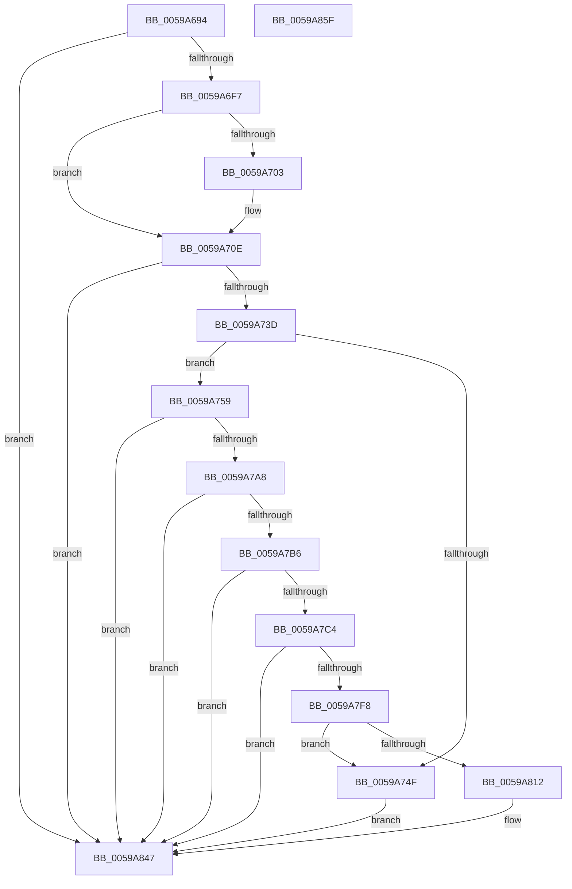

# IopLiveDumpAllocateIptBuffers

- RVA: `0x0059A694`–`0x0059A860` (길이 `460` bytes)
- VA: `0x000000014059A694`
- 실행 섹션: `.text`
- PDB 이름 있음: `예`; PDB Function 태그: `아니요`
- unwind 정보 RVA: `0x000BCAF8`
- 디코드: `104`개 명령, `460/460` bytes 표시
- 미해석 바이트: `0` (있으면 어셈블리에 `.byte`로 보존)

> 이 문서는 커널 이미지의 기계어와 PDB 기호를 분석해 생성했습니다. 4번과 5번은 함수 원형과 자료형을 바이너리 사용 방식에서 추정한 C 해석이며 원본 소스 복구 결과는 아닙니다.

## 1. Dependencies

- 직접 호출 지점: **12**; 고유 호출 대상: **5**
- 직접 호출자로 확인된 함수: **1**
- RIP 상대 이미지 참조: **1**

### Outgoing calls
- `0x0059A6E4` → [guard_dispatch_icall](../6B/guard_dispatch_icall_function_006BAAD0.md) (function, `0x006BAAD0`)
- `0x0059A709` → [IopLiveDumpDiscardVirtualAddressRange](../29/IopLiveDumpDiscardVirtualAddressRange_function_002977F4.md) (function, `0x002977F4`)
- `0x0059A72C` → [MmAllocateIndependentPages](../../page/AA/MmAllocateIndependentPages_function_00AA0CE0.md) (function, `0x00AA0CE0`)
- `0x0059A746` → [IopLiveDumpIsUnderMemoryPressure](../3F/IopLiveDumpIsUnderMemoryPressure_function_003F5EB8.md) (function, `0x003F5EB8`)
- `0x0059A775` → [IopLiveDumpDiscardVirtualAddressRange](../29/IopLiveDumpDiscardVirtualAddressRange_function_002977F4.md) (function, `0x002977F4`)
- `0x0059A786` → [memset](../6C/memset_function_006C6C40.md) (function, `0x006C6C40`)
- `0x0059A79B` → [guard_dispatch_icall](../6B/guard_dispatch_icall_function_006BAAD0.md) (function, `0x006BAAD0`)
- `0x0059A7C7` → [IopLiveDumpDiscardVirtualAddressRange](../29/IopLiveDumpDiscardVirtualAddressRange_function_002977F4.md) (function, `0x002977F4`)
- `0x0059A7E7` → [MmAllocateIndependentPages](../../page/AA/MmAllocateIndependentPages_function_00AA0CE0.md) (function, `0x00AA0CE0`)
- `0x0059A805` → [IopLiveDumpIsUnderMemoryPressure](../3F/IopLiveDumpIsUnderMemoryPressure_function_003F5EB8.md) (function, `0x003F5EB8`)
- `0x0059A82D` → [IopLiveDumpDiscardVirtualAddressRange](../29/IopLiveDumpDiscardVirtualAddressRange_function_002977F4.md) (function, `0x002977F4`)
- `0x0059A842` → [memset](../6C/memset_function_006C6C40.md) (function, `0x006C6C40`)

### Direct callers
- [IopLiveDumpAllocAndInitResources](IopLiveDumpAllocAndInitResources_function_005993B0.md) at `0x00599789`

### Static image references
- `0x0059A6CD` → RVA `0x00E66178` (`.data`; read)

## 2. Other-region calls and transfers

- 다른 실행 섹션으로 향하는 call: **2**
  - `0x0059A72C` → [MmAllocateIndependentPages](../../page/AA/MmAllocateIndependentPages_function_00AA0CE0.md) (`.text` → `PAGE`)
  - `0x0059A7E7` → [MmAllocateIndependentPages](../../page/AA/MmAllocateIndependentPages_function_00AA0CE0.md) (`.text` → `PAGE`)
- 별도 외부 분기/꼬리 이동을 확인하지 못했습니다.

## 3. Assembly (complete function range)

```asm
0059A694  48 8B C4                        mov rax, rsp
0059A697  48 89 58 08                     mov qword ptr [rax + 8], rbx
0059A69B  48 89 70 10                     mov qword ptr [rax + 0x10], rsi
0059A69F  48 89 78 18                     mov qword ptr [rax + 0x18], rdi
0059A6A3  41 56                           push r14
0059A6A5  48 83 EC 40                     sub rsp, 0x40
0059A6A9  33 DB                           xor ebx, ebx
0059A6AB  C7 81 24 04 00 00 00 00 00 10   mov dword ptr [rcx + 0x424], 0x10000000
0059A6B5  4C 8D B1 18 04 00 00            lea r14, [rcx + 0x418]
0059A6BC  48 89 99 38 04 00 00            mov qword ptr [rcx + 0x438], rbx
0059A6C3  0F 57 C0                        xorps xmm0, xmm0
0059A6C6  48 8B F9                        mov rdi, rcx
0059A6C9  0F 11 40 E8                     movups xmmword ptr [rax - 0x18], xmm0
0059A6CD  48 8B 05 A4 BA 8C 00            mov rax, qword ptr [rip + 0x8cbaa4]
0059A6D4  44 8D 4B 30                     lea r9d, [rbx + 0x30]
0059A6D8  4D 8B C6                        mov r8, r14
0059A6DB  8D 4B 02                        lea ecx, [rbx + 2]
0059A6DE  33 D2                           xor edx, edx
0059A6E0  48 8B 40 28                     mov rax, qword ptr [rax + 0x28]
0059A6E4  E8 E7 03 12 00                  call 0x1406baad0
0059A6E9  8B 87 40 04 00 00               mov eax, dword ptr [rdi + 0x440]
0059A6EF  85 C0                           test eax, eax
0059A6F1  0F 84 50 01 00 00               je 0x14059a847
0059A6F7  48 8B 97 38 04 00 00            mov rdx, qword ptr [rdi + 0x438]
0059A6FE  48 85 D2                        test rdx, rdx
0059A701  74 0B                           je 0x14059a70e
0059A703  44 8B C0                        mov r8d, eax
0059A706  48 8B CF                        mov rcx, rdi
0059A709  E8 E6 D0 CF FF                  call 0x1402977f4
0059A70E  8B B7 40 04 00 00               mov esi, dword ptr [rdi + 0x440]
0059A714  83 CA FF                        or edx, 0xffffffff
0059A717  8B CE                           mov ecx, esi
0059A719  48 89 9F 38 04 00 00            mov qword ptr [rdi + 0x438], rbx
0059A720  89 9F 40 04 00 00               mov dword ptr [rdi + 0x440], ebx
0059A726  89 9F 20 04 00 00               mov dword ptr [rdi + 0x420], ebx
0059A72C  E8 AF 65 50 00                  call 0x140aa0ce0
0059A731  49 89 06                        mov qword ptr [r14], rax
0059A734  48 85 C0                        test rax, rax
0059A737  0F 84 0A 01 00 00               je 0x14059a847
0059A73D  48 8B CF                        mov rcx, rdi
0059A740  89 B7 20 04 00 00               mov dword ptr [rdi + 0x420], esi
0059A746  E8 6D B7 E5 FF                  call 0x1403f5eb8
0059A74B  84 C0                           test al, al
0059A74D  74 0A                           je 0x14059a759
0059A74F  BB 40 02 00 C0                  mov ebx, 0xc0000240
0059A754  E9 EE 00 00 00                  jmp 0x14059a847
0059A759  44 8B 87 20 04 00 00            mov r8d, dword ptr [rdi + 0x420]
0059A760  BE FF 0F 00 00                  mov esi, 0xfff
0059A765  49 8B 16                        mov rdx, qword ptr [r14]
0059A768  4C 03 C6                        add r8, rsi
0059A76B  49 81 E0 00 F0 FF FF            and r8, 0xfffffffffffff000
0059A772  48 8B CF                        mov rcx, rdi
0059A775  E8 7A D0 CF FF                  call 0x1402977f4
0059A77A  44 8B 87 20 04 00 00            mov r8d, dword ptr [rdi + 0x420]
0059A781  33 D2                           xor edx, edx
0059A783  49 8B 0E                        mov rcx, qword ptr [r14]
0059A786  E8 B5 C4 12 00                  call 0x1406c6c40
0059A78B  48 8B 05 E6 B9 8C 00            mov rax, qword ptr [rip + 0x8cb9e6]
0059A792  48 8D 4C 24 30                  lea rcx, [rsp + 0x30]
0059A797  48 8B 40 18                     mov rax, qword ptr [rax + 0x18]
0059A79B  E8 30 03 12 00                  call 0x1406baad0
0059A7A0  85 C0                           test eax, eax
0059A7A2  0F 88 9F 00 00 00               js 0x14059a847
0059A7A8  48 8B 54 24 30                  mov rdx, qword ptr [rsp + 0x30]
0059A7AD  48 85 D2                        test rdx, rdx
0059A7B0  0F 84 91 00 00 00               je 0x14059a847
0059A7B6  4C 8B 44 24 38                  mov r8, qword ptr [rsp + 0x38]
0059A7BB  4D 85 C0                        test r8, r8
0059A7BE  0F 84 83 00 00 00               je 0x14059a847
0059A7C4  48 8B CF                        mov rcx, rdi
0059A7C7  E8 28 D0 CF FF                  call 0x1402977f4
0059A7CC  48 8B 4C 24 38                  mov rcx, qword ptr [rsp + 0x38]
0059A7D1  83 CA FF                        or edx, 0xffffffff
0059A7D4  48 89 9F 08 04 00 00            mov qword ptr [rdi + 0x408], rbx
0059A7DB  89 9F 10 04 00 00               mov dword ptr [rdi + 0x410], ebx
0059A7E1  89 9F F0 03 00 00               mov dword ptr [rdi + 0x3f0], ebx
0059A7E7  E8 F4 64 50 00                  call 0x140aa0ce0
0059A7EC  48 89 87 E8 03 00 00            mov qword ptr [rdi + 0x3e8], rax
0059A7F3  48 85 C0                        test rax, rax
0059A7F6  74 4F                           je 0x14059a847
0059A7F8  8B 44 24 38                     mov eax, dword ptr [rsp + 0x38]
0059A7FC  48 8B CF                        mov rcx, rdi
0059A7FF  89 87 F0 03 00 00               mov dword ptr [rdi + 0x3f0], eax
0059A805  E8 AE B6 E5 FF                  call 0x1403f5eb8
0059A80A  84 C0                           test al, al
0059A80C  0F 85 3D FF FF FF               jne 0x14059a74f
0059A812  44 8B 87 F0 03 00 00            mov r8d, dword ptr [rdi + 0x3f0]
0059A819  48 8B CF                        mov rcx, rdi
0059A81C  48 8B 97 E8 03 00 00            mov rdx, qword ptr [rdi + 0x3e8]
0059A823  4C 03 C6                        add r8, rsi
0059A826  49 81 E0 00 F0 FF FF            and r8, 0xfffffffffffff000
0059A82D  E8 C2 CF CF FF                  call 0x1402977f4
0059A832  44 8B 87 F0 03 00 00            mov r8d, dword ptr [rdi + 0x3f0]
0059A839  33 D2                           xor edx, edx
0059A83B  48 8B 8F E8 03 00 00            mov rcx, qword ptr [rdi + 0x3e8]
0059A842  E8 F9 C3 12 00                  call 0x1406c6c40
0059A847  48 8B 74 24 58                  mov rsi, qword ptr [rsp + 0x58]
0059A84C  8B C3                           mov eax, ebx
0059A84E  48 8B 5C 24 50                  mov rbx, qword ptr [rsp + 0x50]
0059A853  48 8B 7C 24 60                  mov rdi, qword ptr [rsp + 0x60]
0059A858  48 83 C4 40                     add rsp, 0x40
0059A85C  41 5E                           pop r14
0059A85E  C3                              ret
0059A85F  CC                              int3
```

## 4. C-style interpretation (structured pseudocode)

```c
__int64 __fastcall IopLiveDumpAllocateIptBuffers(__int64 a1, int a2)
{
    __int64 result;
    __int64 v_rbx;
    __int64 v_rsp;
    unsigned __int64 v_stack_m10;
    unsigned __int64 v_stack_m18;
    unsigned __int64 v_stack_p10;
    unsigned __int64 v_stack_p18;
    unsigned __int64 v_stack_p8;

    *(unsigned __int64 *)(v_rsp + 8) = v_rbx;
    *(unsigned __int64 *)(v_rsp + 16) = v_rsi;
    *(unsigned __int64 *)(v_rsp + 24) = v_rdi;
    v_rsp = (v_rsp) - (64);
    v_rbx = 0;
    *(unsigned int *)(a1 + 1060) = 0x10000000ULL;
    *(unsigned __int64 *)(a1 + 1080) = 0;
    *(unsigned __int64 *)(v_rsp - 24) = v_xmm0;
    a2 = 0;
    result = guard_dispatch_icall(v_rbx + 2, a2, a1 + 1048, v_rbx + 48);
    if ((unsigned int)((unsigned int)(*(unsigned int *)(a1 + 1088))) == 0) goto loc_0059A847;
    result = (unsigned int)(*(unsigned int *)(a1 + 1088));
    if (*(unsigned __int64 *)(a1 + 1080) != 0) {
        a3 = (unsigned int)((unsigned int)(*(unsigned int *)(a1 + 1088)));
        a1 = a1;
        result = IopLiveDumpDiscardVirtualAddressRange(a1, *(unsigned __int64 *)(a1 + 1080), a3, v_rbx + 48);
    }
    a2 = (unsigned int)((*(unsigned __int64 *)(a1 + 1080)) | (0xFFFFFFFFULL));
    *(unsigned __int64 *)(a1 + 1080) = 0;
    *(unsigned int *)(a1 + 1088) = 0;
    *(unsigned int *)(a1 + 1056) = 0;
    result = MmAllocateIndependentPages((unsigned int)((unsigned int)((unsigned int)(*(unsigned int *)(a1 + 1088)))), a2, a3, v_rbx + 48);
    *(unsigned __int64 *)(a1 + 1048) = result;
    if (result == 0) goto loc_0059A847;
    *(unsigned int *)(a1 + 1056) = (unsigned int)((unsigned int)(*(unsigned int *)(a1 + 1088)));
    result = IopLiveDumpIsUnderMemoryPressure(a1, a2, a3, v_rbx + 48);
    if ((unsigned __int8)(result) == 0) goto loc_0059A759;
loc_0059A74F:
    goto loc_0059A847;
loc_0059A759:
    a3 = ((unsigned int)(*(unsigned int *)(a1 + 1056))) + ((unsigned int)(0xFFFULL));
    a3 = (a3) & (0xFFFFFFFFFFFFF000ULL);
    result = IopLiveDumpDiscardVirtualAddressRange(a1, *(unsigned __int64 *)(a1 + 1048), a3, v_rbx + 48);
    a2 = 0;
    result = memset(*(unsigned __int64 *)(a1 + 1048), a2, (unsigned int)(*(unsigned int *)(a1 + 1056)), v_rbx + 48);
    result = guard_dispatch_icall(v_stack_m18, a2, (unsigned int)(*(unsigned int *)(a1 + 1056)), v_rbx + 48);
    if (sign_flag) goto loc_0059A847;
    if (v_stack_m18 == 0) goto loc_0059A847;
    if (v_stack_m10 == 0) goto loc_0059A847;
    result = IopLiveDumpDiscardVirtualAddressRange(a1, v_stack_m18, v_stack_m10, v_rbx + 48);
    a2 = (unsigned int)((v_stack_m18) | (0xFFFFFFFFULL));
    *(unsigned __int64 *)(a1 + 1032) = (unsigned int)(0xC0000240ULL);
    *(unsigned int *)(a1 + 1040) = (unsigned int)((unsigned int)(0xC0000240ULL));
    *(unsigned int *)(a1 + 1008) = (unsigned int)((unsigned int)(0xC0000240ULL));
    result = MmAllocateIndependentPages(v_stack_m10, a2, v_stack_m10, v_rbx + 48);
    *(unsigned __int64 *)(a1 + 1000) = result;
    if (result == 0) goto loc_0059A847;
    *(unsigned int *)(a1 + 1008) = (unsigned int)((unsigned int)(v_stack_m10));
    result = IopLiveDumpIsUnderMemoryPressure(a1, a2, v_stack_m10, v_rbx + 48);
    if ((unsigned __int8)(result) != 0) goto loc_0059A74F;
    a3 = ((unsigned int)(*(unsigned int *)(a1 + 1008))) + ((unsigned int)(0xFFFULL));
    a3 = (a3) & (0xFFFFFFFFFFFFF000ULL);
    result = IopLiveDumpDiscardVirtualAddressRange(a1, *(unsigned __int64 *)(a1 + 1000), a3, v_rbx + 48);
    a2 = 0;
    result = memset(*(unsigned __int64 *)(a1 + 1000), a2, (unsigned int)(*(unsigned int *)(a1 + 1008)), v_rbx + 48);
loc_0059A847:
    v_rsp = (v_rsp) + (64);
    return (unsigned int)((unsigned int)((unsigned int)(0xC0000240ULL)));
}
```

## 5. (Beta) C Style

```c
int64_t IopLiveDumpAllocateIptBuffers(void *Arg1, int32_t Arg2)
{
    uint8_t *arg1 = (uint8_t *)Arg1;

    int64_t result;
    int64_t local_rbx;
    int64_t local_rsp;
    uint64_t v_stack_m10;
    uint64_t v_stack_m18;
    uint64_t v_stack_p10;
    uint64_t v_stack_p18;
    uint64_t v_stack_p8;

    *(uint64_t *)(local_rsp + 0x8) = local_rbx;
    *(uint64_t *)(local_rsp + 0x10) = local_rsi;
    *(uint64_t *)(local_rsp + 0x18) = local_rdi;
    local_rsp = (local_rsp) - (64);
    local_rbx = 0;
    *(uint32_t *)(arg1 + 0x424) = 0x10000000ULL;
    *(uint64_t *)(arg1 + 0x438) = 0;
    *(uint64_t *)(local_rsp - 0x18) = v_xmm0;
    Arg2 = 0;
    result = guard_dispatch_icall(local_rbx + 2, Arg2, Arg1 + 1048, local_rbx + 48);
    if ((uint32_t)((uint32_t)(*(uint32_t *)(arg1 + 0x440))) == 0) goto loc_0059A847;
    result = (uint32_t)(*(uint32_t *)(arg1 + 0x440));
    if (*(uint64_t *)(arg1 + 0x438) != 0) {
        a3 = (uint32_t)((uint32_t)(*(uint32_t *)(arg1 + 0x440)));
        Arg1 = Arg1;
        result = IopLiveDumpDiscardVirtualAddressRange(Arg1, *(uint64_t *)(arg1 + 0x438), a3, local_rbx + 48);
    }
    Arg2 = (uint32_t)((*(uint64_t *)(arg1 + 0x438)) | (0xFFFFFFFFULL));
    *(uint64_t *)(arg1 + 0x438) = 0;
    *(uint32_t *)(arg1 + 0x440) = 0;
    *(uint32_t *)(arg1 + 0x420) = 0;
    result = MmAllocateIndependentPages((uint32_t)((uint32_t)((uint32_t)(*(uint32_t *)(arg1 + 0x440)))), Arg2, a3, local_rbx + 48);
    *(uint64_t *)(arg1 + 0x418) = result;
    if (result == 0) goto loc_0059A847;
    *(uint32_t *)(arg1 + 0x420) = (uint32_t)((uint32_t)(*(uint32_t *)(arg1 + 0x440)));
    result = IopLiveDumpIsUnderMemoryPressure(Arg1, Arg2, a3, local_rbx + 48);
    if ((uint8_t)(result) == 0) goto loc_0059A759;
loc_0059A74F:
    goto loc_0059A847;
loc_0059A759:
    a3 = ((uint32_t)(*(uint32_t *)(arg1 + 0x420))) + ((uint32_t)(0xFFFULL));
    a3 = (a3) & (0xFFFFFFFFFFFFF000ULL);
    result = IopLiveDumpDiscardVirtualAddressRange(Arg1, *(uint64_t *)(arg1 + 0x418), a3, local_rbx + 48);
    Arg2 = 0;
    result = memset(*(uint64_t *)(arg1 + 0x418), Arg2, (uint32_t)(*(uint32_t *)(arg1 + 0x420)), local_rbx + 48);
    result = guard_dispatch_icall(v_stack_m18, Arg2, (uint32_t)(*(uint32_t *)(arg1 + 0x420)), local_rbx + 48);
    if (sign_flag) goto loc_0059A847;
    if (v_stack_m18 == 0) goto loc_0059A847;
    if (v_stack_m10 == 0) goto loc_0059A847;
    result = IopLiveDumpDiscardVirtualAddressRange(Arg1, v_stack_m18, v_stack_m10, local_rbx + 48);
    Arg2 = (uint32_t)((v_stack_m18) | (0xFFFFFFFFULL));
    *(uint64_t *)(arg1 + 0x408) = (uint32_t)(0xC0000240ULL);
    *(uint32_t *)(arg1 + 0x410) = (uint32_t)((uint32_t)(0xC0000240ULL));
    *(uint32_t *)(arg1 + 0x3F0) = (uint32_t)((uint32_t)(0xC0000240ULL));
    result = MmAllocateIndependentPages(v_stack_m10, Arg2, v_stack_m10, local_rbx + 48);
    *(uint64_t *)(arg1 + 0x3E8) = result;
    if (result == 0) goto loc_0059A847;
    *(uint32_t *)(arg1 + 0x3F0) = (uint32_t)((uint32_t)(v_stack_m10));
    result = IopLiveDumpIsUnderMemoryPressure(Arg1, Arg2, v_stack_m10, local_rbx + 48);
    if ((uint8_t)(result) != 0) goto loc_0059A74F;
    a3 = ((uint32_t)(*(uint32_t *)(arg1 + 0x3F0))) + ((uint32_t)(0xFFFULL));
    a3 = (a3) & (0xFFFFFFFFFFFFF000ULL);
    result = IopLiveDumpDiscardVirtualAddressRange(Arg1, *(uint64_t *)(arg1 + 0x3E8), a3, local_rbx + 48);
    Arg2 = 0;
    result = memset(*(uint64_t *)(arg1 + 0x3E8), Arg2, (uint32_t)(*(uint32_t *)(arg1 + 0x3F0)), local_rbx + 48);
loc_0059A847:
    local_rsp = (local_rsp) + (64);
    return (uint32_t)((uint32_t)((uint32_t)(0xC0000240ULL)));
}
```

### 관측된 메모리 오프셋

구조체 형식이 확인되지 않은 접근은 인자 기준의 오프셋으로만 기록했습니다.

| 기준 인자 | 오프셋 표현 | 폭 (bit) | 접근 |
|---|---:|---:|---|
| `Arg1` | `+ 0x0` | `64` | `R` |
| `Arg1` | `+ 0x0` | `64` | `W` |
| `Arg1` | `+ 0x3E8` | `64` | `R` |
| `Arg1` | `+ 0x3E8` | `64` | `W` |
| `Arg1` | `+ 0x3F0` | `32` | `R` |
| `Arg1` | `+ 0x3F0` | `32` | `W` |
| `Arg1` | `+ 0x408` | `64` | `W` |
| `Arg1` | `+ 0x410` | `32` | `W` |
| `Arg1` | `+ 0x418` | `64` | `R` |
| `Arg1` | `+ 0x420` | `32` | `R` |
| `Arg1` | `+ 0x420` | `32` | `W` |
| `Arg1` | `+ 0x424` | `32` | `W` |
| `Arg1` | `+ 0x438` | `64` | `R` |
| `Arg1` | `+ 0x438` | `64` | `W` |
| `Arg1` | `+ 0x440` | `32` | `R` |
| `Arg1` | `+ 0x440` | `32` | `W` |

## 6. Execution-region graph

[열기: 2D/3D 그래프와 함수 탐색 컨트롤 패널](../../../control-panel.html?section=text&rva=0x0059A694&view=graph)

- 2D 그래프는 위에서 아래로 흐르고, 3D 그래프는 빈 공간을 드래그해 회전합니다. Shift+드래그는 이동, 휠은 확대·축소, 함수 노드 선택은 대상 보고서 이동입니다.

### Static fallback


