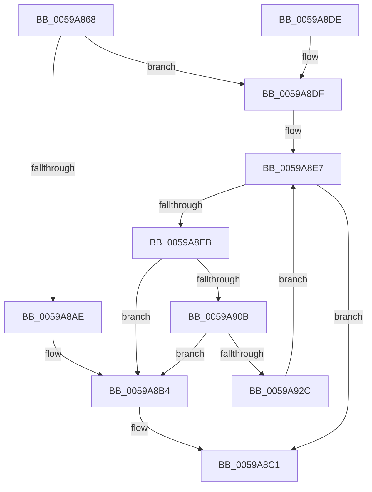

# IopLiveDumpAllocateMappingResources

- RVA: `0x0059A868`–`0x0059A930` (길이 `200` bytes)
- VA: `0x000000014059A868`
- 실행 섹션: `.text`
- PDB 이름 있음: `예`; PDB Function 태그: `아니요`
- unwind 정보 RVA: `0x000C7ABC`
- 디코드: `54`개 명령, `200/200` bytes 표시
- 미해석 바이트: `0` (있으면 어셈블리에 `.byte`로 보존)

> 이 문서는 커널 이미지의 기계어와 PDB 기호를 분석해 생성했습니다. 4번과 5번은 함수 원형과 자료형을 바이너리 사용 방식에서 추정한 C 해석이며 원본 소스 복구 결과는 아닙니다.

## 1. Dependencies

- 직접 호출 지점: **4**; 고유 호출 대상: **4**
- 직접 호출자로 확인된 함수: **1**
- RIP 상대 이미지 참조: **1**

### Outgoing calls
- `0x0059A89B` → [ExAllocatePool2](../../poolcode/B8/ExAllocatePool2_function_00B820F0.md) (function, `0x00B820F0`)
- `0x0059A8BC` → [IopLiveDumpFreeMappingResources](IopLiveDumpFreeMappingResources_function_0059BFE0.md) (function, `0x0059BFE0`)
- `0x0059A8FE` → [MmAllocateDumpHibernateResources](../../page/AB/MmAllocateDumpHibernateResources_function_00AB3B4C.md) (function, `0x00AB3B4C`)
- `0x0059A91E` → [IoAllocateMdl](../29/IoAllocateMdl_function_0029EBF0.md) (function, `0x0029EBF0`)

### Direct callers
- [IopLiveDumpAllocAndInitResources](IopLiveDumpAllocAndInitResources_function_005993B0.md) at `0x00599730`

### Static image references
- `0x0059A881` → RVA `0x00FC6A80` (`ALMOSTRO`; read)

## 2. Other-region calls and transfers

- 다른 실행 섹션으로 향하는 call: **2**
  - `0x0059A89B` → [ExAllocatePool2](../../poolcode/B8/ExAllocatePool2_function_00B820F0.md) (`.text` → `POOLCODE`)
  - `0x0059A8FE` → [MmAllocateDumpHibernateResources](../../page/AB/MmAllocateDumpHibernateResources_function_00AB3B4C.md) (`.text` → `PAGE`)
- 별도 외부 분기/꼬리 이동을 확인하지 못했습니다.

## 3. Assembly (complete function range)

```asm
0059A868  48 8B C4                        mov rax, rsp
0059A86B  48 89 58 08                     mov qword ptr [rax + 8], rbx
0059A86F  48 89 68 10                     mov qword ptr [rax + 0x10], rbp
0059A873  48 89 70 18                     mov qword ptr [rax + 0x18], rsi
0059A877  48 89 78 20                     mov qword ptr [rax + 0x20], rdi
0059A87B  41 56                           push r14
0059A87D  48 83 EC 30                     sub rsp, 0x30
0059A881  8B 2D F9 C1 A2 00               mov ebp, dword ptr [rip + 0xa2c1f9]
0059A887  48 8B F9                        mov rdi, rcx
0059A88A  8B D5                           mov edx, ebp
0059A88C  B9 40 00 00 00                  mov ecx, 0x40
0059A891  48 C1 E2 04                     shl rdx, 4
0059A895  41 B8 4C 64 6D 70               mov r8d, 0x706d644c
0059A89B  E8 50 78 5E 00                  call 0x140b820f0
0059A8A0  33 DB                           xor ebx, ebx
0059A8A2  48 89 87 80 03 00 00            mov qword ptr [rdi + 0x380], rax
0059A8A9  48 85 C0                        test rax, rax
0059A8AC  75 31                           jne 0x14059a8df
0059A8AE  89 9F 78 03 00 00               mov dword ptr [rdi + 0x378], ebx
0059A8B4  BB 9A 00 00 C0                  mov ebx, 0xc000009a
0059A8B9  48 8B CF                        mov rcx, rdi
0059A8BC  E8 1F 17 00 00                  call 0x14059bfe0
0059A8C1  48 8B 6C 24 48                  mov rbp, qword ptr [rsp + 0x48]
0059A8C6  8B C3                           mov eax, ebx
0059A8C8  48 8B 5C 24 40                  mov rbx, qword ptr [rsp + 0x40]
0059A8CD  48 8B 74 24 50                  mov rsi, qword ptr [rsp + 0x50]
0059A8D2  48 8B 7C 24 58                  mov rdi, qword ptr [rsp + 0x58]
0059A8D7  48 83 C4 30                     add rsp, 0x30
0059A8DB  41 5E                           pop r14
0059A8DD  C3                              ret
0059A8DE  CC                              int3
0059A8DF  89 AF 78 03 00 00               mov dword ptr [rdi + 0x378], ebp
0059A8E5  8B F3                           mov esi, ebx
0059A8E7  3B F5                           cmp esi, ebp
0059A8E9  73 D6                           jae 0x14059a8c1
0059A8EB  44 8B F6                        mov r14d, esi
0059A8EE  B9 00 00 01 00                  mov ecx, 0x10000
0059A8F3  49 C1 E6 04                     shl r14, 4
0059A8F7  4C 03 B7 80 03 00 00            add r14, qword ptr [rdi + 0x380]
0059A8FE  E8 49 92 51 00                  call 0x140ab3b4c
0059A903  49 89 06                        mov qword ptr [r14], rax
0059A906  48 85 C0                        test rax, rax
0059A909  74 A9                           je 0x14059a8b4
0059A90B  45 33 C9                        xor r9d, r9d
0059A90E  48 89 5C 24 20                  mov qword ptr [rsp + 0x20], rbx
0059A913  45 33 C0                        xor r8d, r8d
0059A916  BA 00 00 01 00                  mov edx, 0x10000
0059A91B  48 8B C8                        mov rcx, rax
0059A91E  E8 CD 42 D0 FF                  call 0x14029ebf0
0059A923  49 89 46 08                     mov qword ptr [r14 + 8], rax
0059A927  48 85 C0                        test rax, rax
0059A92A  74 88                           je 0x14059a8b4
0059A92C  FF C6                           inc esi
0059A92E  EB B7                           jmp 0x14059a8e7
```

## 4. C-style interpretation (structured pseudocode)

```c
__int64 __fastcall IopLiveDumpAllocateMappingResources(__int64 a1, __int64 a2, __int64 a3, int a4)
{
    __int64 result;
    __int64 v_r14;
    __int64 v_rbx;
    __int64 v_rsi;
    __int64 v_rsp;
    unsigned __int64 v_stack_p10;
    unsigned __int64 v_stack_p18;
    unsigned __int64 v_stack_p20;
    unsigned __int64 v_stack_p8;

    *(unsigned __int64 *)(v_rsp + 8) = v_rbx;
    *(unsigned __int64 *)(v_rsp + 16) = v_rbp;
    *(unsigned __int64 *)(v_rsp + 24) = v_rsi;
    *(unsigned __int64 *)(v_rsp + 32) = v_rdi;
    v_rsp = (v_rsp) - (48);
    a2 = ((unsigned int)((unsigned int)((unsigned int)(*(unsigned int *)(v_rip + 10666489))))) << (4);
    result = ExAllocatePool2(64, a2, (unsigned int)(0x706D644CULL), a4);
    v_rbx = 0;
    *(unsigned __int64 *)(a1 + 896) = result;
    if (result != 0) goto loc_0059A8DF;
    *(unsigned int *)(a1 + 888) = 0;
loc_0059A8B4:
    result = IopLiveDumpFreeMappingResources(a1, a2, (unsigned int)(0x706D644CULL), a4);
loc_0059A8C1:
    v_rsp = (v_rsp) + (48);
    return (unsigned int)((unsigned int)((unsigned int)(0xC000009AULL)));
loc_0059A8DF:
    *(unsigned int *)(v_stack_p20 + 888) = (unsigned int)(v_stack_p10);
loc_0059A8E7:
    if (((unsigned int)((unsigned int)((unsigned int)(v_stack_p8)))) >= ((unsigned int)(v_stack_p10))) goto loc_0059A8C1;
    v_r14 = ((unsigned int)((unsigned int)((unsigned int)((unsigned int)(v_stack_p8))))) << (4);
    v_r14 = (v_r14) + (*(unsigned __int64 *)(v_stack_p20 + 896));
    result = MmAllocateDumpHibernateResources((unsigned int)(0x10000ULL), a2, (unsigned int)(0x706D644CULL), a4);
    *(unsigned __int64 *)(v_r14) = result;
    if (result == 0) goto loc_0059A8B4;
    a4 = 0;
    v_stack_p20 = v_stack_p8;
    a3 = 0;
    result = IoAllocateMdl(result, (unsigned int)(0x10000ULL), a3, a4);
    *(unsigned __int64 *)(v_r14 + 8) = result;
    if (result == 0) goto loc_0059A8B4;
    v_rsi = (unsigned int)(((unsigned int)((unsigned int)(v_stack_p8))) + 1);
    goto loc_0059A8E7;
}
```

## 5. (Beta) C Style

```c
int64_t IopLiveDumpAllocateMappingResources(void *Arg1, int64_t Arg2, int64_t Arg3, int32_t Arg4)
{
    uint8_t *arg1 = (uint8_t *)Arg1;

    int64_t result;
    int64_t local_r14;
    int64_t local_rbx;
    int64_t local_rsi;
    int64_t local_rsp;
    uint64_t v_stack_p10;
    uint64_t v_stack_p18;
    uint64_t v_stack_p20;
    uint64_t v_stack_p8;

    *(uint64_t *)(local_rsp + 0x8) = local_rbx;
    *(uint64_t *)(local_rsp + 0x10) = local_rbp;
    *(uint64_t *)(local_rsp + 0x18) = local_rsi;
    *(uint64_t *)(local_rsp + 0x20) = local_rdi;
    local_rsp = (local_rsp) - (48);
    Arg2 = ((uint32_t)((uint32_t)((uint32_t)(*(uint32_t *)(v_rip + 0xA2C1F9))))) << (4);
    result = ExAllocatePool2(64, Arg2, (uint32_t)(0x706D644CULL), Arg4);
    local_rbx = 0;
    *(uint64_t *)(arg1 + 0x380) = result;
    if (result != 0) goto loc_0059A8DF;
    *(uint32_t *)(arg1 + 0x378) = 0;
loc_0059A8B4:
    result = IopLiveDumpFreeMappingResources(Arg1, Arg2, (uint32_t)(0x706D644CULL), Arg4);
loc_0059A8C1:
    local_rsp = (local_rsp) + (48);
    return (uint32_t)((uint32_t)((uint32_t)(0xC000009AULL)));
loc_0059A8DF:
    *(uint32_t *)(v_stack_p20 + 0x378) = (uint32_t)(v_stack_p10);
loc_0059A8E7:
    if (((uint32_t)((uint32_t)((uint32_t)(v_stack_p8)))) >= ((uint32_t)(v_stack_p10))) goto loc_0059A8C1;
    local_r14 = ((uint32_t)((uint32_t)((uint32_t)((uint32_t)(v_stack_p8))))) << (4);
    local_r14 = (local_r14) + (*(uint64_t *)(v_stack_p20 + 0x380));
    result = MmAllocateDumpHibernateResources((uint32_t)(0x10000ULL), Arg2, (uint32_t)(0x706D644CULL), Arg4);
    *(uint64_t *)(local_r14) = result;
    if (result == 0) goto loc_0059A8B4;
    Arg4 = 0;
    v_stack_p20 = v_stack_p8;
    Arg3 = 0;
    result = IoAllocateMdl(result, (uint32_t)(0x10000ULL), Arg3, Arg4);
    *(uint64_t *)(local_r14 + 0x8) = result;
    if (result == 0) goto loc_0059A8B4;
    local_rsi = (uint32_t)(((uint32_t)((uint32_t)(v_stack_p8))) + 1);
    goto loc_0059A8E7;
}
```

### 관측된 메모리 오프셋

구조체 형식이 확인되지 않은 접근은 인자 기준의 오프셋으로만 기록했습니다.

| 기준 인자 | 오프셋 표현 | 폭 (bit) | 접근 |
|---|---:|---:|---|
| `Arg1` | `+ 0x378` | `32` | `W` |
| `Arg1` | `+ 0x380` | `64` | `R` |
| `Arg1` | `+ 0x380` | `64` | `W` |

## 6. Execution-region graph

[열기: 2D/3D 그래프와 함수 탐색 컨트롤 패널](../../../control-panel.html?section=text&rva=0x0059A868&view=graph)

- 2D 그래프는 위에서 아래로 흐르고, 3D 그래프는 빈 공간을 드래그해 회전합니다. Shift+드래그는 이동, 휠은 확대·축소, 함수 노드 선택은 대상 보고서 이동입니다.

### Static fallback


