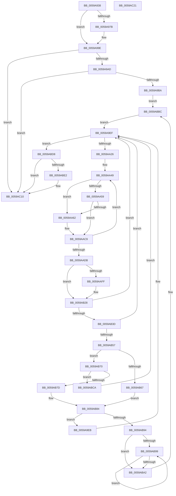

# IopLiveDumpBufferDumpData

- RVA: `0x0059A938`–`0x0059AC22` (길이 `746` bytes)
- VA: `0x000000014059A938`
- 실행 섹션: `.text`
- PDB 이름 있음: `예`; PDB Function 태그: `아니요`
- unwind 정보 RVA: `0x00085920`
- 디코드: `198`개 명령, `746/746` bytes 표시
- 미해석 바이트: `0` (있으면 어셈블리에 `.byte`로 보존)

> 이 문서는 커널 이미지의 기계어와 PDB 기호를 분석해 생성했습니다. 4번과 5번은 함수 원형과 자료형을 바이너리 사용 방식에서 추정한 C 해석이며 원본 소스 복구 결과는 아닙니다.

## 1. Dependencies

- 직접 호출 지점: **10**; 고유 호출 대상: **8**
- 직접 호출자로 확인된 함수: **1**
- RIP 상대 이미지 참조: **4**

### Outgoing calls
- `0x0059A999` → [IopLiveDumpTraceEventGeneric](../5A/IopLiveDumpTraceEventGeneric_function_005A41E4.md) (function, `0x005A41E4`)
- `0x0059AA14` → [IopLiveDumpGetCapturePages](IopLiveDumpGetCapturePages_function_0059C254.md) (function, `0x0059C254`)
- `0x0059AA9B` → [MmMapMemoryDumpMdlEx](../67/MmMapMemoryDumpMdlEx_function_0067DD30.md) (function, `0x0067DD30`)
- `0x0059AAF4` → [IopLiveDumpShouldCheckChunkCRC](../3F/IopLiveDumpShouldCheckChunkCRC_function_003F67B0.md) (function, `0x003F67B0`)
- `0x0059AB18` → [RtlpComputeCrcInternal](../45/RtlpComputeCrcInternal_function_0045A800.md) (function, `0x0045A800`)
- `0x0059AB43` → [IopLiveDumpIsChunkInIOSpace](IopLiveDumpIsChunkInIOSpace_function_0059CAFC.md) (function, `0x0059CAFC`)
- `0x0059AB5E` → [IopLiveDumpIsChunkInIOSpaceBuffer](IopLiveDumpIsChunkInIOSpaceBuffer_function_0059CB38.md) (function, `0x0059CB38`)
- `0x0059AB74` → [IopLiveDumpIsChunkInIOSpaceBuffer](IopLiveDumpIsChunkInIOSpaceBuffer_function_0059CB38.md) (function, `0x0059CB38`)
- `0x0059ABB0` → [MmProtectMdlSystemAddress](../22/MmProtectMdlSystemAddress_function_00227B50.md) (function, `0x00227B50`)
- `0x0059AC0B` → [IopLiveDumpTraceEventGeneric](../5A/IopLiveDumpTraceEventGeneric_function_005A41E4.md) (function, `0x005A41E4`)

### Direct callers
- [IopLiveDumpProcessCorralStateChange](../47/IopLiveDumpProcessCorralStateChange_function_00471C7C.md) at `0x00471DC8`

### Static image references
- `0x0059A95F` → RVA `0x006CAA80` (` ?? ::FNODOBFM::`string'`; read)
- `0x0059A992` → RVA `0x006CAB70` (` ?? ::FNODOBFM::`string'`; read)
- `0x0059AB03` → RVA `0x0000B640` (`.rdata`; read)
- `0x0059ABFE` → RVA `0x006CABB0` (` ?? ::FNODOBFM::`string'`; read)

## 2. Other-region calls and transfers

- 다른 실행 섹션으로 향하는 call: **0**
- 별도 외부 분기/꼬리 이동을 확인하지 못했습니다.

## 3. Assembly (complete function range)

```asm
0059A938  48 89 54 24 10                  mov qword ptr [rsp + 0x10], rdx
0059A93D  55                              push rbp
0059A93E  53                              push rbx
0059A93F  56                              push rsi
0059A940  57                              push rdi
0059A941  41 54                           push r12
0059A943  41 55                           push r13
0059A945  41 56                           push r14
0059A947  41 57                           push r15
0059A949  48 8B EC                        mov rbp, rsp
0059A94C  48 83 EC 78                     sub rsp, 0x78
0059A950  4C 8B 31                        mov r14, qword ptr [rcx]
0059A953  33 C0                           xor eax, eax
0059A955  48 8B FA                        mov rdi, rdx
0059A958  48 89 45 C8                     mov qword ptr [rbp - 0x38], rax
0059A95C  89 45 48                        mov dword ptr [rbp + 0x48], eax
0059A95F  48 8D 0D 1A 01 13 00            lea rcx, [rip + 0x13011a]
0059A966  4C 89 75 E0                     mov qword ptr [rbp - 0x20], r14
0059A96A  41 F7 46 50 00 00 02 00         test dword ptr [r14 + 0x50], 0x20000
0059A972  4D 8D AE A8 02 00 00            lea r13, [r14 + 0x2a8]
0059A979  74 23                           je 0x14059a99e
0059A97B  8B 02                           mov eax, dword ptr [rdx]
0059A97D  4C 8D 4D 58                     lea r9, [rbp + 0x58]
0059A981  48 89 4D 60                     mov qword ptr [rbp + 0x60], rcx
0059A985  4C 8D 45 60                     lea r8, [rbp + 0x60]
0059A989  BA 01 00 00 00                  mov edx, 1
0059A98E  48 89 45 58                     mov qword ptr [rbp + 0x58], rax
0059A992  48 8D 0D D7 01 13 00            lea rcx, [rip + 0x1301d7]
0059A999  E8 46 98 00 00                  call 0x1405a41e4
0059A99E  8B 07                           mov eax, dword ptr [rdi]
0059A9A0  41 3B 86 78 03 00 00            cmp eax, dword ptr [r14 + 0x378]
0059A9A7  0F 83 63 02 00 00               jae 0x14059ac10
0059A9AD  41 3B 86 58 04 00 00            cmp eax, dword ptr [r14 + 0x458]
0059A9B4  0F 83 56 02 00 00               jae 0x14059ac10
0059A9BA  8B C8                           mov ecx, eax
0059A9BC  49 8B 86 60 04 00 00            mov rax, qword ptr [r14 + 0x460]
0059A9C3  48 8B 1C C8                     mov rbx, qword ptr [rax + rcx*8]
0059A9C7  48 C1 E1 04                     shl rcx, 4
0059A9CB  49 03 8E 80 03 00 00            add rcx, qword ptr [r14 + 0x380]
0059A9D2  48 89 5D F0                     mov qword ptr [rbp - 0x10], rbx
0059A9D6  48 89 4D D8                     mov qword ptr [rbp - 0x28], rcx
0059A9DA  48 8B 71 08                     mov rsi, qword ptr [rcx + 8]
0059A9DE  48 83 C6 30                     add rsi, 0x30
0059A9E2  48 89 75 60                     mov qword ptr [rbp + 0x60], rsi
0059A9E6  E9 D1 01 00 00                  jmp 0x14059abbc
0059A9EB  48 8B 75 60                     mov rsi, qword ptr [rbp + 0x60]
0059A9EF  41 8B 46 50                     mov eax, dword ptr [r14 + 0x50]
0059A9F3  4C 8B C3                        mov r8, rbx
0059A9F6  C1 E8 11                        shr eax, 0x11
0059A9F9  49 8B D5                        mov rdx, r13
0059A9FC  24 01                           and al, 1
0059A9FE  88 44 24 30                     mov byte ptr [rsp + 0x30], al
0059AA02  48 8D 45 C8                     lea rax, [rbp - 0x38]
0059AA06  48 89 44 24 28                  mov qword ptr [rsp + 0x28], rax
0059AA0B  48 8D 45 48                     lea rax, [rbp + 0x48]
0059AA0F  48 89 44 24 20                  mov qword ptr [rsp + 0x20], rax
0059AA14  E8 3B 18 00 00                  call 0x14059c254
0059AA19  44 8B 65 48                     mov r12d, dword ptr [rbp + 0x48]
0059AA1D  45 85 E4                        test r12d, r12d
0059AA20  0F 84 B2 01 00 00               je 0x14059abd8
0059AA26  4C 8B 7D C8                     mov r15, qword ptr [rbp - 0x38]
0059AA2A  8B D7                           mov edx, edi
0059AA2C  49 8B 45 48                     mov rax, qword ptr [r13 + 0x48]
0059AA30  4C 8B F3                        mov r14, rbx
0059AA33  4C 8B 6D D8                     mov r13, qword ptr [rbp - 0x28]
0059AA37  4C 89 7D E8                     mov qword ptr [rbp - 0x18], r15
0059AA3B  89 7D 58                        mov dword ptr [rbp + 0x58], edi
0059AA3E  4A 8B 0C F8                     mov rcx, qword ptr [rax + r15*8]
0059AA42  45 33 FF                        xor r15d, r15d
0059AA45  48 89 4D D0                     mov qword ptr [rbp - 0x30], rcx
0059AA49  49 8B 06                        mov rax, qword ptr [r14]
0059AA4C  8B CA                           mov ecx, edx
0059AA4E  FF C2                           inc edx
0059AA50  48 89 04 CE                     mov qword ptr [rsi + rcx*8], rax
0059AA54  83 FA 10                        cmp edx, 0x10
0059AA57  74 09                           je 0x14059aa62
0059AA59  41 8D 44 24 FF                  lea eax, [r12 - 1]
0059AA5E  3B F8                           cmp edi, eax
0059AA60  75 67                           jne 0x14059aac9
0059AA62  49 8B 4D 08                     mov rcx, qword ptr [r13 + 8]
0059AA66  8B C2                           mov eax, edx
0059AA68  C1 E0 0C                        shl eax, 0xc
0059AA6B  45 33 C9                        xor r9d, r9d
0059AA6E  8B D8                           mov ebx, eax
0059AA70  48 C1 E8 0C                     shr rax, 0xc
0059AA74  4C 89 39                        mov qword ptr [rcx], r15
0059AA77  66 83 C0 06                     add ax, 6
0059AA7B  66 44 89 79 0A                  mov word ptr [rcx + 0xa], r15w
0059AA80  4C 89 79 20                     mov qword ptr [rcx + 0x20], r15
0059AA84  44 89 79 2C                     mov dword ptr [rcx + 0x2c], r15d
0059AA88  89 59 28                        mov dword ptr [rcx + 0x28], ebx
0059AA8B  66 C1 E0 03                     shl ax, 3
0059AA8F  66 89 41 08                     mov word ptr [rcx + 8], ax
0059AA93  4D 8B 45 08                     mov r8, qword ptr [r13 + 8]
0059AA97  49 8B 4D 00                     mov rcx, qword ptr [r13]
0059AA9B  E8 90 32 0E 00                  call 0x14067dd30
0059AAA0  49 8B 45 08                     mov rax, qword ptr [r13 + 8]
0059AAA4  8B CB                           mov ecx, ebx
0059AAA6  4C 8B 45 D0                     mov r8, qword ptr [rbp - 0x30]
0059AAAA  41 8B D7                        mov edx, r15d
0059AAAD  48 C1 E9 02                     shr rcx, 2
0059AAB1  49 8B F8                        mov rdi, r8
0059AAB4  4C 03 C3                        add r8, rbx
0059AAB7  48 8B 70 18                     mov rsi, qword ptr [rax + 0x18]
0059AABB  90                              nop
0059AABC  F3 A5                           rep movsd dword ptr [rdi], dword ptr [rsi]
0059AABE  8B 7D 58                        mov edi, dword ptr [rbp + 0x58]
0059AAC1  48 8B 75 60                     mov rsi, qword ptr [rbp + 0x60]
0059AAC5  4C 89 45 D0                     mov qword ptr [rbp - 0x30], r8
0059AAC9  FF C7                           inc edi
0059AACB  49 83 C6 08                     add r14, 8
0059AACF  89 7D 58                        mov dword ptr [rbp + 0x58], edi
0059AAD2  41 3B FC                        cmp edi, r12d
0059AAD5  0F 82 6E FF FF FF               jb 0x14059aa49
0059AADB  4C 8B 75 E0                     mov r14, qword ptr [rbp - 0x20]
0059AADF  4C 8B 7D E8                     mov r15, qword ptr [rbp - 0x18]
0059AAE3  48 8B 5D F0                     mov rbx, qword ptr [rbp - 0x10]
0059AAE7  49 8B D7                        mov rdx, r15
0059AAEA  4D 8D AE A8 02 00 00            lea r13, [r14 + 0x2a8]
0059AAF1  49 8B CD                        mov rcx, r13
0059AAF4  E8 B7 BC E5 FF                  call 0x1403f67b0
0059AAF9  33 FF                           xor edi, edi
0059AAFB  84 C0                           test al, al
0059AAFD  74 29                           je 0x14059ab28
0059AAFF  49 8B 45 48                     mov rax, qword ptr [r13 + 0x48]
0059AB03  4C 8D 0D 36 0B A7 FF            lea r9, [rip - 0x58f4ca]
0059AB0A  41 C1 E4 0C                     shl r12d, 0xc
0059AB0E  45 33 C0                        xor r8d, r8d
0059AB11  41 8B D4                        mov edx, r12d
0059AB14  4A 8B 0C F8                     mov rcx, qword ptr [rax + r15*8]
0059AB18  E8 E3 FC EB FF                  call 0x14045a800
0059AB1D  49 8B 8D C8 00 00 00            mov rcx, qword ptr [r13 + 0xc8]
0059AB24  4A 89 04 F9                     mov qword ptr [rcx + r15*8], rax
0059AB28  41 F7 46 50 00 00 08 00         test dword ptr [r14 + 0x50], 0x80000
0059AB30  49 8D 8E 20 02 00 00            lea rcx, [r14 + 0x220]
0059AB37  0F 84 B2 FE FF FF               je 0x14059a9ef
0059AB3D  49 8B D7                        mov rdx, r15
0059AB40  49 8B CD                        mov rcx, r13
0059AB43  E8 B4 1F 00 00                  call 0x14059cafc
0059AB48  49 8D 8E 20 02 00 00            lea rcx, [r14 + 0x220]
0059AB4F  85 C0                           test eax, eax
0059AB51  0F 84 98 FE FF FF               je 0x14059a9ef
0059AB57  49 8D 8D A0 00 00 00            lea rcx, [r13 + 0xa0]
0059AB5E  E8 D5 1F 00 00                  call 0x14059cb38
0059AB63  85 C0                           test eax, eax
0059AB65  74 09                           je 0x14059ab70
0059AB67  49 8B B5 B0 00 00 00            mov rsi, qword ptr [r13 + 0xb0]
0059AB6E  EB 14                           jmp 0x14059ab84
0059AB70  49 8D 4D 78                     lea rcx, [r13 + 0x78]
0059AB74  E8 BF 1F 00 00                  call 0x14059cb38
0059AB79  85 C0                           test eax, eax
0059AB7B  74 4D                           je 0x14059abca
0059AB7D  49 8B B5 88 00 00 00            mov rsi, qword ptr [r13 + 0x88]
0059AB84  49 8D 8E 20 02 00 00            lea rcx, [r14 + 0x220]
0059AB8B  48 85 F6                        test rsi, rsi
0059AB8E  0F 84 57 FE FF FF               je 0x14059a9eb
0059AB94  4D 85 FF                        test r15, r15
0059AB97  74 09                           je 0x14059aba2
0059AB99  48 8B 36                        mov rsi, qword ptr [rsi]
0059AB9C  49 83 EF 01                     sub r15, 1
0059ABA0  75 F7                           jne 0x14059ab99
0059ABA2  48 8B 3E                        mov rdi, qword ptr [rsi]
0059ABA5  33 C0                           xor eax, eax
0059ABA7  48 8B CE                        mov rcx, rsi
0059ABAA  48 89 06                        mov qword ptr [rsi], rax
0059ABAD  8D 50 02                        lea edx, [rax + 2]
0059ABB0  E8 9B CF C8 FF                  call 0x140227b50
0059ABB5  48 89 3E                        mov qword ptr [rsi], rdi
0059ABB8  48 8B 75 60                     mov rsi, qword ptr [rbp + 0x60]
0059ABBC  49 8D 8E 20 02 00 00            lea rcx, [r14 + 0x220]
0059ABC3  33 FF                           xor edi, edi
0059ABC5  E9 25 FE FF FF                  jmp 0x14059a9ef
0059ABCA  CD 2C                           int 0x2c
0059ABCC  49 8D 8E 20 02 00 00            lea rcx, [r14 + 0x220]
0059ABD3  E9 17 FE FF FF                  jmp 0x14059a9ef
0059ABD8  41 F7 46 50 00 00 02 00         test dword ptr [r14 + 0x50], 0x20000
0059ABE0  74 2E                           je 0x14059ac10
0059ABE2  48 8D 05 97 FE 12 00            lea rax, [rip + 0x12fe97]
0059ABE9  BA 01 00 00 00                  mov edx, 1
0059ABEE  48 89 45 48                     mov qword ptr [rbp + 0x48], rax
0059ABF2  4C 8D 4D 50                     lea r9, [rbp + 0x50]
0059ABF6  48 8B 45 50                     mov rax, qword ptr [rbp + 0x50]
0059ABFA  4C 8D 45 48                     lea r8, [rbp + 0x48]
0059ABFE  48 8D 0D AB FF 12 00            lea rcx, [rip + 0x12ffab]
0059AC05  8B 00                           mov eax, dword ptr [rax]
0059AC07  48 89 45 50                     mov qword ptr [rbp + 0x50], rax
0059AC0B  E8 D4 95 00 00                  call 0x1405a41e4
0059AC10  48 83 C4 78                     add rsp, 0x78
0059AC14  41 5F                           pop r15
0059AC16  41 5E                           pop r14
0059AC18  41 5D                           pop r13
0059AC1A  41 5C                           pop r12
0059AC1C  5F                              pop rdi
0059AC1D  5E                              pop rsi
0059AC1E  5B                              pop rbx
0059AC1F  5D                              pop rbp
0059AC20  C3                              ret
0059AC21  CC                              int3
```

## 4. C-style interpretation (structured pseudocode)

```c
__int64 __fastcall IopLiveDumpBufferDumpData(__int64 a1, __int64 a2)
{
    __int64 result;
    __int64 v_r12;
    __int64 v_r14;
    __int64 v_r15;
    __int64 v_rbx;
    __int64 v_rdi;
    __int64 v_rsi;
    __int64 v_rsp;
    unsigned __int64 v_stack_m50;
    unsigned __int64 v_stack_m58;
    unsigned __int64 v_stack_m60;
    unsigned __int64 v_stack_m68;
    unsigned __int64 v_stack_m70;
    unsigned __int64 v_stack_m78;
    unsigned __int8 v_stack_m88;
    unsigned __int64 v_stack_m90;
    unsigned __int64 v_stack_m98;
    unsigned __int64 v_stack_p10;
    unsigned __int64 v_stack_p18;
    unsigned __int64 v_stack_p20;
    unsigned int v_stack_p8;

    v_stack_p10 = a2;
    v_rsp = (v_rsp) - (120);
    result = 0;
    v_stack_m78 = 0;
    v_stack_p8 = 0;
    v_stack_m60 = *(unsigned __int64 *)(a1);
    if (((*(unsigned int *)(*(unsigned __int64 *)(a1) + 80)) & (0x20000ULL)) != 0) {
        result = *(unsigned int *)(a2);
        a4 = v_stack_p18;
        v_stack_p20 = v_rip + 1245466;
        a3 = v_stack_p20;
        a2 = 1;
        v_stack_p18 = result;
        a1 = v_rip + 1245655;
        result = IopLiveDumpTraceEventGeneric(a1, a2, a3, a4);
    }
    if (((unsigned int)((unsigned int)(*(unsigned int *)(a2)))) >= (*(unsigned int *)(*(unsigned __int64 *)(a1) + 888))) goto loc_0059AC10;
    if (((unsigned int)((unsigned int)(*(unsigned int *)(a2)))) >= (*(unsigned int *)(*(unsigned __int64 *)(a1) + 1112))) goto loc_0059AC10;
    a1 = ((unsigned int)((unsigned int)((unsigned int)(*(unsigned int *)(a2))))) << (4);
    a1 = (a1) + (*(unsigned __int64 *)(*(unsigned __int64 *)(a1) + 896));
    v_stack_m50 = *(unsigned __int64 *)(*(unsigned __int64 *)(*(unsigned __int64 *)(a1) + 1120) + (unsigned int)((unsigned int)((unsigned int)(*(unsigned int *)(a2)))) * 8);
    v_stack_m68 = a1;
    v_rsi = (*(unsigned __int64 *)(a1 + 8)) + (48);
    v_stack_p20 = v_rsi;
    goto loc_0059ABBC;
loc_0059A9EB:
loc_0059A9EF:
    result = (unsigned int)(((unsigned int)(*(unsigned int *)(*(unsigned __int64 *)(a1) + 80))) >> (17));
    result = (unsigned __int8)((result) & (1));
    v_stack_m88 = (unsigned __int8)(result);
    v_stack_m90 = v_stack_m78;
    v_stack_m98 = v_stack_p8;
    result = IopLiveDumpGetCapturePages(a1, *(unsigned __int64 *)(a1) + 680, *(unsigned __int64 *)(*(unsigned __int64 *)(*(unsigned __int64 *)(a1) + 1120) + (unsigned int)((unsigned int)((unsigned int)(*(unsigned int *)(a2)))) * 8), a4);
    if ((unsigned int)((unsigned int)(v_stack_p8)) == 0) goto loc_0059ABD8;
    v_stack_m58 = v_stack_m78;
    v_stack_p18 = (unsigned int)(a2);
    v_r15 = 0;
    v_stack_m70 = *(unsigned __int64 *)(*(unsigned __int64 *)(*(unsigned __int64 *)(a1) + 680 + 72) + v_stack_m78 * 8);
loc_0059AA49:
    a2 = (unsigned int)(((unsigned int)((unsigned int)(a2))) + 1);
    *(unsigned __int64 *)(v_stack_p20 + (unsigned int)((unsigned int)((unsigned int)((unsigned int)(a2)))) * 8) = *(unsigned __int64 *)(*(unsigned __int64 *)(*(unsigned __int64 *)(*(unsigned __int64 *)(a1) + 1120) + (unsigned int)((unsigned int)((unsigned int)(*(unsigned int *)(a2)))) * 8));
    if (((unsigned int)(a2)) == 16) goto loc_0059AA62;
    result = (unsigned int)(v_stack_p8) - 1;
    v_rbx = *(unsigned __int64 *)(*(unsigned __int64 *)(*(unsigned __int64 *)(a1) + 1120) + (unsigned int)((unsigned int)((unsigned int)(*(unsigned int *)(a2)))) * 8);
    v_rsi = v_stack_p20;
    v_rdi = a2;
    if (((unsigned int)(a2)) == ((unsigned int)((unsigned int)(v_stack_p8) - 1))) {
        a1 = *(unsigned __int64 *)(v_stack_m68 + 8);
        result = (unsigned int)(a2);
        result = (unsigned int)((result) << (12));
        a4 = 0;
        v_rbx = (unsigned int)(result);
        result = (result) >> (12);
        *(unsigned __int64 *)(a1) = 0;
        result = (unsigned __int16)((result) + (6));
        *(unsigned __int16 *)(a1 + 10) = 0;
        *(unsigned __int64 *)(a1 + 32) = 0;
        *(unsigned int *)(a1 + 44) = 0;
        *(unsigned int *)(a1 + 40) = (unsigned int)(v_rbx);
        result = (unsigned __int16)((result) << (3));
        *(unsigned __int16 *)(a1 + 8) = (unsigned __int16)(result);
        a3 = *(unsigned __int64 *)(v_stack_m68 + 8);
        a1 = *(unsigned __int64 *)(v_stack_m68);
        result = MmMapMemoryDumpMdlEx(a1, a2, a3, a4);
        result = *(unsigned __int64 *)(v_stack_m68 + 8);
        a1 = (unsigned int)(v_rbx);
        a3 = v_stack_m70;
        a2 = 0;
        a1 = (a1) >> (2);
        v_rdi = a3;
        a3 = (a3) + (v_rbx);
        v_rsi = *(unsigned __int64 *)(result + 24);
        v_rdi = v_stack_p18;
        v_rsi = v_stack_p20;
        v_stack_m70 = a3;
    }
    v_rdi = (unsigned int)((v_rdi) + 1);
    v_r14 = (*(unsigned __int64 *)(*(unsigned __int64 *)(*(unsigned __int64 *)(a1) + 1120) + (unsigned int)((unsigned int)((unsigned int)(*(unsigned int *)(a2)))) * 8)) + (8);
    v_stack_p18 = (unsigned int)(v_rdi);
    if (((unsigned int)(v_rdi)) < ((unsigned int)((unsigned int)(v_stack_p8)))) goto loc_0059AA49;
    result = IopLiveDumpShouldCheckChunkCRC(v_stack_m60 + 680, v_stack_m58, a3, a4);
    v_rdi = 0;
    v_r12 = (unsigned int)(v_stack_p8);
    if ((unsigned __int8)(result) != 0) {
        result = *(unsigned __int64 *)(v_stack_m60 + 680 + 72);
        a4 = v_rip - 5829834;
        v_r12 = (unsigned int)(((unsigned int)(v_stack_p8)) << (12));
        a3 = 0;
        a2 = (unsigned int)(v_r12);
        a1 = *(unsigned __int64 *)(result + v_stack_m58 * 8);
        result = RtlpComputeCrcInternal(a1, a2, a3, a4);
        a1 = *(unsigned __int64 *)(v_stack_m60 + 680 + 200);
        *(unsigned __int64 *)(a1 + v_stack_m58 * 8) = result;
    }
    if (((*(unsigned int *)(v_stack_m60 + 80)) & (0x80000ULL)) == 0) goto loc_0059A9EF;
    result = IopLiveDumpIsChunkInIOSpace(v_stack_m60 + 680, v_stack_m58, a3, a4);
    if ((unsigned int)(result) == 0) goto loc_0059A9EF;
    result = IopLiveDumpIsChunkInIOSpaceBuffer(v_stack_m60 + 680 + 160, v_stack_m58, a3, a4);
    if ((unsigned int)(result) == 0) goto loc_0059AB70;
    goto loc_0059AB84;
loc_0059AB70:
    result = IopLiveDumpIsChunkInIOSpaceBuffer(v_stack_m60 + 680 + 120, v_stack_m58, a3, a4);
    if ((unsigned int)(result) == 0) goto loc_0059ABCA;
loc_0059AB84:
    if (*(unsigned __int64 *)(v_stack_m60 + 680 + 136) == 0) goto loc_0059A9EB;
    if (v_stack_m58 == 0) goto loc_0059ABA2;
loc_0059AB99:
    v_r15 = (v_stack_m58) - (1);
    if (condition_is_not_equal) goto loc_0059AB99;
loc_0059ABA2:
    result = 0;
    *(unsigned __int64 *)(*(unsigned __int64 *)(*(unsigned __int64 *)(v_stack_m60 + 680 + 136))) = 0;
    result = MmProtectMdlSystemAddress(*(unsigned __int64 *)(*(unsigned __int64 *)(v_stack_m60 + 680 + 136)), result + 2, a3, a4);
    *(unsigned __int64 *)(*(unsigned __int64 *)(*(unsigned __int64 *)(v_stack_m60 + 680 + 136))) = *(unsigned __int64 *)(*(unsigned __int64 *)(*(unsigned __int64 *)(v_stack_m60 + 680 + 136)));
loc_0059ABBC:
    v_rdi = 0;
    goto loc_0059A9EF;
loc_0059ABCA:
    goto loc_0059A9EF;
loc_0059ABD8:
    if (((*(unsigned int *)(v_stack_m60 + 80)) & (0x20000ULL)) != 0) {
        result = v_rip + 1244823;
        a2 = 1;
        v_stack_p8 = result;
        a4 = v_stack_p10;
        result = v_stack_p10;
        a3 = v_stack_p8;
        a1 = v_rip + 1245099;
        result = *(unsigned int *)(result);
        v_stack_p10 = result;
        result = IopLiveDumpTraceEventGeneric(a1, a2, a3, a4);
    }
    v_rsp = (v_rsp) + (120);
    return result;
}
```

## 5. (Beta) C Style

```c
int64_t IopLiveDumpBufferDumpData(void *Arg1, void *Arg2)
{
    uint8_t *arg1 = (uint8_t *)Arg1;
    uint8_t *arg2 = (uint8_t *)Arg2;

    int64_t result;
    int64_t local_r12;
    int64_t local_r14;
    int64_t local_r15;
    int64_t local_rbx;
    int64_t local_rdi;
    int64_t local_rsi;
    int64_t local_rsp;
    uint64_t v_stack_m50;
    uint64_t v_stack_m58;
    uint64_t v_stack_m60;
    uint64_t v_stack_m68;
    uint64_t v_stack_m70;
    uint64_t v_stack_m78;
    uint8_t v_stack_m88;
    uint64_t v_stack_m90;
    uint64_t v_stack_m98;
    uint64_t v_stack_p10;
    uint64_t v_stack_p18;
    uint64_t v_stack_p20;
    uint32_t v_stack_p8;

    v_stack_p10 = Arg2;
    local_rsp = (local_rsp) - (120);
    result = 0;
    v_stack_m78 = 0;
    v_stack_p8 = 0;
    v_stack_m60 = *(uint64_t *)(arg1);
    if (((*(uint32_t *)(*(uint64_t *)(arg1) + 0x50)) & (0x20000ULL)) != 0) {
        result = *(uint32_t *)(arg2);
        a4 = v_stack_p18;
        v_stack_p20 = v_rip + 1245466;
        a3 = v_stack_p20;
        Arg2 = 1;
        v_stack_p18 = result;
        Arg1 = v_rip + 1245655;
        result = IopLiveDumpTraceEventGeneric(Arg1, Arg2, a3, a4);
    }
    if (((uint32_t)((uint32_t)(*(uint32_t *)(arg2)))) >= (*(uint32_t *)(*(uint64_t *)(arg1) + 0x378))) goto loc_0059AC10;
    if (((uint32_t)((uint32_t)(*(uint32_t *)(arg2)))) >= (*(uint32_t *)(*(uint64_t *)(arg1) + 0x458))) goto loc_0059AC10;
    Arg1 = ((uint32_t)((uint32_t)((uint32_t)(*(uint32_t *)(arg2))))) << (4);
    Arg1 = (Arg1) + (*(uint64_t *)(*(uint64_t *)(arg1) + 0x380));
    v_stack_m50 = *(uint64_t *)(*(uint64_t *)(*(uint64_t *)(arg1) + 0x460) + (uint32_t)((uint32_t)((uint32_t)(*(uint32_t *)(arg2)))) * 8);
    v_stack_m68 = Arg1;
    local_rsi = (*(uint64_t *)(arg1 + 0x8)) + (48);
    v_stack_p20 = local_rsi;
    goto loc_0059ABBC;
loc_0059A9EB:
loc_0059A9EF:
    result = (uint32_t)(((uint32_t)(*(uint32_t *)(*(uint64_t *)(arg1) + 0x50))) >> (17));
    result = (uint8_t)((result) & (1));
    v_stack_m88 = (uint8_t)(result);
    v_stack_m90 = v_stack_m78;
    v_stack_m98 = v_stack_p8;
    result = IopLiveDumpGetCapturePages(Arg1, *(uint64_t *)(arg1) + 680, *(uint64_t *)(*(uint64_t *)(*(uint64_t *)(arg1) + 0x460) + (uint32_t)((uint32_t)((uint32_t)(*(uint32_t *)(arg2)))) * 8), a4);
    if ((uint32_t)((uint32_t)(v_stack_p8)) == 0) goto loc_0059ABD8;
    v_stack_m58 = v_stack_m78;
    v_stack_p18 = (uint32_t)(Arg2);
    local_r15 = 0;
    v_stack_m70 = *(uint64_t *)(*(uint64_t *)(*(uint64_t *)(arg1) + 0x2A8 + 0x48) + v_stack_m78 * 8);
loc_0059AA49:
    Arg2 = (uint32_t)(((uint32_t)((uint32_t)(Arg2))) + 1);
    *(uint64_t *)(v_stack_p20 + (uint32_t)((uint32_t)((uint32_t)((uint32_t)(arg2)))) * 8) = *(uint64_t *)(*(uint64_t *)(*(uint64_t *)(*(uint64_t *)(arg1) + 0x460) + (uint32_t)((uint32_t)((uint32_t)(*(uint32_t *)(arg2)))) * 8));
    if (((uint32_t)(Arg2)) == 16) goto loc_0059AA62;
    result = (uint32_t)(v_stack_p8) - 1;
    local_rbx = *(uint64_t *)(*(uint64_t *)(*(uint64_t *)(arg1) + 0x460) + (uint32_t)((uint32_t)((uint32_t)(*(uint32_t *)(arg2)))) * 8);
    local_rsi = v_stack_p20;
    local_rdi = Arg2;
    if (((uint32_t)(Arg2)) == ((uint32_t)((uint32_t)(v_stack_p8) - 1))) {
        Arg1 = *(uint64_t *)(v_stack_m68 + 0x8);
        result = (uint32_t)(Arg2);
        result = (uint32_t)((result) << (12));
        a4 = 0;
        local_rbx = (uint32_t)(result);
        result = (result) >> (12);
        *(uint64_t *)(arg1) = 0;
        result = (uint16_t)((result) + (6));
        *(uint16_t *)(arg1 + 0xA) = 0;
        *(uint64_t *)(arg1 + 0x20) = 0;
        *(uint32_t *)(arg1 + 0x2C) = 0;
        *(uint32_t *)(arg1 + 0x28) = (uint32_t)(local_rbx);
        result = (uint16_t)((result) << (3));
        *(uint16_t *)(arg1 + 0x8) = (uint16_t)(result);
        a3 = *(uint64_t *)(v_stack_m68 + 0x8);
        Arg1 = *(uint64_t *)(v_stack_m68);
        result = MmMapMemoryDumpMdlEx(Arg1, Arg2, a3, a4);
        result = *(uint64_t *)(v_stack_m68 + 0x8);
        Arg1 = (uint32_t)(local_rbx);
        a3 = v_stack_m70;
        Arg2 = 0;
        Arg1 = (Arg1) >> (2);
        local_rdi = a3;
        a3 = (a3) + (local_rbx);
        local_rsi = *(uint64_t *)(result + 0x18);
        local_rdi = v_stack_p18;
        local_rsi = v_stack_p20;
        v_stack_m70 = a3;
    }
    local_rdi = (uint32_t)((local_rdi) + 1);
    local_r14 = (*(uint64_t *)(*(uint64_t *)(*(uint64_t *)(arg1) + 0x460) + (uint32_t)((uint32_t)((uint32_t)(*(uint32_t *)(arg2)))) * 8)) + (8);
    v_stack_p18 = (uint32_t)(local_rdi);
    if (((uint32_t)(local_rdi)) < ((uint32_t)((uint32_t)(v_stack_p8)))) goto loc_0059AA49;
    result = IopLiveDumpShouldCheckChunkCRC(v_stack_m60 + 680, v_stack_m58, a3, a4);
    local_rdi = 0;
    local_r12 = (uint32_t)(v_stack_p8);
    if ((uint8_t)(result) != 0) {
        result = *(uint64_t *)(v_stack_m60 + 0x2A8 + 0x48);
        a4 = v_rip - 5829834;
        local_r12 = (uint32_t)(((uint32_t)(v_stack_p8)) << (12));
        a3 = 0;
        Arg2 = (uint32_t)(local_r12);
        Arg1 = *(uint64_t *)(result + v_stack_m58 * 8);
        result = RtlpComputeCrcInternal(Arg1, Arg2, a3, a4);
        Arg1 = *(uint64_t *)(v_stack_m60 + 0x2A8 + 0xC8);
        *(uint64_t *)(arg1 + v_stack_m58 * 8) = result;
    }
    if (((*(uint32_t *)(v_stack_m60 + 0x50)) & (0x80000ULL)) == 0) goto loc_0059A9EF;
    result = IopLiveDumpIsChunkInIOSpace(v_stack_m60 + 680, v_stack_m58, a3, a4);
    if ((uint32_t)(result) == 0) goto loc_0059A9EF;
    result = IopLiveDumpIsChunkInIOSpaceBuffer(v_stack_m60 + 680 + 160, v_stack_m58, a3, a4);
    if ((uint32_t)(result) == 0) goto loc_0059AB70;
    goto loc_0059AB84;
loc_0059AB70:
    result = IopLiveDumpIsChunkInIOSpaceBuffer(v_stack_m60 + 680 + 120, v_stack_m58, a3, a4);
    if ((uint32_t)(result) == 0) goto loc_0059ABCA;
loc_0059AB84:
    if (*(uint64_t *)(v_stack_m60 + 0x2A8 + 0x88) == 0) goto loc_0059A9EB;
    if (v_stack_m58 == 0) goto loc_0059ABA2;
loc_0059AB99:
    local_r15 = (v_stack_m58) - (1);
    if (condition_is_not_equal) goto loc_0059AB99;
loc_0059ABA2:
    result = 0;
    *(uint64_t *)(*(uint64_t *)(*(uint64_t *)(v_stack_m60 + 0x2A8 + 0x88))) = 0;
    result = MmProtectMdlSystemAddress(*(uint64_t *)(*(uint64_t *)(v_stack_m60 + 0x2A8 + 0x88)), result + 2, a3, a4);
    *(uint64_t *)(*(uint64_t *)(*(uint64_t *)(v_stack_m60 + 0x2A8 + 0x88))) = *(uint64_t *)(*(uint64_t *)(*(uint64_t *)(v_stack_m60 + 0x2A8 + 0x88)));
loc_0059ABBC:
    local_rdi = 0;
    goto loc_0059A9EF;
loc_0059ABCA:
    goto loc_0059A9EF;
loc_0059ABD8:
    if (((*(uint32_t *)(v_stack_m60 + 0x50)) & (0x20000ULL)) != 0) {
        result = v_rip + 1244823;
        Arg2 = 1;
        v_stack_p8 = result;
        a4 = v_stack_p10;
        result = v_stack_p10;
        a3 = v_stack_p8;
        Arg1 = v_rip + 1245099;
        result = *(uint32_t *)(result);
        v_stack_p10 = result;
        result = IopLiveDumpTraceEventGeneric(Arg1, Arg2, a3, a4);
    }
    local_rsp = (local_rsp) + (120);
    return result;
}
```

### 관측된 메모리 오프셋

구조체 형식이 확인되지 않은 접근은 인자 기준의 오프셋으로만 기록했습니다.

| 기준 인자 | 오프셋 표현 | 폭 (bit) | 접근 |
|---|---:|---:|---|
| `Arg1` | `+ 0x0` | `64` | `R` |
| `Arg2` | `+ 0x0` | `32` | `R` |

## 6. Execution-region graph

[열기: 2D/3D 그래프와 함수 탐색 컨트롤 패널](../../../control-panel.html?section=text&rva=0x0059A938&view=graph)

- 2D 그래프는 위에서 아래로 흐르고, 3D 그래프는 빈 공간을 드래그해 회전합니다. Shift+드래그는 이동, 휠은 확대·축소, 함수 노드 선택은 대상 보고서 이동입니다.

### Static fallback


