# IopLiveDumpCallRemovePagesCallbacks

- RVA: `0x0059AC28`–`0x0059AF82` (길이 `858` bytes)
- VA: `0x000000014059AC28`
- 실행 섹션: `.text`
- PDB 이름 있음: `예`; PDB Function 태그: `아니요`
- unwind 정보 RVA: `0x000C7B00`
- 디코드: `191`개 명령, `858/858` bytes 표시
- 미해석 바이트: `0` (있으면 어셈블리에 `.byte`로 보존)

> 이 문서는 커널 이미지의 기계어와 PDB 기호를 분석해 생성했습니다. 4번과 5번은 함수 원형과 자료형을 바이너리 사용 방식에서 추정한 C 해석이며 원본 소스 복구 결과는 아닙니다.

## 1. Dependencies

- 직접 호출 지점: **13**; 고유 호출 대상: **10**
- 직접 호출자로 확인된 함수: **1**
- RIP 상대 이미지 참조: **7**

### Outgoing calls
- `0x0059ACA4` → [IopLiveDumpIsTracingEnabled](../4F/IopLiveDumpIsTracingEnabled_function_004FC5AC.md) (function, `0x004FC5AC`)
- `0x0059ACBB` → [IopLiveDumpTraceNoArgs](../5A/IopLiveDumpTraceNoArgs_function_005A43C0.md) (function, `0x005A43C0`)
- `0x0059ACF6` → [KeValidateBugCheckCallbackRecord](../5B/KeValidateBugCheckCallbackRecord_function_005B39C0.md) (function, `0x005B39C0`)
- `0x0059AD17` → [MmIsAddressValidEx](../27/MmIsAddressValidEx_function_0027FDD0.md) (function, `0x0027FDD0`)
- `0x0059AD2E` → [RtlStringCbLengthA](../56/RtlStringCbLengthA_function_00561494.md) (function, `0x00561494`)
- `0x0059AD87` → [IopLiveDumpTrace](../5A/IopLiveDumpTrace_function_005A4070.md) (function, `0x005A4070`)
- `0x0059ADD7` → [guard_dispatch_icall](../6B/guard_dispatch_icall_function_006BAAD0.md) (function, `0x006BAAD0`)
- `0x0059AEB5` → [IoFreeDumpRange](IoFreeDumpRange_function_005927B0.md) (function, `0x005927B0`)
- `0x0059AED0` → [IopLiveDumpTraceRemovePagesCallbackFailure](IopLiveDumpTraceRemovePagesCallbackFailure_function_0059F2AC.md) (function, `0x0059F2AC`)
- `0x0059AEEE` → [IopLiveDumpTraceRemovePagesCallbackFailure](IopLiveDumpTraceRemovePagesCallbackFailure_function_0059F2AC.md) (function, `0x0059F2AC`)
- `0x0059AF21` → [IopLiveDumpTrace](../5A/IopLiveDumpTrace_function_005A4070.md) (function, `0x005A4070`)
- `0x0059AF4E` → [IopLiveDumpTraceNoArgs](../5A/IopLiveDumpTraceNoArgs_function_005A43C0.md) (function, `0x005A43C0`)
- `0x0059AF5E` → [_security_check_cookie](../6A/_security_check_cookie_function_006AC640.md) (function, `0x006AC640`)

### Direct callers
- [IopLiveDumpEstimateMemoryPages](IopLiveDumpEstimateMemoryPages_function_0059BA80.md) at `0x0059BAD9`

### Static image references
- `0x0059AC44` → RVA `0x00E0A740` (`.data`; read)
- `0x0059AC98` → RVA `0x006C7800` (` ?? ::FNODOBFM::`string'`; read)
- `0x0059ACB4` → RVA `0x00020F40` (`.rdata`; read)
- `0x0059ACC0` → RVA `0x00F23480` (`.data`; read)
- `0x0059AD80` → RVA `0x00021440` (`.rdata`; read)
- `0x0059AF1A` → RVA `0x00021FC0` (`.rdata`; read)
- `0x0059AF47` → RVA `0x00021598` (`.rdata`; read)

## 2. Other-region calls and transfers

- 다른 실행 섹션으로 향하는 call: **0**
- 별도 외부 분기/꼬리 이동을 확인하지 못했습니다.

## 3. Assembly (complete function range)

```asm
0059AC28  4C 8B DC                        mov r11, rsp
0059AC2B  49 89 73 10                     mov qword ptr [r11 + 0x10], rsi
0059AC2F  49 89 7B 18                     mov qword ptr [r11 + 0x18], rdi
0059AC33  4D 89 63 20                     mov qword ptr [r11 + 0x20], r12
0059AC37  41 55                           push r13
0059AC39  41 56                           push r14
0059AC3B  41 57                           push r15
0059AC3D  48 81 EC F0 00 00 00            sub rsp, 0xf0
0059AC44  48 8B 05 F5 FA 86 00            mov rax, qword ptr [rip + 0x86faf5]
0059AC4B  48 33 C4                        xor rax, rsp
0059AC4E  48 89 84 24 E0 00 00 00         mov qword ptr [rsp + 0xe0], rax
0059AC56  4C 8B E9                        mov r13, rcx
0059AC59  48 89 4C 24 48                  mov qword ptr [rsp + 0x48], rcx
0059AC5E  48 89 8C 24 88 00 00 00         mov qword ptr [rsp + 0x88], rcx
0059AC66  0F 57 C0                        xorps xmm0, xmm0
0059AC69  0F 11 44 24 50                  movups xmmword ptr [rsp + 0x50], xmm0
0059AC6E  0F 11 44 24 60                  movups xmmword ptr [rsp + 0x60], xmm0
0059AC73  41 0F 11 43 88                  movups xmmword ptr [r11 - 0x78], xmm0
0059AC78  0F 57 C9                        xorps xmm1, xmm1
0059AC7B  41 0F 11 4B 98                  movups xmmword ptr [r11 - 0x68], xmm1
0059AC80  41 0F 11 4B A8                  movups xmmword ptr [r11 - 0x58], xmm1
0059AC85  41 0F 11 4B B8                  movups xmmword ptr [r11 - 0x48], xmm1
0059AC8A  41 BF 01 00 00 00               mov r15d, 1
0059AC90  41 8B FF                        mov edi, r15d
0059AC93  4C 89 7C 24 38                  mov qword ptr [rsp + 0x38], r15
0059AC98  48 8D 35 61 CB 12 00            lea rsi, [rip + 0x12cb61]
0059AC9F  48 89 74 24 40                  mov qword ptr [rsp + 0x40], rsi
0059ACA4  E8 03 19 F6 FF                  call 0x1404fc5ac
0059ACA9  44 8A E0                        mov r12b, al
0059ACAC  88 44 24 31                     mov byte ptr [rsp + 0x31], al
0059ACB0  84 C0                           test al, al
0059ACB2  74 0C                           je 0x14059acc0
0059ACB4  48 8D 0D 85 62 A8 FF            lea rcx, [rip - 0x579d7b]
0059ACBB  E8 00 97 00 00                  call 0x1405a43c0
0059ACC0  4C 8B 35 B9 87 98 00            mov r14, qword ptr [rip + 0x9887b9]
0059ACC7  48 8D 05 B2 87 98 00            lea rax, [rip + 0x9887b2]
0059ACCE  48 89 44 24 70                  mov qword ptr [rsp + 0x70], rax
0059ACD3  4C 89 74 24 78                  mov qword ptr [rsp + 0x78], r14
0059ACD8  4C 3B F0                        cmp r14, rax
0059ACDB  0F 84 61 02 00 00               je 0x14059af42
0059ACE1  4C 89 B4 24 80 00 00 00         mov qword ptr [rsp + 0x80], r14
0059ACE9  4C 8D 44 24 70                  lea r8, [rsp + 0x70]
0059ACEE  BA 06 00 00 00                  mov edx, 6
0059ACF3  49 8B CE                        mov rcx, r14
0059ACF6  E8 C5 8C 01 00                  call 0x1405b39c0
0059ACFB  84 C0                           test al, al
0059ACFD  0F 84 37 02 00 00               je 0x14059af3a
0059AD03  45 84 E4                        test r12b, r12b
0059AD06  0F 84 80 00 00 00               je 0x14059ad8c
0059AD0C  49 8B 4E 18                     mov rcx, qword ptr [r14 + 0x18]
0059AD10  48 85 C9                        test rcx, rcx
0059AD13  74 35                           je 0x14059ad4a
0059AD15  33 D2                           xor edx, edx
0059AD17  E8 B4 50 CE FF                  call 0x14027fdd0
0059AD1C  84 C0                           test al, al
0059AD1E  74 2A                           je 0x14059ad4a
0059AD20  4C 8D 44 24 38                  lea r8, [rsp + 0x38]
0059AD25  BA 01 01 00 00                  mov edx, 0x101
0059AD2A  49 8B 4E 18                     mov rcx, qword ptr [r14 + 0x18]
0059AD2E  E8 61 67 FC FF                  call 0x140561494
0059AD33  85 C0                           test eax, eax
0059AD35  78 13                           js 0x14059ad4a
0059AD37  49 8B 76 18                     mov rsi, qword ptr [r14 + 0x18]
0059AD3B  48 8B 7C 24 38                  mov rdi, qword ptr [rsp + 0x38]
0059AD40  49 03 FF                        add rdi, r15
0059AD43  48 89 7C 24 38                  mov qword ptr [rsp + 0x38], rdi
0059AD48  EB 0F                           jmp 0x14059ad59
0059AD4A  4C 89 7C 24 38                  mov qword ptr [rsp + 0x38], r15
0059AD4F  49 8B FF                        mov rdi, r15
0059AD52  48 8D 35 A7 CA 12 00            lea rsi, [rip + 0x12caa7]
0059AD59  48 89 74 24 40                  mov qword ptr [rsp + 0x40], rsi
0059AD5E  48 89 B4 24 D0 00 00 00         mov qword ptr [rsp + 0xd0], rsi
0059AD66  89 BC 24 D8 00 00 00            mov dword ptr [rsp + 0xd8], edi
0059AD6D  83 A4 24 DC 00 00 00 00         and dword ptr [rsp + 0xdc], 0
0059AD75  4C 8D 84 24 D0 00 00 00         lea r8, [rsp + 0xd0]
0059AD7D  41 8B D7                        mov edx, r15d
0059AD80  48 8D 0D B9 66 A8 FF            lea rcx, [rip - 0x579947]
0059AD87  E8 E4 92 00 00                  call 0x1405a4070
0059AD8C  48 83 64 24 50 00               and qword ptr [rsp + 0x50], 0
0059AD92  41 8B 45 00                     mov eax, dword ptr [r13]
0059AD96  89 44 24 5C                     mov dword ptr [rsp + 0x5c], eax
0059AD9A  33 C0                           xor eax, eax
0059AD9C  89 44 24 34                     mov dword ptr [rsp + 0x34], eax
0059ADA0  48 83 64 24 60 00               and qword ptr [rsp + 0x60], 0
0059ADA6  83 64 24 58 00                  and dword ptr [rsp + 0x58], 0
0059ADAB  48 83 64 24 68 00               and qword ptr [rsp + 0x68], 0
0059ADB1  45 32 ED                        xor r13b, r13b
0059ADB4  44 88 6C 24 30                  mov byte ptr [rsp + 0x30], r13b
0059ADB9  48 8B 8C 24 80 00 00 00         mov rcx, qword ptr [rsp + 0x80]
0059ADC1  48 8B 41 10                     mov rax, qword ptr [rcx + 0x10]
0059ADC5  41 B9 20 00 00 00               mov r9d, 0x20
0059ADCB  4C 8D 44 24 50                  lea r8, [rsp + 0x50]
0059ADD0  48 8B D1                        mov rdx, rcx
0059ADD3  41 8D 49 E6                     lea ecx, [r9 - 0x1a]
0059ADD7  E8 F4 FC 11 00                  call 0x1406baad0
0059ADDC  8B 44 24 34                     mov eax, dword ptr [rsp + 0x34]
0059ADE0  48 8B 4C 24 48                  mov rcx, qword ptr [rsp + 0x48]
0059ADE5  EB 30                           jmp 0x14059ae17
0059ADE7  89 44 24 34                     mov dword ptr [rsp + 0x34], eax
0059ADEB  41 BF 01 00 00 00               mov r15d, 1
0059ADF1  4C 8B 74 24 78                  mov r14, qword ptr [rsp + 0x78]
0059ADF6  44 8A 6C 24 30                  mov r13b, byte ptr [rsp + 0x30]
0059ADFB  48 8B 7C 24 38                  mov rdi, qword ptr [rsp + 0x38]
0059AE00  48 8B 74 24 40                  mov rsi, qword ptr [rsp + 0x40]
0059AE05  44 8A 64 24 31                  mov r12b, byte ptr [rsp + 0x31]
0059AE0A  48 8B 8C 24 88 00 00 00         mov rcx, qword ptr [rsp + 0x88]
0059AE12  48 89 4C 24 48                  mov qword ptr [rsp + 0x48], rcx
0059AE17  85 C0                           test eax, eax
0059AE19  0F 88 BA 00 00 00               js 0x14059aed9
0059AE1F  4C 8B 44 24 68                  mov r8, qword ptr [rsp + 0x68]
0059AE24  4D 85 C0                        test r8, r8
0059AE27  0F 84 AC 00 00 00               je 0x14059aed9
0059AE2D  44 8B 4C 24 58                  mov r9d, dword ptr [rsp + 0x58]
0059AE32  41 F7 C1 03 00 00 80            test r9d, 0x80000003
0059AE39  0F 84 9A 00 00 00               je 0x14059aed9
0059AE3F  4D 85 C0                        test r8, r8
0059AE42  0F 84 91 00 00 00               je 0x14059aed9
0059AE48  41 8B C1                        mov eax, r9d
0059AE4B  25 00 00 00 80                  and eax, 0x80000000
0059AE50  74 0A                           je 0x14059ae5c
0059AE52  41 0F BA F1 1F                  btr r9d, 0x1f
0059AE57  44 89 4C 24 58                  mov dword ptr [rsp + 0x58], r9d
0059AE5C  85 C0                           test eax, eax
0059AE5E  41 0F 95 C5                     setne r13b
0059AE62  41 8D 41 FF                     lea eax, [r9 - 1]
0059AE66  41 85 C1                        test r9d, eax
0059AE69  75 51                           jne 0x14059aebc
0059AE6B  45 23 CF                        and r9d, r15d
0059AE6E  48 8B 54 24 60                  mov rdx, qword ptr [rsp + 0x60]
0059AE73  75 04                           jne 0x14059ae79
0059AE75  48 C1 EA 0C                     shr rdx, 0xc
0059AE79  48 8B 81 40 02 00 00            mov rax, qword ptr [rcx + 0x240]
0059AE80  48 89 84 24 90 00 00 00         mov qword ptr [rsp + 0x90], rax
0059AE88  48 8B 81 48 02 00 00            mov rax, qword ptr [rcx + 0x248]
0059AE8F  48 89 84 24 98 00 00 00         mov qword ptr [rsp + 0x98], rax
0059AE97  48 8D 84 24 90 00 00 00         lea rax, [rsp + 0x90]
0059AE9F  48 89 84 24 B0 00 00 00         mov qword ptr [rsp + 0xb0], rax
0059AEA7  45 33 CF                        xor r9d, r15d
0059AEAA  45 03 C9                        add r9d, r9d
0059AEAD  48 8D 8C 24 A0 00 00 00         lea rcx, [rsp + 0xa0]
0059AEB5  E8 F6 78 FF FF                  call 0x1405927b0
0059AEBA  EB 05                           jmp 0x14059aec1
0059AEBC  B8 0D 00 00 C0                  mov eax, 0xc000000d
0059AEC1  85 C0                           test eax, eax
0059AEC3  79 10                           jns 0x14059aed5
0059AEC5  45 32 ED                        xor r13b, r13b
0059AEC8  44 8B C0                        mov r8d, eax
0059AECB  8B D7                           mov edx, edi
0059AECD  48 8B CE                        mov rcx, rsi
0059AED0  E8 D7 43 00 00                  call 0x14059f2ac
0059AED5  8B 44 24 34                     mov eax, dword ptr [rsp + 0x34]
0059AED9  45 84 ED                        test r13b, r13b
0059AEDC  0F 85 BE FE FF FF               jne 0x14059ada0
0059AEE2  85 C0                           test eax, eax
0059AEE4  79 0D                           jns 0x14059aef3
0059AEE6  44 8B C0                        mov r8d, eax
0059AEE9  8B D7                           mov edx, edi
0059AEEB  48 8B CE                        mov rcx, rsi
0059AEEE  E8 B9 43 00 00                  call 0x14059f2ac
0059AEF3  45 84 E4                        test r12b, r12b
0059AEF6  74 2E                           je 0x14059af26
0059AEF8  48 89 B4 24 D0 00 00 00         mov qword ptr [rsp + 0xd0], rsi
0059AF00  89 BC 24 D8 00 00 00            mov dword ptr [rsp + 0xd8], edi
0059AF07  83 A4 24 DC 00 00 00 00         and dword ptr [rsp + 0xdc], 0
0059AF0F  4C 8D 84 24 D0 00 00 00         lea r8, [rsp + 0xd0]
0059AF17  41 8B D7                        mov edx, r15d
0059AF1A  48 8D 0D 9F 70 A8 FF            lea rcx, [rip - 0x578f61]
0059AF21  E8 4A 91 00 00                  call 0x1405a4070
0059AF26  4C 8B 6C 24 48                  mov r13, qword ptr [rsp + 0x48]
0059AF2B  4D 8B 36                        mov r14, qword ptr [r14]
0059AF2E  48 8D 05 4B 85 98 00            lea rax, [rip + 0x98854b]
0059AF35  E9 99 FD FF FF                  jmp 0x14059acd3
0059AF3A  48 83 7C 24 70 00               cmp qword ptr [rsp + 0x70], 0
0059AF40  75 E9                           jne 0x14059af2b
0059AF42  45 84 E4                        test r12b, r12b
0059AF45  74 0C                           je 0x14059af53
0059AF47  48 8D 0D 4A 66 A8 FF            lea rcx, [rip - 0x5799b6]
0059AF4E  E8 6D 94 00 00                  call 0x1405a43c0
0059AF53  48 8B 8C 24 E0 00 00 00         mov rcx, qword ptr [rsp + 0xe0]
0059AF5B  48 33 CC                        xor rcx, rsp
0059AF5E  E8 DD 16 11 00                  call 0x1406ac640
0059AF63  4C 8D 9C 24 F0 00 00 00         lea r11, [rsp + 0xf0]
0059AF6B  49 8B 73 28                     mov rsi, qword ptr [r11 + 0x28]
0059AF6F  49 8B 7B 30                     mov rdi, qword ptr [r11 + 0x30]
0059AF73  4D 8B 63 38                     mov r12, qword ptr [r11 + 0x38]
0059AF77  49 8B E3                        mov rsp, r11
0059AF7A  41 5F                           pop r15
0059AF7C  41 5E                           pop r14
0059AF7E  41 5D                           pop r13
0059AF80  C3                              ret
0059AF81  CC                              int3
```

## 4. C-style interpretation (structured pseudocode)

```c
__int64 __fastcall IopLiveDumpCallRemovePagesCallbacks(__int64 a1)
{
    __int64 result;
    __int64 v_r13;
    __int64 v_rdi;
    __int64 v_rsp;
    unsigned __int64 v_stack_m18;
    unsigned __int64 v_stack_m28;
    unsigned int v_stack_m2C;
    unsigned int v_stack_m30;
    unsigned __int64 v_stack_m38;
    unsigned __int64 v_stack_m58;
    unsigned __int64 v_stack_m68;
    unsigned __int64 v_stack_m70;
    unsigned __int64 v_stack_m78;
    unsigned __int64 v_stack_m80;
    unsigned __int64 v_stack_m88;
    unsigned __int64 v_stack_m90;
    unsigned __int64 v_stack_m98;
    unsigned __int64 v_stack_mA0;
    unsigned __int64 v_stack_mA8;
    unsigned int v_stack_mAC;
    unsigned int v_stack_mB0;
    unsigned __int64 v_stack_mB8;
    unsigned __int64 v_stack_mC0;
    unsigned __int64 v_stack_mC8;
    unsigned __int64 v_stack_mD0;
    unsigned int v_stack_mD4;
    unsigned __int8 v_stack_mD7;
    unsigned __int8 v_stack_mD8;

    *(unsigned __int64 *)(v_rsp + 16) = v_rsi;
    *(unsigned __int64 *)(v_rsp + 24) = v_rdi;
    *(unsigned __int64 *)(v_rsp + 32) = v_r12;
    v_rsp = (v_rsp) - (240);
    result = (*(unsigned __int64 *)(v_rip + 8846069)) ^ (v_rsp);
    v_stack_m28 = result;
    v_stack_mC0 = a1;
    v_stack_m80 = a1;
    v_stack_mB8 = v_xmm0;
    v_stack_mA8 = v_xmm0;
    *(unsigned __int64 *)(v_rsp - 120) = v_xmm0;
    *(unsigned __int64 *)(v_rsp - 104) = v_xmm1;
    *(unsigned __int64 *)(v_rsp - 88) = v_xmm1;
    *(unsigned __int64 *)(v_rsp - 72) = v_xmm1;
    v_stack_mD0 = 1;
    v_stack_mC8 = v_rip + 1231713;
    result = IopLiveDumpIsTracingEnabled(a1, a2, a3, a4);
    v_stack_mD7 = (unsigned __int8)(result);
    if ((unsigned __int8)(result) != 0) {
        a1 = v_rip - 5741947;
        result = IopLiveDumpTraceNoArgs(a1, a2, a3, a4);
    }
    v_stack_m98 = v_rip + 9996210;
loc_0059ACD3:
    v_stack_m90 = *(unsigned __int64 *)(v_rip + 9996217);
    if ((*(unsigned __int64 *)(v_rip + 9996217)) == (v_rip + 9996210)) goto loc_0059AF42;
    v_stack_m88 = *(unsigned __int64 *)(v_rip + 9996217);
    result = KeValidateBugCheckCallbackRecord(*(unsigned __int64 *)(v_rip + 9996217), 6, v_stack_m98, a4);
    if ((unsigned __int8)(result) == 0) goto loc_0059AF3A;
    if ((unsigned __int8)((unsigned __int8)(result)) == 0) goto loc_0059AD8C;
    if (*(unsigned __int64 *)(*(unsigned __int64 *)(v_rip + 9996217) + 24) == 0) goto loc_0059AD4A;
    a2 = 0;
    result = MmIsAddressValidEx(*(unsigned __int64 *)(*(unsigned __int64 *)(v_rip + 9996217) + 24), a2, v_stack_m98, a4);
    if ((unsigned __int8)(result) == 0) goto loc_0059AD4A;
    result = RtlStringCbLengthA(*(unsigned __int64 *)(*(unsigned __int64 *)(v_rip + 9996217) + 24), 257, v_stack_mD0, a4);
    if (sign_flag) goto loc_0059AD4A;
    v_rdi = (v_stack_mD0) + (1);
    v_stack_mD0 = v_rdi;
    goto loc_0059AD59;
loc_0059AD4A:
    v_stack_mD0 = 1;
loc_0059AD59:
    v_stack_mC8 = v_rip + 1231527;
    v_stack_m38 = v_rip + 1231527;
    v_stack_m30 = 1;
    result = IopLiveDumpTrace(v_rip - 5740871, 1, v_stack_m38, a4);
loc_0059AD8C:
    v_stack_mAC = (unsigned int)((unsigned int)(*(unsigned int *)(a1)));
    result = 0;
    v_stack_mD4 = 0;
loc_0059ADA0:
    v_r13 = 0;
    v_stack_mD8 = 0;
    result = guard_dispatch_icall(32 - 26, v_stack_m88, v_stack_mB8, 32);
    goto loc_0059AE17;
loc_0059AE17:
    if (sign_flag) goto loc_0059AED9;
    if (v_stack_mA0 == 0) goto loc_0059AED9;
    if ((((unsigned int)((unsigned int)(v_stack_mB0))) & (0x80000003ULL)) == 0) goto loc_0059AED9;
    if (v_stack_mA0 == 0) goto loc_0059AED9;
    result = (unsigned int)(((unsigned int)((unsigned int)((unsigned int)(v_stack_mB0)))) & (0x80000000ULL));
    if (!(condition_is_equal)) {
        v_stack_mB0 = (unsigned int)((unsigned int)(v_stack_mB0));
    }
    v_r13 = ((unsigned int)(result) != 0) ? 1 : 0;
    if ((((unsigned int)((unsigned int)(v_stack_mB0))) & ((unsigned int)((unsigned int)(v_stack_mB0) - 1))) != 0) goto loc_0059AEBC;
    a4 = (unsigned int)(((unsigned int)(v_stack_mB0)) & (1));
    if (!(condition_is_not_equal)) {
        a2 = (v_stack_mA8) >> (12);
    }
    v_stack_m78 = *(unsigned __int64 *)(v_stack_mC0 + 576);
    v_stack_m70 = *(unsigned __int64 *)(v_stack_mC0 + 584);
    v_stack_m58 = v_stack_m78;
    a4 = (unsigned int)((a4) ^ (1));
    a4 = (unsigned int)((a4) + ((unsigned int)(a4)));
    result = IoFreeDumpRange(v_stack_m68, a2, v_stack_mA0, a4);
    goto loc_0059AEC1;
loc_0059AEBC:
loc_0059AEC1:
    result = (unsigned int)(0xC000000DULL);
    if (sign_flag) {
        v_r13 = 0;
        a3 = (unsigned int)((unsigned int)(0xC000000DULL));
        a2 = 1;
        a1 = v_rip + 1231527;
        result = IopLiveDumpTraceRemovePagesCallbackFailure(a1, a2, a3, a4);
    }
loc_0059AED9:
    if (0 != 0) goto loc_0059ADA0;
    result = (unsigned int)(v_stack_mD4);
    if (sign_flag) {
        a3 = (unsigned int)((unsigned int)(v_stack_mD4));
        a2 = 1;
        a1 = v_rip + 1231527;
        result = IopLiveDumpTraceRemovePagesCallbackFailure(a1, a2, a3, a4);
    }
    if ((unsigned __int8)((unsigned __int8)(result)) != 0) {
        v_stack_m38 = v_rip + 1231527;
        v_stack_m30 = 1;
        a3 = v_stack_m38;
        a2 = 1;
        a1 = v_rip - 5738337;
        result = IopLiveDumpTrace(a1, a2, a3, a4);
    }
loc_0059AF2B:
    goto loc_0059ACD3;
loc_0059AF3A:
    if (v_stack_m98 != 0) goto loc_0059AF2B;
loc_0059AF42:
    result = v_rip + 9995595;
    if ((unsigned __int8)((unsigned __int8)(result)) != 0) {
        a1 = v_rip - 5740982;
        result = IopLiveDumpTraceNoArgs(a1, a2, a3, a4);
    }
    a1 = (v_stack_m28) ^ (v_rsp);
    result = _security_check_cookie(a1, a2, a3, a4);
    return result;
}
```

## 5. (Beta) C Style

```c
int64_t IopLiveDumpCallRemovePagesCallbacks(int64_t Arg1)
{
    int64_t result;
    int64_t local_r13;
    int64_t local_rdi;
    int64_t local_rsp;
    uint64_t v_stack_m18;
    uint64_t v_stack_m28;
    uint32_t v_stack_m2C;
    uint32_t v_stack_m30;
    uint64_t v_stack_m38;
    uint64_t v_stack_m58;
    uint64_t v_stack_m68;
    uint64_t v_stack_m70;
    uint64_t v_stack_m78;
    uint64_t v_stack_m80;
    uint64_t v_stack_m88;
    uint64_t v_stack_m90;
    uint64_t v_stack_m98;
    uint64_t v_stack_mA0;
    uint64_t v_stack_mA8;
    uint32_t v_stack_mAC;
    uint32_t v_stack_mB0;
    uint64_t v_stack_mB8;
    uint64_t v_stack_mC0;
    uint64_t v_stack_mC8;
    uint64_t v_stack_mD0;
    uint32_t v_stack_mD4;
    uint8_t v_stack_mD7;
    uint8_t v_stack_mD8;

    *(uint64_t *)(local_rsp + 0x10) = local_rsi;
    *(uint64_t *)(local_rsp + 0x18) = local_rdi;
    *(uint64_t *)(local_rsp + 0x20) = local_r12;
    local_rsp = (local_rsp) - (240);
    result = (*(uint64_t *)(v_rip + 0x86FAF5)) ^ (local_rsp);
    v_stack_m28 = result;
    v_stack_mC0 = Arg1;
    v_stack_m80 = Arg1;
    v_stack_mB8 = v_xmm0;
    v_stack_mA8 = v_xmm0;
    *(uint64_t *)(local_rsp - 0x78) = v_xmm0;
    *(uint64_t *)(local_rsp - 0x68) = v_xmm1;
    *(uint64_t *)(local_rsp - 0x58) = v_xmm1;
    *(uint64_t *)(local_rsp - 0x48) = v_xmm1;
    v_stack_mD0 = 1;
    v_stack_mC8 = v_rip + 1231713;
    result = IopLiveDumpIsTracingEnabled(Arg1, a2, a3, a4);
    v_stack_mD7 = (uint8_t)(result);
    if ((uint8_t)(result) != 0) {
        Arg1 = v_rip - 5741947;
        result = IopLiveDumpTraceNoArgs(Arg1, a2, a3, a4);
    }
    v_stack_m98 = v_rip + 9996210;
loc_0059ACD3:
    v_stack_m90 = *(uint64_t *)(v_rip + 0x9887B9);
    if ((*(uint64_t *)(v_rip + 0x9887B9)) == (v_rip + 9996210)) goto loc_0059AF42;
    v_stack_m88 = *(uint64_t *)(v_rip + 0x9887B9);
    result = KeValidateBugCheckCallbackRecord(*(uint64_t *)(v_rip + 0x9887B9), 6, v_stack_m98, a4);
    if ((uint8_t)(result) == 0) goto loc_0059AF3A;
    if ((uint8_t)((uint8_t)(result)) == 0) goto loc_0059AD8C;
    if (*(uint64_t *)(*(uint64_t *)(v_rip + 0x9887B9) + 0x18) == 0) goto loc_0059AD4A;
    a2 = 0;
    result = MmIsAddressValidEx(*(uint64_t *)(*(uint64_t *)(v_rip + 0x9887B9) + 0x18), a2, v_stack_m98, a4);
    if ((uint8_t)(result) == 0) goto loc_0059AD4A;
    result = RtlStringCbLengthA(*(uint64_t *)(*(uint64_t *)(v_rip + 0x9887B9) + 0x18), 257, v_stack_mD0, a4);
    if (sign_flag) goto loc_0059AD4A;
    local_rdi = (v_stack_mD0) + (1);
    v_stack_mD0 = local_rdi;
    goto loc_0059AD59;
loc_0059AD4A:
    v_stack_mD0 = 1;
loc_0059AD59:
    v_stack_mC8 = v_rip + 1231527;
    v_stack_m38 = v_rip + 1231527;
    v_stack_m30 = 1;
    result = IopLiveDumpTrace(v_rip - 5740871, 1, v_stack_m38, a4);
loc_0059AD8C:
    v_stack_mAC = (uint32_t)((uint32_t)(*(uint32_t *)(Arg1)));
    result = 0;
    v_stack_mD4 = 0;
loc_0059ADA0:
    local_r13 = 0;
    v_stack_mD8 = 0;
    result = guard_dispatch_icall(32 - 26, v_stack_m88, v_stack_mB8, 32);
    goto loc_0059AE17;
loc_0059AE17:
    if (sign_flag) goto loc_0059AED9;
    if (v_stack_mA0 == 0) goto loc_0059AED9;
    if ((((uint32_t)((uint32_t)(v_stack_mB0))) & (0x80000003ULL)) == 0) goto loc_0059AED9;
    if (v_stack_mA0 == 0) goto loc_0059AED9;
    result = (uint32_t)(((uint32_t)((uint32_t)((uint32_t)(v_stack_mB0)))) & (0x80000000ULL));
    if (!(condition_is_equal)) {
        v_stack_mB0 = (uint32_t)((uint32_t)(v_stack_mB0));
    }
    local_r13 = ((uint32_t)(result) != 0) ? 1 : 0;
    if ((((uint32_t)((uint32_t)(v_stack_mB0))) & ((uint32_t)((uint32_t)(v_stack_mB0) - 1))) != 0) goto loc_0059AEBC;
    a4 = (uint32_t)(((uint32_t)(v_stack_mB0)) & (1));
    if (!(condition_is_not_equal)) {
        a2 = (v_stack_mA8) >> (12);
    }
    v_stack_m78 = *(uint64_t *)(v_stack_mC0 + 0x240);
    v_stack_m70 = *(uint64_t *)(v_stack_mC0 + 0x248);
    v_stack_m58 = v_stack_m78;
    a4 = (uint32_t)((a4) ^ (1));
    a4 = (uint32_t)((a4) + ((uint32_t)(a4)));
    result = IoFreeDumpRange(v_stack_m68, a2, v_stack_mA0, a4);
    goto loc_0059AEC1;
loc_0059AEBC:
loc_0059AEC1:
    result = (uint32_t)(0xC000000DULL);
    if (sign_flag) {
        local_r13 = 0;
        a3 = (uint32_t)((uint32_t)(0xC000000DULL));
        a2 = 1;
        Arg1 = v_rip + 1231527;
        result = IopLiveDumpTraceRemovePagesCallbackFailure(Arg1, a2, a3, a4);
    }
loc_0059AED9:
    if (0 != 0) goto loc_0059ADA0;
    result = (uint32_t)(v_stack_mD4);
    if (sign_flag) {
        a3 = (uint32_t)((uint32_t)(v_stack_mD4));
        a2 = 1;
        Arg1 = v_rip + 1231527;
        result = IopLiveDumpTraceRemovePagesCallbackFailure(Arg1, a2, a3, a4);
    }
    if ((uint8_t)((uint8_t)(result)) != 0) {
        v_stack_m38 = v_rip + 1231527;
        v_stack_m30 = 1;
        a3 = v_stack_m38;
        a2 = 1;
        Arg1 = v_rip - 5738337;
        result = IopLiveDumpTrace(Arg1, a2, a3, a4);
    }
loc_0059AF2B:
    goto loc_0059ACD3;
loc_0059AF3A:
    if (v_stack_m98 != 0) goto loc_0059AF2B;
loc_0059AF42:
    result = v_rip + 9995595;
    if ((uint8_t)((uint8_t)(result)) != 0) {
        Arg1 = v_rip - 5740982;
        result = IopLiveDumpTraceNoArgs(Arg1, a2, a3, a4);
    }
    Arg1 = (v_stack_m28) ^ (local_rsp);
    result = _security_check_cookie(Arg1, a2, a3, a4);
    return result;
}
```

## 6. Execution-region graph

[열기: 2D/3D 그래프와 함수 탐색 컨트롤 패널](../../../control-panel.html?section=text&rva=0x0059AC28&view=graph)

- 2D 그래프는 위에서 아래로 흐르고, 3D 그래프는 빈 공간을 드래그해 회전합니다. Shift+드래그는 이동, 휠은 확대·축소, 함수 노드 선택은 대상 보고서 이동입니다.

### Static fallback

```mermaid
flowchart TD
  bb_0059AC28[BB_0059AC28]
  bb_0059ACB4[BB_0059ACB4]
  bb_0059ACC0[BB_0059ACC0]
  bb_0059ACD3[BB_0059ACD3]
  bb_0059ACE1[BB_0059ACE1]
  bb_0059AD03[BB_0059AD03]
  bb_0059AD0C[BB_0059AD0C]
  bb_0059AD15[BB_0059AD15]
  bb_0059AD20[BB_0059AD20]
  bb_0059AD37[BB_0059AD37]
  bb_0059AD4A[BB_0059AD4A]
  bb_0059AD59[BB_0059AD59]
  bb_0059AD8C[BB_0059AD8C]
  bb_0059ADA0[BB_0059ADA0]
  bb_0059ADE7[BB_0059ADE7]
  bb_0059AE17[BB_0059AE17]
  bb_0059AE1F[BB_0059AE1F]
  bb_0059AE2D[BB_0059AE2D]
  bb_0059AE3F[BB_0059AE3F]
  bb_0059AE48[BB_0059AE48]
  bb_0059AE52[BB_0059AE52]
  bb_0059AE5C[BB_0059AE5C]
  bb_0059AE6B[BB_0059AE6B]
  bb_0059AE75[BB_0059AE75]
  bb_0059AE79[BB_0059AE79]
  bb_0059AEBC[BB_0059AEBC]
  bb_0059AEC1[BB_0059AEC1]
  bb_0059AEC5[BB_0059AEC5]
  bb_0059AED5[BB_0059AED5]
  bb_0059AED9[BB_0059AED9]
  bb_0059AEE2[BB_0059AEE2]
  bb_0059AEE6[BB_0059AEE6]
  bb_0059AEF3[BB_0059AEF3]
  bb_0059AEF8[BB_0059AEF8]
  bb_0059AF26[BB_0059AF26]
  bb_0059AF2B[BB_0059AF2B]
  bb_0059AF3A[BB_0059AF3A]
  bb_0059AF42[BB_0059AF42]
  bb_0059AF47[BB_0059AF47]
  bb_0059AF53[BB_0059AF53]
  bb_0059AF81[BB_0059AF81]
  bb_0059AC28 -->|branch| bb_0059ACC0
  bb_0059AC28 -->|fallthrough| bb_0059ACB4
  bb_0059ACB4 -->|flow| bb_0059ACC0
  bb_0059ACC0 -->|flow| bb_0059ACD3
  bb_0059ACD3 -->|branch| bb_0059AF42
  bb_0059ACD3 -->|fallthrough| bb_0059ACE1
  bb_0059ACE1 -->|branch| bb_0059AF3A
  bb_0059ACE1 -->|fallthrough| bb_0059AD03
  bb_0059AD03 -->|branch| bb_0059AD8C
  bb_0059AD03 -->|fallthrough| bb_0059AD0C
  bb_0059AD0C -->|branch| bb_0059AD4A
  bb_0059AD0C -->|fallthrough| bb_0059AD15
  bb_0059AD15 -->|branch| bb_0059AD4A
  bb_0059AD15 -->|fallthrough| bb_0059AD20
  bb_0059AD20 -->|branch| bb_0059AD4A
  bb_0059AD20 -->|fallthrough| bb_0059AD37
  bb_0059AD37 -->|branch| bb_0059AD59
  bb_0059AD4A -->|flow| bb_0059AD59
  bb_0059AD59 -->|flow| bb_0059AD8C
  bb_0059AD8C -->|flow| bb_0059ADA0
  bb_0059ADA0 -->|branch| bb_0059AE17
  bb_0059ADE7 -->|flow| bb_0059AE17
  bb_0059AE17 -->|branch| bb_0059AED9
  bb_0059AE17 -->|fallthrough| bb_0059AE1F
  bb_0059AE1F -->|branch| bb_0059AED9
  bb_0059AE1F -->|fallthrough| bb_0059AE2D
  bb_0059AE2D -->|branch| bb_0059AED9
  bb_0059AE2D -->|fallthrough| bb_0059AE3F
  bb_0059AE3F -->|branch| bb_0059AED9
  bb_0059AE3F -->|fallthrough| bb_0059AE48
  bb_0059AE48 -->|branch| bb_0059AE5C
  bb_0059AE48 -->|fallthrough| bb_0059AE52
  bb_0059AE52 -->|flow| bb_0059AE5C
  bb_0059AE5C -->|branch| bb_0059AEBC
  bb_0059AE5C -->|fallthrough| bb_0059AE6B
  bb_0059AE6B -->|branch| bb_0059AE79
  bb_0059AE6B -->|fallthrough| bb_0059AE75
  bb_0059AE75 -->|flow| bb_0059AE79
  bb_0059AE79 -->|branch| bb_0059AEC1
  bb_0059AEBC -->|flow| bb_0059AEC1
  bb_0059AEC1 -->|branch| bb_0059AED5
  bb_0059AEC1 -->|fallthrough| bb_0059AEC5
  bb_0059AEC5 -->|flow| bb_0059AED5
  bb_0059AED5 -->|flow| bb_0059AED9
  bb_0059AED9 -->|branch| bb_0059ADA0
  bb_0059AED9 -->|fallthrough| bb_0059AEE2
  bb_0059AEE2 -->|branch| bb_0059AEF3
  bb_0059AEE2 -->|fallthrough| bb_0059AEE6
  bb_0059AEE6 -->|flow| bb_0059AEF3
  bb_0059AEF3 -->|branch| bb_0059AF26
  bb_0059AEF3 -->|fallthrough| bb_0059AEF8
  bb_0059AEF8 -->|flow| bb_0059AF26
  bb_0059AF26 -->|flow| bb_0059AF2B
  bb_0059AF2B -->|branch| bb_0059ACD3
  bb_0059AF3A -->|branch| bb_0059AF2B
  bb_0059AF3A -->|fallthrough| bb_0059AF42
  bb_0059AF42 -->|branch| bb_0059AF53
  bb_0059AF42 -->|fallthrough| bb_0059AF47
  bb_0059AF47 -->|flow| bb_0059AF53
```


